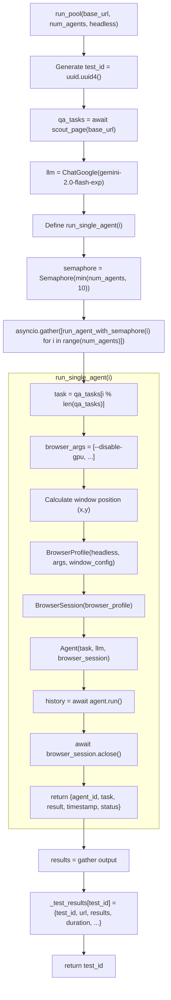
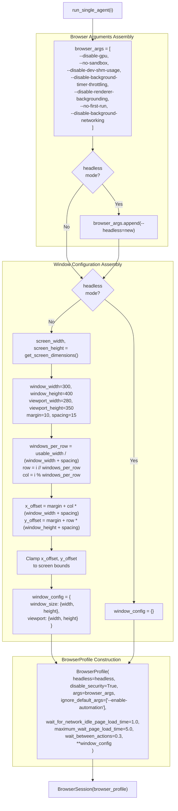
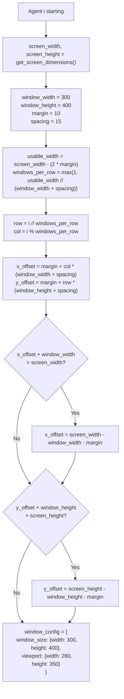
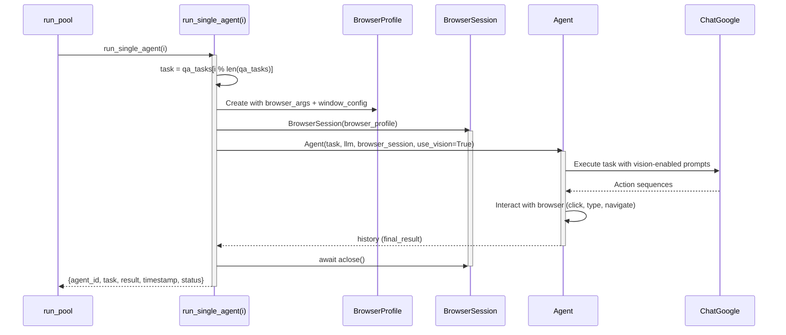
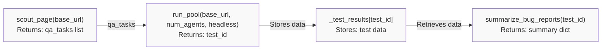

<!-- source: DeepWiki mcp.deepwiki.com · repo browser-use/vibetest-use · extra page QA Agent Pool · fetched 2026-10-30 -->

# QA Agent Pool

<details>
<summary>Relevant source files</summary>

The following files were used as context for generating this wiki page:

- [vibetest/agents.py](vibetest/agents.py)

</details>


## Purpose and Scope

This document details the `run_pool` function ([vibetest/agents.py:23-170]()), which implements the parallel QA agent execution system. It covers task distribution, browser configuration, window management, concurrent execution control, and result collection.

For information about how test tasks are generated, see [Scout Agent](#4.2.1). For details on how collected results are analyzed and summarized, see [Results Analysis](#4.2.3).

**Sources**: [vibetest/agents.py:23-170]()

---

## Function Overview

The `run_pool` function orchestrates multiple browser-based QA agents that test a target URL in parallel. It coordinates the three-phase testing process:

1. **Task Generation**: Calls `scout_page` to discover testable elements
2. **Parallel Execution**: Spawns multiple agents with optimized browser configurations
3. **Result Collection**: Aggregates findings into an in-memory store indexed by `test_id`

```python
async def run_pool(base_url: str, num_agents: int = 3, headless: bool = False) -> str
```

**Sources**: [vibetest/agents.py:23-26]()

---

## Function Signature and Parameters

| Parameter | Type | Default | Description |
|-----------|------|---------|-------------|
| `base_url` | `str` | Required | Target URL to test (e.g., `https://example.com` or `localhost:3000`) |
| `num_agents` | `int` | `3` | Number of parallel QA agents to spawn |
| `headless` | `bool` | `False` | Whether to run browsers in headless mode |

**Return Value**: `str` - UUID test identifier for retrieving results later

The function generates a unique `test_id` using `uuid.uuid4()` and records execution timing from `start_time` to `end_time` for duration tracking.

**Sources**: [vibetest/agents.py:23-25]()

---

## Execution Flow Diagram



**Sources**: [vibetest/agents.py:23-170]()

---

## Task Distribution Model

Tasks are distributed to agents using a **round-robin assignment strategy**:

```python
task_description = qa_tasks[i % len(qa_tasks)]
```

This ensures:
- **Even distribution**: If 6 tasks exist and 10 agents are spawned, tasks 0-5 are assigned once, then tasks 0-3 are assigned again
- **Scalability**: Works regardless of the ratio between `num_agents` and task count
- **Simplicity**: No complex load balancing required

### Distribution Examples

| Scenario | Agent 0 | Agent 1 | Agent 2 | Agent 3 | Agent 4 | Agent 5 |
|----------|---------|---------|---------|---------|---------|---------|
| 3 tasks, 6 agents | Task 0 | Task 1 | Task 2 | Task 0 | Task 1 | Task 2 |
| 5 tasks, 3 agents | Task 0 | Task 1 | Task 2 | - | - | - |

**Sources**: [vibetest/agents.py:36]()

---

## Browser Configuration Architecture

Each agent receives an optimized `BrowserProfile` configuration designed for fast startup and stable execution.



**Sources**: [vibetest/agents.py:39-102]()

---

## Browser Configuration Parameters

### Performance Optimization Arguments

The `browser_args` list ([vibetest/agents.py:40-52]()) contains flags that reduce startup time and resource consumption:

| Argument | Purpose |
|----------|---------|
| `--disable-gpu` | Disables GPU hardware acceleration (reduces overhead for testing) |
| `--no-sandbox` | Disables Chrome sandboxing (required in some containerized environments) |
| `--disable-dev-shm-usage` | Prevents shared memory issues in Docker/limited-memory environments |
| `--disable-background-timer-throttling` | Prevents background tab throttling for consistent timing |
| `--disable-backgrounding-occluded-windows` | Keeps hidden windows active |
| `--disable-renderer-backgrounding` | Prevents renderer process throttling |
| `--disable-features=TranslateUI` | Disables translation popup overlays |
| `--disable-component-extensions-with-background-pages` | Reduces extension overhead |
| `--no-first-run` | Skips first-run wizard |
| `--no-default-browser-check` | Skips default browser prompt |
| `--disable-background-networking` | Prevents background network activity |
| `--headless=new` | Enables new headless mode (only when `headless=True`) |

Additionally, `ignore_default_args=['--enable-automation']` ([vibetest/agents.py:95]()) removes the automation flag that some websites detect.

**Sources**: [vibetest/agents.py:40-55]()

### Timing Configuration

The `BrowserProfile` includes aggressive timeout settings for faster execution:

| Parameter | Value | Purpose |
|-----------|-------|---------|
| `wait_for_network_idle_page_load_time` | `1.0` seconds | Reduced from default for faster page loads |
| `maximum_wait_page_load_time` | `5.0` seconds | Maximum wait before timeout |
| `wait_between_actions` | `0.3` seconds | Minimal delay between agent actions |

**Sources**: [vibetest/agents.py:96-98]()

---

## Window Positioning Algorithm

For non-headless mode, agents are arranged in a grid layout across the screen to allow visual monitoring.

### Positioning Logic



### Layout Example

On a 1920x1080 screen with margin=10 and spacing=15:
- `usable_width = 1920 - 20 = 1900`
- `windows_per_row = 1900 // 315 = 6`
- Agents 0-5 appear in row 0, agents 6-11 in row 1, etc.

**Note**: The window position coordinates (x, y) are calculated but not applied due to API incompatibility. The comment at [vibetest/agents.py:88]() indicates the `window_position` parameter expects `width/height` but requires `x/y` coordinates.

**Sources**: [vibetest/agents.py:58-88]()

---

## Agent Execution Lifecycle

Each agent follows this lifecycle within `run_single_agent(i)`:



**Sources**: [vibetest/agents.py:35-137]()

---

## Agent Result Structure

Each agent returns a dictionary with standardized fields:

### Success Result

```python
{
    "agent_id": int,           # Agent index (0 to num_agents-1)
    "task": str,               # Task description from qa_tasks
    "result": str,             # Final result from agent.run()
    "timestamp": float,        # Unix timestamp when completed
    "status": "success"
}
```

### Error Result

```python
{
    "agent_id": int,
    "task": str,
    "error": str,              # Exception message
    "timestamp": float,
    "status": "error"
}
```

Error handling at [vibetest/agents.py:130-137]() ensures that agent failures don't crash the entire pool.

**Sources**: [vibetest/agents.py:116-137]()

---

## Parallel Execution and Resource Management

### Semaphore-Based Concurrency Control

```python
semaphore = asyncio.Semaphore(min(num_agents, 10))

async def run_agent_with_semaphore(i: int):
    async with semaphore:
        return await run_single_agent(i)
```

The semaphore limits concurrent browser sessions to prevent resource exhaustion:

- **Maximum concurrent browsers**: 10 (hardcoded limit)
- **Actual concurrency**: `min(num_agents, 10)`
- **Queue behavior**: If 15 agents are requested, only 10 run simultaneously; remaining 5 wait for slots

This prevents excessive memory consumption and browser process limits.

**Sources**: [vibetest/agents.py:140-144]()

### Parallel Execution with asyncio.gather

```python
results = await asyncio.gather(
    *[run_agent_with_semaphore(i) for i in range(num_agents)], 
    return_exceptions=True
)
```

| Parameter | Value | Purpose |
|-----------|-------|---------|
| `return_exceptions=True` | Returns exceptions as values instead of raising | Allows partial success even if some agents fail |

The function continues execution even if individual agents crash, collecting both successful results and exception objects.

**Sources**: [vibetest/agents.py:146-149]()

---

## Browser Session Cleanup

Proper cleanup prevents orphaned browser processes:

```python
try:
    # ... agent execution
finally:
    try:
        await browser_session.aclose()
    except Exception:
        pass
```

Cleanup occurs at two levels:

1. **Per-agent cleanup** ([vibetest/agents.py:124-128]()): Each `run_single_agent` uses a try/finally block to close its session
2. **Pool-level grace period** ([vibetest/agents.py:154]()): After gathering results, a 1-second sleep allows lingering processes to terminate

**Sources**: [vibetest/agents.py:124-128, 154]()

---

## Result Storage Structure

The `_test_results` global dictionary ([vibetest/agents.py:12]()) stores test data in memory:

```python
_test_results[test_id] = {
    "test_id": str,           # UUID identifier
    "url": str,               # Target URL tested
    "agents": int,            # Number of agents spawned
    "start_time": float,      # Unix timestamp at test start
    "end_time": float,        # Unix timestamp at test end
    "duration": float,        # Calculated as end_time - start_time
    "results": list,          # Array of result dicts (excludes exceptions)
    "status": "completed"
}
```

The results list excludes exception objects using list comprehension:

```python
"results": [r for r in results if not isinstance(r, Exception)]
```

This ensures only valid result dictionaries (with `agent_id`, `task`, `result`/`error`, etc.) are stored.

**Sources**: [vibetest/agents.py:156-168]()

---

## LLM Configuration

The pool uses **Google Gemini 2.0 Flash Experimental** for agent execution:

```python
llm = ChatGoogle(
    model="gemini-2.0-flash-exp",
    temperature=0.9,
    api_key=get_google_api_key()
)
```

| Parameter | Value | Rationale |
|-----------|-------|-----------|
| `model` | `gemini-2.0-flash-exp` | Fast, experimental model for creative exploration |
| `temperature` | `0.9` | High temperature encourages diverse testing approaches |
| `api_key` | From `GOOGLE_API_KEY` env var | API authentication |

This contrasts with the `gemini-1.5-flash` model (temperature=0.1) used in [Results Analysis](#4.2.3) for deterministic summarization.

**Sources**: [vibetest/agents.py:29-33]()

---

## Integration with Scout and Analysis



The QA agent pool sits between:
- **Upstream**: `scout_page` ([Scout Agent](#4.2.1)) provides the `qa_tasks` list
- **Downstream**: `summarize_bug_reports` ([Results Analysis](#4.2.3)) retrieves data from `_test_results`

**Sources**: [vibetest/agents.py:27, 168, 174-178]()

---

## Performance Characteristics

### Timing Breakdown

For a typical test run:

| Phase | Approximate Duration | Notes |
|-------|---------------------|-------|
| Scout discovery | 5-15 seconds | Single headless browser, depends on page complexity |
| Agent spawn | < 1 second | Parallel browser initialization |
| Agent execution | 10-60 seconds | Varies by task complexity and timeout settings |
| Cleanup grace period | 1 second | Fixed sleep for browser closure |

Total duration is stored in `test_data["duration"]` as `end_time - start_time`.

### Resource Consumption

With default settings (3 agents, non-headless):
- **Memory**: ~500-800 MB per browser instance
- **CPU**: Variable, spikes during page interactions
- **Network**: Depends on target website size
- **Processes**: 10+ per browser (Chromium multiprocess architecture)

The 10-agent concurrency limit prevents resource exhaustion on typical development machines.

**Sources**: [vibetest/agents.py:140, 151-163]()

---

