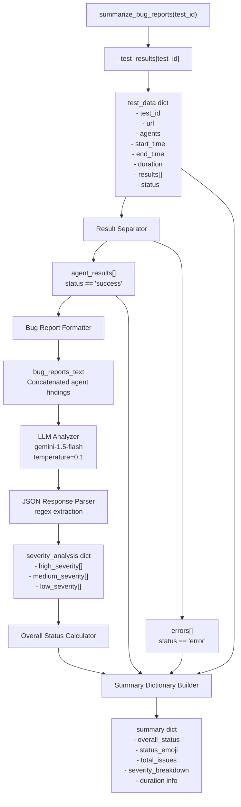
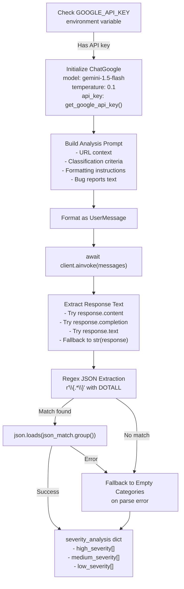
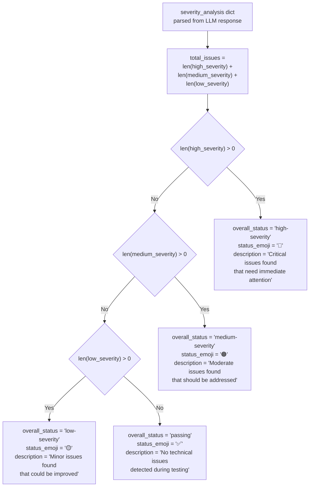

<!-- source: DeepWiki mcp.deepwiki.com · repo browser-use/vibetest-use · extra page Results Analysis · fetched 2026-10-30 -->

# Results Analysis

<details>
<summary>Relevant source files</summary>

The following files were used as context for generating this wiki page:

- [vibetest/agents.py](vibetest/agents.py)

</details>


## Purpose and Scope

This document details the results analysis system that processes raw test execution data into structured, severity-classified bug reports. The analysis is performed by the `summarize_bug_reports` function, which constitutes the third and final phase of the agent execution pipeline.

For information about the preceding phases, see [Scout Agent](#4.2.1) and [QA Agent Pool](#4.2.2). For the MCP server interface that exposes this functionality, see [MCP Server Interface](#4.1).

**Sources**: [vibetest/agents.py:174-361]()

---

## Overview

The `summarize_bug_reports` function transforms raw agent execution results into an actionable test report with AI-powered severity classification. This function is invoked via the MCP server's `results` tool and provides the final output returned to the IDE.

The analysis process involves four key stages:

1. **Test Data Retrieval**: Fetching stored results from the `_test_results` in-memory dictionary
2. **Bug Report Formatting**: Converting agent outputs into structured text for LLM analysis
3. **LLM-Based Classification**: Using Gemini 1.5-flash to categorize issues by severity
4. **Summary Generation**: Creating a comprehensive report with status indicators and metrics

**Sources**: [vibetest/agents.py:174-361](), [vibetest/mcp_server.py:22-65]()

---

## Data Flow Architecture

The following diagram illustrates how test data flows through the analysis pipeline:

**Diagram: Results Analysis Data Flow**



**Sources**: [vibetest/agents.py:174-210](), [vibetest/agents.py:213-331]()

---

## Test Results Retrieval

The function begins by retrieving test data from the `_test_results` global dictionary, which is populated by the `run_pool` function during test execution.

### Storage Structure

Test results are stored with the following schema:

| Field | Type | Description |
|-------|------|-------------|
| `test_id` | `str` | UUID identifier for the test run |
| `url` | `str` | Base URL that was tested |
| `agents` | `int` | Number of agents deployed |
| `start_time` | `float` | Unix timestamp of test start |
| `end_time` | `float` | Unix timestamp of test completion |
| `duration` | `float` | Test duration in seconds |
| `results` | `list[dict]` | Array of individual agent results |
| `status` | `str` | Overall test execution status |

### Retrieval Logic

```python
if test_id not in _test_results:
    return {"error": f"Test ID {test_id} not found"}

test_data = _test_results[test_id]
```

**Sources**: [vibetest/agents.py:175-178](), [vibetest/agents.py:12](), [vibetest/agents.py:157-168]()

---

## Result Separation and Bug Report Formatting

The function separates successful agent results from errors and formats them for LLM analysis.

### Separation Logic

Results are categorized based on their `status` field:

```python
for result in test_data["results"]:
    if result["status"] == "success":
        agent_results.append(result)
        if "result" in result and result["result"]:
            bug_reports.append({
                "agent_id": result["agent_id"],
                "task": result["task"],
                "findings": result["result"],
                "timestamp": result["timestamp"]
            })
    else:
        errors.append(result)
```

### Text Formatting

Bug reports are concatenated into a single text document:

```python
bug_reports_text = "\n\n".join([
    f"Agent {report['agent_id']} Report:\nTask: {report['task']}\nFindings: {report['findings']}"
    for report in bug_reports
])
```

This formatted text serves as input to the LLM for severity analysis.

**Sources**: [vibetest/agents.py:181-201]()

---

## LLM-Based Severity Analysis

The core of the analysis system is the LLM-powered severity classification using Google's Gemini 1.5-flash model.

**Diagram: LLM Analysis Workflow**



### Model Configuration

The analysis uses specific model parameters optimized for objective classification:

| Parameter | Value | Rationale |
|-----------|-------|-----------|
| `model` | `gemini-1.5-flash` | Fast, analytical model (vs. gemini-2.0-flash-exp for exploration) |
| `temperature` | `0.1` | Low temperature for consistent, objective analysis |
| `api_key` | `get_google_api_key()` | Retrieved from environment with fallback |

**Sources**: [vibetest/agents.py:213-219]()

---

## Analysis Prompt Structure

The LLM receives a carefully structured prompt that defines objective classification criteria and output format.

### Classification Criteria

The prompt specifies that issues must represent:

- **Broken functionality**: Buttons that don't work, forms that fail
- **Technical errors**: 404s, JavaScript errors, broken links
- **Accessibility violations**: Missing alt text, poor contrast
- **Performance problems**: Very slow loading, timeouts

The prompt explicitly excludes:
- Subjective opinions
- Missing features that may be intentional
- Design preferences

### Required Detail Level

Each issue must include:
- Exact element tested (button name, link text, form field)
- Specific action taken (clicked, typed, submitted)
- Exact result or error observed (404 error, no response, broken redirect)
- Relevant context from agent testing

### Output Format Specification

```json
{
    "high_severity": [
        { "category": "category_name", "description": "specific detailed description with exact steps and results" }
    ],
    "medium_severity": [
        { "category": "category_name", "description": "specific detailed description with exact steps and results" }
    ],
    "low_severity": [
        { "category": "category_name", "description": "specific detailed description with exact steps and results" }
    ]
}
```

**Sources**: [vibetest/agents.py:221-262]()

---

## Response Processing and Parsing

The function handles multiple response formats and extracts JSON content robustly.

### Multi-Attribute Response Handling

The code checks multiple possible response attributes to extract text:

```python
if hasattr(response, 'content'):
    response_text = str(response.content)
elif hasattr(response, 'completion'):
    response_text = str(response.completion)
elif hasattr(response, 'text'):
    response_text = str(response.text)
else:
    response_text = str(response)
```

### JSON Extraction with Regex

A regular expression extracts JSON content from potentially verbose responses:

```python
json_match = re.search(r'\{.*\}', response_text, re.DOTALL)
if json_match:
    severity_analysis = json.loads(json_match.group())
```

This approach handles cases where the LLM includes explanatory text before or after the JSON.

**Sources**: [vibetest/agents.py:269-295]()

---

## Severity Classification Logic

After parsing the LLM response, the function calculates metrics and determines overall test status.

**Diagram: Overall Status Determination Logic**



### Status Hierarchy

The status determination follows a strict priority hierarchy:

1. **High Severity** (`🔴`): Any high-severity issues found
2. **Medium Severity** (`🟠`): Medium-severity issues but no high-severity
3. **Low Severity** (`🟡`): Only low-severity issues found
4. **Passing** (`✅`): No issues detected

**Sources**: [vibetest/agents.py:297-320]()

---

## Summary Output Structure

The function constructs a comprehensive summary dictionary that combines all analysis results.

### Core Summary Fields

| Field | Type | Description |
|-------|------|-------------|
| `test_id` | `str` | Original test identifier |
| `total_agents` | `int` | Total number of agents deployed |
| `successful_agents` | `int` | Agents that completed successfully |
| `failed_agents` | `int` | Agents that encountered errors |
| `errors` | `list[dict]` | Detailed error information |
| `summary_generated` | `float` | Unix timestamp of summary creation |

### LLM Analysis Fields

When LLM analysis is available, these fields are added:

| Field | Type | Description |
|-------|------|-------------|
| `overall_status` | `str` | One of: `high-severity`, `medium-severity`, `low-severity`, `passing` |
| `status_emoji` | `str` | Visual indicator: `🔴`, `🟠`, `🟡`, or `✅` |
| `status_description` | `str` | Human-readable status explanation |
| `total_issues` | `int` | Sum of all severity levels |
| `severity_breakdown` | `dict` | Complete severity analysis from LLM |
| `llm_analysis` | `dict` | Metadata including raw response and model used |

### Complete Example Structure

```python
{
    "test_id": "abc-123-...",
    "total_agents": 5,
    "successful_agents": 5,
    "failed_agents": 0,
    "errors": [],
    "summary_generated": 1735689600.0,
    "overall_status": "medium-severity",
    "status_emoji": "🟠",
    "status_description": "Moderate issues found that should be addressed",
    "total_issues": 3,
    "severity_breakdown": {
        "high_severity": [],
        "medium_severity": [
            {"category": "Navigation", "description": "Upon clicking the 'Contact Us' button..."},
            {"category": "Forms", "description": "When submitting the newsletter signup form..."}
        ],
        "low_severity": [
            {"category": "Accessibility", "description": "The hero image is missing alt text..."}
        ]
    },
    "llm_analysis": {
        "raw_response": "...",
        "model_used": "gemini-1.5-flash"
    }
}
```

**Sources**: [vibetest/agents.py:203-331]()

---

## Error Handling and Fallback Mechanisms

The function implements multiple layers of error handling to ensure graceful degradation.

### LLM Analysis Error Handling

If LLM analysis fails, the function provides a fallback summary:

```python
except Exception as e:
    summary.update({
        "overall_status": "low-severity" if bug_reports else "passing",
        "status_emoji": "🟡" if bug_reports else "✅",
        "status_description": f"Found {len(bug_reports)} potential issues requiring manual review" if bug_reports else "No technical issues detected during testing",
        "total_issues": len(bug_reports),
        "severity_breakdown": {
            "high_severity": [],
            "medium_severity": [],
            "low_severity": [{"category": "general", "description": f"Found {len(bug_reports)} potential issues requiring manual review"}] if bug_reports else []
        },
        "llm_analysis_error": str(e)
    })
```

### No API Key Fallback

When `GOOGLE_API_KEY` is not available, the function skips LLM analysis and provides basic categorization:

```python
else:
    summary.update({
        "overall_status": "low-severity" if bug_reports else "passing",
        "status_emoji": "🟡" if bug_reports else "✅",
        "status_description": f"Found {len(bug_reports)} potential issues requiring manual review" if bug_reports else "No technical issues detected during testing",
        "total_issues": len(bug_reports),
        "severity_breakdown": {
            "high_severity": [],
            "medium_severity": [],
            "low_severity": [{"category": "general", "description": f"Found {len(bug_reports)} potential issues requiring manual review"}] if bug_reports else []
        }
    })
```

### JSON Parsing Fallback

If JSON extraction or parsing fails, the function returns empty severity categories:

```python
except:
    severity_analysis = {
        "high_severity": [],
        "medium_severity": [],
        "low_severity": []
    }
```

**Sources**: [vibetest/agents.py:290-295](), [vibetest/agents.py:333-346](), [vibetest/agents.py:347-359]()

---

## Integration with MCP Server

The `summarize_bug_reports` function is exposed to IDEs via the MCP server's `results` tool. The MCP server adds duration formatting before returning the summary to the client.

### Duration Enhancement

The MCP server calculates human-readable duration:

```python
duration = test_data.get("duration", 0)
minutes = int(duration // 60)
seconds = int(duration % 60)
duration_formatted = f"{minutes}m {seconds}s"

summary["duration_seconds"] = duration
summary["duration_formatted"] = duration_formatted
```

This enhanced summary is then returned to the IDE for display to the developer.

**Sources**: [vibetest/mcp_server.py:48-64]()

---

