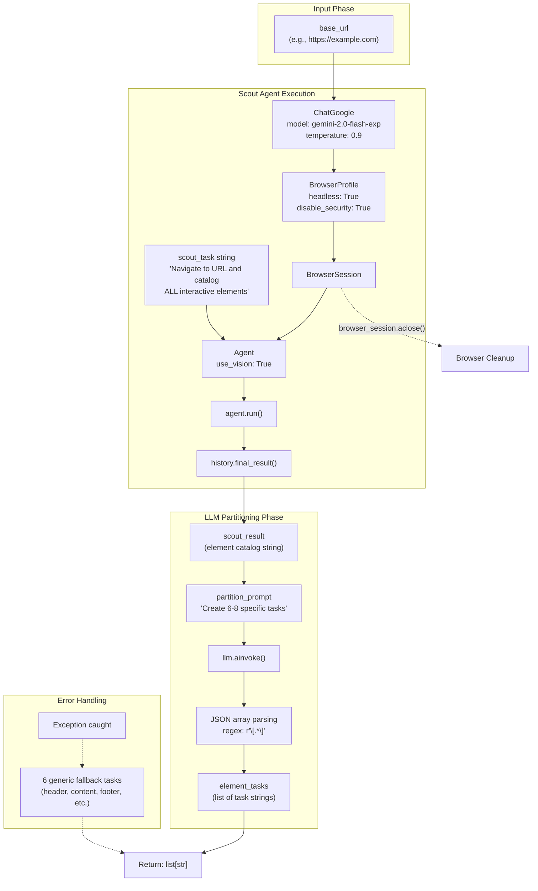
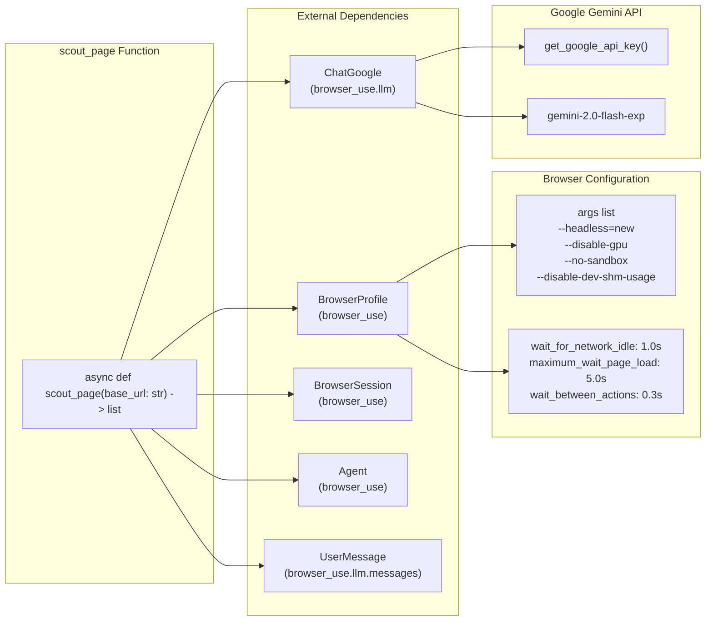
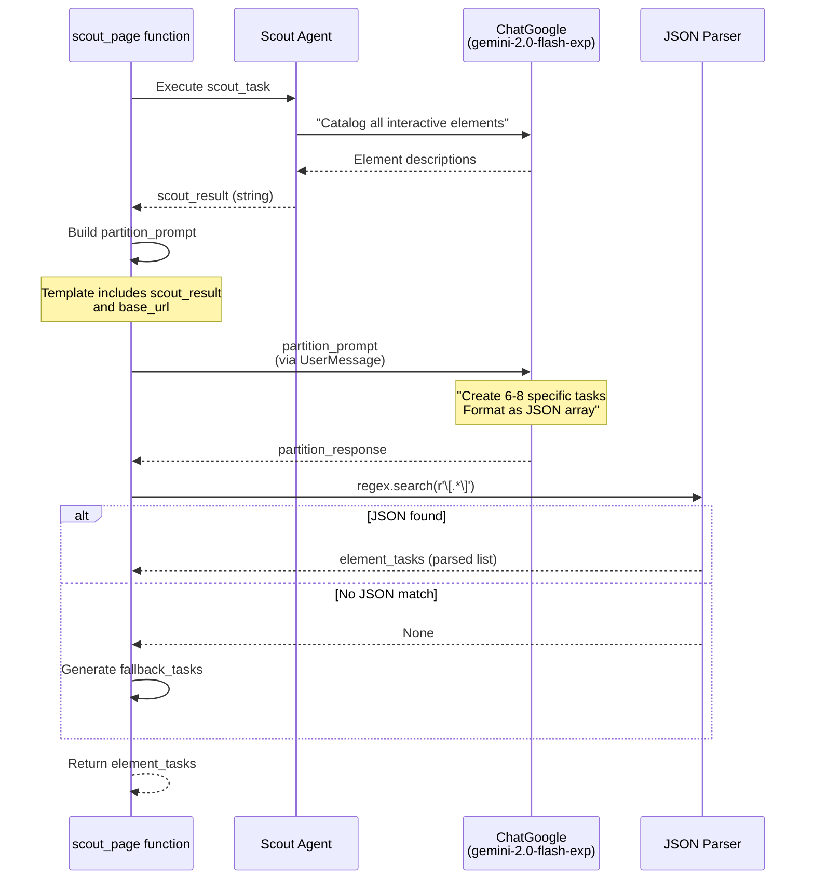
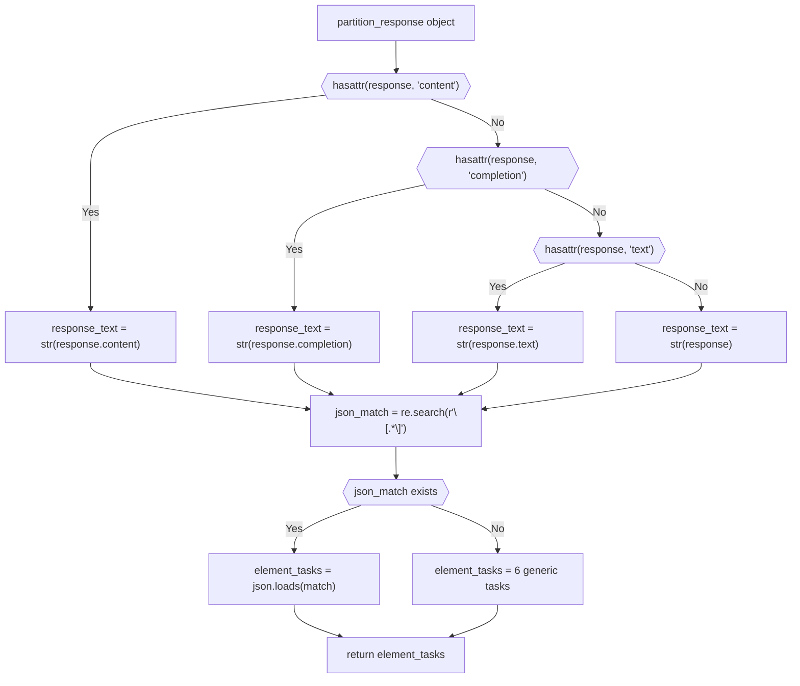
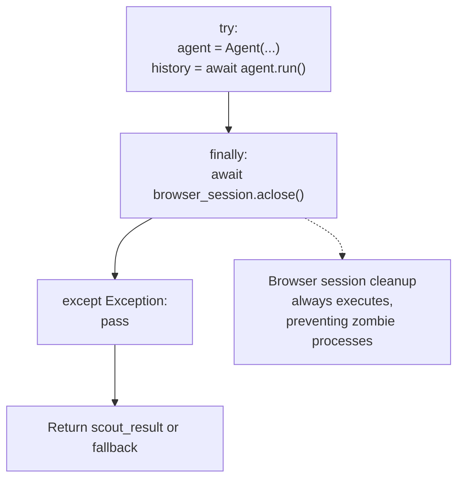

<!-- source: DeepWiki mcp.deepwiki.com · repo browser-use/vibetest-use · extra page Scout Agent · fetched 2026-10-30 -->

# Scout Agent

<details>
<summary>Relevant source files</summary>

The following files were used as context for generating this wiki page:

- [vibetest/agents.py](vibetest/agents.py)

</details>


## Purpose and Scope

The Scout Agent is the discovery phase of the Vibetest Use system, responsible for intelligently mapping a website's interactive elements and generating specific test tasks for QA agents. Implemented in the `scout_page` function [vibetest/agents.py:363-473](), it operates in headless mode to catalog buttons, links, forms, and other interactive elements without executing any interactions. The scout then uses LLM-based partitioning to divide the discovered elements into 6-8 distinct, non-overlapping test tasks.

This document covers the scout's architecture, LLM interaction strategy, and task generation logic. For information about how these tasks are executed, see [QA Agent Pool](#4.2.2). For the full orchestration flow, see [Agent Orchestration System](#4.2).

**Sources**: [vibetest/agents.py:363-473]()

## Scout Agent Architecture

The scout operates as a single-purpose, headless browser agent that performs reconnaissance before the parallel testing phase. It integrates with the Browser-Use library and Google Gemini API to perform visual analysis of web pages.

### Scout Execution Flow



**Sources**: [vibetest/agents.py:363-473]()

### Component Integration



**Sources**: [vibetest/agents.py:363-392](), [vibetest/agents.py:5-10]()

## Browser Configuration

The scout agent uses an optimized headless browser configuration designed for fast execution and minimal resource usage. The configuration is defined at [vibetest/agents.py:372-390]().

### Browser Profile Settings

| Setting | Value | Purpose |
|---------|-------|---------|
| `headless` | `True` | Runs without GUI for speed and resource efficiency |
| `disable_security` | `True` | Allows testing of local/development sites |
| `user_data_dir` | `None` | No persistent browser data |
| `wait_for_network_idle_page_load_time` | `1.0` | Reduced from default for faster page loads |
| `maximum_wait_page_load_time` | `5.0` | Timeout limit for page loading |
| `wait_between_actions` | `0.3` | Minimal delay between browser actions |

### Browser Arguments

The scout uses aggressive browser optimization flags [vibetest/agents.py:376-386]():

```
--disable-gpu
--no-sandbox
--disable-dev-shm-usage
--headless=new
--disable-background-timer-throttling
--disable-backgrounding-occluded-windows
--disable-renderer-backgrounding
--disable-features=TranslateUI
--disable-component-extensions-with-background-pages
--no-first-run
--no-default-browser-check
--disable-background-networking
```

These flags minimize startup time, disable unnecessary features, and reduce resource consumption during the scouting phase.

**Sources**: [vibetest/agents.py:372-390]()

## Scout Task Generation

The scout agent receives a carefully crafted task instruction designed to perform observation without interaction [vibetest/agents.py:395]():

```
Navigate to {base_url} using the go_to_url action, then identify ALL 
interactive elements on the page. Do NOT click anything, just observe 
and catalog what's available. List buttons, links, forms, input fields, 
menus, dropdowns, and any other clickable elements you can see. Provide 
a comprehensive inventory.
```

This instruction leverages the vision-enabled agent (`use_vision=True`) to perform visual analysis of the page, identifying interactive elements through both DOM inspection and visual observation.

**Sources**: [vibetest/agents.py:395-402]()

## LLM-Based Task Partitioning

After the scout catalogues elements, the system uses a second LLM call to partition the discovered elements into specific, non-overlapping test tasks. This two-stage approach separates discovery from task planning.

### Partitioning Flow



**Sources**: [vibetest/agents.py:414-462]()

### Partition Prompt Template

The partition prompt [vibetest/agents.py:415-430]() instructs the LLM to:

1. **Analyze** the scout report of interactive elements
2. **Create** 6-8 distinct testing tasks
3. **Specify** exact elements to test (by text, location, or description)
4. **Avoid** overlap between tasks
5. **Include** navigation instructions in each task
6. **Format** as a JSON array

Example partition prompt structure:

```
Based on this scout report of interactive elements found on {base_url}:

{scout_result}

Create a list of specific testing tasks, each focusing on different 
elements. Each task should specify exactly which elements to test 
(by their text, location, or description). Aim for 6-8 distinct 
tasks that cover different elements without overlap.

Format as JSON array:
[
    "Navigate to {base_url} using go_to_url, then test the 
     [specific element description] - click on [exact button/link 
     text or location]",
    ...
]
```

**Sources**: [vibetest/agents.py:415-430]()

## Response Parsing and Handling

The scout implements robust parsing logic to handle various LLM response formats [vibetest/agents.py:437-450]().

### Multi-Attribute Response Handling



This multi-level fallback strategy ensures the scout always returns a usable task list, even if LLM response formats change or JSON parsing fails.

**Sources**: [vibetest/agents.py:437-462]()

## Fallback Task Generation

If the scout agent fails (network error, timeout, LLM error), the system provides six generic fallback tasks [vibetest/agents.py:464-473]():

| Task Index | Task Description |
|------------|------------------|
| 0 | Test navigation elements in the header area |
| 1 | Test main content links and buttons |
| 2 | Test footer links and elements |
| 3 | Test any form elements found |
| 4 | Test sidebar or secondary navigation |
| 5 | Test any remaining interactive elements |

These fallback tasks provide broad coverage across common website sections, ensuring testing can proceed even when intelligent scouting fails.

**Sources**: [vibetest/agents.py:464-473]()

## Resource Management

The scout implements proper resource cleanup to prevent lingering browser processes [vibetest/agents.py:405-410]().

### Cleanup Pattern



The `finally` block ensures browser session closure even if the scout agent encounters errors. The inner `try-except` on `aclose()` prevents cleanup failures from affecting the overall scouting process.

**Sources**: [vibetest/agents.py:394-410]()

## Integration with Agent Pool

The scout agent is called at the beginning of `run_pool` to generate tasks before spawning QA agents [vibetest/agents.py:27]():

```python
qa_tasks = await scout_page(base_url)
```

The returned task list is then distributed round-robin to QA agents:

```python
task_description = qa_tasks[i % len(qa_tasks)]
```

This ensures even task distribution across all agents. If 5 agents are spawned and 8 tasks are generated, agents 0-4 receive tasks 0-4, and agents 0-2 receive tasks 5-7 (wrapping around).

**Sources**: [vibetest/agents.py:27](), [vibetest/agents.py:36]()

## Model Selection and Temperature

The scout uses `gemini-2.0-flash-exp` with `temperature=0.9` [vibetest/agents.py:366-370](). This configuration choice reflects:

- **Model**: Flash variant for fast response times during discovery
- **Temperature**: High (0.9) to encourage creative exploration and diverse element identification
- **Version**: 2.0 experimental for latest multimodal capabilities

This contrasts with the results analysis phase, which uses `gemini-1.5-flash` at `temperature=0.1` for more deterministic, analytical outputs (see [Results Analysis](#4.2.3)).

**Sources**: [vibetest/agents.py:366-370]()

## Example Task Output

Given a scout discovering elements on a blog homepage, the partition phase might generate:

```json
[
  "Navigate to https://blog.example.com using go_to_url, then test the 'Subscribe' button in the header - click on the button labeled 'Subscribe to Newsletter'",
  "Navigate to https://blog.example.com using go_to_url, then test the search functionality - click on the search icon and enter a test query",
  "Navigate to https://blog.example.com using go_to_url, then test the category navigation - click on 'Technology' in the sidebar menu",
  "Navigate to https://blog.example.com using go_to_url, then test the 'Read More' links in article previews - click on the first article's read more button",
  "Navigate to https://blog.example.com using go_to_url, then test social media links in the footer - click on the Twitter icon",
  "Navigate to https://blog.example.com using go_to_url, then test the contact form - fill in name, email, and message fields"
]
```

Each task includes explicit navigation instructions and specific element descriptions, enabling QA agents to execute precise, focused tests.

**Sources**: [vibetest/agents.py:415-430]()

## Performance Characteristics

| Metric | Value | Configuration |
|--------|-------|---------------|
| Average execution time | 10-20 seconds | Depends on page complexity |
| Browser startup | ~2 seconds | Optimized with fast-start flags |
| Page load timeout | 5 seconds | `maximum_wait_page_load_time` |
| Network idle wait | 1 second | `wait_for_network_idle_page_load_time` |
| LLM calls | 2 per scout | Initial catalog + partition |
| Concurrency | 1 (serial) | Single headless browser |

The scout's serial execution is acceptable because it runs only once per test session, before parallel QA agent deployment.

**Sources**: [vibetest/agents.py:387-389]()

---

