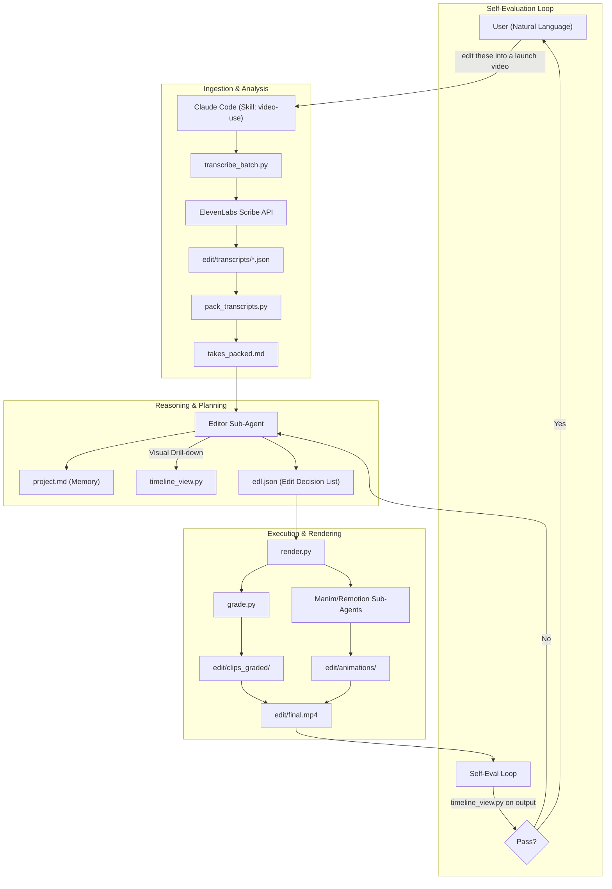
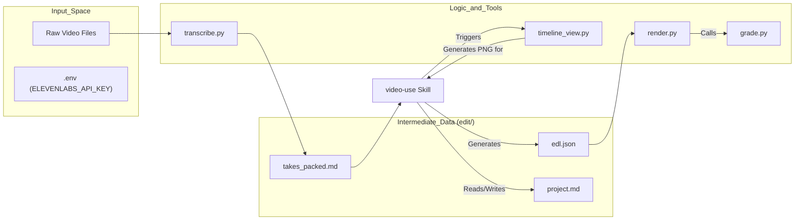

<!-- source: DeepWiki mcp.deepwiki.com · repo browser-use/video-use · page 1 Overview · fetched 2026-10-30 -->

# Overview

Relevant source files

The following files were used as context for generating this wiki page:

- [README.md](README.md)
- [poster.html](poster.html)
- [static/video-use-banner.png](static/video-use-banner.png)

Introducing **video-use** — a high-level framework for editing videos using Claude Code. It allows users to drop raw footage into a folder, chat with an LLM agent, and receive a production-ready `final.mp4`. [README.md:5-9]()

The system is designed for diverse content types, including talking heads, tutorials, interviews, and montages. It replaces traditional manual editing interfaces with a natural language conversation that drives a robust Python-based rendering and analysis pipeline. [README.md:9-19]()

## Core Philosophy: The LLM as Editor

The fundamental design principle of `video-use` is that the **LLM never watches the video; it reads it**. This is achieved through a "Two-Layer Perception" model that bridges the gap between raw pixels and semantic understanding. [README.md:69-70]()

1.  **Layer 1: Audio Transcript (The Surface):** The system uses the ElevenLabs Scribe API to generate word-level timestamps, speaker diarization, and audio event detection (e.g., laughter, applause). This data is packed into a compact Markdown format (`takes_packed.md`) that fits within LLM context windows. [README.md:75-81]()
2.  **Layer 2: Visual Composite (The Drill-down):** When the LLM needs visual context—such as checking for jump cuts, evaluating a speaker's expression, or verifying an overlay—it generates on-demand visual composites using `timeline_view.py`. [README.md:83-84]()

### Design Principles
*   **Audio is Primary:** Cuts are derived from speech boundaries and silence gaps. [README.md:103-103]()
*   **Human-in-the-Loop:** The agent follows an **Ask → Confirm → Execute → Self-Eval → Persist** cycle. It never modifies a cut without strategy approval. [README.md:104-104]()
*   **Production Correctness:** While the LLM has artistic freedom, the system enforces 12 "Hard Rules" (e.g., 30ms audio fades, PTS shifting for overlays) to ensure technical quality. [README.md:106-108]()

**Sources:** [README.md:67-108](), [poster.html:41-46]()

---

## System Workflow

The following diagram illustrates how the system transitions from Natural Language instructions to Code Entities and back to a verified video file.

### Pipeline: From Natural Language to final.mp4

**Sources:** [README.md:90-98](), [README.md:13-19]()

---

## Major Subsystems

### 1. Ingestion and Transcription
The pipeline begins by inventorying source files and generating word-level transcripts. The system caches these transcripts to avoid redundant API calls. [README.md:75-76]()
*   **Key Files:** `transcribe.py`, `transcribe_batch.py`, `pack_transcripts.py`.
*   For details, see [Transcription and Ingestion](#2.1) and [Transcript Packing (takes_packed.md)](#2.2).

### 2. Timeline Visualization
To allow the LLM to "see" the video without processing millions of frames, `timeline_view.py` generates a composite PNG containing a filmstrip, audio waveform, and word labels. [README.md:83-88]()
*   **Key Files:** `timeline_view.py`.
*   For details, see [Timeline View (Visual Composite Generator)](#2.3).

### 3. The Rendering Engine
The rendering engine processes the `edl.json` produced by the LLM. It performs per-segment extraction, applies color grading, handles audio fades to prevent pops, and burns subtitles. [README.md:13-16]()
*   **Key Files:** `render.py`, `grade.py`.
*   For details, see [Rendering Pipeline (render.py)](#2.4) and [Color Grading (grade.py)](#2.5).

### 4. Animation Sub-Agents
For complex overlays, the system can spawn parallel sub-agents to generate animations using Manim, Remotion, or HyperFrames. [README.md:17-17]()
*   **Key Files:** `skills/manim-video/`.
*   For details, see [Manim Video Sub-Skill](#4).

---

## Code Entity Map

This diagram bridges the conceptual subsystems to the specific file paths and data structures used in the codebase.

**Sources:** [README.md:44-44](), [README.md:62-65](), [README.md:75-84]()

## Next Steps
*   To set up the environment and integrate with Claude Code, see [Getting Started](#1.1).
*   To understand the mental model of "Two-Layer Perception" and the EDL format, see [Core Concepts and Terminology](#1.2).

---

