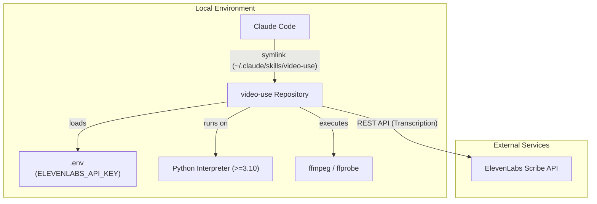
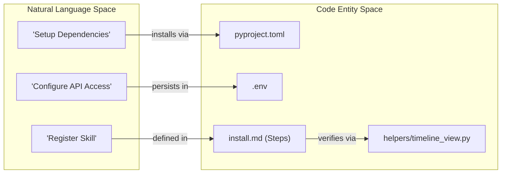

<!-- source: DeepWiki mcp.deepwiki.com · repo browser-use/video-use · page 1.1 Getting Started · fetched 2026-10-30 -->

# Getting Started

<details>
<summary>Relevant source files</summary>

The following files were used as context for generating this wiki page:

- [.env.example](.env.example)
- [.gitignore](.gitignore)
- [install.md](install.md)
- [pyproject.toml](pyproject.toml)

</details>


This page provides the technical setup instructions for `video-use`, a conversation-driven video editor designed to function as a skill for Claude Code. It covers environment configuration, dependency management, and the integration process required to enable the LLM to orchestrate video editing tasks.

## Prerequisites

Before installing the skill, ensure your environment meets the following requirements:

*   **Python 3.10+**: Required for core processing scripts [pyproject.toml:5-5]().
*   **FFmpeg & FFprobe**: Must be installed and available in your system `PATH`. These are hard requirements for the rendering pipeline and media inspection [install.md:51-53]().
*   **yt-dlp (Optional)**: Needed if you intend to pull video sources from URLs [install.md:51-53]().
*   **Claude Code / Codex**: The host environment for the skill [install.md:70-90]().

## Environment Configuration

The system relies on external APIs for transcription and audio processing. These must be configured via environment variables or a `.env` file at the repository root [install.md:18-19]().

1.  **API Keys**: Copy `.env.example` to `.env` [ .env.example:1-1]().
2.  **ElevenLabs**: Obtain an API key from ElevenLabs. This is used by the transcription engine (Scribe API) to generate word-level timestamps and speaker diarization [install.md:94-95]().

```bash
# .env file content
ELEVENLABS_API_KEY=your_api_key_here
```

The setup process includes a sanity check using a `curl` call to `https://api.elevenlabs.io/v1/user` to verify the key's validity before proceeding [install.md:118-124]().

*Sources: [.env.example:1-1](), [.gitignore:2-2](), [install.md:92-127]()*

## Installation and Dependencies

The project uses a standard Python structure defined in `pyproject.toml`.

### Core Dependencies
The following packages are required for visual analysis, audio processing, and timeline generation [pyproject.toml:6-12]():
*   `requests`: For API communication.
*   `librosa`: For audio analysis and waveform generation.
*   `matplotlib` & `pillow`: For generating the visual composite timeline views.
*   `numpy`: For numerical processing of audio and video frames.

### Installation Command
It is recommended to use `uv` for fast dependency resolution, falling back to `pip` if necessary [install.md:44-47]():
```bash
# Prefer uv if available
command -v uv >/dev/null && uv sync || pip install -e .
```

### Optional: Animation Support
If you intend to use the `manim-video` sub-skill for programmatic animations, you must install the optional `animations` dependencies [pyproject.toml:14-15]():
```bash
pip install ".[animations]"
```
This installs `manim`, which is required for the PLAN → CODE → RENDER pipeline. Note that HyperFrames or Remotion slots may additionally require Node.js 22+ [install.md:159-160]().

*Sources: [pyproject.toml:1-15](), [install.md:42-66]()*

## Integration as a Claude Code Skill

`video-use` is designed to be consumed by Claude Code or similar agents. The integration involves symlinking the entire repository directory into the agent's skills directory. This ensures that `SKILL.md` and the `helpers/` directory remain siblings, which is required for the skill to reference scripts by bare names [install.md:28-28]().

### Skill Setup Flow
The diagram below illustrates how the local `video-use` repository connects to the Claude Code environment and the external API services.

**System Integration Architecture**

*Sources: [pyproject.toml:1-12](), [install.md:70-88](), [install.md:132-135]()*

### Implementation Data Flow

When the skill is invoked, the agent interacts with the `helpers/` scripts. The following diagram maps the natural language setup requirements to the specific code entities and configuration files.

**Initial Setup Data Flow**

*Sources: [install.md:6-30](), [install.md:130-135](), [pyproject.toml:1-23](), [.env.example:1-1]()*

## Directory Conventions and Git Safety

The project includes a comprehensive `.gitignore` to prevent session-specific artifacts and secrets from being committed. When running the skill, the following directories and files are generated but ignored by version control:

| File/Directory | Purpose |
| :--- | :--- |
| `edit/` | Main output directory for project sessions [ .gitignore:46-46](). |
| `transcripts/` | Cached JSON results from ElevenLabs [ .gitignore:47-47](). |
| `takes_packed.md` | The LLM-readable view of the footage [ .gitignore:58-58](). |
| `edl.json` | The Edit Decision List defining the cut [ .gitignore:59-59](). |
| `project.md` | Persistent memory for the LLM agent [ .gitignore:60-60](). |
| `clips_preview/` | Intermediate preview-quality video segments [ .gitignore:50-50](). |

*Sources: [.gitignore:44-61](), [install.md:146-146]()*

---

