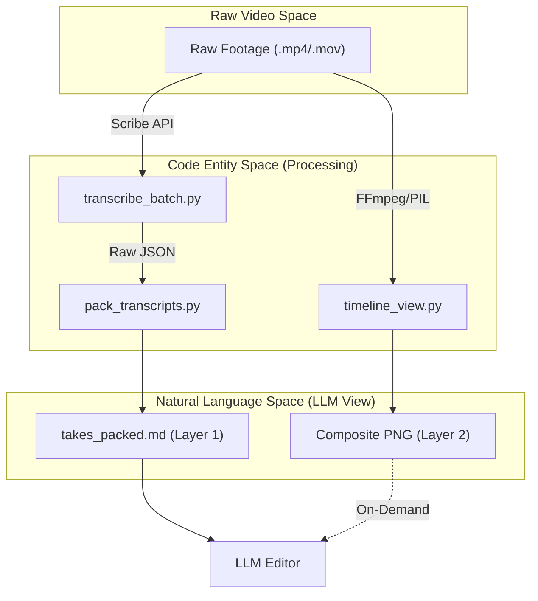
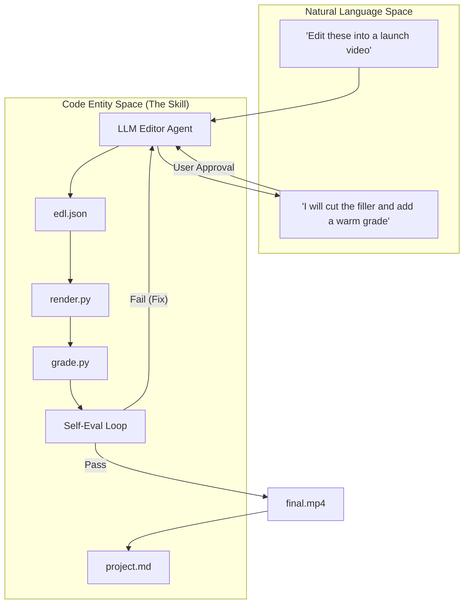

<!-- source: DeepWiki mcp.deepwiki.com · repo browser-use/video-use · page 1.2 Core Concepts and Terminology · fetched 2026-10-30 -->

# Core Concepts and Terminology

Relevant source files

The following files were used as context for generating this wiki page:

- [README.md](README.md)
- [SKILL.md](SKILL.md)
- [poster.html](poster.html)
- [static/timeline-view.svg](static/timeline-view.svg)

This page defines the foundational concepts and the mental model required to understand how `video-use` enables an LLM to edit video with professional precision. It covers the transition from raw footage to a structured "reading view," the execution model, and the self-correction loops that ensure production quality.

## Purpose and Scope

The core philosophy of `video-use` is that **the LLM never watches the video; it reads it.** By converting dense pixel data into structured text and on-demand visual composites, the system bypasses the context-window limitations of multi-modal models while maintaining frame-accurate control [README.md:67-69]().

---

## Two-Layer Perception

The system provides the LLM with two complementary views of the video data. This "Two-Layer Perception" mimics how a human editor uses a transcript to find content and a timeline to refine cuts.

### Layer 1: Audio Transcript (The Primary View)
Every source file is processed via the ElevenLabs Scribe API to produce a word-level transcript with metadata [README.md:75-75](). This data is "packed" into a human-readable Markdown format optimized for LLM context windows [README.md:75-81]().

*   **Key File:** `takes_packed.md` [SKILL.md:46-46]()
*   **Contents:** Word-level timestamps, speaker diarization, and audio events like `(laughter)` or `(applause)` [README.md:75-75]().
*   **Logic:** `pack_transcripts.py` segments the raw JSON into phrases based on a silence threshold (default ≥ 0.5s) [SKILL.md:76-76]().

### Layer 2: Visual Composite (On-Demand)
When the LLM needs to verify a visual detail—such as a jump cut, a facial expression, or a framing issue—it requests a visual composite [README.md:83-84]().

*   **Tool:** `timeline_view.py` [SKILL.md:77-77]()
*   **Contents:** A single PNG containing a filmstrip, audio waveform, word labels, and silence-gap candidates [README.md:71-73]().

### Perception Data Flow
The following diagram illustrates how raw video is transformed into these two layers for the LLM.

**Diagram: Natural Language Space to Code Entity Space (Perception)**

Sources: [README.md:67-88](), [SKILL.md:74-77](), [SKILL.md:46-49]()

---

## The LLM-as-Editor Model

The system operates as a conversation-driven engine where the LLM acts as the lead editor. It follows a strict "Ask → Confirm → Execute" loop to ensure the user retains creative control while the agent handles the technical implementation [SKILL.md:12-12]().

### Decision Making
The LLM uses `takes_packed.md` to identify "Cut Candidates" based on speech boundaries and silence gaps [SKILL.md:10-11](). It then proposes a strategy in plain English before generating any code or configuration [SKILL.md:32-32]().

### EDL-Based Execution
Once a strategy is confirmed, the agent produces an `edl.json` (Edit Decision List). This file acts as the source of truth for the rendering engine [SKILL.md:47-47]().

| Concept | Description | Code Entity |
| :--- | :--- | :--- |
| **Cut Craft** | Principles like "Never cut inside a word" and "30ms audio fades" [SKILL.md:24-27](). | `render.py` / `SKILL.md` |
| **EDL** | A JSON schema defining source ranges, grades, and overlays [SKILL.md:47-47](). | `edl.json` |
| **Parallelism** | Spawning sub-agents for heavy tasks like Manim animations [SKILL.md:31-31](). | `Agent` tool |

---

## The Self-Evaluation Loop

A critical concept in `video-use` is that the agent is responsible for verifying its own work before presenting it to the user [SKILL.md:16-16]().

After `render.py` produces a `preview.mp4`, the agent runs `timeline_view.py` on the **rendered output** at every cut boundary [README.md:98-98](). It looks for:
1.  **Visual Jumps:** Unexpected movement or framing changes at the cut [README.md:98-98]().
2.  **Audio Pops:** Waveform spikes that the 30ms fade failed to catch [README.md:98-98]().
3.  **Subtitle Violations:** Captions hidden by overlays [README.md:98-98]().

If issues are detected, the agent performs a "fix-and-re-render" cycle (up to 3 attempts) [README.md:93-96]().

---

## Mental Model: The Editing Pipeline

The following diagram bridges the conceptual "Natural Language" goals of the user with the "Code Entities" that execute them.

**Diagram: Natural Language Space to Code Entity Space (Execution)**

Sources: [README.md:90-96](), [SKILL.md:78-79](), [SKILL.md:45-47](), [SKILL.md:18-33]()

## Persistent Memory: project.md
To maintain state across multiple Claude Code sessions, the system uses `project.md` [SKILL.md:45-45](). This file stores the session history, reasoning, and approved strategies, allowing the LLM to resume work without re-analyzing the entire project from scratch [README.md:19-19]().

Sources:
- `README.md:19-19`
- `README.md:67-88`
- `README.md:90-96`
- `SKILL.md:10-12`
- `SKILL.md:16-16`
- `SKILL.md:18-33`
- `SKILL.md:45-49`
- `SKILL.md:74-79`

---

