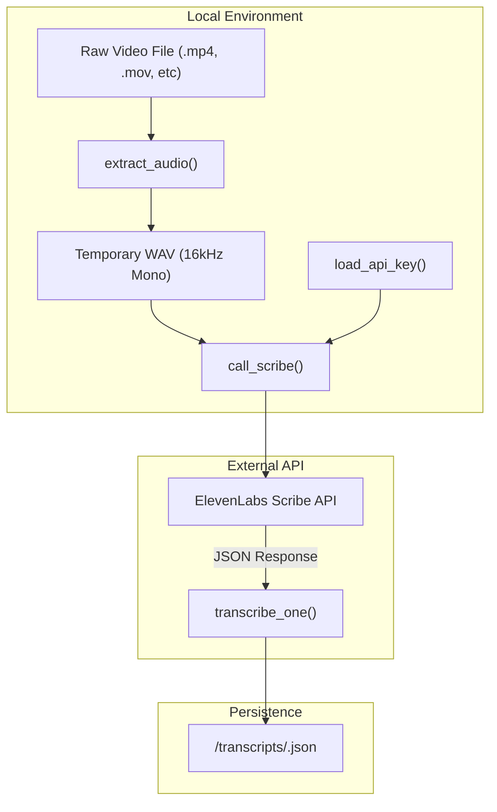
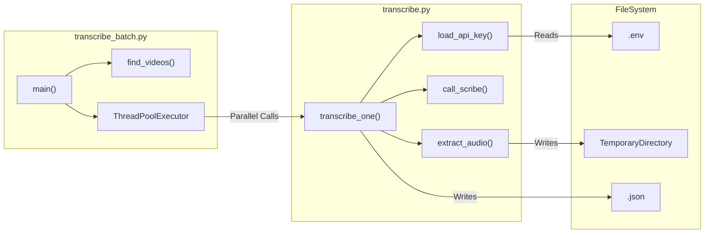

<!-- source: DeepWiki mcp.deepwiki.com · repo browser-use/video-use · page 2.1 Transcription and Ingestion · fetched 2026-10-30 -->

# Transcription and Ingestion

Relevant source files

The following files were used as context for generating this wiki page:

- [.env.example](.env.example)
- [SKILL.md](SKILL.md)
- [helpers/transcribe.py](helpers/transcribe.py)
- [helpers/transcribe_batch.py](helpers/transcribe_batch.py)

The Transcription and Ingestion stage is the first step in the `video-use` pipeline. It transforms raw video files into structured JSON transcripts containing word-level timestamps, speaker diarization, and audio event tags. This process is powered by the ElevenLabs Scribe API and is designed to handle both single files and large batches of footage efficiently through caching and parallelization.

## Data Flow Overview

The ingestion process begins by extracting a standardized audio stream from the source video, which is then transmitted to the Scribe API. The resulting metadata is stored locally to prevent redundant API calls.

### Transcription Logic Flow
"The diagram below illustrates the path from a raw video file to a cached JSON transcript."

Sources: [helpers/transcribe.py:49-55](), [helpers/transcribe.py:58-87](), [helpers/transcribe.py:90-132]()

## Audio Preprocessing

Before transmission, `video-use` standardizes audio using `ffmpeg` to ensure compatibility and reduce upload bandwidth. The `extract_audio` function converts the input video into a specific PCM format required for optimal transcription accuracy.

| Parameter | Value | Description |
| :--- | :--- | :--- |
| **Channels** | 1 (Mono) | Mixed down to a single channel using `-ac 1` |
| **Sample Rate** | 16,000 Hz | Resampled using `-ar 16000` |
| **Codec** | `pcm_s16le` | Uncompressed 16-bit Little Endian PCM |
| **Container** | `.wav` | Temporary WAV file created in a system temp directory |

Sources: [helpers/transcribe.py:49-55](), [helpers/transcribe.py:115-117]()

## ElevenLabs Scribe Integration

The system interacts with the Scribe API via the `call_scribe` function. It uses the `scribe_v1` model and requests high-granularity metadata to support downstream editing tasks.

Key features requested in the API payload:
*   **Diarization**: Enabled via `diarize: "true"` to distinguish between different speakers [helpers/transcribe.py:66-66]().
*   **Audio Events**: Enabled via `tag_audio_events: "true"` to identify non-speech sounds like laughter or applause [helpers/transcribe.py:67-67]().
*   **Timestamps**: Set to `word` granularity to allow the LLM to make precise cuts between words [helpers/transcribe.py:68-68]().
*   **Language Support**: Supports optional ISO language codes (e.g., "en") or auto-detection if omitted [helpers/transcribe.py:70-71]().
*   **Verbatim Mode**: The system mandates word-level verbatim ASR to preserve fillers, which are considered critical editorial signals [SKILL.md:29-29]().

Sources: [helpers/transcribe.py:58-82](), [SKILL.md:29-29]()

## Batch Processing and Caching

For projects with multiple takes or long-form footage, `helpers/transcribe_batch.py` provides a parallelized wrapper.

### Implementation Details
*   **Parallelism**: Uses `concurrent.futures.ThreadPoolExecutor` with a default of 4 workers to process multiple videos simultaneously [helpers/transcribe_batch.py:86-87]().
*   **File Discovery**: Scans a directory for common extensions including `.mp4`, `.mov`, `.mkv`, `.avi`, and `.m4v` [helpers/transcribe_batch.py:26-34]().
*   **Caching Mechanism**: Both `transcribe.py` and `transcribe_batch.py` check for the existence of the output JSON in `<edit_dir>/transcripts/` before initiating an upload. If the file exists, the API call is skipped entirely [helpers/transcribe.py:106-109](), [helpers/transcribe_batch.py:72-73](). This is enforced as a Hard Rule to minimize API costs and latency [SKILL.md:30-30]().

### Batch Execution Entity Map
"This diagram maps the batch processing components to their specific code implementations."

Sources: [helpers/transcribe_batch.py:29-34](), [helpers/transcribe_batch.py:86-100](), [helpers/transcribe.py:33-46](), [helpers/transcribe.py:90-132]()

## Configuration and Environment

The transcription scripts require an ElevenLabs API key, which is retrieved via the `load_api_key` function. The function searches for the key in the following order:
1.  A `.env` file in the project root [helpers/transcribe.py:34-42]().
2.  A `.env` file in the current working directory [helpers/transcribe.py:34-42]().
3.  The `ELEVENLABS_API_KEY` environment variable [helpers/transcribe.py:43-43]().

If no key is found, the script exits with an error [helpers/transcribe.py:44-45]().

Sources: [helpers/transcribe.py:33-47](), [.env.example:1-1]()

---

