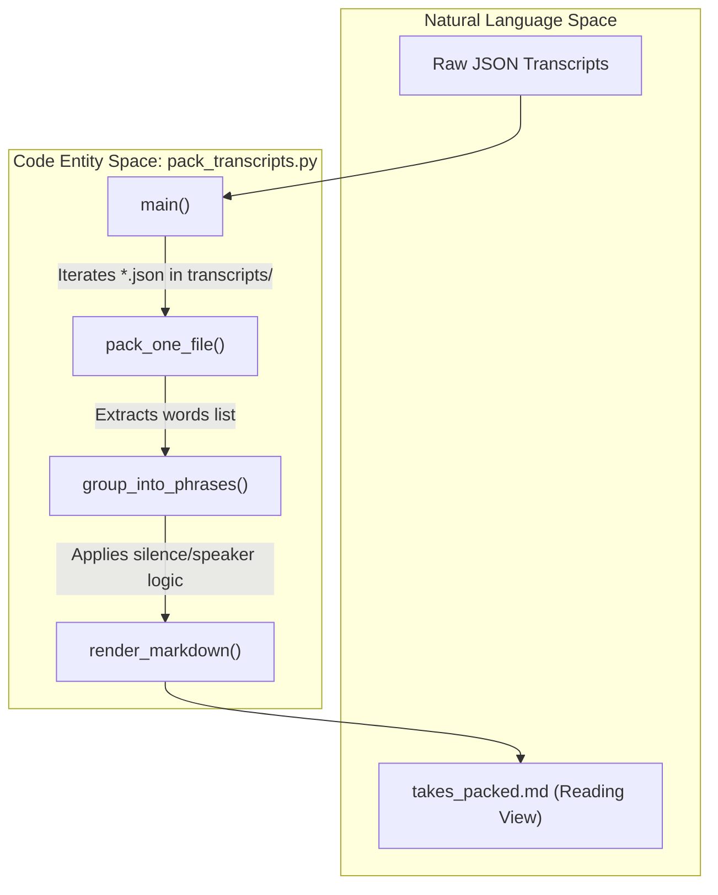
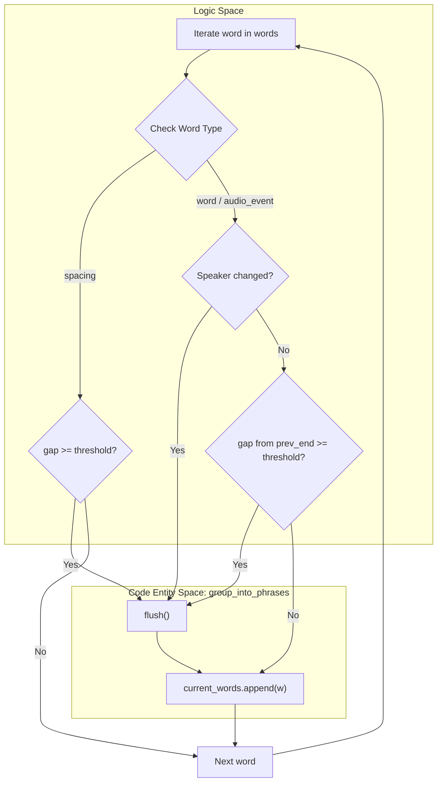

<!-- source: DeepWiki mcp.deepwiki.com · repo browser-use/video-use · page 2.2 Transcript Packing (takes_packed.md) · fetched 2026-10-30 -->

# Transcript Packing (takes_packed.md)

<details>
<summary>Relevant source files</summary>

The following files were used as context for generating this wiki page:

- [README.md](README.md)
- [SKILL.md](SKILL.md)
- [helpers/pack_transcripts.py](helpers/pack_transcripts.py)

</details>


The transcript packing stage is the bridge between raw machine-generated data and the LLM's editorial reasoning. While the transcription stage produces word-level JSON with high precision, this format is too verbose for LLM context windows and lacks the semantic structure of human speech. `pack_transcripts.py` transforms these JSON files into `takes_packed.md`, a phrase-level Markdown file optimized for readability and efficient token usage [helpers/pack_transcripts.py:1-14]().

## Purpose and Design Philosophy

The primary artifact for the editor sub-agent is the packed transcript. It is designed around three core principles:
1.  **Token Efficiency**: By grouping word-level data into phrases, it fits approximately one hour of takes into one-tenth the tokens required for raw Scribe JSON [helpers/pack_transcripts.py:5-7]().
2.  **Audio-First Segmentation**: Cut candidates are proposed based on speech boundaries and silence gaps, which are explicitly surfaced in the Markdown view [SKILL.md:10-11]().
3.  **Verbatim Signal**: The packer preserves "audio events" (e.g., laughter, sighs) and fillers, as these provide critical editorial signals for detecting retakes or emotional beats [SKILL.md:28-29]().

### Data Flow: Raw JSON to Markdown
The following diagram illustrates the transformation from the raw output of the ElevenLabs Scribe API to the structured Markdown used by the LLM.

**Transcript Transformation Pipeline**

**Sources:** [helpers/pack_transcripts.py:125-134](), [helpers/pack_transcripts.py:165-195](), [SKILL.md:46-46]()

---

## Segmentation Logic

The `group_into_phrases` function is the core logic engine. It walks the Scribe word list and breaks segments based on two primary triggers: silence duration and speaker transitions [helpers/pack_transcripts.py:38-41]().

### Silence Thresholding
The script defaults to a **0.5s silence threshold** [helpers/pack_transcripts.py:171-173](). It detects silences in two ways:
1.  **Explicit Spacing**: Scribe JSON includes `spacing` type entries. If the gap between the `start` and `end` of a spacing entry exceeds the threshold, the current phrase is flushed [helpers/pack_transcripts.py:90-99]().
2.  **Implicit Gaps**: The script calculates the delta between the `start` of the current word and the `prev_end` of the last word. If this exceeds the threshold, it triggers a break [helpers/pack_transcripts.py:112-113]().

### Speaker Diarization
Every time the `speaker_id` changes in the word stream, the current phrase is immediately flushed to ensure that different speakers never share a single line in the Markdown output [helpers/pack_transcripts.py:108-109]().

### Audio Events
Entries of type `audio_event` (such as `(laughter)` or `(applause)`) are wrapped in parentheses and kept within the phrase text to provide context for the editor [helpers/pack_transcripts.py:64-67]().

**Segmentation Logic Flow**

**Sources:** [helpers/pack_transcripts.py:88-121]()

---

## Markdown Format (takes_packed.md)

The resulting Markdown file is structured for high-density reading. Each phrase is prefixed with a timestamp range and an optional speaker tag.

### Output Structure
| Component | Format | Example |
| :--- | :--- | :--- |
| **Header** | `## <filename>` | `## C0103` |
| **Metadata** | `(duration: Xs, Y phrases)` | `(duration: 43.0s, 8 phrases)` |
| **Timestamp** | `[start-end]` | `[002.52-005.36]` |
| **Speaker Tag** | `S<id>` | `S0` (Shortened from `speaker_0`) |
| **Content** | Text + (Events) | `We fixed this. (applause)` |

**Example Output:**
```markdown
## C0103  (duration: 43.0s, 8 phrases)
  [002.52-005.36] S0 Ninety percent of what a web agent does is completely wasted.
  [006.08-006.74] S0 We fixed this.
```
**Sources:** [helpers/pack_transcripts.py:137-162](), [helpers/pack_transcripts.py:24-35](), [README.md:78-81]()

---

## Integration with Editing Workflow

The `takes_packed.md` file serves as the "source of truth" for the `edl.json` generation.

1.  **Cut Precision**: Even though the view is phrase-level, the timestamps are derived from word-level data. The LLM is instructed to snap every cut edge to these word boundaries to avoid cutting mid-word [SKILL.md:27-27]().
2.  **Addressing**: The `[start-end]` ranges provided in the Markdown are used by the LLM to fill the `source_start` and `source_end` fields in the EDL [helpers/pack_transcripts.py:142-142]().
3.  **Padding**: While the transcript provides precise word boundaries, the system enforces a "Hard Rule" to pad every cut edge by 30–200ms to account for Scribe timestamp drift and ensure a natural audio flow [SKILL.md:28-28]().

### Usage
To generate the packed transcript for a project:
```bash
python helpers/pack_transcripts.py --edit-dir ./edit/ --silence-threshold 0.5
```
**Sources:** [helpers/pack_transcripts.py:11-14](), [SKILL.md:70-77]()

---

