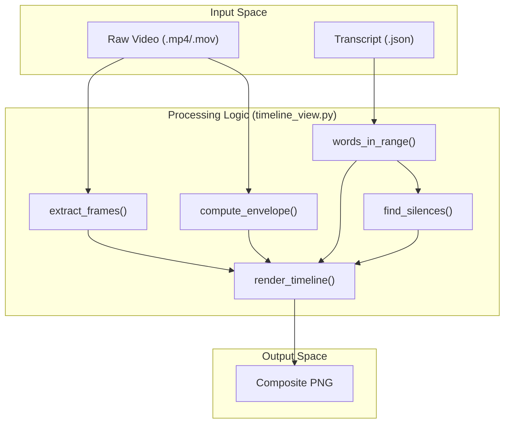
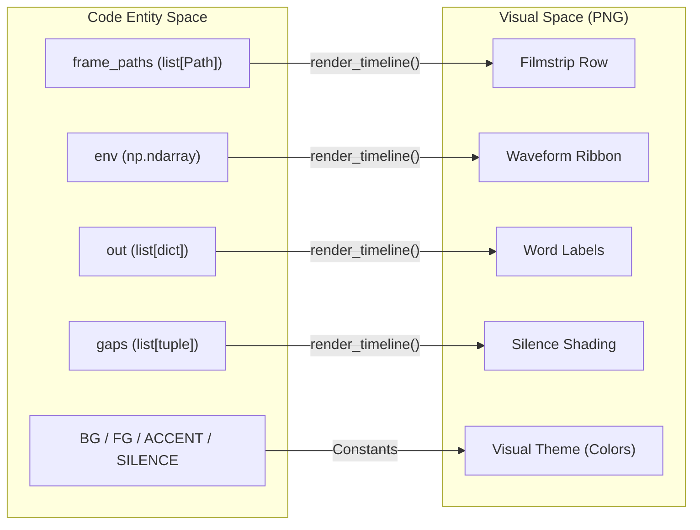

<!-- source: DeepWiki mcp.deepwiki.com · repo browser-use/video-use · page 2.3 Timeline View (Visual Composite Generator) · fetched 2026-10-30 -->

# Timeline View (Visual Composite Generator)

<details>
<summary>Relevant source files</summary>

The following files were used as context for generating this wiki page:

- [SKILL.md](SKILL.md)
- [helpers/timeline_view.py](helpers/timeline_view.py)
- [poster.html](poster.html)
- [static/timeline-view.svg](static/timeline-view.svg)

</details>


The Timeline View is the primary visual perception mechanism for the LLM. Since the LLM cannot "watch" video files, it requests on-demand composite PNG images that translate temporal video data into a spatially organized format. This tool allows the agent to perform cut-point sanity checks, disambiguate retakes, and verify visual transitions without processing raw pixel streams [helpers/timeline_view.py:1-11]().

## System Overview

The `timeline_view.py` script generates a high-resolution horizontal composite consisting of three main tracks:
1.  **Filmstrip**: A series of evenly spaced thumbnails extracted from the video segment [helpers/timeline_view.py:4-5]().
2.  **Audio Waveform**: A normalized RMS envelope showing audio intensity and silence gaps [helpers/timeline_view.py:5-7]().
3.  **Transcript Overlay**: Word-level labels aligned with the waveform, including speaker identification and silence shading [helpers/timeline_view.py:5-7]().

### Data Flow Diagram

The following diagram illustrates how raw video and transcript data are transformed into the composite PNG.

**Visual Composite Generation Pipeline**

**Sources:** [helpers/timeline_view.py:37-62](), [helpers/timeline_view.py:68-110](), [helpers/timeline_view.py:118-132](), [helpers/timeline_view.py:135-148](), [helpers/timeline_view.py:184-191]()

---

## Key Components and Implementation

### 1. Frame Extraction
The `extract_frames` function uses `ffmpeg` to capture `n` frames evenly spaced across the requested `[start, end]` interval [helpers/timeline_view.py:37-46](). Frames are scaled to a width of 320px for the composite using the `-vf scale=320:-2` filter [helpers/timeline_view.py:57]().

### 2. Audio Envelope Computation
The `compute_envelope` function generates a visual representation of the audio [helpers/timeline_view.py:68-73]():
*   It extracts a mono 16kHz PCM stream to a temporary WAV file using `ffmpeg` [helpers/timeline_view.py:77-83]().
*   It calculates a windowed RMS (Root Mean Square) to create an envelope of a fixed length (default 2000 samples) by reshaping the PCM buffer and computing the mean of squared values [helpers/timeline_view.py:97-102]().
*   The envelope is normalized to a `[0, 1]` range for consistent rendering [helpers/timeline_view.py:108-110]().

### 3. Transcript and Silence Alignment
The generator pulls word-level timestamps from the Scribe JSON transcript using `words_in_range` [helpers/timeline_view.py:118-132](). 
*   **Silence Detection**: The `find_silences` function identifies gaps between words that exceed a specific threshold (default 0.4s) [helpers/timeline_view.py:135-137](). 
*   **Visual Shading**: These gaps are rendered as semi-transparent blue boxes (defined by the `SILENCE` constant) over the waveform to help the LLM identify "dead air" [helpers/timeline_view.py:180](), [helpers/timeline_view.py:6-7]().

### 4. Compositing Logic
The `render_timeline` function manages the `PIL` (Pillow) canvas layout [helpers/timeline_view.py:184-191](). It calculates vertical offsets for the filmstrip (`filmstrip_y`), waveform (`wave_y`), and labels (`label_y`) [helpers/timeline_view.py:199-206]().

**Entity Mapping: Code to Visuals**

**Sources:** [helpers/timeline_view.py:196](), [helpers/timeline_view.py:102](), [helpers/timeline_view.py:131](), [helpers/timeline_view.py:144-147](), [helpers/timeline_view.py:176-182]()

---

## CLI Interface

The script provides a command-line interface for both manual debugging and LLM tool calls. It is invoked as a helper within the `video-use` skill [SKILL.md:77]().

| Argument | Description |
| :--- | :--- |
| `video` | Path to the source video file. |
| `start` / `end` | Time range in seconds. |
| `-o`, `--output` | Destination for the PNG (defaults to `timeline.png`). |
| `--n-frames` | Number of thumbnails to include in the filmstrip (default: 10). |
| `--transcript` | Path to the `.json` transcript for word overlays. |

**Example Usage:**
```bash
python helpers/timeline_view.py input.mp4 10.5 15.0 --n-frames 12 --transcript input.json
```
**Sources:** [helpers/timeline_view.py:13-18](), [SKILL.md:77]()

---

## LLM Usage and Decision Making

The LLM uses these composites during the **Self-Evaluation Loop** [SKILL.md:85](). It does not scan every second of video; instead, it calls `timeline_view.py` as an "on-demand visual drill-down" at specific "decision points" [helpers/timeline_view.py:9-11]():

1.  **Cut-Point Sanity**: Ensuring a cut doesn't happen mid-word or during a visual blink. Hard Rule #6 mandates snapping cuts to word boundaries, and `timeline_view` verifies this visually [SKILL.md:27]().
2.  **Retake Disambiguation**: Comparing two similar-sounding takes by looking at the visual performance (e.g., "In take 1 the speaker is looking at the camera, in take 2 they are looking down").
3.  **Silence Verification**: Confirming that a detected silence in the transcript is actually empty air and not a non-verbal cue (like a laugh or a gesture) that should be preserved.
4.  **Verification**: Post-render verification to check for visual jumps, audio pops, or subtitle visibility violations [SKILL.md:16]().

**Sources:** [helpers/timeline_view.py:9-12](), [SKILL.md:27](), [SKILL.md:85]()

---

