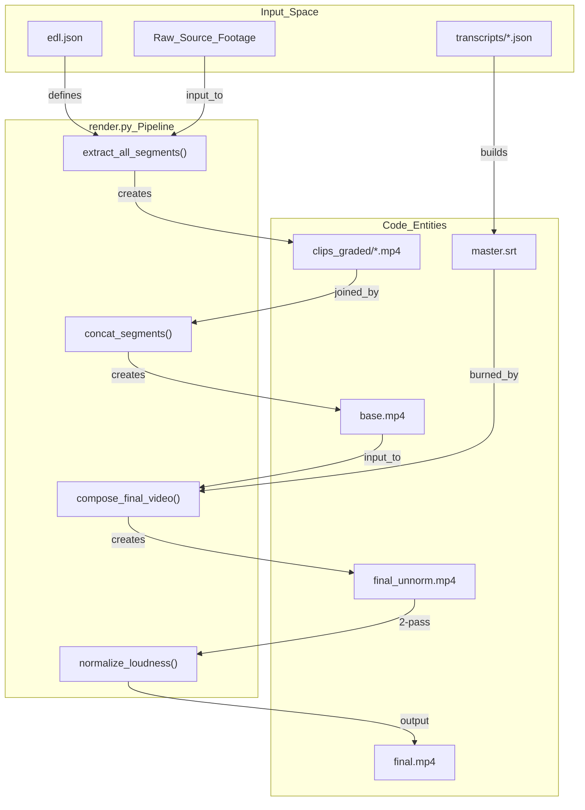
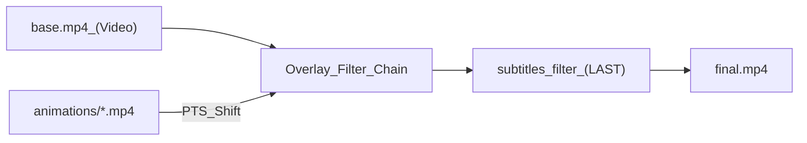

<!-- source: DeepWiki mcp.deepwiki.com · repo browser-use/video-use · page 2.4 Rendering Pipeline (render.py) · fetched 2026-10-30 -->

# Rendering Pipeline (render.py)

Relevant source files

The following files were used as context for generating this wiki page:

- [SKILL.md](SKILL.md)
- [helpers/render.py](helpers/render.py)

The rendering pipeline in `video-use` is a heuristic-driven system designed for production correctness and efficiency. It follows a multi-stage process that prioritizes audio integrity and minimizes generational loss by using a "Per-segment extract → Lossless concat" architecture rather than a single-pass complex filtergraph [SKILL.md:22-23]().

## Pipeline Overview

The pipeline implements the **HEURISTICS** render sequence to ensure that effects like color grading, audio fades, overlays, and subtitles are applied in the correct order [helpers/render.py:3-9]().

### Data Flow Diagram

The following diagram illustrates the transformation from an `edl.json` file and raw source footage to the final rendered video.

**Figure 1: Rendering Data Flow**

Sources: [helpers/render.py:3-20](), [helpers/render.py:137-145](), [helpers/render.py:197-202](), [SKILL.md:41-56]()

## Core Implementation Details

### 1. HDR to SDR Tone Mapping
Before processing, `render.py` detects if the source uses HDR transfer functions like PQ (HDR10) or HLG [helpers/render.py:108-121](). If detected, it prepends a `zscale` and `tonemap` chain to ensure the output is clean Rec.709 SDR, preventing the "blown out" look common when 10-bit HDR is downconverted to 8-bit without mapping [helpers/render.py:95-106]().

### 2. Per-Segment Extraction (Rule 2 & 3)
Instead of processing the entire timeline at once, `render.py` extracts each clip defined in the `edl.json` ranges. This stage bakes in:
*   **Color Grading:** Applied via `-vf` filter strings, presets, or "auto" analysis [helpers/render.py:67-84]().
*   **Audio Fades:** A mandatory 30ms fade-in and fade-out is applied to every segment via `afade` to prevent audible "pops" at cut boundaries [SKILL.md:24-24](), [helpers/render.py:170-172]().
*   **Scaling:** Normalizes footage to 1080p (or 720p for drafts) [helpers/render.py:157-160]().

### 3. Lossless Concatenation
Once segments are extracted with matching codecs and parameters, they are joined using the ffmpeg `concat` demuxer with `-c copy` [SKILL.md:22-23](). This avoids re-encoding the video frames a second time, preserving quality and saving significant compute time.

### 4. Overlay Compositing and PTS Shifting (Rule 4)
Overlays (animations) are composited onto the concatenated base video. To ensure an animation starts at the correct time within its specific window, the pipeline applies a PTS (Presentation Time Stamp) shift [SKILL.md:25-25](). The filter logic used is `setpts=PTS-STARTPTS+T/TB`, which shifts the overlay's frame 0 to align with the start of the designated overlay window [helpers/render.py:7-9]().

### 5. Subtitle Burning (Rule 1)
Subtitles are always applied **last** in the filter chain [SKILL.md:22-22](). This ensures that overlays or other visual elements do not accidentally obscure the captions. The pipeline uses a specific `SUB_FORCE_STYLE` (Helvetica 18 Bold, Alignment 2) with a high `MarginV=90` to ensure captions remain clear of UI elements on platforms like TikTok or Instagram Reels [helpers/render.py:41-56]().

**Figure 2: Composite Filter Graph Construction**

Sources: [helpers/render.py:7-9](), [SKILL.md:22-22](), [helpers/render.py:41-56]()

## Quality Ladder Modes

The `extract_segment` function supports three distinct quality modes to balance speed and fidelity [helpers/render.py:150-154]().

| Mode | Resolution | Preset | CRF | Purpose |
| :--- | :--- | :--- | :--- | :--- |
| **Draft** | 1280x720 | `ultrafast` | 28 | Rapid cut-point verification |
| **Preview** | 1920x1080 | `medium` | 22 | General quality and pacing review |
| **Final** | 1920x1080 | `fast` | 20 | High-quality production output |

Sources: [helpers/render.py:157-160](), [helpers/render.py:174-180]()

## Key Functions and Logic

*   **`is_hdr_source(video)`**: Uses `ffprobe` to check for `smpte2084` or `arib-std-b67` color transfers [helpers/render.py:120-132]().
*   **`extract_segment(...)`**: Constructs the ffmpeg command for per-clip extraction, applying the `TONEMAP_CHAIN`, scaling, grading, and `afade` [helpers/render.py:137-194]().
*   **`resolve_grade_filter(grade_field)`**: Translates EDL grade strings into valid ffmpeg filter strings. It handles presets via `get_preset()` or returns the sentinel `"__AUTO__"` for per-segment analysis [helpers/render.py:67-84]().
*   **`SUB_FORCE_STYLE`**: A hard-coded constant defining the visual look of burned-in subtitles, including the platform-safe `MarginV=90` [helpers/render.py:51-56]().

Sources: [helpers/render.py:41-194]()

---

