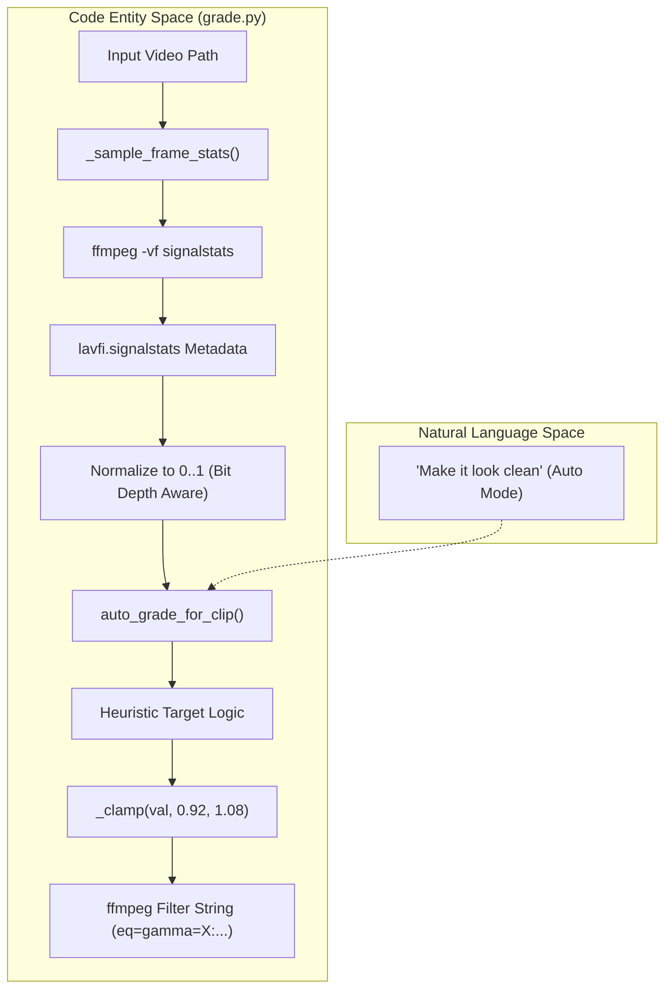
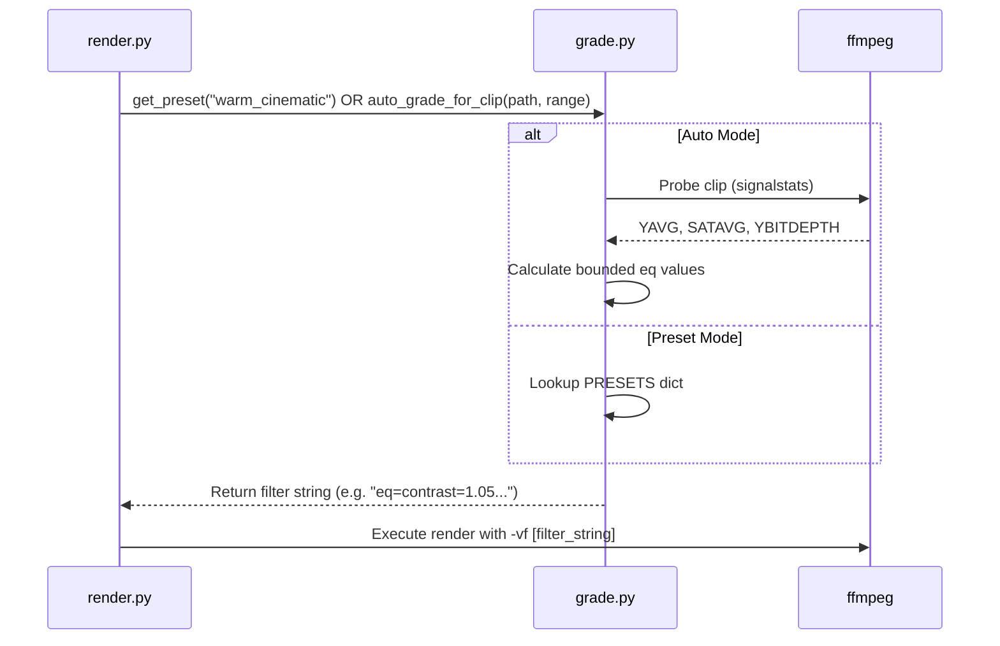

<!-- source: DeepWiki mcp.deepwiki.com · repo browser-use/video-use · page 2.5 Color Grading (grade.py) · fetched 2026-10-30 -->

# Color Grading (grade.py)

Relevant source files

The following files were used as context for generating this wiki page:

- [helpers/grade.py](helpers/grade.py)
- [helpers/render.py](helpers/render.py)

The `grade.py` module provides a data-driven approach to video color correction within the `video-use` pipeline. It focuses on subtle, automated adjustments to normalize footage (brightness, contrast, and saturation) rather than aggressive creative grading. It offers both a mathematical "Auto" mode and a selection of named presets for specific visual styles.

### Core Philosophy and Modes

The module operates under two primary modes as defined in the file header: [helpers/grade.py:3-17]().

1.  **Auto Mode (Default):** Analyzes the clip using `ffmpeg` signalstats to compute mean brightness, RMS contrast, and saturation. It emits a bounded filter string capped at ±8% adjustment on any axis to ensure the output looks "clean without looking graded" [helpers/grade.py:8-16]().
2.  **Preset Mode:** Applies a fixed, named filter chain for specific looks like `warm_cinematic` or `neutral_punch` [helpers/grade.py:5-6]().

---

### Named Presets

Presets are defined in the `PRESETS` dictionary [helpers/grade.py:38-63](). These presets use standard `ffmpeg` filters such as `eq` (equalizer), `curves`, and `colorbalance`.

| Preset Name | Description | Key Filter Components |
| :--- | :--- | :--- |
| `subtle` | Baseline cleanup; no color shift. | `eq=contrast=1.03:saturation=0.98` |
| `neutral_punch` | Minimal corrective grade with a subtle S-curve. | `eq=contrast=1.06`, `curves=master` |
| `warm_cinematic` | Creative preset (opt-in only). Warm shadows, cool highlights, and filmic curves. | `colorbalance`, `curves`, `saturation=0.88` |
| `none` | Sentinel for skipping grading. | `""` (Empty string) |

**Source:** [helpers/grade.py:38-63]()

---

### Auto-Grading Logic

The auto-grading process involves two stages: statistical sampling and heuristic decision-making.

#### 1. Statistical Sampling (`_sample_frame_stats`)
The system uses `ffmpeg`'s `signalstats` filter to extract metadata from the video stream [helpers/grade.py:84-95](). It samples frames at a calculated FPS to ensure a representative distribution across the clip duration [helpers/grade.py:98-112]().

The function normalizes values based on the source's native bit depth (e.g., 8-bit or 10-bit) by reading `lavfi.signalstats.YBITDEPTH` and dividing by `(2^depth - 1)` to map everything to a 0.0–1.0 range [helpers/grade.py:114-161]().

**Key Metrics Captured:**
*   `y_mean`: Mean Luma (brightness) [helpers/grade.py:161]().
*   `y_std`: Approximate standard deviation of Luma, calculated as `(YMAX - YMIN) / 4.0` [helpers/grade.py:162-171]().
*   `sat_mean`: Mean saturation [helpers/grade.py:167]().

**Source:** [helpers/grade.py:78-173]()

#### 2. Heuristic Adjustment (`auto_grade_for_clip`)
Once stats are gathered, the system applies a "bounded correction" logic. This logic calculates adjustments for `gamma` (exposure), `contrast`, and `saturation` based on target ideals [helpers/grade.py:184-190]().

**Adjustment Bounds:**
To prevent "hallucinated" grading or extreme distortion, all corrections are clamped using a `_clamp` helper [helpers/grade.py:228-232]().
*   **Gamma:** Target `y_mean` is ~0.45. Correction is clamped between `0.92` and `1.08` [helpers/grade.py:214-215]().
*   **Contrast:** Target `y_std` is ~0.18. Correction is clamped between `0.95` and `1.08` [helpers/grade.py:218-219]().
*   **Saturation:** Target `sat_mean` is ~0.25. Correction is clamped between `0.95` and `1.08` [helpers/grade.py:222-223]().

**Source:** [helpers/grade.py:178-245]()

---

### Integration and Data Flow

The grading system is integrated into the `render.py` pipeline. The EDL's `grade` field is resolved via `resolve_grade_filter` [helpers/render.py:67-72](). If the field is set to `"auto"`, the renderer returns a sentinel `"__AUTO__"` which triggers per-segment analysis during the extraction phase [helpers/render.py:75-76]().

#### Data Flow: Signal Analysis to Filter String
"This diagram illustrates how raw video data is transformed into an ffmpeg filter string via the analysis pipeline."

**Sources:** [helpers/grade.py:78-112](), [helpers/grade.py:159-173](), [helpers/grade.py:214-232]()

---

### Pipeline Orchestration

The following diagram shows how `grade.py` interacts with the broader rendering system.

**Sources:** [helpers/render.py:32](), [helpers/render.py:67-84](), [helpers/grade.py:25-26](), [helpers/grade.py:38-63](), [helpers/grade.py:104-112]()

### Usage via CLI
The script can be used as a standalone tool for analysis or testing presets:
*   **Analyze a clip:** `python helpers/grade.py --analyze <input>` [helpers/grade.py:23]()
*   **Apply a preset:** `python helpers/grade.py <input> -o <output> --preset warm_cinematic` [helpers/grade.py:20]()
*   **Print preset filter:** `python helpers/grade.py --print-preset warm_cinematic` [helpers/grade.py:22]()

**Sources:** [helpers/grade.py:18-24]()

---

