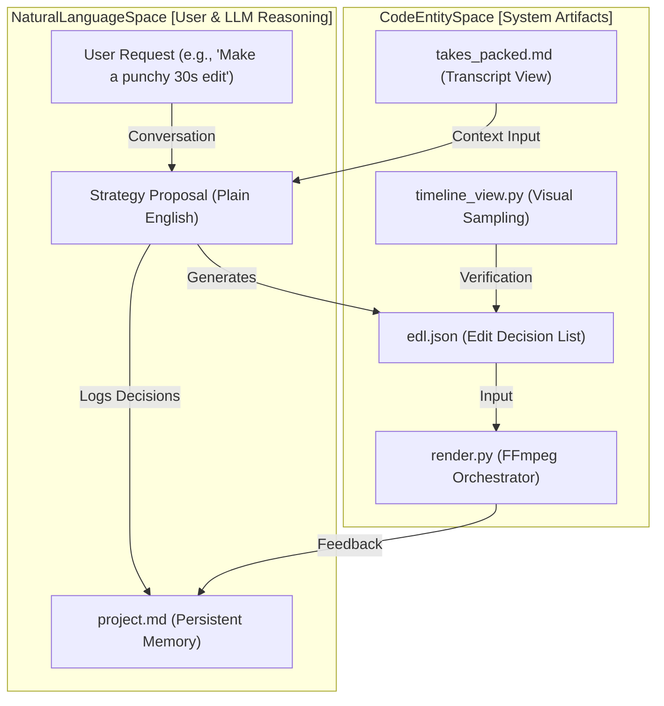

<!-- source: DeepWiki mcp.deepwiki.com · repo browser-use/video-use · page 3 LLM Editing Workflow · fetched 2026-10-30 -->

# LLM Editing Workflow

Relevant source files

The following files were used as context for generating this wiki page:

- [README.md](README.md)
- [SKILL.md](SKILL.md)

The LLM editing workflow in `video-use` is a multi-stage conversational and execution loop. Rather than acting as a simple script runner, the LLM operates as a creative director and lead editor, orchestrating specialized sub-agents and verification tools to transform raw footage into a polished final product.

## High-Level Orchestration

The workflow follows a "Perceive → Propose → Execute → Evaluate" cycle. The agent first builds a mental model of the footage using text-based transcripts and on-demand visual composites, then confirms a creative strategy with the user before generating technical instructions (EDL).

### System Data Flow
The following diagram illustrates how the LLM bridges the gap between natural language intent and the concrete file entities used by the rendering engine.

**Diagram: Natural Language to Code Entity Mapping**

**Sources:** [SKILL.md:78-90](), [README.md:75-81](), [README.md:92-96]()

---

## 1. Perception and Strategy Confirmation
Before any cutting occurs, the agent performs an inventory of the source material. It uses `transcribe_batch.py` and `pack_transcripts.py` to create a high-density text representation of the video.

*   **Initial Inventory:** The agent runs `ffprobe` on all sources, calls `transcribe_batch.py` for parallel transcription, and runs `pack_transcripts.py` to produce `takes_packed.md` [SKILL.md:85-85]().
*   **Visual Sampling:** It uses `timeline_view.py` at specific timestamps to understand the framing, lighting, and "vibe" of the footage without processing the entire stream [SKILL.md:77-77](), [README.md:83-88]().
*   **The Strategy Proposal:** Per **Hard Rule 11**, the agent must describe its plan in plain English and wait for user approval before generating the EDL [SKILL.md:32-32](), [SKILL.md:12-12]().

---

## 2. Editor Sub-Agent and EDL Generation (#3.1)
Once the strategy is approved, the "Editor" persona takes over. This stage involves translating the creative plan into a precise `edl.json` file.

*   **Cut Craft:** The agent applies principles like snapping to word boundaries and adding 30-200ms padding to absorb transcript drift [SKILL.md:27-28]().
*   **EDL Schema:** The generated JSON defines the sequence of sources, start/end timestamps, color grade presets, and metadata for overlays.
*   **Sub-Agent Spawning:** If animations are required (e.g., Manim, Remotion, or HyperFrames), the main agent spawns parallel sub-agents to handle them using the `Agent` tool [SKILL.md:31-31](), [SKILL.md:81-82]().

For details on the EDL schema and editing principles, see [Editor Sub-Agent and EDL Generation](#3.1).

---

## 3. Self-Evaluation Loop (#3.2)
`video-use` follows a "Verify before showing" philosophy. After `render.py` produces a preview, the agent does not immediately present it to the user.

*   **Automated Review:** The agent runs `timeline_view.py` on the *rendered output* at every cut boundary to catch visual jumps or audio pops [README.md:98-98]().
*   **Hard Rules Enforcement:** It checks for compliance with production standards, such as ensuring subtitles are applied last in the filter chain [SKILL.md:22-22]().
*   **The Fix Cycle:** If an issue is detected, the agent modifies the `edl.json` and re-renders, repeating this up to 3 times before reporting a failure [README.md:95-96]().

For details on the verification criteria and the fix-and-re-render logic, see [Self-Evaluation Loop](#3.2).

---

## 4. Session Persistence (project.md) (#3.3)
To ensure that long editing sessions can be resumed or audited, the agent maintains a `project.md` file within the `edit/` directory.

*   **Memory Layer:** Every major decision, strategy confirmation, and reasoning step is logged here [SKILL.md:45-45]().
*   **Context Recovery:** When a new session starts, the LLM reads `project.md` to resume work, maintaining the "Ask → confirm → execute → iterate → persist" loop [SKILL.md:12-12](), [README.md:19-19]().

For details on the structure and usage of the project log, see [Session Persistence (project.md)](#3.3).

---

## Workflow Execution Summary

The following table summarizes the primary tools used during the LLM workflow and their associated code entities.

| Stage | Primary Tool / Code Entity | LLM Role |
| :--- | :--- | :--- |
| **Ingestion** | `transcribe_batch.py` [SKILL.md:75]() | Orchestrate transcription of raw takes. |
| **Perception** | `takes_packed.md` [SKILL.md:46]() | Read and identify best takes/filler words. |
| **Strategy** | Chat Interface / `project.md` | Propose plan and wait for user "OK". |
| **Drafting** | `edl.json` [SKILL.md:47]() | Generate technical cut list with grades/overlays. |
| **Execution** | `render.py` [SKILL.md:78]() | Invoke the FFmpeg-based rendering pipeline. |
| **Verification** | `timeline_view.py` [SKILL.md:77]() | Inspect rendered cut boundaries for errors. |
| **Persistence** | `project.md` [SKILL.md:45]() | Log progress and reasoning for future sessions. |

**Sources:** [SKILL.md:68-82](), [SKILL.md:41-56](), [README.md:11-19](), [README.md:92-96]()

---

