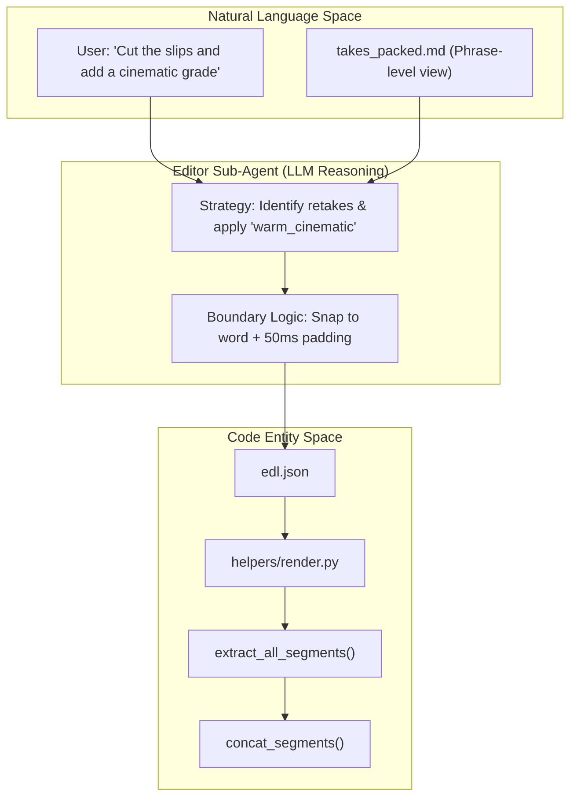
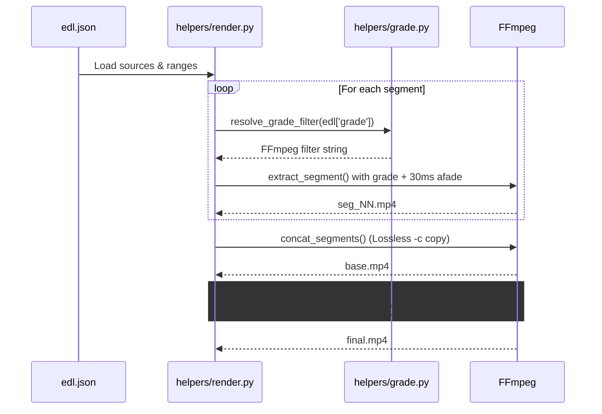

<!-- source: DeepWiki mcp.deepwiki.com · repo browser-use/video-use · page 3.1 Editor Sub-Agent and EDL Generation · fetched 2026-10-30 -->

# Editor Sub-Agent and EDL Generation

Relevant source files

The following files were used as context for generating this wiki page:

- [README.md](README.md)
- [SKILL.md](SKILL.md)
- [helpers/render.py](helpers/render.py)

The Editor Sub-Agent is the primary reasoning engine for video assembly. It translates high-level creative strategies and raw transcript data into a structured Edit Decision List (`edl.json`). By applying "Cut Craft" principles—such as beat-based organization and technical padding—the sub-agent ensures that the final sequence is both narratively coherent and technically sound for the rendering pipeline.

## The Editor's Input: `takes_packed.md`

The sub-agent's primary reading view is `takes_packed.md`, which provides a phrase-level perspective of the footage [SKILL.md:10-11](). This format is optimized for LLM context windows by breaking transcripts into segments based on silence thresholds (typically $\ge 0.5$s) [SKILL.md:76-77]().

Key characteristics of this input:
*   **Speaker Tagging:** Identifies who is speaking (e.g., `S0`, `S1`) to manage handoffs and dialogue flow [README.md:78-81]().
*   **Verbatim Accuracy:** Includes filler words (`umm`, `uh`) and audio events (`(laughter)`, `(applause)`), which the editor uses to identify "bad takes" or points for removal [SKILL.md:29-30](), [README.md:75-76]().
*   **Silence Indicators:** Gaps in the transcript signal natural breath points or scene transitions [README.md:103-103]().

Sources: [SKILL.md:10-11](), [SKILL.md:29-30](), [SKILL.md:76-77](), [README.md:75-81](), [README.md:103-103]()

## Cut Craft Principles

The sub-agent follows a set of "Hard Rules" and heuristic principles to generate professional-grade cuts.

### 1. Technical Padding and Drift Absorption
Scribe timestamps can drift by 50–100ms. To compensate, the sub-agent applies a working window of 30–200ms padding at every cut edge [SKILL.md:28-28]().
*   **Fast-paced:** Tighter padding (~30-50ms).
*   **Cinematic:** Looser padding (~100-200ms).

### 2. Word Boundary Snap
The sub-agent is forbidden from cutting inside a word. It must snap every cut edge to a word boundary identified in the raw transcript [SKILL.md:27-27]().

### 3. Audio Continuity
To prevent audible pops at cuts, the sub-agent relies on the `render.py` pipeline to apply 30ms audio fades (`afade`) at every segment boundary [SKILL.md:24-24](), [helpers/render.py:170-172]().

### 4. Beat and Punchline Preservation
The sub-agent organizes segments by "beats." It identifies punchlines or key takeaways and ensures the preceding silence and subsequent reaction time are preserved to maintain comedic or dramatic timing [SKILL.md:85-87]().

Sources: [SKILL.md:24-28](), [SKILL.md:85-87](), [helpers/render.py:170-172]()

## EDL JSON Schema

The output of the Editor Sub-Agent is the `edl.json` file [SKILL.md:47-47](). This file serves as the single source of truth for the `render.py` script.

### Schema Structure
| Field | Type | Description |
| :--- | :--- | :--- |
| `sources` | Object | Map of short names to absolute file paths of raw footage [SKILL.md:42-43](). |
| `grade` | String | Global color grading setting: `"auto"`, a preset name (e.g., `"warm_cinematic"`), or a raw FFmpeg filter [helpers/render.py:67-76](). |
| `ranges` | Array | Ordered list of segments to be extracted and concatenated [helpers/render.py:197-202](). |
| `overlays` | Array | Metadata for animations or images to be composited over the base video [SKILL.md:25-25](). |

### Range Object
Each entry in the `ranges` array contains:
*   `source`: The key from the `sources` object.
*   `start` / `end`: Timestamps in seconds.
*   `beat`: (Optional) A natural language description of why this cut exists.

### Overlay Metadata
Overlays must include timing relative to the **output** timeline. The renderer uses `setpts=PTS-STARTPTS+T/TB` to ensure the overlay's internal frame 0 aligns with the specified start time [SKILL.md:25-25]().

Sources: [SKILL.md:25-25](), [SKILL.md:42-47](), [helpers/render.py:67-76](), [helpers/render.py:197-202]()

## Implementation Flow

The following diagram illustrates the transition from natural language editing requests to the structured `edl.json` used by the rendering code.

### Editor Sub-Agent Logic Flow

Sources: [SKILL.md:10-15](), [SKILL.md:85-87](), [helpers/render.py:137-145](), [helpers/render.py:197-204]()

## Data Flow: EDL to Final Render

The `render.py` script processes the `edl.json` in a specific sequence to maintain quality and avoid double-encoding [SKILL.md:23-23]().

### Rendering Pipeline Diagram

Sources: [SKILL.md:22-25](), [helpers/render.py:3-13](), [helpers/render.py:67-76](), [helpers/render.py:137-145](), [helpers/render.py:197-204]()

---

