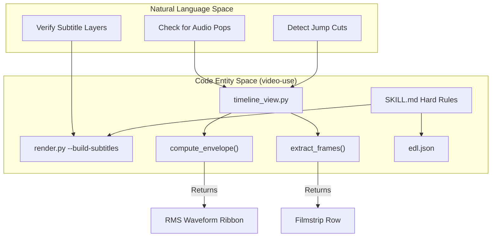
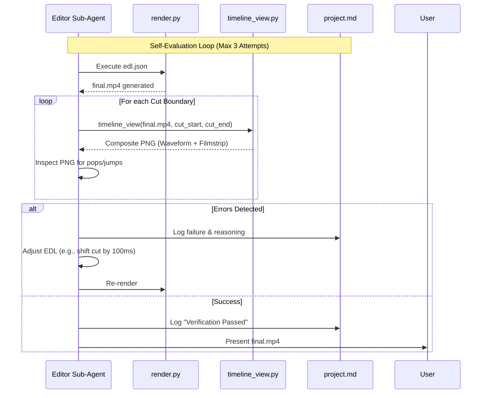

<!-- source: DeepWiki mcp.deepwiki.com · repo browser-use/video-use · page 3.2 Self-Evaluation Loop · fetched 2026-10-30 -->

# Self-Evaluation Loop

Relevant source files

The following files were used as context for generating this wiki page:

- [SKILL.md](SKILL.md)
- [helpers/timeline_view.py](helpers/timeline_view.py)
- [poster.html](poster.html)

The Self-Evaluation Loop is a post-render verification process where the agent acts as its own Quality Assurance (QA) engineer. Before presenting any output to the user, the agent inspects the rendered video for technical artifacts, production-rule violations, and continuity errors. This loop ensures that the "Hard Rules" of the system are met and that the final product maintains professional standards.

## Purpose and Scope

The loop is designed to catch silent failures that may occur during the complex multi-stage rendering process. While the LLM can reason about transcripts effectively, it cannot "watch" the video in real-time. The self-evaluation loop bridges this gap by using `timeline_view.py` to generate visual and auditory "drill-down" composites of the **rendered output**, allowing the agent to verify its work against the original intent.

The process covers:
1.  **Visual Continuity**: Checking for jump cuts or "flashes" at boundaries.
2.  **Audio Integrity**: Detecting pops or spikes at cut points.
3.  **Rule Enforcement**: Ensuring subtitles are visible and overlays are correctly timed.
4.  **Iterative Correction**: Automatically attempting up to 3 fix-and-re-render cycles if errors are detected.

Sources: [SKILL.md:16-16](), [SKILL.md:85-90]()

## The Verification Mechanism

The core of the evaluation is the `timeline_view.py` tool. Unlike its use during the planning phase (where it samples source footage), in the evaluation phase, it is targeted at the `final.mp4` or `preview.mp4` file.

### Inspection Windows
The agent targets every cut boundary defined in the `edl.json`. For each cut, it generates a composite image with a ±1.5s window centered on the transition point.

### Technical Inspection Criteria
| Category | Checkpoint | Detection Method |
| :--- | :--- | :--- |
| **Visuals** | Discontinuity / Jump Cuts | Inspecting the filmstrip row for sudden framing shifts or "flashes". |
| **Audio** | Boundary Pops | Checking the waveform ribbon for vertical spikes at the exact 0.0s mark of the cut. |
| **Subtitles** | Visibility | Verifying that the `Master SRT` (applied last) is not obscured by an animation. |
| **Overlays** | Frame Alignment | Confirming the `setpts` logic correctly shifted the animation to the intended window. |

Sources: [SKILL.md:22-25](), [SKILL.md:85-90](), [helpers/timeline_view.py:1-11]()

## Process Flow: Fix-and-Re-render

The agent follows a structured loop to ensure production correctness. If the evaluation fails, the agent must modify the `edl.json` or the animation parameters and restart the render.

### System Entity Mapping
The following diagram illustrates how the natural language goals of "Verification" map to specific code entities and files.

**Verification Logic to Code Mapping**

Sources: [SKILL.md:18-33](), [SKILL.md:72-73](), [helpers/timeline_view.py:37-38](), [helpers/timeline_view.py:68-70]()

### The Evaluation Pipeline
The loop persists until the video passes inspection or the maximum attempt count (3) is reached.

**The Iterative Loop**

Sources: [SKILL.md:16-16](), [SKILL.md:45-47](), [SKILL.md:85-90]()

## Hard Rules Enforcement

The self-evaluation loop is the primary mechanism for enforcing the **Hard Rules** defined in the system architecture. Failure to pass these rules results in a mandatory re-render.

1.  **Audio Pops (Rule 3)**: Every segment must have a 30ms fade (`afade=t=in:d=0.03`). If `timeline_view.py` shows a waveform spike at the boundary, the agent must verify the `render.py` command included the correct fade parameters [SKILL.md:24-24]().
2.  **Subtitle Visibility (Rule 1)**: Subtitles must be applied **last** in the filter chain. The agent checks the `verify/` directory for frames where overlays might have been rendered over the text [SKILL.md:22-22](), [SKILL.md:53-53]().
3.  **Timing Drift (Rule 7 & 8)**: Because Scribe timestamps can drift by 50–100ms, the agent uses the evaluation loop to check if a cut "clipped" the start or end of a word. If a word is truncated, the agent expands the padding (standard 30–200ms) in the `edl.json` [SKILL.md:27-29](), [helpers/timeline_view.py:135-148]().

Sources: [SKILL.md:18-33](), [SKILL.md:53-53](), [helpers/timeline_view.py:135-148]()

## Implementation Details

### `timeline_view.py` API
The tool provides the visual evidence needed for the loop. It extracts N frames and computes an RMS envelope of the audio.

*   **Function `extract_frames`**: Uses `ffmpeg` to grab evenly spaced frames at specific timestamps [helpers/timeline_view.py:37-62]().
*   **Function `compute_envelope`**: Dumps mono 16kHz PCM to a temporary WAV and calculates windowed RMS to visualize audio levels [helpers/timeline_view.py:68-110]().
*   **Function `words_in_range`**: Overlays word labels from the transcript onto the waveform to verify word-boundary alignment [helpers/timeline_view.py:118-132]().
*   **Function `find_silences`**: Identifies gaps between words to help the agent confirm that cuts occurred during silence rather than mid-word [helpers/timeline_view.py:135-148]().

### Logging and Persistence
Every evaluation attempt is logged in `project.md`. This allows the agent to track what adjustments have already been tried (e.g., "Attempt 2: Increased padding on Cut #4 by 50ms to fix audio pop").

Sources: [SKILL.md:45-45](), [helpers/timeline_view.py:184-191]()

---

