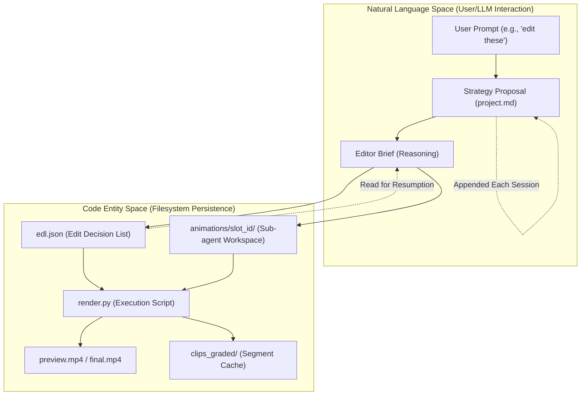
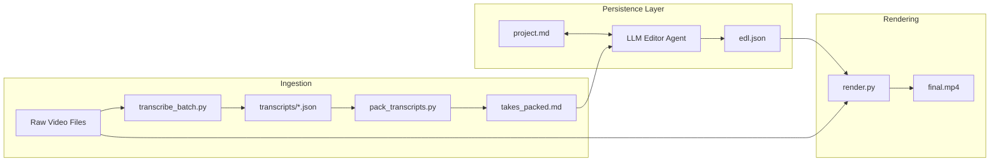

<!-- source: DeepWiki mcp.deepwiki.com · repo browser-use/video-use · page 3.3 Session Persistence (project.md) · fetched 2026-10-30 -->

# Session Persistence (project.md)

Relevant source files

The following files were used as context for generating this wiki page:

- [README.md](README.md)
- [SKILL.md](SKILL.md)
- [install.md](install.md)

Session persistence in `video-use` is managed through a decentralized memory layer centered around a `project.md` file. Unlike traditional video editors that store state in proprietary binary formats, this system uses human-readable and LLM-parsable Markdown and JSON files to maintain context across multiple interactions, allowing the agent to resume work, remember previous decisions, and track the evolution of the edit.

### The Role of project.md

The `project.md` file serves as the "long-term memory" of the editing session. It is located within the `<videos_dir>/edit/` directory [SKILL.md:45-45](). The LLM is instructed to append to this file every session to maintain a log of the project's progress [SKILL.md:19-19]().

#### Data Logged in project.md
The file typically contains:
*   **Strategy and Reasoning:** The 4–8 sentence strategy proposed by the LLM and confirmed by the user [SKILL.md:104-104]().
*   **Decision Logs:** Why specific takes were chosen or why certain cuts were made.
*   **Aesthetic Direction:** Preferences for color grading, subtitle styles, and pacing [SKILL.md:13-14]().
*   **Sub-agent Coordination:** Status and reasoning for parallel animation tasks handled by sub-agents [SKILL.md:49-49]().

**Sources:** [SKILL.md:19-19](), [SKILL.md:45-45](), [SKILL.md:104-104]()

### Directory Structure Conventions

The persistence layer relies on a strict directory layout within the user's video directory. This structure ensures that all derived artifacts are isolated from the source footage and the core skill code [SKILL.md:33-33]().

| File/Folder | Purpose | Source of Truth |
| :--- | :--- | :--- |
| `project.md` | Persistent session memory and reasoning log. [SKILL.md:45-45]() | LLM Appends |
| `takes_packed.md` | Phrase-level transcripts; the primary reading view for the LLM. [SKILL.md:46-46]() | `pack_transcripts.py` |
| `edl.json` | The current state of the timeline (Edit Decision List). [SKILL.md:47-47]() | Editor Sub-agent |
| `transcripts/` | Cached raw JSON output from the Scribe API. [SKILL.md:48-48]() | `transcribe.py` |
| `animations/` | Source code, renders, and reasoning for visual overlays. [SKILL.md:49-49]() | Animation Sub-agents |
| `clips_graded/` | Rendered intermediate segments with color grading and audio fades. [SKILL.md:50-50]() | `render.py` |
| `verify/` | On-demand timeline PNGs and debug frames. [SKILL.md:53-53]() | `timeline_view.py` |

**Sources:** [SKILL.md:37-56]()

### Persistence Flow: Natural Language to Code Entity

The following diagram illustrates how natural language strategy and user intent are persisted into code-level entities and files within the `edit/` directory.

**Strategy to Artifact Mapping**

**Sources:** [README.md:19-19](), [SKILL.md:37-56](), [SKILL.md:72-81](), [SKILL.md:104-104]()

### Resuming Work and Iteration

The LLM follows a specific "Inventory" process at the start of a session to reconstruct the project state from the persistent files.

1.  **Inventory:** The agent runs `ffprobe` on sources and checks for the existence of `takes_packed.md` and `project.md` [SKILL.md:85-85]().
2.  **State Reconstruction:** By reading `project.md`, the agent understands the previously agreed-upon strategy. By reading `edl.json`, it understands the current structure of the video [SKILL.md:45-47]().
3.  **Self-Evaluation Loop:** If a render was previously performed, the agent uses `timeline_view.py` on the rendered output to verify the work before proceeding with new edits [README.md:98-98]().

**Sources:** [SKILL.md:85-85](), [README.md:98-98]()

### Data Flow for Session Persistence

This diagram tracks how data flows from raw input through the persistence layer to final output.

**Session Data Flow**

**Sources:** [SKILL.md:37-56](), [SKILL.md:72-81](), [SKILL.md:85-90]()

### Hard Rules for Persistence
To prevent data loss or "silent failures" across sessions, the following rules are enforced:
*   **No skill-dir writes:** All session outputs MUST be in `<videos_dir>/edit/`, never inside the `video-use/` project directory [SKILL.md:33-33]().
*   **Transcript Caching:** Transcripts are cached per source. They are never re-transcribed unless the source file itself changes [SKILL.md:30-30]().
*   **Strategy Confirmation:** The agent must never modify the `edl.json` or start a render until the strategy recorded in `project.md` is confirmed by the user [SKILL.md:32-32]().

**Sources:** [SKILL.md:18-35]()

---

