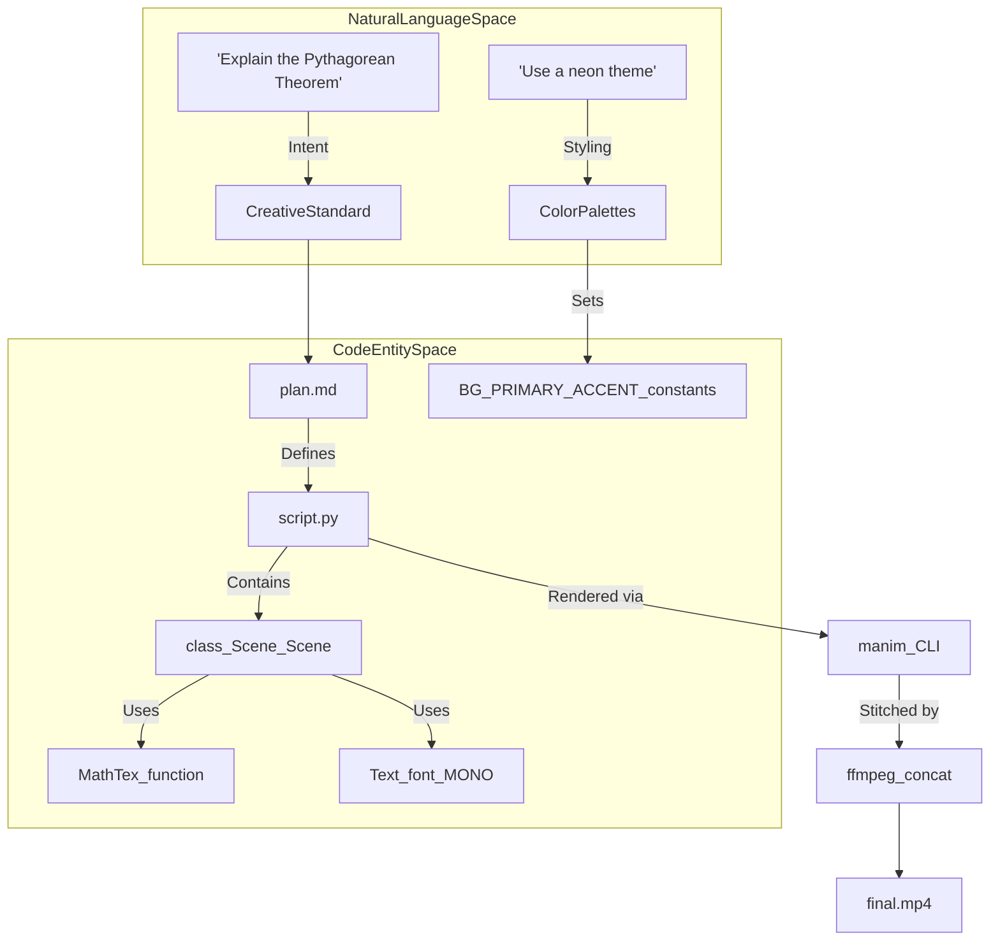

<!-- source: DeepWiki mcp.deepwiki.com · repo browser-use/video-use · page 4 Manim Video Sub-Skill · fetched 2026-10-30 -->

# Manim Video Sub-Skill

Relevant source files

The following files were used as context for generating this wiki page:

- [pyproject.toml](pyproject.toml)
- [skills/manim-video/README.md](skills/manim-video/README.md)
- [skills/manim-video/SKILL.md](skills/manim-video/SKILL.md)

The `manim-video` skill is a specialized sub-agent within the `video-use` ecosystem designed for the programmatic generation of mathematical, technical, and algorithmic animations [skills/manim-video/SKILL.md:1-5](). It leverages the **Manim Community Edition** engine to produce high-quality, 3Blue1Brown-style educational content where every frame is intended to reveal underlying structures through geometric intuition [skills/manim-video/SKILL.md:9-11]().

Unlike the core `video-use` editor which manipulates existing footage, the Manim sub-skill generates video from scratch using Python scripts, LaTeX for equations, and ffmpeg for final assembly [skills/manim-video/SKILL.md:41-50]().

## System Integration and Purpose

The skill acts as a technical explainer engine. It is invoked when a user requests visualizations of abstract concepts that cannot be easily filmed, such as neural network architectures, mathematical proofs, or data structures [skills/manim-video/README.md:9-15](). It is defined as an optional dependency in the core project [pyproject.toml:14-15]().

### Core Use Cases
| Mode | Input | Output | Reference |
| :--- | :--- | :--- | :--- |
| **Concept Explainer** | Topic/Concept | Animated geometric intuition | `references/scene-planning.md` [skills/manim-video/SKILL.md:33]() |
| **Equation Derivation** | Math expressions | Step-by-step animated proof | `references/equations.md` [skills/manim-video/SKILL.md:34]() |
| **Algorithm Visualization** | Logic description | Execution of data structures | `references/graphs-and-data.md` [skills/manim-video/SKILL.md:35]() |
| **Architecture Diagram** | System description | Building components and connections | `references/mobjects.md` [skills/manim-video/SKILL.md:37]() |

### Natural Language to Code Entity Mapping

The following diagram illustrates how high-level creative requirements are mapped to specific technical entities within the `manim-video` skill.

**Creative-to-Code Mapping**

Sources: [skills/manim-video/SKILL.md:52-75](), [skills/manim-video/SKILL.md:141-155]()

## The Manim Pipeline

The production of a Manim video follows a rigid linear pipeline to ensure "First-render excellence" [skills/manim-video/SKILL.md:17-18](). The process transitions from a narrative `plan.md` to a single `script.py` containing multiple scene classes, which are then rendered and stitched [skills/manim-video/SKILL.md:52-56]().

**Production Flow**

Sources: [skills/manim-video/SKILL.md:52-63](), [skills/manim-video/SKILL.md:67-75]()

For a detailed breakdown of the production stages, creative constraints (such as the mandatory use of monospace fonts and specific opacity layering), and the `setup.sh` environment verification, see **[Manim Pipeline and Creative Standards](#4.1)**.

## Reference Library and Capabilities

The skill includes an extensive reference library that the LLM agent uses to construct complex scenes. This library covers everything from basic `Mobjects` to advanced `updaters` and 3D camera manipulations [skills/manim-video/SKILL.md:31-39]().

Key technical components include:
*   **Typography**: Mandatory use of `MONO` fonts (e.g., "Menlo") to avoid Pango kerning issues [skills/manim-video/SKILL.md:111-119]().
*   **Attention Layering**: Using opacity (1.0 for primary, 0.15 for structural) to guide the viewer's eye [skills/manim-video/SKILL.md:19]().
*   **Timing**: Standardized `run_time` and `self.wait()` intervals to provide "breathing room" for the audience [skills/manim-video/SKILL.md:21-22](), [skills/manim-video/SKILL.md:88-97]().

For the complete technical API and implementation guides covering animations, equations, and 3D visualization, see **[Manim Reference Library](#4.2)**.

## Project Structure

Every `manim-video` project is self-contained within a directory, following this convention:
*   `plan.md`: The narrative and visual roadmap including scene breakdowns and voiceover scripts [skills/manim-video/SKILL.md:69]().
*   `script.py`: The source code containing all scene classes, where each class is independently renderable [skills/manim-video/SKILL.md:70](), [skills/manim-video/SKILL.md:139]().
*   `concat.txt`: The instruction file for `ffmpeg` to merge individual scene renders [skills/manim-video/SKILL.md:71]().
*   `final.mp4`: The final stitched output [skills/manim-video/SKILL.md:72]().
*   `media/`: The auto-generated output directory for Manim renders [skills/manim-video/SKILL.md:73]().

Sources: [skills/manim-video/README.md:1-24](), [skills/manim-video/SKILL.md:1-155](), [pyproject.toml:14-15]()

---

