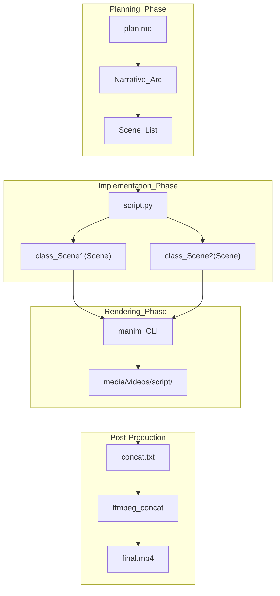
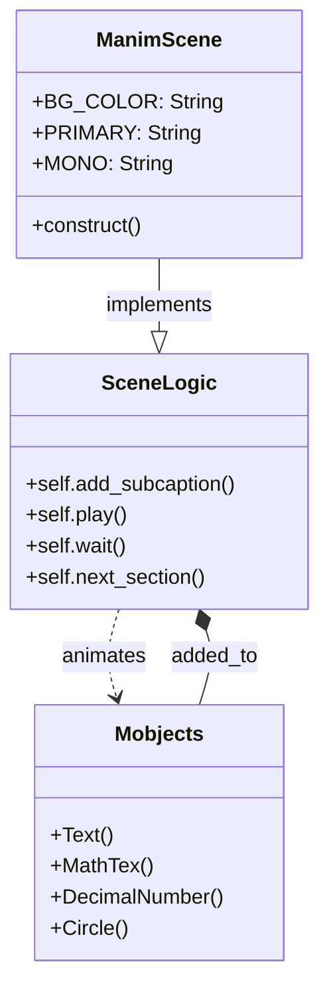

<!-- source: DeepWiki mcp.deepwiki.com · repo browser-use/video-use · page 4.1 Manim Pipeline and Creative Standards · fetched 2026-10-30 -->

# Manim Pipeline and Creative Standards

<details>
<summary>Relevant source files</summary>

The following files were used as context for generating this wiki page:

- [skills/manim-video/SKILL.md](skills/manim-video/SKILL.md)
- [skills/manim-video/references/production-quality.md](skills/manim-video/references/production-quality.md)
- [skills/manim-video/references/rendering.md](skills/manim-video/references/rendering.md)
- [skills/manim-video/references/scene-planning.md](skills/manim-video/references/scene-planning.md)
- [skills/manim-video/scripts/setup.sh](skills/manim-video/scripts/setup.sh)

</details>


The `manim-video` skill provides a production pipeline for creating high-quality, mathematical, and technical animations using the Manim Community Edition. It is designed to produce "educational cinema" where every frame reveals structure and follows the pedagogical style popularized by 3Blue1Brown [skills/manim-video/SKILL.md:1-11]().

## Prerequisites and Setup

Before initiating the pipeline, the environment must be validated for mathematical rendering and video processing dependencies.

### Dependency Checker (`setup.sh`)
The `scripts/setup.sh` utility verifies the presence of the following core components:
*   **Python 3.10+**: The base runtime.
*   **Manim Community Edition (v0.20+)**: The animation engine.
*   **LaTeX (pdflatex)**: Required for rendering equations via `MathTex`.
*   **ffmpeg**: Required for scene stitching, audio muxing, and format conversion.

[skills/manim-video/scripts/setup.sh:1-15](), [skills/manim-video/SKILL.md:25-27]()

## The Production Pipeline

The Manim workflow follows a linear progression from narrative planning to final review.

### Pipeline Stages
1.  **PLAN**: Define the narrative arc and visual elements in `plan.md` [skills/manim-video/SKILL.md:58-58]().
2.  **CODE**: Implement the logic in `script.py` with one class per scene [skills/manim-video/SKILL.md:59-59]().
3.  **RENDER**: Execute `manim` commands (`-ql` for draft, `-qh` for production) [skills/manim-video/SKILL.md:60-60]().
4.  **STITCH**: Concatenate individual scene clips into `final.mp4` using `ffmpeg` and a `concat.txt` file [skills/manim-video/SKILL.md:61-61]().
5.  **AUDIO**: (Optional) Mux voiceover or background music using `ffmpeg` or the `manim-voiceover` plugin [skills/manim-video/SKILL.md:62-62](), [skills/manim-video/references/rendering.md:134-153]().
6.  **REVIEW**: Compare rendered output against the original plan and adjust [skills/manim-video/SKILL.md:63-63]().

[skills/manim-video/SKILL.md:52-63]()

### Project Structure
A standard project directory is organized as follows:
```text
project-name/
  plan.md                # Narrative arc, scene breakdown
  script.py              # All scenes in one file
  concat.txt             # ffmpeg scene list for stitching
  final.mp4              # Stitched output
  media/                 # Manim-generated assets
```
[skills/manim-video/SKILL.md:65-75]()

## Creative Standards and Direction

The skill enforces strict aesthetic and pedagogical standards to ensure "First-render excellence" [skills/manim-video/SKILL.md:17-17]().

### Opacity Layering and Attention
Visual salience is managed through opacity layers to prevent cognitive overload:
*   **Primary Elements**: `1.0` opacity.
*   **Contextual Elements**: `0.4` opacity.
*   **Structural Elements (Axes/Grids)**: `0.15` opacity.

[skills/manim-video/SKILL.md:19-19](), [skills/manim-video/references/production-quality.md:130-133]()

### Typography and Fonts
To avoid kerning issues with Manim's Pango renderer, **monospace fonts** (e.g., "Menlo") must be used for all text [skills/manim-video/SKILL.md:109-111]().

| Role | Font Size | Usage |
| :--- | :--- | :--- |
| Title | 48 | Scene openings |
| Heading | 36 | Section headers |
| Body | 30 | Explanatory text |
| Label | 24 | Annotations, axis labels |
| Caption | 20 | Subtitles |

[skills/manim-video/SKILL.md:99-108](), [skills/manim-video/references/production-quality.md:43-58]()

### Animation Timing
Every animation requires a "breathing room" pause using `self.wait()` to allow the viewer to absorb information [skills/manim-video/SKILL.md:21-21]().

| Context | `run_time` | `self.wait()` after |
| :--- | :--- | :--- |
| Key equation reveal | 2.0s | 2.0s |
| Transform/morph | 1.5s | 1.5s |
| "Aha moment" | 2.5s | 3.0s |
| FadeOut cleanup | 0.5s | 0.3s |

[skills/manim-video/SKILL.md:88-97]()

## Technical Implementation

### Pipeline Flow Diagram
This diagram maps the conceptual pipeline stages to the specific files and tools used in the `manim-video` skill.

Title: Manim Production Data Flow

Sources: [skills/manim-video/SKILL.md:52-75](), [skills/manim-video/references/scene-planning.md:85-118](), [skills/manim-video/references/rendering.md:31-46]()

### Spatial Layout and Coordinate System
The visible frame in a standard 16:9 aspect ratio is approximately 14.2 units wide by 8.0 units tall.

| Zone | Coordinate Range |
| :--- | :--- |
| **Usable Area** | x: [-6.5, 6.5], y: [-3.5, 3.5] |
| **Top Title Zone** | y: [2.5, 3.5] |
| **Bottom Note Zone** | y: [-3.5, -2.5] |
| **Main Content** | y: [-2.5, 2.5], x: [-6.0, 6.0] |

[skills/manim-video/references/production-quality.md:60-71]()

### Scene Logic Entity Mapping
This diagram bridges the natural language concepts of a "Scene" to the code entities required in `script.py`.

Title: Scene Entity Mapping

Sources: [skills/manim-video/SKILL.md:141-160](), [skills/manim-video/references/production-quality.md:155-163](), [skills/manim-video/references/rendering.md:118-129]()

## Quality Enforcement

### Hard Rules for Production
*   **No Overlap**: Use `buff >= 0.5` for `.to_edge()` calls to prevent clipping [skills/manim-video/references/production-quality.md:17-22]().
*   **Max Elements**: Limit to 6 actively visible elements per scene to maintain clarity [skills/manim-video/references/production-quality.md:83-87]().
*   **Clean Exits**: Every scene must end with a `FadeOut` of all mobjects [skills/manim-video/references/production-quality.md:115-117]().
*   **Width Enforcement**: Long text strings must be scaled to fit `config.frame_width - 1.0` [skills/manim-video/references/production-quality.md:32-42]().
*   **Consistency**: Use shared constants for colors (e.g., `PRIMARY`, `SECONDARY`) and fonts (`MONO`) across all scenes [skills/manim-video/references/scene-planning.md:49-59]().

### Narrative Arcs
The `plan.md` should follow one of the established narrative structures:
*   **Discovery Arc**: Hook → Intuition → Formalize → Reveal → Extend [skills/manim-video/references/scene-planning.md:5-10]().
*   **Problem-Solution Arc**: Problem → Failed Attempt → Key Insight → Solution → Result [skills/manim-video/references/scene-planning.md:12-18]().
*   **Comparison Arc**: Setup → Approach A → Approach B → Contrast → Verdict [skills/manim-video/references/scene-planning.md:19-25]().
*   **Build-Up Arc**: Component A → Component B → Connection → Scale → Full Picture [skills/manim-video/references/scene-planning.md:26-32]().

Sources:
* `skills/manim-video/SKILL.md`
* `skills/manim-video/references/production-quality.md`
* `skills/manim-video/references/scene-planning.md`
* `skills/manim-video/references/rendering.md`
* `skills/manim-video/scripts/setup.sh`

---

