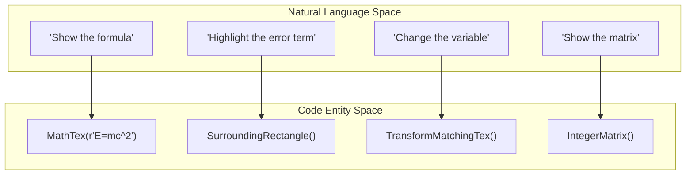
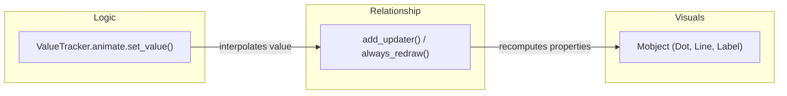

<!-- source: DeepWiki mcp.deepwiki.com · repo browser-use/video-use · page 4.2 Manim Reference Library · fetched 2026-10-30 -->

# Manim Reference Library

Relevant source files

The following files were used as context for generating this wiki page:

- [skills/manim-video/references/animation-design-thinking.md](skills/manim-video/references/animation-design-thinking.md)
- [skills/manim-video/references/animations.md](skills/manim-video/references/animations.md)
- [skills/manim-video/references/camera-and-3d.md](skills/manim-video/references/camera-and-3d.md)
- [skills/manim-video/references/decorations.md](skills/manim-video/references/decorations.md)
- [skills/manim-video/references/equations.md](skills/manim-video/references/equations.md)
- [skills/manim-video/references/graphs-and-data.md](skills/manim-video/references/graphs-and-data.md)
- [skills/manim-video/references/mobjects.md](skills/manim-video/references/mobjects.md)
- [skills/manim-video/references/paper-explainer.md](skills/manim-video/references/paper-explainer.md)
- [skills/manim-video/references/troubleshooting.md](skills/manim-video/references/troubleshooting.md)
- [skills/manim-video/references/updaters-and-trackers.md](skills/manim-video/references/updaters-and-trackers.md)
- [skills/manim-video/references/visual-design.md](skills/manim-video/references/visual-design.md)

The Manim Reference Library provides a comprehensive guide for the programmatic animation engine used within the `manim-video` sub-skill. It covers the technical implementation of animations, mathematical objects (mobjects), visual design standards, and the specialized workflows required for research paper explainers and data visualization.

## Animation Design Thinking

Effective animation in `manim-video` requires a shift from static diagramming to temporal storytelling. The core philosophy is to use motion only when it reduces cognitive load or explains a sequence that unfolds over time [skills/manim-video/references/animation-design-thinking.md:5-14]().

### The Production Pipeline
1.  **Narration First**: Write the full script before code to determine order, duration, and visual beats [skills/manim-video/references/animation-design-thinking.md:26-34]().
2.  **Identify Visual Beats**: A "beat" is a moment of change (e.g., an object appearing, a transformation). Each beat typically maps to a `self.play()` call [skills/manim-video/references/animation-design-thinking.md:35-47]().
3.  **Synchronization**: The "see then hear" principle dictates that visuals should appear slightly before the narration describes them to prime the viewer's brain [skills/manim-video/references/animation-design-thinking.md:90-93]().

### Design Patterns
*   **Dim and Reveal**: For complex equations, show the full destination at low opacity (0.2) and highlight terms one by one as they are explained [skills/manim-video/references/animation-design-thinking.md:108-117]().
*   **Zoom-and-Return**: For complex architectures, show the overview, zoom into a specific box to expand its internals, then zoom back out [skills/manim-video/references/animation-design-thinking.md:145-153]().

**Sources**: [skills/manim-video/references/animation-design-thinking.md:5-153]()

---

## Core Animations and Mobjects

In Manim, everything visible is a `Mobject`. Animations are objects passed to `self.play()` that compute intermediate states over time [skills/manim-video/references/animations.md:3-7]().

### Mobject Hierarchy
| Category | Entities | Usage |
| :--- | :--- | :--- |
| **Basic Shapes** | `Circle`, `Square`, `Dot`, `Line` | Foundational geometry [skills/manim-video/references/mobjects.md:27-36](). |
| **Text/Math** | `Text`, `MathTex`, `Tex`, `MarkupText` | `MathTex` is a `VMobject`; `Text` is a standard `Mobject` [skills/manim-video/references/mobjects.md:7-21](). |
| **Groups** | `VGroup`, `Group` | `VGroup` is for `VMobjects` only. Use `Group` if mixing `Text` with shapes [skills/manim-video/references/mobjects.md:94-113](). |
| **Specialized** | `BarChart`, `Axes`, `Code`, `Table` | High-level data and code visualization [skills/manim-video/references/mobjects.md:129-135](). |
| **Complex UI** | `IntegerMatrix`, `Variable`, `BulletedList` | Dynamic UI-like elements [skills/manim-video/references/mobjects.md:148-220](). |

### Animation Types
*   **Creation**: `Create()`, `Write()`, `FadeIn()`, `GrowFromCenter()`, `DrawBorderThenFill()` [skills/manim-video/references/animations.md:9-17]().
*   **Transformations**: `Transform(A, B)` modifies A to look like B. `ReplacementTransform(A, B)` removes A and replaces it with B. `FadeTransform` is preferred for dissimilar shapes [skills/manim-video/references/animations.md:27-45](), [skills/manim-video/references/animations.md:188-208]().
*   **Reactive**: `always_redraw()` rebuilds a mobject every frame, essential for objects whose geometry depends on other moving parts [skills/manim-video/references/animations.md:149-164]().
*   **Movement**: `MoveAlongPath()`, `Rotate()`, `Rotating()` [skills/manim-video/references/animations.md:62-76]().

**Sources**: [skills/manim-video/references/animations.md:3-208](), [skills/manim-video/references/mobjects.md:7-220]()

---

## Equations and Mathematical Visualization

`MathTex` is the primary interface for LaTeX rendering. It supports selective coloring, incremental building, and smart morphing via `TransformMatchingTex` [skills/manim-video/references/equations.md:1-42]().

### Complex Equation Logic
To animate dense equations, use `substrings_to_isolate`. This allows Manim to track individual LaTeX tokens as separate submobjects for coloring or targeted transformations [skills/manim-video/references/equations.md:133-153]().

### System-to-Code Mapping: Mathematical Entities
The following diagram bridges the conceptual mathematical requirements to the specific Manim classes used in the library.

**Diagram: Math Entity Mapping**

**Sources**: [skills/manim-video/references/equations.md:6-186](), [skills/manim-video/references/decorations.md:5-30]()

---

## Data Visualization and Graphs

Manim provides high-level mobjects for coordinate systems and data storytelling.

*   **Axes**: Created with `x_range` and `y_range`. Supports `axes.plot()` for functions and `axes.get_area()` for integrals [skills/manim-video/references/graphs-and-data.md:3-21]().
*   **Graph Theory**: `Graph` and `DiGraph` support automatic layouts like `spring`, `circular`, and `tree` [skills/manim-video/references/graphs-and-data.md:93-125]().
*   **Vector Fields**: `ArrowVectorField` and `StreamLines` visualize particle flow and gradients [skills/manim-video/references/graphs-and-data.md:126-148]().
*   **Planes**: `ComplexPlane` and `PolarPlane` for complex and polar coordinate visualization [skills/manim-video/references/graphs-and-data.md:150-164]().

**Sources**: [skills/manim-video/references/graphs-and-data.md:3-164]()

---

## Camera, 3D, and Updaters

Advanced scenes utilize camera movement and persistent relationships between objects.

### Camera Control
*   **MovingCameraScene**: Allows panning and zooming of the 2D frame via `self.camera.frame.animate` [skills/manim-video/references/camera-and-3d.md:3-25]().
*   **ThreeDScene**: Enables 3D orientation (`phi`, `theta`), 3D mobjects like `Sphere` or `Cube`, and ambient rotation [skills/manim-video/references/camera-and-3d.md:27-58]().
*   **ZoomedScene**: Provides an inset zoom display for magnifying specific details [skills/manim-video/references/camera-and-3d.md:78-108]().

### Continuous Relationships (Updaters)
Updaters solve the problem of discrete animations by declaring a relationship once. Manim enforces it every frame [skills/manim-video/references/updaters-and-trackers.md:3-9]().

*   **ValueTracker**: An invisible float used to "steer" visible objects. Dependent objects read the tracker value inside an `add_updater` or `always_redraw` call [skills/manim-video/references/updaters-and-trackers.md:11-48]().

**Diagram: Data Flow for Updaters**

**Sources**: [skills/manim-video/references/camera-and-3d.md:3-108](), [skills/manim-video/references/updaters-and-trackers.md:3-119]()

---

## Visual Design and Paper Explainers

### Visual Design Principles
Manim videos must adhere to specific design standards to ensure clarity and professional aesthetics:
*   **Opacity Layering**: Primary elements at 1.0, context at 0.4, and structural elements (grids) at 0.15 [skills/manim-video/references/visual-design.md:6]().
*   **Monospace Fonts**: Use `"Menlo"` or `"JetBrains Mono"` for all text to avoid Pango kerning issues [skills/manim-video/references/visual-design.md:61-73]().
*   **Geometry Before Algebra**: Always show the visual shape before introducing the corresponding equation [skills/manim-video/references/visual-design.md:5]().

### Paper Explainer Workflow
Translating research papers into video involves extracting core insights and following a structured template:
1.  **Hook (30s)**: Surprising result [skills/manim-video/references/paper-explainer.md:29]().
2.  **Problem (60s)**: What was missing [skills/manim-video/references/paper-explainer.md:30]().
3.  **Key Insight (90s)**: Core visual idea [skills/manim-video/references/paper-explainer.md:31]().
4.  **Progressive Build**: Architecture diagrams should build component-by-component rather than appearing all at once [skills/manim-video/references/paper-explainer.md:142-150]().

**Sources**: [skills/manim-video/references/visual-design.md:3-125](), [skills/manim-video/references/paper-explainer.md:1-200]()

---

## Rendering and Troubleshooting

### Rendering Modes
Manim uses CLI flags to control output quality during development and final production.
*   `-ql`: Low quality (480p, 15fps) for fast iteration [skills/manim-video/references/troubleshooting.md:109-111]().
*   `-qh`: High quality (1080p, 60fps) for final output [skills/manim-video/references/troubleshooting.md:109]().
*   `-s`: Render a single still frame of the scene [skills/manim-video/references/troubleshooting.md:131]().

### Common Issues
*   **LaTeX Missing Raw String**: Forgetting the `r` in `r"\frac{1}{2}"` is the #1 error [skills/manim-video/references/troubleshooting.md:5-9]().
*   **VGroup TypeError**: Mixing `Text()` (Mobject) with shapes (VMobjects) in a `VGroup` fails. Use `Group` for mixed collections [skills/manim-video/references/troubleshooting.md:22-42]().
*   **Invisible Animations**: A mobject must be added to the scene (`self.add()` or `self.play(Create())`) before its properties can be animated [skills/manim-video/references/troubleshooting.md:86-90]().
*   **Group save_state()**: `Group` does not support `save_state()` or `restore()`; use individual `VMobjects` or `VGroup` for these operations [skills/manim-video/references/troubleshooting.md:49-67]().

**Sources**: [skills/manim-video/references/troubleshooting.md:1-136]()

---

