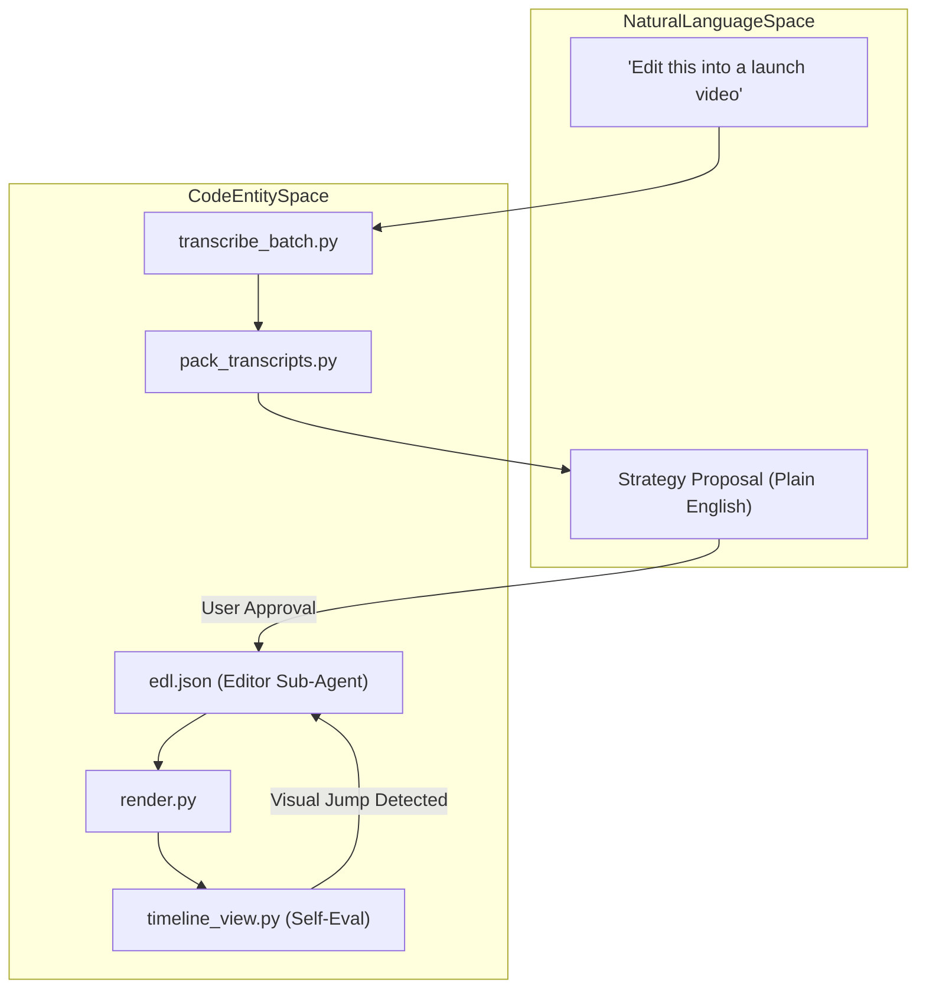
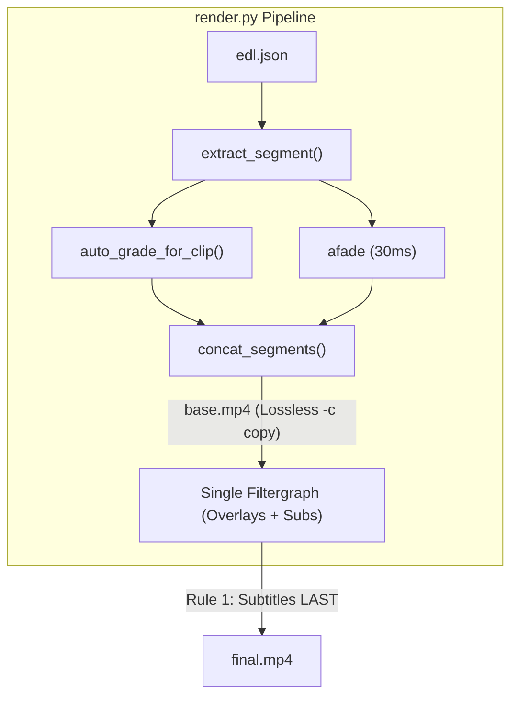

<!-- source: DeepWiki mcp.deepwiki.com · repo browser-use/video-use · page 5 Glossary · fetched 2026-10-30 -->

# Glossary

Relevant source files

The following files were used as context for generating this wiki page:

- [README.md](README.md)
- [SKILL.md](SKILL.md)
- [helpers/grade.py](helpers/grade.py)
- [helpers/pack_transcripts.py](helpers/pack_transcripts.py)
- [helpers/render.py](helpers/render.py)
- [helpers/timeline_view.py](helpers/timeline_view.py)
- [helpers/transcribe.py](helpers/transcribe.py)
- [skills/manim-video/SKILL.md](skills/manim-video/SKILL.md)
- [static/timeline-view.svg](static/timeline-view.svg)

This page provides technical definitions for terms, jargon, and domain concepts specific to the `video-use` codebase. It serves as a reference for onboarding engineers to understand how natural language requests translate into specific code entities and data structures.

## Purpose and Scope
The `video-use` system bridges the gap between high-level editorial intent (e.g., "make this more cinematic") and low-level media manipulation (FFmpeg filtergraphs). This glossary defines the core objects and processes used to maintain production-grade correctness while allowing the LLM artistic freedom.

---

## Core Pipeline Concepts

### EDL (Edit Decision List)
The central data structure that defines the final video. It is a JSON object produced by the editor sub-agent.
*   **Implementation:** The EDL contains `sources` (mapping names to file paths), `ranges` (start/end timestamps in source files), and global/per-segment metadata like `grade` or `overlays`.
*   **Code Pointers:** 
    *   Schema usage in `render.py`: [helpers/render.py:197-202]()
    *   Resolution of paths: [helpers/render.py:87-92]()
*   **Hard Rule:** Never touch the cut until the user has approved the plain-English strategy that informs the EDL [SKILL.md:32-32]().

### Takes Packed View (`takes_packed.md`)
A Markdown-formatted, phrase-level representation of all source videos. It is the LLM's primary "reading" view of the footage.
*   **Implementation:** Generated by `pack_transcripts.py`. It groups word-level timestamps from Scribe into phrases based on a silence threshold (default 0.5s) [helpers/pack_transcripts.py:3-7]().
*   **Key Function:** `group_into_phrases` [helpers/pack_transcripts.py:38-122]().
*   **Data Flow:** `Scribe JSON` → `group_into_phrases()` → `render_markdown()` → `takes_packed.md`.

### Timeline View (Visual Composite)
An on-demand PNG image combining a filmstrip, audio waveform, and transcript labels.
*   **Implementation:** Created by `timeline_view.py` using PIL and NumPy [helpers/timeline_view.py:30-32]().
*   **Purpose:** Used for "Two-Layer Perception"—the LLM uses the transcript for general flow and the `timeline_view` for surgical precision at cut points [README.md:69-83]().
*   **Code Pointers:** `render_timeline` [helpers/timeline_view.py:184-213]().

---

## Technical Jargon & Abbreviations

| Term | Definition | Code Reference |
| :--- | :--- | :--- |
| **ASR** | Automatic Speech Recognition. Specifically word-level verbatim output from ElevenLabs Scribe. | [SKILL.md:29-29]() |
| **Diarization** | The process of partitioning an audio stream into homogeneous segments according to the speaker identity. | [helpers/transcribe.py:66-66]() |
| **PTS Shift** | Presentation TimeStamp shifting. Required for overlays to ensure an animation starts at frame 0 when it appears mid-video. | [SKILL.md:25-25](), [helpers/render.py:7-9]() |
| **Hard Rules** | Non-negotiable production standards (e.g., 30ms audio fades) that prevent "silent failures" like audio pops. | [SKILL.md:18-33]() |
| **SignalStats** | FFmpeg filter used to mathematically analyze frames for auto-grading. | [helpers/grade.py:8-12](), [helpers/grade.py:86-88]() |
| **Tone Mapping** | Converting HDR (HLG/PQ) sources to Rec.709 SDR to prevent blown-out colors on standard players. | [helpers/render.py:95-117]() |

---

## System Architecture Diagrams

### From Natural Language to Code Execution
The following diagram maps the conceptual "Editor" workflow to the specific Python entities that handle each stage.

**Editor Workflow Mapping**

**Sources:** [README.md:92-96](), [SKILL.md:83-90]()

### Rendering Pipeline Logic
This diagram details the `render.py` execution flow, specifically how it adheres to the "Hard Rules" regarding segment extraction and concatenation.

**Render Execution Flow**

**Sources:** [helpers/render.py:3-13](), [SKILL.md:22-26](), [helpers/grade.py:178-183]()

---

## Implementation Details

### Audio Fades (Rule 3)
To prevent audible pops at cut boundaries, the system enforces a 30ms fade-in and fade-out on every segment.
*   **Implementation:** Applied via the `afade` filter in FFmpeg during the extraction phase.
*   **Code Pointer:** `afade` string construction in `extract_segment` [helpers/render.py:170-172]().

### Auto-Grading (Heuristics)
The system can mathematically "normalize" footage without applying creative LUTs.
*   **Implementation:** `_sample_frame_stats` uses the `signalstats` filter to calculate `YAVG` (luma) and `SATAVG` (saturation) [helpers/grade.py:86-94]().
*   **Logic:** Adjustments are capped at ±8% on any axis to ensure the video looks "clean" rather than "processed" [helpers/grade.py:12-16]().

### Project Memory (`project.md`)
A persistent log file stored in the user's `<videos_dir>/edit/` directory.
*   **Purpose:** Stores session context, reasoning, and approved strategies so that the LLM can resume work across multiple sessions [README.md:19-19]().
*   **Code Pointer:** [SKILL.md:45-45]()

### Quality Ladder
The rendering pipeline supports different quality modes to balance speed and accuracy during the editing loop.
*   **Draft:** 720p, `ultrafast` preset, CRF 28 (for cut-point checks) [helpers/render.py:153-154]().
*   **Preview:** 1080p, `medium` preset, CRF 22 (for quality control) [helpers/render.py:152-152]().
*   **Final:** 1080p, `fast` preset, CRF 20 (production output) [helpers/render.py:151-151]().

**Sources:**
- [README.md:13-19](), [README.md:69-83](), [README.md:92-96]()
- [SKILL.md:18-33](), [SKILL.md:45-45](), [SKILL.md:83-90]()
- [helpers/render.py:1-20](), [helpers/render.py:87-92](), [helpers/render.py:170-172](), [helpers/render.py:197-202]()
- [helpers/grade.py:1-26](), [helpers/grade.py:86-94](), [helpers/grade.py:178-183]()
- [helpers/pack_transcripts.py:1-14](), [helpers/pack_transcripts.py:38-122]()
- [helpers/timeline_view.py:1-12](), [helpers/timeline_view.py:30-32](), [helpers/timeline_view.py:184-213]()