# Page: Overview

# Overview

<details>
<summary>Relevant source files</summary>

The following files were used as context for generating this wiki page:

- [README.md](README.md)
- [poster.html](poster.html)
- [static/video-use-banner.png](static/video-use-banner.png)

</details>


Introducing **video-use** — a high-level framework for editing videos using Claude Code. It allows users to drop raw footage into a folder, chat with an LLM agent, and receive a production-ready `final.mp4`. [README.md:5-9]()

The system is designed for diverse content types, including talking heads, tutorials, interviews, and montages. It replaces traditional manual editing interfaces with a natural language conversation that drives a robust Python-based rendering and analysis pipeline. [README.md:9-19]()

## Core Philosophy: The LLM as Editor

The fundamental design principle of `video-use` is that the **LLM never watches the video; it reads it**. This is achieved through a "Two-Layer Perception" model that bridges the gap between raw pixels and semantic understanding. [README.md:69-70]()

1.  **Layer 1: Audio Transcript (The Surface):** The system uses the ElevenLabs Scribe API to generate word-level timestamps, speaker diarization, and audio event detection (e.g., laughter, applause). This data is packed into a compact Markdown format (`takes_packed.md`) that fits within LLM context windows. [README.md:75-81]()
2.  **Layer 2: Visual Composite (The Drill-down):** When the LLM needs visual context—such as checking for jump cuts, evaluating a speaker's expression, or verifying an overlay—it generates on-demand visual composites using `timeline_view.py`. [README.md:83-84]()

### Design Principles
*   **Audio is Primary:** Cuts are derived from speech boundaries and silence gaps. [README.md:103-103]()
*   **Human-in-the-Loop:** The agent follows an **Ask → Confirm → Execute → Self-Eval → Persist** cycle. It never modifies a cut without strategy approval. [README.md:104-104]()
*   **Production Correctness:** While the LLM has artistic freedom, the system enforces 12 "Hard Rules" (e.g., 30ms audio fades, PTS shifting for overlays) to ensure technical quality. [README.md:106-108]()

**Sources:** [README.md:67-108](), [poster.html:41-46]()

---

## System Workflow

The following diagram illustrates how the system transitions from Natural Language instructions to Code Entities and back to a verified video file.

### Pipeline: From Natural Language to final.mp4

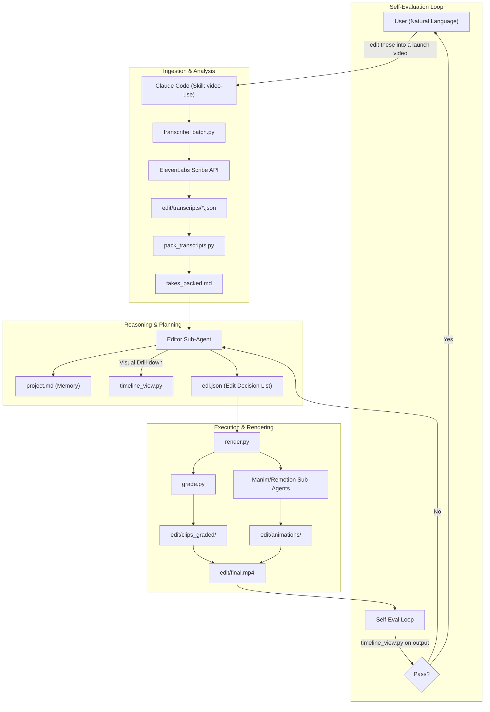
**Sources:** [README.md:90-98](), [README.md:13-19]()

---

## Major Subsystems

### 1. Ingestion and Transcription
The pipeline begins by inventorying source files and generating word-level transcripts. The system caches these transcripts to avoid redundant API calls. [README.md:75-76]()
*   **Key Files:** `transcribe.py`, `transcribe_batch.py`, `pack_transcripts.py`.
*   For details, see [Transcription and Ingestion](#2.1) and [Transcript Packing (takes_packed.md)](#2.2).

### 2. Timeline Visualization
To allow the LLM to "see" the video without processing millions of frames, `timeline_view.py` generates a composite PNG containing a filmstrip, audio waveform, and word labels. [README.md:83-88]()
*   **Key Files:** `timeline_view.py`.
*   For details, see [Timeline View (Visual Composite Generator)](#2.3).

### 3. The Rendering Engine
The rendering engine processes the `edl.json` produced by the LLM. It performs per-segment extraction, applies color grading, handles audio fades to prevent pops, and burns subtitles. [README.md:13-16]()
*   **Key Files:** `render.py`, `grade.py`.
*   For details, see [Rendering Pipeline (render.py)](#2.4) and [Color Grading (grade.py)](#2.5).

### 4. Animation Sub-Agents
For complex overlays, the system can spawn parallel sub-agents to generate animations using Manim, Remotion, or HyperFrames. [README.md:17-17]()
*   **Key Files:** `skills/manim-video/`.
*   For details, see [Manim Video Sub-Skill](#4).

---

## Code Entity Map

This diagram bridges the conceptual subsystems to the specific file paths and data structures used in the codebase.

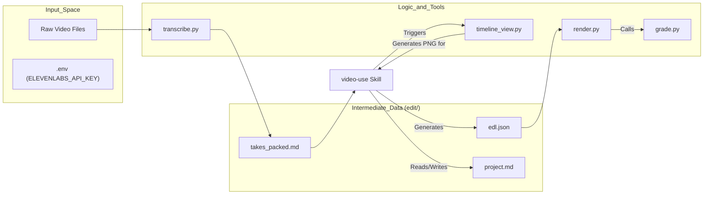
**Sources:** [README.md:44-44](), [README.md:62-65](), [README.md:75-84]()

## Next Steps
*   To set up the environment and integrate with Claude Code, see [Getting Started](#1.1).
*   To understand the mental model of "Two-Layer Perception" and the EDL format, see [Core Concepts and Terminology](#1.2).

---

# Page: Getting Started

# Getting Started

<details>
<summary>Relevant source files</summary>

The following files were used as context for generating this wiki page:

- [.env.example](.env.example)
- [.gitignore](.gitignore)
- [install.md](install.md)
- [pyproject.toml](pyproject.toml)

</details>


This page provides the technical setup instructions for `video-use`, a conversation-driven video editor designed to function as a skill for Claude Code. It covers environment configuration, dependency management, and the integration process required to enable the LLM to orchestrate video editing tasks.

## Prerequisites

Before installing the skill, ensure your environment meets the following requirements:

*   **Python 3.10+**: Required for core processing scripts [pyproject.toml:5-5]().
*   **FFmpeg & FFprobe**: Must be installed and available in your system `PATH`. These are hard requirements for the rendering pipeline and media inspection [install.md:51-53]().
*   **yt-dlp (Optional)**: Needed if you intend to pull video sources from URLs [install.md:51-53]().
*   **Claude Code / Codex**: The host environment for the skill [install.md:70-90]().

## Environment Configuration

The system relies on external APIs for transcription and audio processing. These must be configured via environment variables or a `.env` file at the repository root [install.md:18-19]().

1.  **API Keys**: Copy `.env.example` to `.env` [ .env.example:1-1]().
2.  **ElevenLabs**: Obtain an API key from ElevenLabs. This is used by the transcription engine (Scribe API) to generate word-level timestamps and speaker diarization [install.md:94-95]().

```bash
# .env file content
ELEVENLABS_API_KEY=your_api_key_here
```

The setup process includes a sanity check using a `curl` call to `https://api.elevenlabs.io/v1/user` to verify the key's validity before proceeding [install.md:118-124]().

*Sources: [.env.example:1-1](), [.gitignore:2-2](), [install.md:92-127]()*

## Installation and Dependencies

The project uses a standard Python structure defined in `pyproject.toml`.

### Core Dependencies
The following packages are required for visual analysis, audio processing, and timeline generation [pyproject.toml:6-12]():
*   `requests`: For API communication.
*   `librosa`: For audio analysis and waveform generation.
*   `matplotlib` & `pillow`: For generating the visual composite timeline views.
*   `numpy`: For numerical processing of audio and video frames.

### Installation Command
It is recommended to use `uv` for fast dependency resolution, falling back to `pip` if necessary [install.md:44-47]():
```bash
# Prefer uv if available
command -v uv >/dev/null && uv sync || pip install -e .
```

### Optional: Animation Support
If you intend to use the `manim-video` sub-skill for programmatic animations, you must install the optional `animations` dependencies [pyproject.toml:14-15]():
```bash
pip install ".[animations]"
```
This installs `manim`, which is required for the PLAN → CODE → RENDER pipeline. Note that HyperFrames or Remotion slots may additionally require Node.js 22+ [install.md:159-160]().

*Sources: [pyproject.toml:1-15](), [install.md:42-66]()*

## Integration as a Claude Code Skill

`video-use` is designed to be consumed by Claude Code or similar agents. The integration involves symlinking the entire repository directory into the agent's skills directory. This ensures that `SKILL.md` and the `helpers/` directory remain siblings, which is required for the skill to reference scripts by bare names [install.md:28-28]().

### Skill Setup Flow
The diagram below illustrates how the local `video-use` repository connects to the Claude Code environment and the external API services.

**System Integration Architecture**
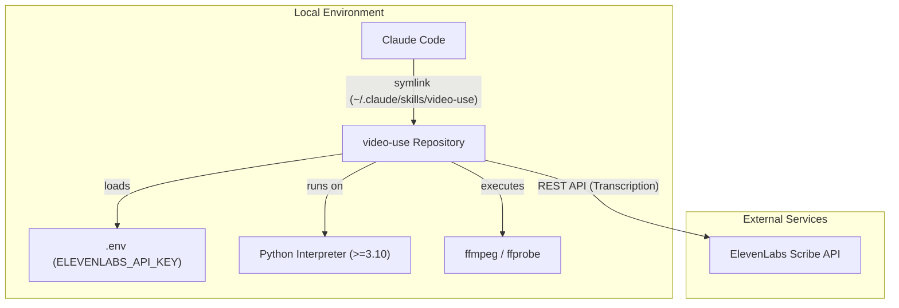
*Sources: [pyproject.toml:1-12](), [install.md:70-88](), [install.md:132-135]()*

### Implementation Data Flow

When the skill is invoked, the agent interacts with the `helpers/` scripts. The following diagram maps the natural language setup requirements to the specific code entities and configuration files.

**Initial Setup Data Flow**
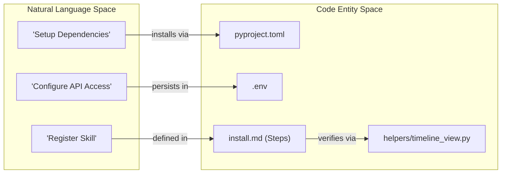
*Sources: [install.md:6-30](), [install.md:130-135](), [pyproject.toml:1-23](), [.env.example:1-1]()*

## Directory Conventions and Git Safety

The project includes a comprehensive `.gitignore` to prevent session-specific artifacts and secrets from being committed. When running the skill, the following directories and files are generated but ignored by version control:

| File/Directory | Purpose |
| :--- | :--- |
| `edit/` | Main output directory for project sessions [ .gitignore:46-46](). |
| `transcripts/` | Cached JSON results from ElevenLabs [ .gitignore:47-47](). |
| `takes_packed.md` | The LLM-readable view of the footage [ .gitignore:58-58](). |
| `edl.json` | The Edit Decision List defining the cut [ .gitignore:59-59](). |
| `project.md` | Persistent memory for the LLM agent [ .gitignore:60-60](). |
| `clips_preview/` | Intermediate preview-quality video segments [ .gitignore:50-50](). |

*Sources: [.gitignore:44-61](), [install.md:146-146]()*

---

# Page: Core Concepts and Terminology

# Core Concepts and Terminology

<details>
<summary>Relevant source files</summary>

The following files were used as context for generating this wiki page:

- [README.md](README.md)
- [SKILL.md](SKILL.md)
- [poster.html](poster.html)
- [static/timeline-view.svg](static/timeline-view.svg)

</details>


This page defines the foundational concepts and the mental model required to understand how `video-use` enables an LLM to edit video with professional precision. It covers the transition from raw footage to a structured "reading view," the execution model, and the self-correction loops that ensure production quality.

## Purpose and Scope

The core philosophy of `video-use` is that **the LLM never watches the video; it reads it.** By converting dense pixel data into structured text and on-demand visual composites, the system bypasses the context-window limitations of multi-modal models while maintaining frame-accurate control [README.md:67-69]().

---

## Two-Layer Perception

The system provides the LLM with two complementary views of the video data. This "Two-Layer Perception" mimics how a human editor uses a transcript to find content and a timeline to refine cuts.

### Layer 1: Audio Transcript (The Primary View)
Every source file is processed via the ElevenLabs Scribe API to produce a word-level transcript with metadata [README.md:75-75](). This data is "packed" into a human-readable Markdown format optimized for LLM context windows [README.md:75-81]().

*   **Key File:** `takes_packed.md` [SKILL.md:46-46]()
*   **Contents:** Word-level timestamps, speaker diarization, and audio events like `(laughter)` or `(applause)` [README.md:75-75]().
*   **Logic:** `pack_transcripts.py` segments the raw JSON into phrases based on a silence threshold (default ≥ 0.5s) [SKILL.md:76-76]().

### Layer 2: Visual Composite (On-Demand)
When the LLM needs to verify a visual detail—such as a jump cut, a facial expression, or a framing issue—it requests a visual composite [README.md:83-84]().

*   **Tool:** `timeline_view.py` [SKILL.md:77-77]()
*   **Contents:** A single PNG containing a filmstrip, audio waveform, word labels, and silence-gap candidates [README.md:71-73]().

### Perception Data Flow
The following diagram illustrates how raw video is transformed into these two layers for the LLM.

**Diagram: Natural Language Space to Code Entity Space (Perception)**

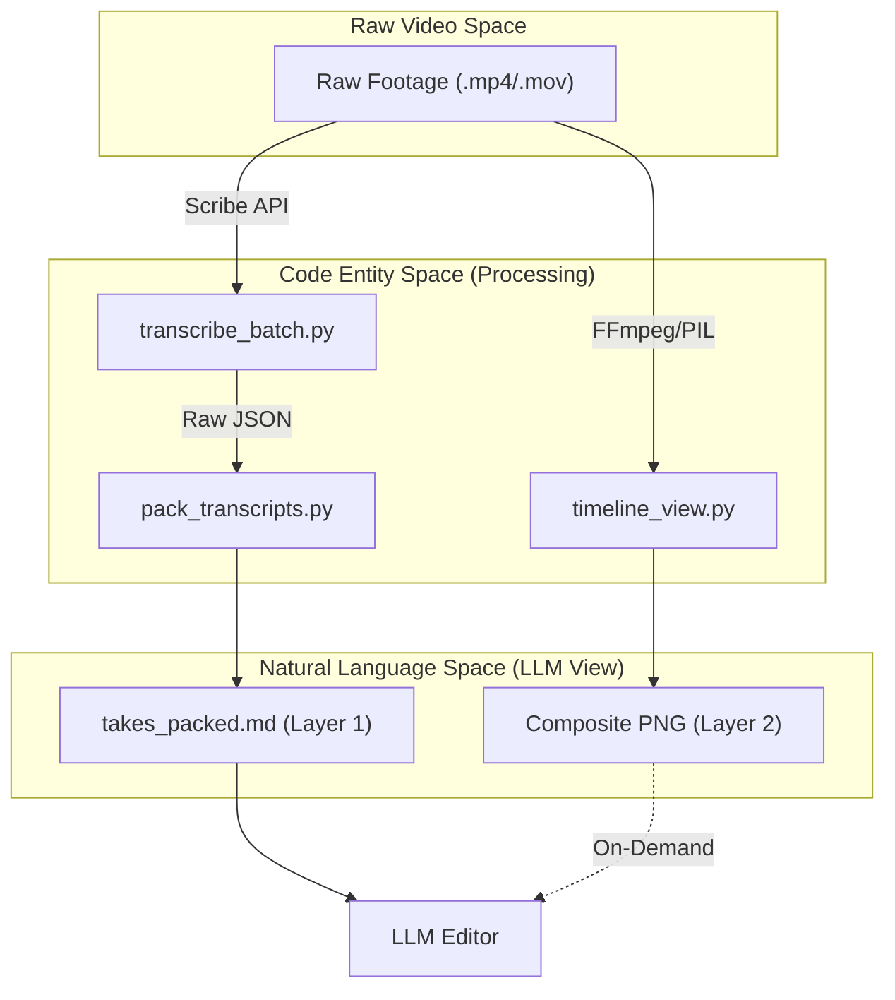
Sources: [README.md:67-88](), [SKILL.md:74-77](), [SKILL.md:46-49]()

---

## The LLM-as-Editor Model

The system operates as a conversation-driven engine where the LLM acts as the lead editor. It follows a strict "Ask → Confirm → Execute" loop to ensure the user retains creative control while the agent handles the technical implementation [SKILL.md:12-12]().

### Decision Making
The LLM uses `takes_packed.md` to identify "Cut Candidates" based on speech boundaries and silence gaps [SKILL.md:10-11](). It then proposes a strategy in plain English before generating any code or configuration [SKILL.md:32-32]().

### EDL-Based Execution
Once a strategy is confirmed, the agent produces an `edl.json` (Edit Decision List). This file acts as the source of truth for the rendering engine [SKILL.md:47-47]().

| Concept | Description | Code Entity |
| :--- | :--- | :--- |
| **Cut Craft** | Principles like "Never cut inside a word" and "30ms audio fades" [SKILL.md:24-27](). | `render.py` / `SKILL.md` |
| **EDL** | A JSON schema defining source ranges, grades, and overlays [SKILL.md:47-47](). | `edl.json` |
| **Parallelism** | Spawning sub-agents for heavy tasks like Manim animations [SKILL.md:31-31](). | `Agent` tool |

---

## The Self-Evaluation Loop

A critical concept in `video-use` is that the agent is responsible for verifying its own work before presenting it to the user [SKILL.md:16-16]().

After `render.py` produces a `preview.mp4`, the agent runs `timeline_view.py` on the **rendered output** at every cut boundary [README.md:98-98](). It looks for:
1.  **Visual Jumps:** Unexpected movement or framing changes at the cut [README.md:98-98]().
2.  **Audio Pops:** Waveform spikes that the 30ms fade failed to catch [README.md:98-98]().
3.  **Subtitle Violations:** Captions hidden by overlays [README.md:98-98]().

If issues are detected, the agent performs a "fix-and-re-render" cycle (up to 3 attempts) [README.md:93-96]().

---

## Mental Model: The Editing Pipeline

The following diagram bridges the conceptual "Natural Language" goals of the user with the "Code Entities" that execute them.

**Diagram: Natural Language Space to Code Entity Space (Execution)**

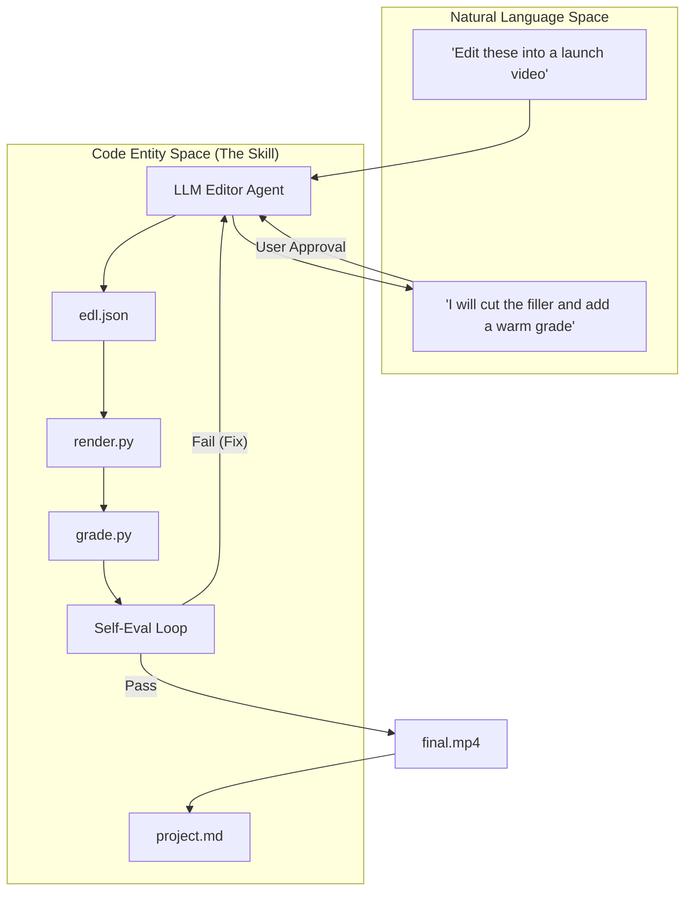
Sources: [README.md:90-96](), [SKILL.md:78-79](), [SKILL.md:45-47](), [SKILL.md:18-33]()

## Persistent Memory: project.md
To maintain state across multiple Claude Code sessions, the system uses `project.md` [SKILL.md:45-45](). This file stores the session history, reasoning, and approved strategies, allowing the LLM to resume work without re-analyzing the entire project from scratch [README.md:19-19]().

Sources:
- `README.md:19-19`
- `README.md:67-88`
- `README.md:90-96`
- `SKILL.md:10-12`
- `SKILL.md:16-16`
- `SKILL.md:18-33`
- `SKILL.md:45-49`
- `SKILL.md:74-79`

---

# Page: Architecture and Pipeline

# Architecture and Pipeline

<details>
<summary>Relevant source files</summary>

The following files were used as context for generating this wiki page:

- [README.md](README.md)
- [SKILL.md](SKILL.md)
- [poster.html](poster.html)

</details>


The **video-use** pipeline is designed around a "Text-First, Visuals-on-Demand" philosophy. Rather than forcing an LLM to process thousands of raw video frames, the system converts video into a structured, searchable text format (`takes_packed.md`) and provides high-density visual composites (`timeline_view.py`) only when specific visual decisions are required [README.md:67-89]().

The pipeline follows a linear progression from raw footage ingestion to a self-evaluated final render.

### System Data Flow

The following diagram illustrates the transformation of data from raw source files through the internal representations to the final output.

**Data Transformation Pipeline**
```mermaid
graph TD
    subgraph "Ingestion Phase"
        [Source_Footage] --> ["transcribe_batch.py"]
        ["transcribe_batch.py"] --> ["ElevenLabs_Scribe_API"]
        ["ElevenLabs_Scribe_API"] --> [Raw_JSON_Transcripts]
        [Raw_JSON_Transcripts] --> ["pack_transcripts.py"]
        ["pack_transcripts.py"] --> ["takes_packed.md"]
    end

    subgraph "Reasoning Phase"
        ["takes_packed.md"] --> [LLM_Editor_Agent]
        [LLM_Editor_Agent] --> ["timeline_view.py"]
        ["timeline_view.py"] --> [Visual_Composites_PNG]
        [Visual_Composites_PNG] --> [LLM_Editor_Agent]
        [LLM_Editor_Agent] --> ["edl.json"]
    end

    subgraph "Execution Phase"
        ["edl.json"] --> ["render.py"]
        ["render.py"] --> ["grade.py"]
        ["grade.py"] --> [Final_Render_MP4]
    end

    subgraph "Verification Phase"
        [Final_Render_MP4] --> [Self_Evaluation_Loop]
        [Self_Evaluation_Loop] --> ["timeline_view.py"]
        [Self_Evaluation_Loop] --> |"Issues found"| [LLM_Editor_Agent]
    end
```
**Sources:** [README.md:92-96](), [SKILL.md:83-91]()

---

### 1. Transcription and Ingestion
The pipeline begins by inventorying all source files and submitting them for transcription. This stage uses the **ElevenLabs Scribe API** to generate word-level timestamps, speaker diarization, and audio event tags like `(laughter)` [README.md:75-81](). Results are cached locally in the `edit/transcripts/` directory to prevent redundant API costs [SKILL.md:30-30]().

*   **Key Entities:** `transcribe.py`, `transcribe_batch.py`
*   **Output:** `edit/transcripts/<name>.json`
*   **For details, see [Transcription and Ingestion](#2.1)**

**Sources:** [SKILL.md:74-75](), [SKILL.md:48-48]()

### 2. Transcript Packing
Raw JSON transcripts are too verbose for LLM context windows. The packing stage processes these into `takes_packed.md`, a Markdown-formatted "reading view" [README.md:75-81](). It segments speech into phrases based on silence thresholds (default ≥ 0.5s) and labels speakers, making the footage searchable by text [SKILL.md:76-76]().

*   **Key Entities:** `pack_transcripts.py`
*   **Output:** `edit/takes_packed.md`
*   **For details, see [Transcript Packing (takes_packed.md)](#2.2)**

**Sources:** [SKILL.md:46-46](), [SKILL.md:76-76]()

### 3. Timeline View (Visual Drill-down)
When the LLM needs to see the video (e.g., to check a facial expression or verify a cut point), it calls `timeline_view.py` [README.md:83-84](). This generates a composite image containing a filmstrip, audio waveform, and word labels. This allows the LLM to "see" seconds of footage in a single token-efficient PNG [poster.html:42-46]().

*   **Key Entities:** `timeline_view.py`
*   **Usage:** On-demand during reasoning and self-evaluation [SKILL.md:77-77]().
*   **For details, see [Timeline View (Visual Composite Generator)](#2.3)**

**Sources:** [README.md:71-73](), [SKILL.md:77-77]()

### 4. Rendering Pipeline
The LLM expresses its editing decisions in an `edl.json` (Edit Decision List). The `render.py` script executes this list using a high-performance heuristic: it extracts segments individually, applies 30ms audio fades to prevent pops, and then performs a lossless concatenation [SKILL.md:23-24]().

*   **Key Entities:** `render.py`, `edl.json`
*   **Hard Rules:** 30ms fades, PTS shifting for overlays, subtitles applied last [SKILL.md:18-29]().
*   **For details, see [Rendering Pipeline (render.py)](#2.4)**

**Sources:** [SKILL.md:78-78](), [SKILL.md:47-47]()

### 5. Color Grading
Color grading is integrated into the segment extraction phase. The system can automatically analyze footage or apply named presets like `warm_cinematic` or `neutral_punch` [README.md:14-14](). It uses `ffmpeg` filter chains to perform the grade [SKILL.md:79-79]().

*   **Key Entities:** `grade.py`
*   **Presets:** `warm_cinematic`, `neutral_punch`, `subtle` [SKILL.md:79-79]().
*   **For details, see [Color Grading (grade.py)](#2.5)**

**Sources:** [SKILL.md:79-79](), [README.md:14-14]()

---

### Pipeline Logic: Code Entity Space

The following diagram maps the logical stages of the pipeline to the specific Python scripts and data structures defined in the codebase.

**Code Entity Relationship Diagram**
```mermaid
graph LR
    subgraph "CLI / Entry Points"
        ["transcribe_batch.py"]
        ["pack_transcripts.py"]
        ["render.py"]
    end

    subgraph "Core Logic"
        ["transcribe.py"] --> |"calls"| ["ElevenLabs Scribe"]
        ["render.py"] --> |"imports"| ["grade.py"]
        ["render.py"] --> |"executes"| ["edl.json"]
    end

    subgraph "Project State (edit/)"
        ["takes_packed.md"]
        ["project.md"]
        ["master.srt"]
    end

    ["transcribe_batch.py"] --> ["transcribe.py"]
    ["pack_transcripts.py"] --> ["takes_packed.md"]
    ["render.py"] --> ["master.srt"]
    ["render.py"] --> ["final.mp4"]
```
**Sources:** [SKILL.md:37-56](), [SKILL.md:74-79]()

---

# Page: Transcription and Ingestion

# Transcription and Ingestion

<details>
<summary>Relevant source files</summary>

The following files were used as context for generating this wiki page:

- [.env.example](.env.example)
- [SKILL.md](SKILL.md)
- [helpers/transcribe.py](helpers/transcribe.py)
- [helpers/transcribe_batch.py](helpers/transcribe_batch.py)

</details>


The Transcription and Ingestion stage is the first step in the `video-use` pipeline. It transforms raw video files into structured JSON transcripts containing word-level timestamps, speaker diarization, and audio event tags. This process is powered by the ElevenLabs Scribe API and is designed to handle both single files and large batches of footage efficiently through caching and parallelization.

## Data Flow Overview

The ingestion process begins by extracting a standardized audio stream from the source video, which is then transmitted to the Scribe API. The resulting metadata is stored locally to prevent redundant API calls.

### Transcription Logic Flow
"The diagram below illustrates the path from a raw video file to a cached JSON transcript."

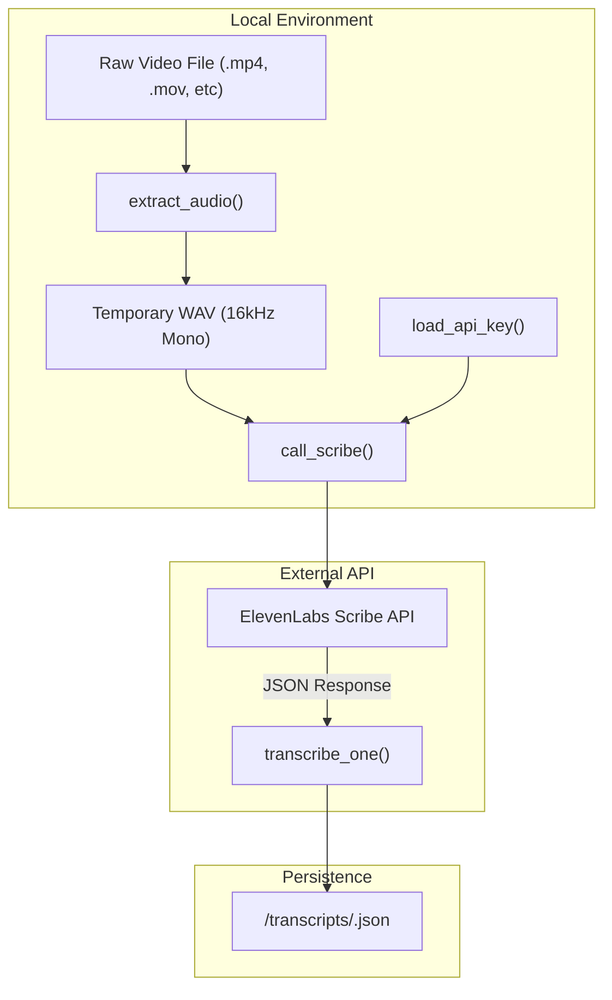
Sources: [helpers/transcribe.py:49-55](), [helpers/transcribe.py:58-87](), [helpers/transcribe.py:90-132]()

## Audio Preprocessing

Before transmission, `video-use` standardizes audio using `ffmpeg` to ensure compatibility and reduce upload bandwidth. The `extract_audio` function converts the input video into a specific PCM format required for optimal transcription accuracy.

| Parameter | Value | Description |
| :--- | :--- | :--- |
| **Channels** | 1 (Mono) | Mixed down to a single channel using `-ac 1` |
| **Sample Rate** | 16,000 Hz | Resampled using `-ar 16000` |
| **Codec** | `pcm_s16le` | Uncompressed 16-bit Little Endian PCM |
| **Container** | `.wav` | Temporary WAV file created in a system temp directory |

Sources: [helpers/transcribe.py:49-55](), [helpers/transcribe.py:115-117]()

## ElevenLabs Scribe Integration

The system interacts with the Scribe API via the `call_scribe` function. It uses the `scribe_v1` model and requests high-granularity metadata to support downstream editing tasks.

Key features requested in the API payload:
*   **Diarization**: Enabled via `diarize: "true"` to distinguish between different speakers [helpers/transcribe.py:66-66]().
*   **Audio Events**: Enabled via `tag_audio_events: "true"` to identify non-speech sounds like laughter or applause [helpers/transcribe.py:67-67]().
*   **Timestamps**: Set to `word` granularity to allow the LLM to make precise cuts between words [helpers/transcribe.py:68-68]().
*   **Language Support**: Supports optional ISO language codes (e.g., "en") or auto-detection if omitted [helpers/transcribe.py:70-71]().
*   **Verbatim Mode**: The system mandates word-level verbatim ASR to preserve fillers, which are considered critical editorial signals [SKILL.md:29-29]().

Sources: [helpers/transcribe.py:58-82](), [SKILL.md:29-29]()

## Batch Processing and Caching

For projects with multiple takes or long-form footage, `helpers/transcribe_batch.py` provides a parallelized wrapper.

### Implementation Details
*   **Parallelism**: Uses `concurrent.futures.ThreadPoolExecutor` with a default of 4 workers to process multiple videos simultaneously [helpers/transcribe_batch.py:86-87]().
*   **File Discovery**: Scans a directory for common extensions including `.mp4`, `.mov`, `.mkv`, `.avi`, and `.m4v` [helpers/transcribe_batch.py:26-34]().
*   **Caching Mechanism**: Both `transcribe.py` and `transcribe_batch.py` check for the existence of the output JSON in `<edit_dir>/transcripts/` before initiating an upload. If the file exists, the API call is skipped entirely [helpers/transcribe.py:106-109](), [helpers/transcribe_batch.py:72-73](). This is enforced as a Hard Rule to minimize API costs and latency [SKILL.md:30-30]().

### Batch Execution Entity Map
"This diagram maps the batch processing components to their specific code implementations."

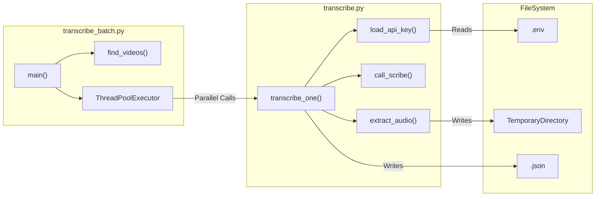
Sources: [helpers/transcribe_batch.py:29-34](), [helpers/transcribe_batch.py:86-100](), [helpers/transcribe.py:33-46](), [helpers/transcribe.py:90-132]()

## Configuration and Environment

The transcription scripts require an ElevenLabs API key, which is retrieved via the `load_api_key` function. The function searches for the key in the following order:
1.  A `.env` file in the project root [helpers/transcribe.py:34-42]().
2.  A `.env` file in the current working directory [helpers/transcribe.py:34-42]().
3.  The `ELEVENLABS_API_KEY` environment variable [helpers/transcribe.py:43-43]().

If no key is found, the script exits with an error [helpers/transcribe.py:44-45]().

Sources: [helpers/transcribe.py:33-47](), [.env.example:1-1]()

---

# Page: Transcript Packing (takes_packed.md)

# Transcript Packing (takes_packed.md)

<details>
<summary>Relevant source files</summary>

The following files were used as context for generating this wiki page:

- [README.md](README.md)
- [SKILL.md](SKILL.md)
- [helpers/pack_transcripts.py](helpers/pack_transcripts.py)

</details>


The transcript packing stage is the bridge between raw machine-generated data and the LLM's editorial reasoning. While the transcription stage produces word-level JSON with high precision, this format is too verbose for LLM context windows and lacks the semantic structure of human speech. `pack_transcripts.py` transforms these JSON files into `takes_packed.md`, a phrase-level Markdown file optimized for readability and efficient token usage [helpers/pack_transcripts.py:1-14]().

## Purpose and Design Philosophy

The primary artifact for the editor sub-agent is the packed transcript. It is designed around three core principles:
1.  **Token Efficiency**: By grouping word-level data into phrases, it fits approximately one hour of takes into one-tenth the tokens required for raw Scribe JSON [helpers/pack_transcripts.py:5-7]().
2.  **Audio-First Segmentation**: Cut candidates are proposed based on speech boundaries and silence gaps, which are explicitly surfaced in the Markdown view [SKILL.md:10-11]().
3.  **Verbatim Signal**: The packer preserves "audio events" (e.g., laughter, sighs) and fillers, as these provide critical editorial signals for detecting retakes or emotional beats [SKILL.md:28-29]().

### Data Flow: Raw JSON to Markdown
The following diagram illustrates the transformation from the raw output of the ElevenLabs Scribe API to the structured Markdown used by the LLM.

**Transcript Transformation Pipeline**
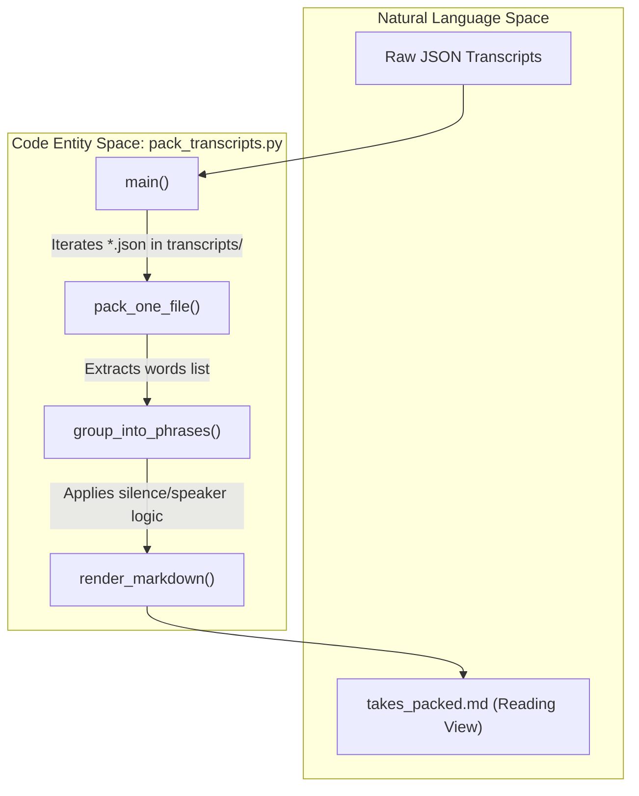
**Sources:** [helpers/pack_transcripts.py:125-134](), [helpers/pack_transcripts.py:165-195](), [SKILL.md:46-46]()

---

## Segmentation Logic

The `group_into_phrases` function is the core logic engine. It walks the Scribe word list and breaks segments based on two primary triggers: silence duration and speaker transitions [helpers/pack_transcripts.py:38-41]().

### Silence Thresholding
The script defaults to a **0.5s silence threshold** [helpers/pack_transcripts.py:171-173](). It detects silences in two ways:
1.  **Explicit Spacing**: Scribe JSON includes `spacing` type entries. If the gap between the `start` and `end` of a spacing entry exceeds the threshold, the current phrase is flushed [helpers/pack_transcripts.py:90-99]().
2.  **Implicit Gaps**: The script calculates the delta between the `start` of the current word and the `prev_end` of the last word. If this exceeds the threshold, it triggers a break [helpers/pack_transcripts.py:112-113]().

### Speaker Diarization
Every time the `speaker_id` changes in the word stream, the current phrase is immediately flushed to ensure that different speakers never share a single line in the Markdown output [helpers/pack_transcripts.py:108-109]().

### Audio Events
Entries of type `audio_event` (such as `(laughter)` or `(applause)`) are wrapped in parentheses and kept within the phrase text to provide context for the editor [helpers/pack_transcripts.py:64-67]().

**Segmentation Logic Flow**
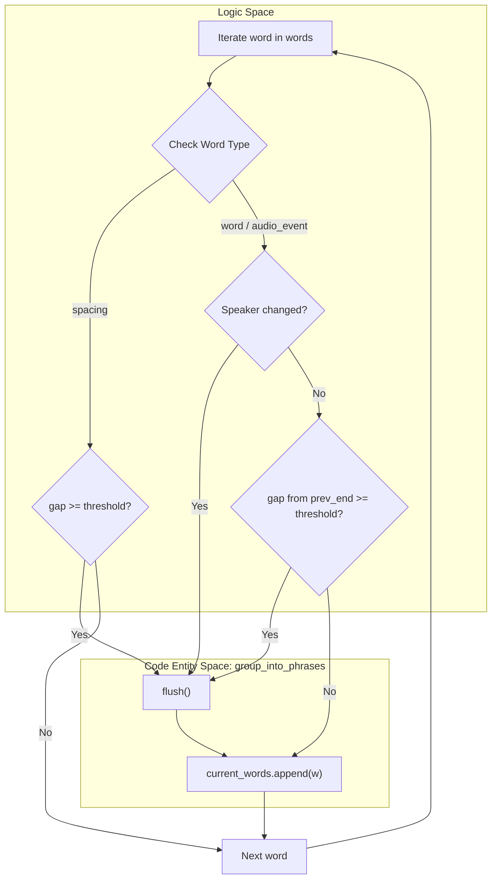
**Sources:** [helpers/pack_transcripts.py:88-121]()

---

## Markdown Format (takes_packed.md)

The resulting Markdown file is structured for high-density reading. Each phrase is prefixed with a timestamp range and an optional speaker tag.

### Output Structure
| Component | Format | Example |
| :--- | :--- | :--- |
| **Header** | `## <filename>` | `## C0103` |
| **Metadata** | `(duration: Xs, Y phrases)` | `(duration: 43.0s, 8 phrases)` |
| **Timestamp** | `[start-end]` | `[002.52-005.36]` |
| **Speaker Tag** | `S<id>` | `S0` (Shortened from `speaker_0`) |
| **Content** | Text + (Events) | `We fixed this. (applause)` |

**Example Output:**
```markdown
## C0103  (duration: 43.0s, 8 phrases)
  [002.52-005.36] S0 Ninety percent of what a web agent does is completely wasted.
  [006.08-006.74] S0 We fixed this.
```
**Sources:** [helpers/pack_transcripts.py:137-162](), [helpers/pack_transcripts.py:24-35](), [README.md:78-81]()

---

## Integration with Editing Workflow

The `takes_packed.md` file serves as the "source of truth" for the `edl.json` generation.

1.  **Cut Precision**: Even though the view is phrase-level, the timestamps are derived from word-level data. The LLM is instructed to snap every cut edge to these word boundaries to avoid cutting mid-word [SKILL.md:27-27]().
2.  **Addressing**: The `[start-end]` ranges provided in the Markdown are used by the LLM to fill the `source_start` and `source_end` fields in the EDL [helpers/pack_transcripts.py:142-142]().
3.  **Padding**: While the transcript provides precise word boundaries, the system enforces a "Hard Rule" to pad every cut edge by 30–200ms to account for Scribe timestamp drift and ensure a natural audio flow [SKILL.md:28-28]().

### Usage
To generate the packed transcript for a project:
```bash
python helpers/pack_transcripts.py --edit-dir ./edit/ --silence-threshold 0.5
```
**Sources:** [helpers/pack_transcripts.py:11-14](), [SKILL.md:70-77]()

---

# Page: Timeline View (Visual Composite Generator)

# Timeline View (Visual Composite Generator)

<details>
<summary>Relevant source files</summary>

The following files were used as context for generating this wiki page:

- [SKILL.md](SKILL.md)
- [helpers/timeline_view.py](helpers/timeline_view.py)
- [poster.html](poster.html)
- [static/timeline-view.svg](static/timeline-view.svg)

</details>


The Timeline View is the primary visual perception mechanism for the LLM. Since the LLM cannot "watch" video files, it requests on-demand composite PNG images that translate temporal video data into a spatially organized format. This tool allows the agent to perform cut-point sanity checks, disambiguate retakes, and verify visual transitions without processing raw pixel streams [helpers/timeline_view.py:1-11]().

## System Overview

The `timeline_view.py` script generates a high-resolution horizontal composite consisting of three main tracks:
1.  **Filmstrip**: A series of evenly spaced thumbnails extracted from the video segment [helpers/timeline_view.py:4-5]().
2.  **Audio Waveform**: A normalized RMS envelope showing audio intensity and silence gaps [helpers/timeline_view.py:5-7]().
3.  **Transcript Overlay**: Word-level labels aligned with the waveform, including speaker identification and silence shading [helpers/timeline_view.py:5-7]().

### Data Flow Diagram

The following diagram illustrates how raw video and transcript data are transformed into the composite PNG.

**Visual Composite Generation Pipeline**
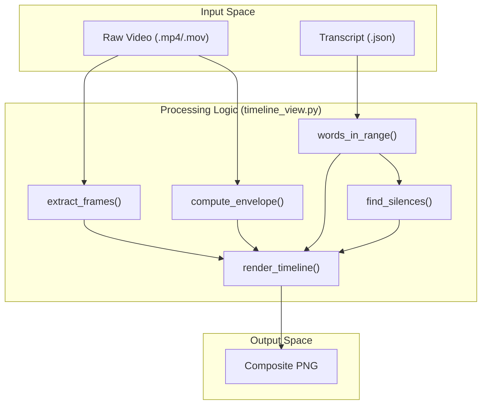
**Sources:** [helpers/timeline_view.py:37-62](), [helpers/timeline_view.py:68-110](), [helpers/timeline_view.py:118-132](), [helpers/timeline_view.py:135-148](), [helpers/timeline_view.py:184-191]()

---

## Key Components and Implementation

### 1. Frame Extraction
The `extract_frames` function uses `ffmpeg` to capture `n` frames evenly spaced across the requested `[start, end]` interval [helpers/timeline_view.py:37-46](). Frames are scaled to a width of 320px for the composite using the `-vf scale=320:-2` filter [helpers/timeline_view.py:57]().

### 2. Audio Envelope Computation
The `compute_envelope` function generates a visual representation of the audio [helpers/timeline_view.py:68-73]():
*   It extracts a mono 16kHz PCM stream to a temporary WAV file using `ffmpeg` [helpers/timeline_view.py:77-83]().
*   It calculates a windowed RMS (Root Mean Square) to create an envelope of a fixed length (default 2000 samples) by reshaping the PCM buffer and computing the mean of squared values [helpers/timeline_view.py:97-102]().
*   The envelope is normalized to a `[0, 1]` range for consistent rendering [helpers/timeline_view.py:108-110]().

### 3. Transcript and Silence Alignment
The generator pulls word-level timestamps from the Scribe JSON transcript using `words_in_range` [helpers/timeline_view.py:118-132](). 
*   **Silence Detection**: The `find_silences` function identifies gaps between words that exceed a specific threshold (default 0.4s) [helpers/timeline_view.py:135-137](). 
*   **Visual Shading**: These gaps are rendered as semi-transparent blue boxes (defined by the `SILENCE` constant) over the waveform to help the LLM identify "dead air" [helpers/timeline_view.py:180](), [helpers/timeline_view.py:6-7]().

### 4. Compositing Logic
The `render_timeline` function manages the `PIL` (Pillow) canvas layout [helpers/timeline_view.py:184-191](). It calculates vertical offsets for the filmstrip (`filmstrip_y`), waveform (`wave_y`), and labels (`label_y`) [helpers/timeline_view.py:199-206]().

**Entity Mapping: Code to Visuals**
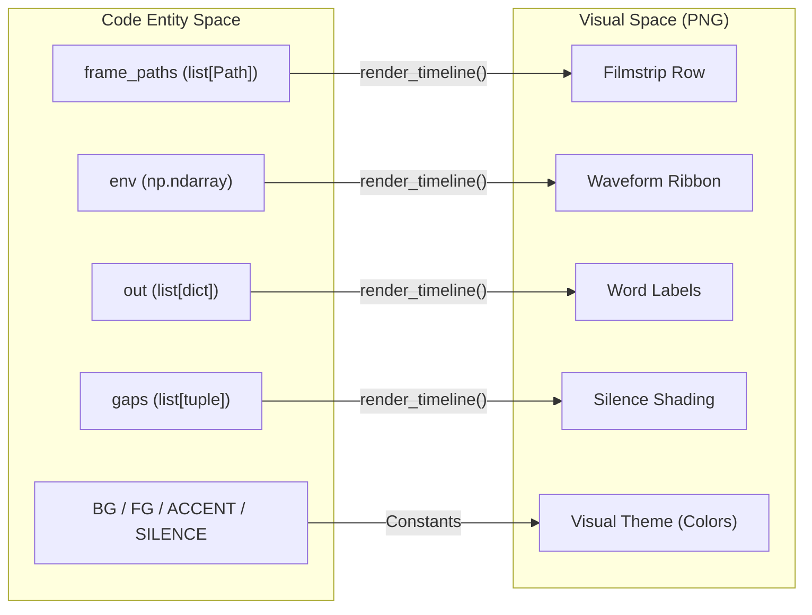
**Sources:** [helpers/timeline_view.py:196](), [helpers/timeline_view.py:102](), [helpers/timeline_view.py:131](), [helpers/timeline_view.py:144-147](), [helpers/timeline_view.py:176-182]()

---

## CLI Interface

The script provides a command-line interface for both manual debugging and LLM tool calls. It is invoked as a helper within the `video-use` skill [SKILL.md:77]().

| Argument | Description |
| :--- | :--- |
| `video` | Path to the source video file. |
| `start` / `end` | Time range in seconds. |
| `-o`, `--output` | Destination for the PNG (defaults to `timeline.png`). |
| `--n-frames` | Number of thumbnails to include in the filmstrip (default: 10). |
| `--transcript` | Path to the `.json` transcript for word overlays. |

**Example Usage:**
```bash
python helpers/timeline_view.py input.mp4 10.5 15.0 --n-frames 12 --transcript input.json
```
**Sources:** [helpers/timeline_view.py:13-18](), [SKILL.md:77]()

---

## LLM Usage and Decision Making

The LLM uses these composites during the **Self-Evaluation Loop** [SKILL.md:85](). It does not scan every second of video; instead, it calls `timeline_view.py` as an "on-demand visual drill-down" at specific "decision points" [helpers/timeline_view.py:9-11]():

1.  **Cut-Point Sanity**: Ensuring a cut doesn't happen mid-word or during a visual blink. Hard Rule #6 mandates snapping cuts to word boundaries, and `timeline_view` verifies this visually [SKILL.md:27]().
2.  **Retake Disambiguation**: Comparing two similar-sounding takes by looking at the visual performance (e.g., "In take 1 the speaker is looking at the camera, in take 2 they are looking down").
3.  **Silence Verification**: Confirming that a detected silence in the transcript is actually empty air and not a non-verbal cue (like a laugh or a gesture) that should be preserved.
4.  **Verification**: Post-render verification to check for visual jumps, audio pops, or subtitle visibility violations [SKILL.md:16]().

**Sources:** [helpers/timeline_view.py:9-12](), [SKILL.md:27](), [SKILL.md:85]()

---

# Page: Rendering Pipeline (render.py)

# Rendering Pipeline (render.py)

<details>
<summary>Relevant source files</summary>

The following files were used as context for generating this wiki page:

- [SKILL.md](SKILL.md)
- [helpers/render.py](helpers/render.py)

</details>


The rendering pipeline in `video-use` is a heuristic-driven system designed for production correctness and efficiency. It follows a multi-stage process that prioritizes audio integrity and minimizes generational loss by using a "Per-segment extract → Lossless concat" architecture rather than a single-pass complex filtergraph [SKILL.md:22-23]().

## Pipeline Overview

The pipeline implements the **HEURISTICS** render sequence to ensure that effects like color grading, audio fades, overlays, and subtitles are applied in the correct order [helpers/render.py:3-9]().

### Data Flow Diagram

The following diagram illustrates the transformation from an `edl.json` file and raw source footage to the final rendered video.

**Figure 1: Rendering Data Flow**
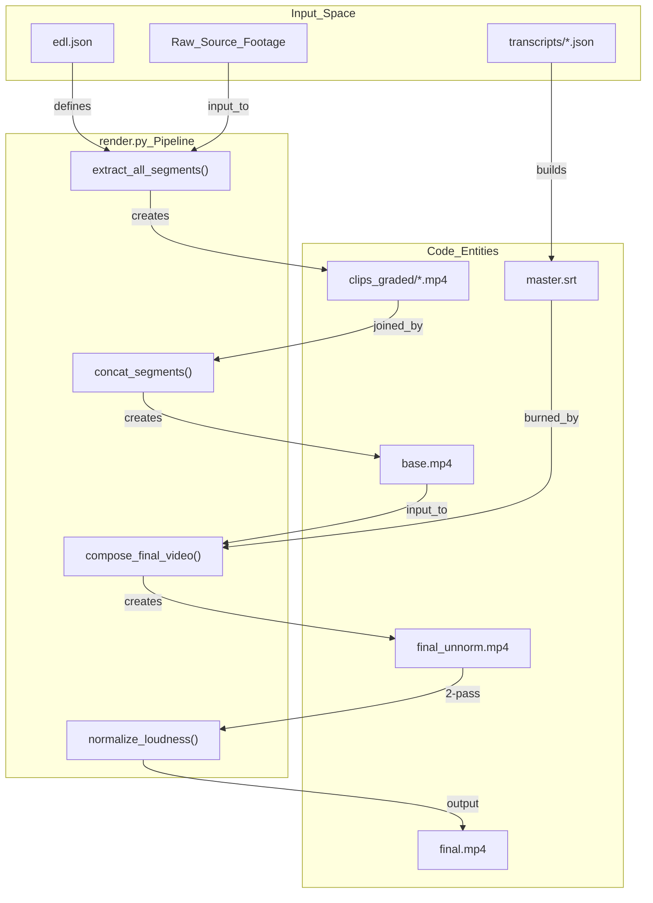
Sources: [helpers/render.py:3-20](), [helpers/render.py:137-145](), [helpers/render.py:197-202](), [SKILL.md:41-56]()

## Core Implementation Details

### 1. HDR to SDR Tone Mapping
Before processing, `render.py` detects if the source uses HDR transfer functions like PQ (HDR10) or HLG [helpers/render.py:108-121](). If detected, it prepends a `zscale` and `tonemap` chain to ensure the output is clean Rec.709 SDR, preventing the "blown out" look common when 10-bit HDR is downconverted to 8-bit without mapping [helpers/render.py:95-106]().

### 2. Per-Segment Extraction (Rule 2 & 3)
Instead of processing the entire timeline at once, `render.py` extracts each clip defined in the `edl.json` ranges. This stage bakes in:
*   **Color Grading:** Applied via `-vf` filter strings, presets, or "auto" analysis [helpers/render.py:67-84]().
*   **Audio Fades:** A mandatory 30ms fade-in and fade-out is applied to every segment via `afade` to prevent audible "pops" at cut boundaries [SKILL.md:24-24](), [helpers/render.py:170-172]().
*   **Scaling:** Normalizes footage to 1080p (or 720p for drafts) [helpers/render.py:157-160]().

### 3. Lossless Concatenation
Once segments are extracted with matching codecs and parameters, they are joined using the ffmpeg `concat` demuxer with `-c copy` [SKILL.md:22-23](). This avoids re-encoding the video frames a second time, preserving quality and saving significant compute time.

### 4. Overlay Compositing and PTS Shifting (Rule 4)
Overlays (animations) are composited onto the concatenated base video. To ensure an animation starts at the correct time within its specific window, the pipeline applies a PTS (Presentation Time Stamp) shift [SKILL.md:25-25](). The filter logic used is `setpts=PTS-STARTPTS+T/TB`, which shifts the overlay's frame 0 to align with the start of the designated overlay window [helpers/render.py:7-9]().

### 5. Subtitle Burning (Rule 1)
Subtitles are always applied **last** in the filter chain [SKILL.md:22-22](). This ensures that overlays or other visual elements do not accidentally obscure the captions. The pipeline uses a specific `SUB_FORCE_STYLE` (Helvetica 18 Bold, Alignment 2) with a high `MarginV=90` to ensure captions remain clear of UI elements on platforms like TikTok or Instagram Reels [helpers/render.py:41-56]().

**Figure 2: Composite Filter Graph Construction**
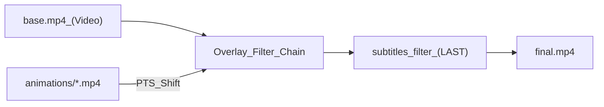
Sources: [helpers/render.py:7-9](), [SKILL.md:22-22](), [helpers/render.py:41-56]()

## Quality Ladder Modes

The `extract_segment` function supports three distinct quality modes to balance speed and fidelity [helpers/render.py:150-154]().

| Mode | Resolution | Preset | CRF | Purpose |
| :--- | :--- | :--- | :--- | :--- |
| **Draft** | 1280x720 | `ultrafast` | 28 | Rapid cut-point verification |
| **Preview** | 1920x1080 | `medium` | 22 | General quality and pacing review |
| **Final** | 1920x1080 | `fast` | 20 | High-quality production output |

Sources: [helpers/render.py:157-160](), [helpers/render.py:174-180]()

## Key Functions and Logic

*   **`is_hdr_source(video)`**: Uses `ffprobe` to check for `smpte2084` or `arib-std-b67` color transfers [helpers/render.py:120-132]().
*   **`extract_segment(...)`**: Constructs the ffmpeg command for per-clip extraction, applying the `TONEMAP_CHAIN`, scaling, grading, and `afade` [helpers/render.py:137-194]().
*   **`resolve_grade_filter(grade_field)`**: Translates EDL grade strings into valid ffmpeg filter strings. It handles presets via `get_preset()` or returns the sentinel `"__AUTO__"` for per-segment analysis [helpers/render.py:67-84]().
*   **`SUB_FORCE_STYLE`**: A hard-coded constant defining the visual look of burned-in subtitles, including the platform-safe `MarginV=90` [helpers/render.py:51-56]().

Sources: [helpers/render.py:41-194]()

---

# Page: Color Grading (grade.py)

# Color Grading (grade.py)

<details>
<summary>Relevant source files</summary>

The following files were used as context for generating this wiki page:

- [helpers/grade.py](helpers/grade.py)
- [helpers/render.py](helpers/render.py)

</details>


The `grade.py` module provides a data-driven approach to video color correction within the `video-use` pipeline. It focuses on subtle, automated adjustments to normalize footage (brightness, contrast, and saturation) rather than aggressive creative grading. It offers both a mathematical "Auto" mode and a selection of named presets for specific visual styles.

### Core Philosophy and Modes

The module operates under two primary modes as defined in the file header: [helpers/grade.py:3-17]().

1.  **Auto Mode (Default):** Analyzes the clip using `ffmpeg` signalstats to compute mean brightness, RMS contrast, and saturation. It emits a bounded filter string capped at ±8% adjustment on any axis to ensure the output looks "clean without looking graded" [helpers/grade.py:8-16]().
2.  **Preset Mode:** Applies a fixed, named filter chain for specific looks like `warm_cinematic` or `neutral_punch` [helpers/grade.py:5-6]().

---

### Named Presets

Presets are defined in the `PRESETS` dictionary [helpers/grade.py:38-63](). These presets use standard `ffmpeg` filters such as `eq` (equalizer), `curves`, and `colorbalance`.

| Preset Name | Description | Key Filter Components |
| :--- | :--- | :--- |
| `subtle` | Baseline cleanup; no color shift. | `eq=contrast=1.03:saturation=0.98` |
| `neutral_punch` | Minimal corrective grade with a subtle S-curve. | `eq=contrast=1.06`, `curves=master` |
| `warm_cinematic` | Creative preset (opt-in only). Warm shadows, cool highlights, and filmic curves. | `colorbalance`, `curves`, `saturation=0.88` |
| `none` | Sentinel for skipping grading. | `""` (Empty string) |

**Source:** [helpers/grade.py:38-63]()

---

### Auto-Grading Logic

The auto-grading process involves two stages: statistical sampling and heuristic decision-making.

#### 1. Statistical Sampling (`_sample_frame_stats`)
The system uses `ffmpeg`'s `signalstats` filter to extract metadata from the video stream [helpers/grade.py:84-95](). It samples frames at a calculated FPS to ensure a representative distribution across the clip duration [helpers/grade.py:98-112]().

The function normalizes values based on the source's native bit depth (e.g., 8-bit or 10-bit) by reading `lavfi.signalstats.YBITDEPTH` and dividing by `(2^depth - 1)` to map everything to a 0.0–1.0 range [helpers/grade.py:114-161]().

**Key Metrics Captured:**
*   `y_mean`: Mean Luma (brightness) [helpers/grade.py:161]().
*   `y_std`: Approximate standard deviation of Luma, calculated as `(YMAX - YMIN) / 4.0` [helpers/grade.py:162-171]().
*   `sat_mean`: Mean saturation [helpers/grade.py:167]().

**Source:** [helpers/grade.py:78-173]()

#### 2. Heuristic Adjustment (`auto_grade_for_clip`)
Once stats are gathered, the system applies a "bounded correction" logic. This logic calculates adjustments for `gamma` (exposure), `contrast`, and `saturation` based on target ideals [helpers/grade.py:184-190]().

**Adjustment Bounds:**
To prevent "hallucinated" grading or extreme distortion, all corrections are clamped using a `_clamp` helper [helpers/grade.py:228-232]().
*   **Gamma:** Target `y_mean` is ~0.45. Correction is clamped between `0.92` and `1.08` [helpers/grade.py:214-215]().
*   **Contrast:** Target `y_std` is ~0.18. Correction is clamped between `0.95` and `1.08` [helpers/grade.py:218-219]().
*   **Saturation:** Target `sat_mean` is ~0.25. Correction is clamped between `0.95` and `1.08` [helpers/grade.py:222-223]().

**Source:** [helpers/grade.py:178-245]()

---

### Integration and Data Flow

The grading system is integrated into the `render.py` pipeline. The EDL's `grade` field is resolved via `resolve_grade_filter` [helpers/render.py:67-72](). If the field is set to `"auto"`, the renderer returns a sentinel `"__AUTO__"` which triggers per-segment analysis during the extraction phase [helpers/render.py:75-76]().

#### Data Flow: Signal Analysis to Filter String
"This diagram illustrates how raw video data is transformed into an ffmpeg filter string via the analysis pipeline."

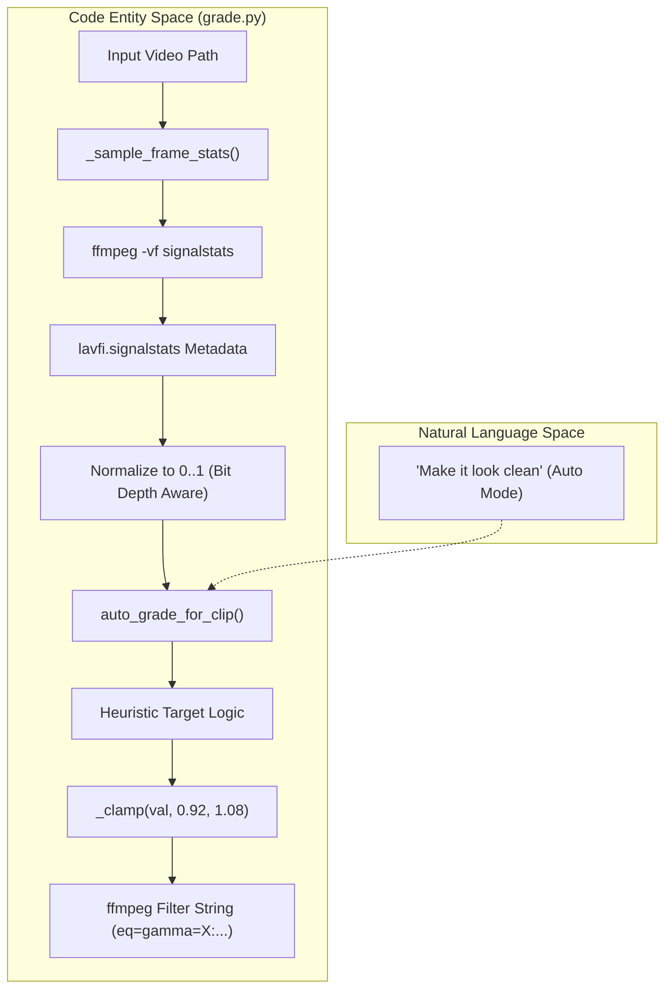
**Sources:** [helpers/grade.py:78-112](), [helpers/grade.py:159-173](), [helpers/grade.py:214-232]()

---

### Pipeline Orchestration

The following diagram shows how `grade.py` interacts with the broader rendering system.

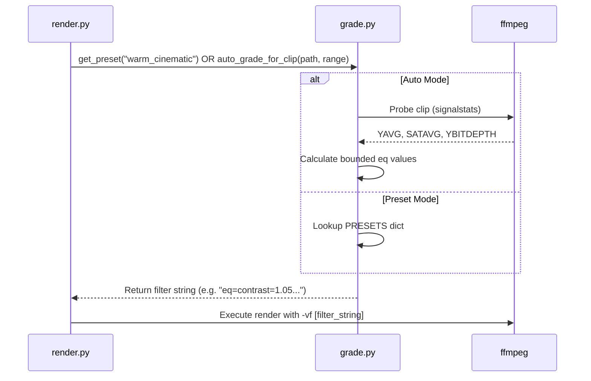
**Sources:** [helpers/render.py:32](), [helpers/render.py:67-84](), [helpers/grade.py:25-26](), [helpers/grade.py:38-63](), [helpers/grade.py:104-112]()

### Usage via CLI
The script can be used as a standalone tool for analysis or testing presets:
*   **Analyze a clip:** `python helpers/grade.py --analyze <input>` [helpers/grade.py:23]()
*   **Apply a preset:** `python helpers/grade.py <input> -o <output> --preset warm_cinematic` [helpers/grade.py:20]()
*   **Print preset filter:** `python helpers/grade.py --print-preset warm_cinematic` [helpers/grade.py:22]()

**Sources:** [helpers/grade.py:18-24]()

---

# Page: LLM Editing Workflow

# LLM Editing Workflow

<details>
<summary>Relevant source files</summary>

The following files were used as context for generating this wiki page:

- [README.md](README.md)
- [SKILL.md](SKILL.md)

</details>


The LLM editing workflow in `video-use` is a multi-stage conversational and execution loop. Rather than acting as a simple script runner, the LLM operates as a creative director and lead editor, orchestrating specialized sub-agents and verification tools to transform raw footage into a polished final product.

## High-Level Orchestration

The workflow follows a "Perceive → Propose → Execute → Evaluate" cycle. The agent first builds a mental model of the footage using text-based transcripts and on-demand visual composites, then confirms a creative strategy with the user before generating technical instructions (EDL).

### System Data Flow
The following diagram illustrates how the LLM bridges the gap between natural language intent and the concrete file entities used by the rendering engine.

**Diagram: Natural Language to Code Entity Mapping**
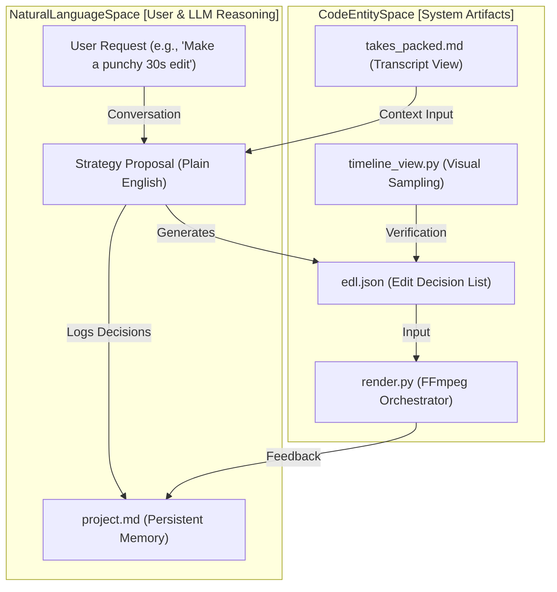
**Sources:** [SKILL.md:78-90](), [README.md:75-81](), [README.md:92-96]()

---

## 1. Perception and Strategy Confirmation
Before any cutting occurs, the agent performs an inventory of the source material. It uses `transcribe_batch.py` and `pack_transcripts.py` to create a high-density text representation of the video.

*   **Initial Inventory:** The agent runs `ffprobe` on all sources, calls `transcribe_batch.py` for parallel transcription, and runs `pack_transcripts.py` to produce `takes_packed.md` [SKILL.md:85-85]().
*   **Visual Sampling:** It uses `timeline_view.py` at specific timestamps to understand the framing, lighting, and "vibe" of the footage without processing the entire stream [SKILL.md:77-77](), [README.md:83-88]().
*   **The Strategy Proposal:** Per **Hard Rule 11**, the agent must describe its plan in plain English and wait for user approval before generating the EDL [SKILL.md:32-32](), [SKILL.md:12-12]().

---

## 2. Editor Sub-Agent and EDL Generation (#3.1)
Once the strategy is approved, the "Editor" persona takes over. This stage involves translating the creative plan into a precise `edl.json` file.

*   **Cut Craft:** The agent applies principles like snapping to word boundaries and adding 30-200ms padding to absorb transcript drift [SKILL.md:27-28]().
*   **EDL Schema:** The generated JSON defines the sequence of sources, start/end timestamps, color grade presets, and metadata for overlays.
*   **Sub-Agent Spawning:** If animations are required (e.g., Manim, Remotion, or HyperFrames), the main agent spawns parallel sub-agents to handle them using the `Agent` tool [SKILL.md:31-31](), [SKILL.md:81-82]().

For details on the EDL schema and editing principles, see [Editor Sub-Agent and EDL Generation](#3.1).

---

## 3. Self-Evaluation Loop (#3.2)
`video-use` follows a "Verify before showing" philosophy. After `render.py` produces a preview, the agent does not immediately present it to the user.

*   **Automated Review:** The agent runs `timeline_view.py` on the *rendered output* at every cut boundary to catch visual jumps or audio pops [README.md:98-98]().
*   **Hard Rules Enforcement:** It checks for compliance with production standards, such as ensuring subtitles are applied last in the filter chain [SKILL.md:22-22]().
*   **The Fix Cycle:** If an issue is detected, the agent modifies the `edl.json` and re-renders, repeating this up to 3 times before reporting a failure [README.md:95-96]().

For details on the verification criteria and the fix-and-re-render logic, see [Self-Evaluation Loop](#3.2).

---

## 4. Session Persistence (project.md) (#3.3)
To ensure that long editing sessions can be resumed or audited, the agent maintains a `project.md` file within the `edit/` directory.

*   **Memory Layer:** Every major decision, strategy confirmation, and reasoning step is logged here [SKILL.md:45-45]().
*   **Context Recovery:** When a new session starts, the LLM reads `project.md` to resume work, maintaining the "Ask → confirm → execute → iterate → persist" loop [SKILL.md:12-12](), [README.md:19-19]().

For details on the structure and usage of the project log, see [Session Persistence (project.md)](#3.3).

---

## Workflow Execution Summary

The following table summarizes the primary tools used during the LLM workflow and their associated code entities.

| Stage | Primary Tool / Code Entity | LLM Role |
| :--- | :--- | :--- |
| **Ingestion** | `transcribe_batch.py` [SKILL.md:75]() | Orchestrate transcription of raw takes. |
| **Perception** | `takes_packed.md` [SKILL.md:46]() | Read and identify best takes/filler words. |
| **Strategy** | Chat Interface / `project.md` | Propose plan and wait for user "OK". |
| **Drafting** | `edl.json` [SKILL.md:47]() | Generate technical cut list with grades/overlays. |
| **Execution** | `render.py` [SKILL.md:78]() | Invoke the FFmpeg-based rendering pipeline. |
| **Verification** | `timeline_view.py` [SKILL.md:77]() | Inspect rendered cut boundaries for errors. |
| **Persistence** | `project.md` [SKILL.md:45]() | Log progress and reasoning for future sessions. |

**Sources:** [SKILL.md:68-82](), [SKILL.md:41-56](), [README.md:11-19](), [README.md:92-96]()

---

# Page: Editor Sub-Agent and EDL Generation

# Editor Sub-Agent and EDL Generation

<details>
<summary>Relevant source files</summary>

The following files were used as context for generating this wiki page:

- [README.md](README.md)
- [SKILL.md](SKILL.md)
- [helpers/render.py](helpers/render.py)

</details>


The Editor Sub-Agent is the primary reasoning engine for video assembly. It translates high-level creative strategies and raw transcript data into a structured Edit Decision List (`edl.json`). By applying "Cut Craft" principles—such as beat-based organization and technical padding—the sub-agent ensures that the final sequence is both narratively coherent and technically sound for the rendering pipeline.

## The Editor's Input: `takes_packed.md`

The sub-agent's primary reading view is `takes_packed.md`, which provides a phrase-level perspective of the footage [SKILL.md:10-11](). This format is optimized for LLM context windows by breaking transcripts into segments based on silence thresholds (typically $\ge 0.5$s) [SKILL.md:76-77]().

Key characteristics of this input:
*   **Speaker Tagging:** Identifies who is speaking (e.g., `S0`, `S1`) to manage handoffs and dialogue flow [README.md:78-81]().
*   **Verbatim Accuracy:** Includes filler words (`umm`, `uh`) and audio events (`(laughter)`, `(applause)`), which the editor uses to identify "bad takes" or points for removal [SKILL.md:29-30](), [README.md:75-76]().
*   **Silence Indicators:** Gaps in the transcript signal natural breath points or scene transitions [README.md:103-103]().

Sources: [SKILL.md:10-11](), [SKILL.md:29-30](), [SKILL.md:76-77](), [README.md:75-81](), [README.md:103-103]()

## Cut Craft Principles

The sub-agent follows a set of "Hard Rules" and heuristic principles to generate professional-grade cuts.

### 1. Technical Padding and Drift Absorption
Scribe timestamps can drift by 50–100ms. To compensate, the sub-agent applies a working window of 30–200ms padding at every cut edge [SKILL.md:28-28]().
*   **Fast-paced:** Tighter padding (~30-50ms).
*   **Cinematic:** Looser padding (~100-200ms).

### 2. Word Boundary Snap
The sub-agent is forbidden from cutting inside a word. It must snap every cut edge to a word boundary identified in the raw transcript [SKILL.md:27-27]().

### 3. Audio Continuity
To prevent audible pops at cuts, the sub-agent relies on the `render.py` pipeline to apply 30ms audio fades (`afade`) at every segment boundary [SKILL.md:24-24](), [helpers/render.py:170-172]().

### 4. Beat and Punchline Preservation
The sub-agent organizes segments by "beats." It identifies punchlines or key takeaways and ensures the preceding silence and subsequent reaction time are preserved to maintain comedic or dramatic timing [SKILL.md:85-87]().

Sources: [SKILL.md:24-28](), [SKILL.md:85-87](), [helpers/render.py:170-172]()

## EDL JSON Schema

The output of the Editor Sub-Agent is the `edl.json` file [SKILL.md:47-47](). This file serves as the single source of truth for the `render.py` script.

### Schema Structure
| Field | Type | Description |
| :--- | :--- | :--- |
| `sources` | Object | Map of short names to absolute file paths of raw footage [SKILL.md:42-43](). |
| `grade` | String | Global color grading setting: `"auto"`, a preset name (e.g., `"warm_cinematic"`), or a raw FFmpeg filter [helpers/render.py:67-76](). |
| `ranges` | Array | Ordered list of segments to be extracted and concatenated [helpers/render.py:197-202](). |
| `overlays` | Array | Metadata for animations or images to be composited over the base video [SKILL.md:25-25](). |

### Range Object
Each entry in the `ranges` array contains:
*   `source`: The key from the `sources` object.
*   `start` / `end`: Timestamps in seconds.
*   `beat`: (Optional) A natural language description of why this cut exists.

### Overlay Metadata
Overlays must include timing relative to the **output** timeline. The renderer uses `setpts=PTS-STARTPTS+T/TB` to ensure the overlay's internal frame 0 aligns with the specified start time [SKILL.md:25-25]().

Sources: [SKILL.md:25-25](), [SKILL.md:42-47](), [helpers/render.py:67-76](), [helpers/render.py:197-202]()

## Implementation Flow

The following diagram illustrates the transition from natural language editing requests to the structured `edl.json` used by the rendering code.

### Editor Sub-Agent Logic Flow
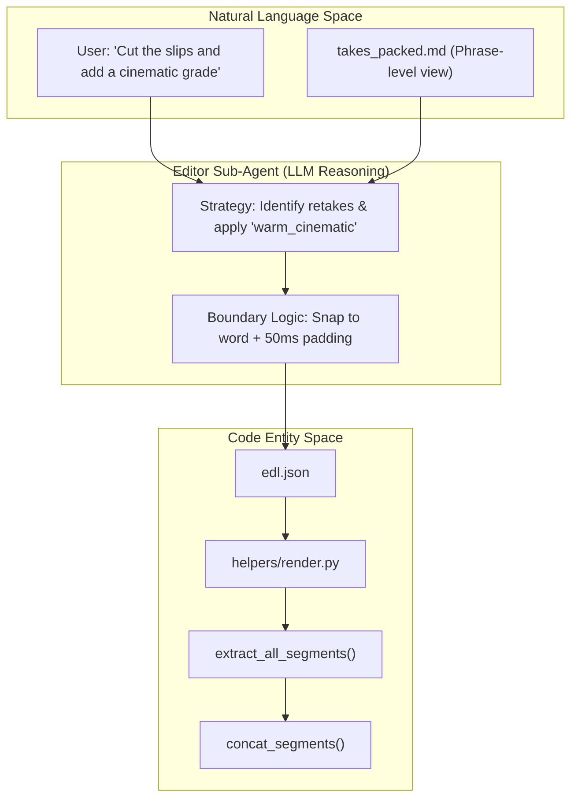
Sources: [SKILL.md:10-15](), [SKILL.md:85-87](), [helpers/render.py:137-145](), [helpers/render.py:197-204]()

## Data Flow: EDL to Final Render

The `render.py` script processes the `edl.json` in a specific sequence to maintain quality and avoid double-encoding [SKILL.md:23-23]().

### Rendering Pipeline Diagram
```mermaid
sequenceDiagram
    participant EDL as edl.json
    participant R as helpers/render.py
    participant G as helpers/grade.py
    participant FF as FFmpeg

    EDL->>R: Load sources & ranges
    loop For each segment
        R->>G: resolve_grade_filter(edl['grade'])
        G-->>R: FFmpeg filter string
        R->>FF: extract_segment() with grade + 30ms afade
        FF-->>R: seg_NN.mp4
    end
    R->>FF: concat_segments() (Lossless -c copy)
    FF-->>R: base.mp4
    rect Path if Overlays exist
        R->>FF: Apply Overlays (PTS shift) + Subtitles LAST
    end
    FF-->>R: final.mp4
```
Sources: [SKILL.md:22-25](), [helpers/render.py:3-13](), [helpers/render.py:67-76](), [helpers/render.py:137-145](), [helpers/render.py:197-204]()

---

# Page: Self-Evaluation Loop

# Self-Evaluation Loop

<details>
<summary>Relevant source files</summary>

The following files were used as context for generating this wiki page:

- [SKILL.md](SKILL.md)
- [helpers/timeline_view.py](helpers/timeline_view.py)
- [poster.html](poster.html)

</details>


The Self-Evaluation Loop is a post-render verification process where the agent acts as its own Quality Assurance (QA) engineer. Before presenting any output to the user, the agent inspects the rendered video for technical artifacts, production-rule violations, and continuity errors. This loop ensures that the "Hard Rules" of the system are met and that the final product maintains professional standards.

## Purpose and Scope

The loop is designed to catch silent failures that may occur during the complex multi-stage rendering process. While the LLM can reason about transcripts effectively, it cannot "watch" the video in real-time. The self-evaluation loop bridges this gap by using `timeline_view.py` to generate visual and auditory "drill-down" composites of the **rendered output**, allowing the agent to verify its work against the original intent.

The process covers:
1.  **Visual Continuity**: Checking for jump cuts or "flashes" at boundaries.
2.  **Audio Integrity**: Detecting pops or spikes at cut points.
3.  **Rule Enforcement**: Ensuring subtitles are visible and overlays are correctly timed.
4.  **Iterative Correction**: Automatically attempting up to 3 fix-and-re-render cycles if errors are detected.

Sources: [SKILL.md:16-16](), [SKILL.md:85-90]()

## The Verification Mechanism

The core of the evaluation is the `timeline_view.py` tool. Unlike its use during the planning phase (where it samples source footage), in the evaluation phase, it is targeted at the `final.mp4` or `preview.mp4` file.

### Inspection Windows
The agent targets every cut boundary defined in the `edl.json`. For each cut, it generates a composite image with a ±1.5s window centered on the transition point.

### Technical Inspection Criteria
| Category | Checkpoint | Detection Method |
| :--- | :--- | :--- |
| **Visuals** | Discontinuity / Jump Cuts | Inspecting the filmstrip row for sudden framing shifts or "flashes". |
| **Audio** | Boundary Pops | Checking the waveform ribbon for vertical spikes at the exact 0.0s mark of the cut. |
| **Subtitles** | Visibility | Verifying that the `Master SRT` (applied last) is not obscured by an animation. |
| **Overlays** | Frame Alignment | Confirming the `setpts` logic correctly shifted the animation to the intended window. |

Sources: [SKILL.md:22-25](), [SKILL.md:85-90](), [helpers/timeline_view.py:1-11]()

## Process Flow: Fix-and-Re-render

The agent follows a structured loop to ensure production correctness. If the evaluation fails, the agent must modify the `edl.json` or the animation parameters and restart the render.

### System Entity Mapping
The following diagram illustrates how the natural language goals of "Verification" map to specific code entities and files.

**Verification Logic to Code Mapping**
```mermaid
graph TD
    subgraph "Natural Language Space"
        A["Check for Audio Pops"]
        B["Verify Subtitle Layers"]
        C["Detect Jump Cuts"]
    end

    subgraph "Code Entity Space (video-use)"
        A --> D["timeline_view.py"]
        B --> E["render.py --build-subtitles"]
        C --> D
        
        D --> F["compute_envelope()"]
        D --> G["extract_frames()"]
        
        H["SKILL.md Hard Rules"] --> E
        H --> I["edl.json"]
    end

    F --"Returns"--> J["RMS Waveform Ribbon"]
    G --"Returns"--> K["Filmstrip Row"]
```
Sources: [SKILL.md:18-33](), [SKILL.md:72-73](), [helpers/timeline_view.py:37-38](), [helpers/timeline_view.py:68-70]()

### The Evaluation Pipeline
The loop persists until the video passes inspection or the maximum attempt count (3) is reached.

**The Iterative Loop**
```mermaid
sequenceDiagram
    participant Agent as Editor Sub-Agent
    participant Render as render.py
    participant TV as timeline_view.py
    participant Project as project.md

    Note over Agent, Project: Self-Evaluation Loop (Max 3 Attempts)
    
    Agent->>Render: Execute edl.json
    Render-->>Agent: final.mp4 generated
    
    loop For each Cut Boundary
        Agent->>TV: timeline_view(final.mp4, cut_start, cut_end)
        TV-->>Agent: Composite PNG (Waveform + Filmstrip)
        Agent->>Agent: Inspect PNG for pops/jumps
    end
    
    alt Errors Detected
        Agent->>Project: Log failure & reasoning
        Agent->>Agent: Adjust EDL (e.g., shift cut by 100ms)
        Agent->>Render: Re-render
    else Success
        Agent->>Project: Log "Verification Passed"
        Agent->>User: Present final.mp4
    end
```
Sources: [SKILL.md:16-16](), [SKILL.md:45-47](), [SKILL.md:85-90]()

## Hard Rules Enforcement

The self-evaluation loop is the primary mechanism for enforcing the **Hard Rules** defined in the system architecture. Failure to pass these rules results in a mandatory re-render.

1.  **Audio Pops (Rule 3)**: Every segment must have a 30ms fade (`afade=t=in:d=0.03`). If `timeline_view.py` shows a waveform spike at the boundary, the agent must verify the `render.py` command included the correct fade parameters [SKILL.md:24-24]().
2.  **Subtitle Visibility (Rule 1)**: Subtitles must be applied **last** in the filter chain. The agent checks the `verify/` directory for frames where overlays might have been rendered over the text [SKILL.md:22-22](), [SKILL.md:53-53]().
3.  **Timing Drift (Rule 7 & 8)**: Because Scribe timestamps can drift by 50–100ms, the agent uses the evaluation loop to check if a cut "clipped" the start or end of a word. If a word is truncated, the agent expands the padding (standard 30–200ms) in the `edl.json` [SKILL.md:27-29](), [helpers/timeline_view.py:135-148]().

Sources: [SKILL.md:18-33](), [SKILL.md:53-53](), [helpers/timeline_view.py:135-148]()

## Implementation Details

### `timeline_view.py` API
The tool provides the visual evidence needed for the loop. It extracts N frames and computes an RMS envelope of the audio.

*   **Function `extract_frames`**: Uses `ffmpeg` to grab evenly spaced frames at specific timestamps [helpers/timeline_view.py:37-62]().
*   **Function `compute_envelope`**: Dumps mono 16kHz PCM to a temporary WAV and calculates windowed RMS to visualize audio levels [helpers/timeline_view.py:68-110]().
*   **Function `words_in_range`**: Overlays word labels from the transcript onto the waveform to verify word-boundary alignment [helpers/timeline_view.py:118-132]().
*   **Function `find_silences`**: Identifies gaps between words to help the agent confirm that cuts occurred during silence rather than mid-word [helpers/timeline_view.py:135-148]().

### Logging and Persistence
Every evaluation attempt is logged in `project.md`. This allows the agent to track what adjustments have already been tried (e.g., "Attempt 2: Increased padding on Cut #4 by 50ms to fix audio pop").

Sources: [SKILL.md:45-45](), [helpers/timeline_view.py:184-191]()

---

# Page: Session Persistence (project.md)

# Session Persistence (project.md)

<details>
<summary>Relevant source files</summary>

The following files were used as context for generating this wiki page:

- [README.md](README.md)
- [SKILL.md](SKILL.md)
- [install.md](install.md)

</details>


Session persistence in `video-use` is managed through a decentralized memory layer centered around a `project.md` file. Unlike traditional video editors that store state in proprietary binary formats, this system uses human-readable and LLM-parsable Markdown and JSON files to maintain context across multiple interactions, allowing the agent to resume work, remember previous decisions, and track the evolution of the edit.

### The Role of project.md

The `project.md` file serves as the "long-term memory" of the editing session. It is located within the `<videos_dir>/edit/` directory [SKILL.md:45-45](). The LLM is instructed to append to this file every session to maintain a log of the project's progress [SKILL.md:19-19]().

#### Data Logged in project.md
The file typically contains:
*   **Strategy and Reasoning:** The 4–8 sentence strategy proposed by the LLM and confirmed by the user [SKILL.md:104-104]().
*   **Decision Logs:** Why specific takes were chosen or why certain cuts were made.
*   **Aesthetic Direction:** Preferences for color grading, subtitle styles, and pacing [SKILL.md:13-14]().
*   **Sub-agent Coordination:** Status and reasoning for parallel animation tasks handled by sub-agents [SKILL.md:49-49]().

**Sources:** [SKILL.md:19-19](), [SKILL.md:45-45](), [SKILL.md:104-104]()

### Directory Structure Conventions

The persistence layer relies on a strict directory layout within the user's video directory. This structure ensures that all derived artifacts are isolated from the source footage and the core skill code [SKILL.md:33-33]().

| File/Folder | Purpose | Source of Truth |
| :--- | :--- | :--- |
| `project.md` | Persistent session memory and reasoning log. [SKILL.md:45-45]() | LLM Appends |
| `takes_packed.md` | Phrase-level transcripts; the primary reading view for the LLM. [SKILL.md:46-46]() | `pack_transcripts.py` |
| `edl.json` | The current state of the timeline (Edit Decision List). [SKILL.md:47-47]() | Editor Sub-agent |
| `transcripts/` | Cached raw JSON output from the Scribe API. [SKILL.md:48-48]() | `transcribe.py` |
| `animations/` | Source code, renders, and reasoning for visual overlays. [SKILL.md:49-49]() | Animation Sub-agents |
| `clips_graded/` | Rendered intermediate segments with color grading and audio fades. [SKILL.md:50-50]() | `render.py` |
| `verify/` | On-demand timeline PNGs and debug frames. [SKILL.md:53-53]() | `timeline_view.py` |

**Sources:** [SKILL.md:37-56]()

### Persistence Flow: Natural Language to Code Entity

The following diagram illustrates how natural language strategy and user intent are persisted into code-level entities and files within the `edit/` directory.

**Strategy to Artifact Mapping**
```mermaid
graph TD
    subgraph "Natural Language Space (User/LLM Interaction)"
        A["User Prompt (e.g., 'edit these')"] --> B["Strategy Proposal (project.md)"]
        B --> C["Editor Brief (Reasoning)"]
    end

    subgraph "Code Entity Space (Filesystem Persistence)"
        C --> D["edl.json (Edit Decision List)"]
        C --> E["animations/slot_id/ (Sub-agent Workspace)"]
        D --> F["render.py (Execution Script)"]
        E --> F
        F --> G["preview.mp4 / final.mp4"]
        F --> H["clips_graded/ (Segment Cache)"]
    end

    B -.->|Appended Each Session| B
    D -.->|Read for Resumption| C
```
**Sources:** [README.md:19-19](), [SKILL.md:37-56](), [SKILL.md:72-81](), [SKILL.md:104-104]()

### Resuming Work and Iteration

The LLM follows a specific "Inventory" process at the start of a session to reconstruct the project state from the persistent files.

1.  **Inventory:** The agent runs `ffprobe` on sources and checks for the existence of `takes_packed.md` and `project.md` [SKILL.md:85-85]().
2.  **State Reconstruction:** By reading `project.md`, the agent understands the previously agreed-upon strategy. By reading `edl.json`, it understands the current structure of the video [SKILL.md:45-47]().
3.  **Self-Evaluation Loop:** If a render was previously performed, the agent uses `timeline_view.py` on the rendered output to verify the work before proceeding with new edits [README.md:98-98]().

**Sources:** [SKILL.md:85-85](), [README.md:98-98]()

### Data Flow for Session Persistence

This diagram tracks how data flows from raw input through the persistence layer to final output.

**Session Data Flow**
```mermaid
flowchart LR
    subgraph "Ingestion"
        RAW["Raw Video Files"] --> T["transcribe_batch.py"]
        T --> JSON["transcripts/*.json"]
        JSON --> PACK["pack_transcripts.py"]
        PACK --> TP["takes_packed.md"]
    end

    subgraph "Persistence Layer"
        TP --> LLM["LLM Editor Agent"]
        PM["project.md"] <--> LLM
        LLM --> EDL["edl.json"]
    end

    subgraph "Rendering"
        EDL --> REND["render.py"]
        RAW --> REND
        REND --> OUT["final.mp4"]
    end
```
**Sources:** [SKILL.md:37-56](), [SKILL.md:72-81](), [SKILL.md:85-90]()

### Hard Rules for Persistence
To prevent data loss or "silent failures" across sessions, the following rules are enforced:
*   **No skill-dir writes:** All session outputs MUST be in `<videos_dir>/edit/`, never inside the `video-use/` project directory [SKILL.md:33-33]().
*   **Transcript Caching:** Transcripts are cached per source. They are never re-transcribed unless the source file itself changes [SKILL.md:30-30]().
*   **Strategy Confirmation:** The agent must never modify the `edl.json` or start a render until the strategy recorded in `project.md` is confirmed by the user [SKILL.md:32-32]().

**Sources:** [SKILL.md:18-35]()

---

# Page: Manim Video Sub-Skill

# Manim Video Sub-Skill

<details>
<summary>Relevant source files</summary>

The following files were used as context for generating this wiki page:

- [pyproject.toml](pyproject.toml)
- [skills/manim-video/README.md](skills/manim-video/README.md)
- [skills/manim-video/SKILL.md](skills/manim-video/SKILL.md)

</details>


The `manim-video` skill is a specialized sub-agent within the `video-use` ecosystem designed for the programmatic generation of mathematical, technical, and algorithmic animations [skills/manim-video/SKILL.md:1-5](). It leverages the **Manim Community Edition** engine to produce high-quality, 3Blue1Brown-style educational content where every frame is intended to reveal underlying structures through geometric intuition [skills/manim-video/SKILL.md:9-11]().

Unlike the core `video-use` editor which manipulates existing footage, the Manim sub-skill generates video from scratch using Python scripts, LaTeX for equations, and ffmpeg for final assembly [skills/manim-video/SKILL.md:41-50]().

## System Integration and Purpose

The skill acts as a technical explainer engine. It is invoked when a user requests visualizations of abstract concepts that cannot be easily filmed, such as neural network architectures, mathematical proofs, or data structures [skills/manim-video/README.md:9-15](). It is defined as an optional dependency in the core project [pyproject.toml:14-15]().

### Core Use Cases
| Mode | Input | Output | Reference |
| :--- | :--- | :--- | :--- |
| **Concept Explainer** | Topic/Concept | Animated geometric intuition | `references/scene-planning.md` [skills/manim-video/SKILL.md:33]() |
| **Equation Derivation** | Math expressions | Step-by-step animated proof | `references/equations.md` [skills/manim-video/SKILL.md:34]() |
| **Algorithm Visualization** | Logic description | Execution of data structures | `references/graphs-and-data.md` [skills/manim-video/SKILL.md:35]() |
| **Architecture Diagram** | System description | Building components and connections | `references/mobjects.md` [skills/manim-video/SKILL.md:37]() |

### Natural Language to Code Entity Mapping

The following diagram illustrates how high-level creative requirements are mapped to specific technical entities within the `manim-video` skill.

**Creative-to-Code Mapping**
```mermaid
graph TD
    subgraph "NaturalLanguageSpace"
        A["'Explain the Pythagorean Theorem'"] -- "Intent" --> B["CreativeStandard"]
        C["'Use a neon theme'"] -- "Styling" --> D["ColorPalettes"]
    end

    subgraph "CodeEntitySpace"
        B --> E["plan.md"]
        E -- "Defines" --> F["script.py"]
        F -- "Contains" --> G["class_Scene_Scene"]
        G -- "Uses" --> H["MathTex_function"]
        G -- "Uses" --> I["Text_font_MONO"]
        D -- "Sets" --> J["BG_PRIMARY_ACCENT_constants"]
    end

    F -- "Rendered via" --> K["manim_CLI"]
    K -- "Stitched by" --> L["ffmpeg_concat"]
    L --> M["final.mp4"]
```
Sources: [skills/manim-video/SKILL.md:52-75](), [skills/manim-video/SKILL.md:141-155]()

## The Manim Pipeline

The production of a Manim video follows a rigid linear pipeline to ensure "First-render excellence" [skills/manim-video/SKILL.md:17-18](). The process transitions from a narrative `plan.md` to a single `script.py` containing multiple scene classes, which are then rendered and stitched [skills/manim-video/SKILL.md:52-56]().

**Production Flow**
```mermaid
graph LR
    subgraph "PlanningStage"
        P["plan.md"]
    end

    subgraph "DevelopmentStage"
        S["script.py"]
    end

    subgraph "ExecutionStage"
        R["manim_ql_qh_commands"]
        ST["ffmpeg_concat_logic"]
    end

    P --> S
    S --> R
    R -- ".mp4 segments" --> ST
    ST --> FINAL["final.mp4"]
```
Sources: [skills/manim-video/SKILL.md:52-63](), [skills/manim-video/SKILL.md:67-75]()

For a detailed breakdown of the production stages, creative constraints (such as the mandatory use of monospace fonts and specific opacity layering), and the `setup.sh` environment verification, see **[Manim Pipeline and Creative Standards](#4.1)**.

## Reference Library and Capabilities

The skill includes an extensive reference library that the LLM agent uses to construct complex scenes. This library covers everything from basic `Mobjects` to advanced `updaters` and 3D camera manipulations [skills/manim-video/SKILL.md:31-39]().

Key technical components include:
*   **Typography**: Mandatory use of `MONO` fonts (e.g., "Menlo") to avoid Pango kerning issues [skills/manim-video/SKILL.md:111-119]().
*   **Attention Layering**: Using opacity (1.0 for primary, 0.15 for structural) to guide the viewer's eye [skills/manim-video/SKILL.md:19]().
*   **Timing**: Standardized `run_time` and `self.wait()` intervals to provide "breathing room" for the audience [skills/manim-video/SKILL.md:21-22](), [skills/manim-video/SKILL.md:88-97]().

For the complete technical API and implementation guides covering animations, equations, and 3D visualization, see **[Manim Reference Library](#4.2)**.

## Project Structure

Every `manim-video` project is self-contained within a directory, following this convention:
*   `plan.md`: The narrative and visual roadmap including scene breakdowns and voiceover scripts [skills/manim-video/SKILL.md:69]().
*   `script.py`: The source code containing all scene classes, where each class is independently renderable [skills/manim-video/SKILL.md:70](), [skills/manim-video/SKILL.md:139]().
*   `concat.txt`: The instruction file for `ffmpeg` to merge individual scene renders [skills/manim-video/SKILL.md:71]().
*   `final.mp4`: The final stitched output [skills/manim-video/SKILL.md:72]().
*   `media/`: The auto-generated output directory for Manim renders [skills/manim-video/SKILL.md:73]().

Sources: [skills/manim-video/README.md:1-24](), [skills/manim-video/SKILL.md:1-155](), [pyproject.toml:14-15]()

---

# Page: Manim Pipeline and Creative Standards

# Manim Pipeline and Creative Standards

<details>
<summary>Relevant source files</summary>

The following files were used as context for generating this wiki page:

- [skills/manim-video/SKILL.md](skills/manim-video/SKILL.md)
- [skills/manim-video/references/production-quality.md](skills/manim-video/references/production-quality.md)
- [skills/manim-video/references/rendering.md](skills/manim-video/references/rendering.md)
- [skills/manim-video/references/scene-planning.md](skills/manim-video/references/scene-planning.md)
- [skills/manim-video/scripts/setup.sh](skills/manim-video/scripts/setup.sh)

</details>


The `manim-video` skill provides a production pipeline for creating high-quality, mathematical, and technical animations using the Manim Community Edition. It is designed to produce "educational cinema" where every frame reveals structure and follows the pedagogical style popularized by 3Blue1Brown [skills/manim-video/SKILL.md:1-11]().

## Prerequisites and Setup

Before initiating the pipeline, the environment must be validated for mathematical rendering and video processing dependencies.

### Dependency Checker (`setup.sh`)
The `scripts/setup.sh` utility verifies the presence of the following core components:
*   **Python 3.10+**: The base runtime.
*   **Manim Community Edition (v0.20+)**: The animation engine.
*   **LaTeX (pdflatex)**: Required for rendering equations via `MathTex`.
*   **ffmpeg**: Required for scene stitching, audio muxing, and format conversion.

[skills/manim-video/scripts/setup.sh:1-15](), [skills/manim-video/SKILL.md:25-27]()

## The Production Pipeline

The Manim workflow follows a linear progression from narrative planning to final review.

### Pipeline Stages
1.  **PLAN**: Define the narrative arc and visual elements in `plan.md` [skills/manim-video/SKILL.md:58-58]().
2.  **CODE**: Implement the logic in `script.py` with one class per scene [skills/manim-video/SKILL.md:59-59]().
3.  **RENDER**: Execute `manim` commands (`-ql` for draft, `-qh` for production) [skills/manim-video/SKILL.md:60-60]().
4.  **STITCH**: Concatenate individual scene clips into `final.mp4` using `ffmpeg` and a `concat.txt` file [skills/manim-video/SKILL.md:61-61]().
5.  **AUDIO**: (Optional) Mux voiceover or background music using `ffmpeg` or the `manim-voiceover` plugin [skills/manim-video/SKILL.md:62-62](), [skills/manim-video/references/rendering.md:134-153]().
6.  **REVIEW**: Compare rendered output against the original plan and adjust [skills/manim-video/SKILL.md:63-63]().

[skills/manim-video/SKILL.md:52-63]()

### Project Structure
A standard project directory is organized as follows:
```text
project-name/
  plan.md                # Narrative arc, scene breakdown
  script.py              # All scenes in one file
  concat.txt             # ffmpeg scene list for stitching
  final.mp4              # Stitched output
  media/                 # Manim-generated assets
```
[skills/manim-video/SKILL.md:65-75]()

## Creative Standards and Direction

The skill enforces strict aesthetic and pedagogical standards to ensure "First-render excellence" [skills/manim-video/SKILL.md:17-17]().

### Opacity Layering and Attention
Visual salience is managed through opacity layers to prevent cognitive overload:
*   **Primary Elements**: `1.0` opacity.
*   **Contextual Elements**: `0.4` opacity.
*   **Structural Elements (Axes/Grids)**: `0.15` opacity.

[skills/manim-video/SKILL.md:19-19](), [skills/manim-video/references/production-quality.md:130-133]()

### Typography and Fonts
To avoid kerning issues with Manim's Pango renderer, **monospace fonts** (e.g., "Menlo") must be used for all text [skills/manim-video/SKILL.md:109-111]().

| Role | Font Size | Usage |
| :--- | :--- | :--- |
| Title | 48 | Scene openings |
| Heading | 36 | Section headers |
| Body | 30 | Explanatory text |
| Label | 24 | Annotations, axis labels |
| Caption | 20 | Subtitles |

[skills/manim-video/SKILL.md:99-108](), [skills/manim-video/references/production-quality.md:43-58]()

### Animation Timing
Every animation requires a "breathing room" pause using `self.wait()` to allow the viewer to absorb information [skills/manim-video/SKILL.md:21-21]().

| Context | `run_time` | `self.wait()` after |
| :--- | :--- | :--- |
| Key equation reveal | 2.0s | 2.0s |
| Transform/morph | 1.5s | 1.5s |
| "Aha moment" | 2.5s | 3.0s |
| FadeOut cleanup | 0.5s | 0.3s |

[skills/manim-video/SKILL.md:88-97]()

## Technical Implementation

### Pipeline Flow Diagram
This diagram maps the conceptual pipeline stages to the specific files and tools used in the `manim-video` skill.

Title: Manim Production Data Flow
```mermaid
graph TD
    subgraph "Planning_Phase"
        A["plan.md"] --> B["Narrative_Arc"]
        B --> C["Scene_List"]
    end

    subgraph "Implementation_Phase"
        C --> D["script.py"]
        D --> E["class_Scene1(Scene)"]
        D --> F["class_Scene2(Scene)"]
    end

    subgraph "Rendering_Phase"
        E --> G["manim_CLI"]
        F --> G
        G --> H["media/videos/script/"]
    end

    subgraph "Post-Production"
        H --> I["concat.txt"]
        I --> J["ffmpeg_concat"]
        J --> K["final.mp4"]
    end
```
Sources: [skills/manim-video/SKILL.md:52-75](), [skills/manim-video/references/scene-planning.md:85-118](), [skills/manim-video/references/rendering.md:31-46]()

### Spatial Layout and Coordinate System
The visible frame in a standard 16:9 aspect ratio is approximately 14.2 units wide by 8.0 units tall.

| Zone | Coordinate Range |
| :--- | :--- |
| **Usable Area** | x: [-6.5, 6.5], y: [-3.5, 3.5] |
| **Top Title Zone** | y: [2.5, 3.5] |
| **Bottom Note Zone** | y: [-3.5, -2.5] |
| **Main Content** | y: [-2.5, 2.5], x: [-6.0, 6.0] |

[skills/manim-video/references/production-quality.md:60-71]()

### Scene Logic Entity Mapping
This diagram bridges the natural language concepts of a "Scene" to the code entities required in `script.py`.

Title: Scene Entity Mapping
```mermaid
classDiagram
    class ManimScene {
        +BG_COLOR: String
        +PRIMARY: String
        +MONO: String
        +construct()
    }
    class SceneLogic {
        +self.add_subcaption()
        +self.play()
        +self.wait()
        +self.next_section()
    }
    class Mobjects {
        +Text()
        +MathTex()
        +DecimalNumber()
        +Circle()
    }
    ManimScene --|> SceneLogic : implements
    SceneLogic ..> Mobjects : animates
    Mobjects --* SceneLogic : added_to
```
Sources: [skills/manim-video/SKILL.md:141-160](), [skills/manim-video/references/production-quality.md:155-163](), [skills/manim-video/references/rendering.md:118-129]()

## Quality Enforcement

### Hard Rules for Production
*   **No Overlap**: Use `buff >= 0.5` for `.to_edge()` calls to prevent clipping [skills/manim-video/references/production-quality.md:17-22]().
*   **Max Elements**: Limit to 6 actively visible elements per scene to maintain clarity [skills/manim-video/references/production-quality.md:83-87]().
*   **Clean Exits**: Every scene must end with a `FadeOut` of all mobjects [skills/manim-video/references/production-quality.md:115-117]().
*   **Width Enforcement**: Long text strings must be scaled to fit `config.frame_width - 1.0` [skills/manim-video/references/production-quality.md:32-42]().
*   **Consistency**: Use shared constants for colors (e.g., `PRIMARY`, `SECONDARY`) and fonts (`MONO`) across all scenes [skills/manim-video/references/scene-planning.md:49-59]().

### Narrative Arcs
The `plan.md` should follow one of the established narrative structures:
*   **Discovery Arc**: Hook → Intuition → Formalize → Reveal → Extend [skills/manim-video/references/scene-planning.md:5-10]().
*   **Problem-Solution Arc**: Problem → Failed Attempt → Key Insight → Solution → Result [skills/manim-video/references/scene-planning.md:12-18]().
*   **Comparison Arc**: Setup → Approach A → Approach B → Contrast → Verdict [skills/manim-video/references/scene-planning.md:19-25]().
*   **Build-Up Arc**: Component A → Component B → Connection → Scale → Full Picture [skills/manim-video/references/scene-planning.md:26-32]().

Sources:
* `skills/manim-video/SKILL.md`
* `skills/manim-video/references/production-quality.md`
* `skills/manim-video/references/scene-planning.md`
* `skills/manim-video/references/rendering.md`
* `skills/manim-video/scripts/setup.sh`

---

# Page: Manim Reference Library

# Manim Reference Library

<details>
<summary>Relevant source files</summary>

The following files were used as context for generating this wiki page:

- [skills/manim-video/references/animation-design-thinking.md](skills/manim-video/references/animation-design-thinking.md)
- [skills/manim-video/references/animations.md](skills/manim-video/references/animations.md)
- [skills/manim-video/references/camera-and-3d.md](skills/manim-video/references/camera-and-3d.md)
- [skills/manim-video/references/decorations.md](skills/manim-video/references/decorations.md)
- [skills/manim-video/references/equations.md](skills/manim-video/references/equations.md)
- [skills/manim-video/references/graphs-and-data.md](skills/manim-video/references/graphs-and-data.md)
- [skills/manim-video/references/mobjects.md](skills/manim-video/references/mobjects.md)
- [skills/manim-video/references/paper-explainer.md](skills/manim-video/references/paper-explainer.md)
- [skills/manim-video/references/troubleshooting.md](skills/manim-video/references/troubleshooting.md)
- [skills/manim-video/references/updaters-and-trackers.md](skills/manim-video/references/updaters-and-trackers.md)
- [skills/manim-video/references/visual-design.md](skills/manim-video/references/visual-design.md)

</details>


The Manim Reference Library provides a comprehensive guide for the programmatic animation engine used within the `manim-video` sub-skill. It covers the technical implementation of animations, mathematical objects (mobjects), visual design standards, and the specialized workflows required for research paper explainers and data visualization.

## Animation Design Thinking

Effective animation in `manim-video` requires a shift from static diagramming to temporal storytelling. The core philosophy is to use motion only when it reduces cognitive load or explains a sequence that unfolds over time [skills/manim-video/references/animation-design-thinking.md:5-14]().

### The Production Pipeline
1.  **Narration First**: Write the full script before code to determine order, duration, and visual beats [skills/manim-video/references/animation-design-thinking.md:26-34]().
2.  **Identify Visual Beats**: A "beat" is a moment of change (e.g., an object appearing, a transformation). Each beat typically maps to a `self.play()` call [skills/manim-video/references/animation-design-thinking.md:35-47]().
3.  **Synchronization**: The "see then hear" principle dictates that visuals should appear slightly before the narration describes them to prime the viewer's brain [skills/manim-video/references/animation-design-thinking.md:90-93]().

### Design Patterns
*   **Dim and Reveal**: For complex equations, show the full destination at low opacity (0.2) and highlight terms one by one as they are explained [skills/manim-video/references/animation-design-thinking.md:108-117]().
*   **Zoom-and-Return**: For complex architectures, show the overview, zoom into a specific box to expand its internals, then zoom back out [skills/manim-video/references/animation-design-thinking.md:145-153]().

**Sources**: [skills/manim-video/references/animation-design-thinking.md:5-153]()

---

## Core Animations and Mobjects

In Manim, everything visible is a `Mobject`. Animations are objects passed to `self.play()` that compute intermediate states over time [skills/manim-video/references/animations.md:3-7]().

### Mobject Hierarchy
| Category | Entities | Usage |
| :--- | :--- | :--- |
| **Basic Shapes** | `Circle`, `Square`, `Dot`, `Line` | Foundational geometry [skills/manim-video/references/mobjects.md:27-36](). |
| **Text/Math** | `Text`, `MathTex`, `Tex`, `MarkupText` | `MathTex` is a `VMobject`; `Text` is a standard `Mobject` [skills/manim-video/references/mobjects.md:7-21](). |
| **Groups** | `VGroup`, `Group` | `VGroup` is for `VMobjects` only. Use `Group` if mixing `Text` with shapes [skills/manim-video/references/mobjects.md:94-113](). |
| **Specialized** | `BarChart`, `Axes`, `Code`, `Table` | High-level data and code visualization [skills/manim-video/references/mobjects.md:129-135](). |
| **Complex UI** | `IntegerMatrix`, `Variable`, `BulletedList` | Dynamic UI-like elements [skills/manim-video/references/mobjects.md:148-220](). |

### Animation Types
*   **Creation**: `Create()`, `Write()`, `FadeIn()`, `GrowFromCenter()`, `DrawBorderThenFill()` [skills/manim-video/references/animations.md:9-17]().
*   **Transformations**: `Transform(A, B)` modifies A to look like B. `ReplacementTransform(A, B)` removes A and replaces it with B. `FadeTransform` is preferred for dissimilar shapes [skills/manim-video/references/animations.md:27-45](), [skills/manim-video/references/animations.md:188-208]().
*   **Reactive**: `always_redraw()` rebuilds a mobject every frame, essential for objects whose geometry depends on other moving parts [skills/manim-video/references/animations.md:149-164]().
*   **Movement**: `MoveAlongPath()`, `Rotate()`, `Rotating()` [skills/manim-video/references/animations.md:62-76]().

**Sources**: [skills/manim-video/references/animations.md:3-208](), [skills/manim-video/references/mobjects.md:7-220]()

---

## Equations and Mathematical Visualization

`MathTex` is the primary interface for LaTeX rendering. It supports selective coloring, incremental building, and smart morphing via `TransformMatchingTex` [skills/manim-video/references/equations.md:1-42]().

### Complex Equation Logic
To animate dense equations, use `substrings_to_isolate`. This allows Manim to track individual LaTeX tokens as separate submobjects for coloring or targeted transformations [skills/manim-video/references/equations.md:133-153]().

### System-to-Code Mapping: Mathematical Entities
The following diagram bridges the conceptual mathematical requirements to the specific Manim classes used in the library.

**Diagram: Math Entity Mapping**
```mermaid
graph TD
    subgraph "Natural Language Space"
        N1["'Show the formula'"]
        N2["'Highlight the error term'"]
        N3["'Change the variable'"]
        N4["'Show the matrix'"]
    end

    subgraph "Code Entity Space"
        C1["MathTex(r'E=mc^2')"]
        C2["SurroundingRectangle()"]
        C3["TransformMatchingTex()"]
        C4["IntegerMatrix()"]
    end

    N1 --> C1
    N2 --> C2
    N3 --> C3
    N4 --> C4
```
**Sources**: [skills/manim-video/references/equations.md:6-186](), [skills/manim-video/references/decorations.md:5-30]()

---

## Data Visualization and Graphs

Manim provides high-level mobjects for coordinate systems and data storytelling.

*   **Axes**: Created with `x_range` and `y_range`. Supports `axes.plot()` for functions and `axes.get_area()` for integrals [skills/manim-video/references/graphs-and-data.md:3-21]().
*   **Graph Theory**: `Graph` and `DiGraph` support automatic layouts like `spring`, `circular`, and `tree` [skills/manim-video/references/graphs-and-data.md:93-125]().
*   **Vector Fields**: `ArrowVectorField` and `StreamLines` visualize particle flow and gradients [skills/manim-video/references/graphs-and-data.md:126-148]().
*   **Planes**: `ComplexPlane` and `PolarPlane` for complex and polar coordinate visualization [skills/manim-video/references/graphs-and-data.md:150-164]().

**Sources**: [skills/manim-video/references/graphs-and-data.md:3-164]()

---

## Camera, 3D, and Updaters

Advanced scenes utilize camera movement and persistent relationships between objects.

### Camera Control
*   **MovingCameraScene**: Allows panning and zooming of the 2D frame via `self.camera.frame.animate` [skills/manim-video/references/camera-and-3d.md:3-25]().
*   **ThreeDScene**: Enables 3D orientation (`phi`, `theta`), 3D mobjects like `Sphere` or `Cube`, and ambient rotation [skills/manim-video/references/camera-and-3d.md:27-58]().
*   **ZoomedScene**: Provides an inset zoom display for magnifying specific details [skills/manim-video/references/camera-and-3d.md:78-108]().

### Continuous Relationships (Updaters)
Updaters solve the problem of discrete animations by declaring a relationship once. Manim enforces it every frame [skills/manim-video/references/updaters-and-trackers.md:3-9]().

*   **ValueTracker**: An invisible float used to "steer" visible objects. Dependent objects read the tracker value inside an `add_updater` or `always_redraw` call [skills/manim-video/references/updaters-and-trackers.md:11-48]().

**Diagram: Data Flow for Updaters**
```mermaid
graph LR
    subgraph "Logic"
        VT["ValueTracker.animate.set_value()"]
    end

    subgraph "Relationship"
        UP["add_updater() / always_redraw()"]
    end

    subgraph "Visuals"
        MOB["Mobject (Dot, Line, Label)"]
    end

    VT -- "interpolates value" --> UP
    UP -- "recomputes properties" --> MOB
```
**Sources**: [skills/manim-video/references/camera-and-3d.md:3-108](), [skills/manim-video/references/updaters-and-trackers.md:3-119]()

---

## Visual Design and Paper Explainers

### Visual Design Principles
Manim videos must adhere to specific design standards to ensure clarity and professional aesthetics:
*   **Opacity Layering**: Primary elements at 1.0, context at 0.4, and structural elements (grids) at 0.15 [skills/manim-video/references/visual-design.md:6]().
*   **Monospace Fonts**: Use `"Menlo"` or `"JetBrains Mono"` for all text to avoid Pango kerning issues [skills/manim-video/references/visual-design.md:61-73]().
*   **Geometry Before Algebra**: Always show the visual shape before introducing the corresponding equation [skills/manim-video/references/visual-design.md:5]().

### Paper Explainer Workflow
Translating research papers into video involves extracting core insights and following a structured template:
1.  **Hook (30s)**: Surprising result [skills/manim-video/references/paper-explainer.md:29]().
2.  **Problem (60s)**: What was missing [skills/manim-video/references/paper-explainer.md:30]().
3.  **Key Insight (90s)**: Core visual idea [skills/manim-video/references/paper-explainer.md:31]().
4.  **Progressive Build**: Architecture diagrams should build component-by-component rather than appearing all at once [skills/manim-video/references/paper-explainer.md:142-150]().

**Sources**: [skills/manim-video/references/visual-design.md:3-125](), [skills/manim-video/references/paper-explainer.md:1-200]()

---

## Rendering and Troubleshooting

### Rendering Modes
Manim uses CLI flags to control output quality during development and final production.
*   `-ql`: Low quality (480p, 15fps) for fast iteration [skills/manim-video/references/troubleshooting.md:109-111]().
*   `-qh`: High quality (1080p, 60fps) for final output [skills/manim-video/references/troubleshooting.md:109]().
*   `-s`: Render a single still frame of the scene [skills/manim-video/references/troubleshooting.md:131]().

### Common Issues
*   **LaTeX Missing Raw String**: Forgetting the `r` in `r"\frac{1}{2}"` is the #1 error [skills/manim-video/references/troubleshooting.md:5-9]().
*   **VGroup TypeError**: Mixing `Text()` (Mobject) with shapes (VMobjects) in a `VGroup` fails. Use `Group` for mixed collections [skills/manim-video/references/troubleshooting.md:22-42]().
*   **Invisible Animations**: A mobject must be added to the scene (`self.add()` or `self.play(Create())`) before its properties can be animated [skills/manim-video/references/troubleshooting.md:86-90]().
*   **Group save_state()**: `Group` does not support `save_state()` or `restore()`; use individual `VMobjects` or `VGroup` for these operations [skills/manim-video/references/troubleshooting.md:49-67]().

**Sources**: [skills/manim-video/references/troubleshooting.md:1-136]()

---

# Page: Glossary

# Glossary

<details>
<summary>Relevant source files</summary>

The following files were used as context for generating this wiki page:

- [README.md](README.md)
- [SKILL.md](SKILL.md)
- [helpers/grade.py](helpers/grade.py)
- [helpers/pack_transcripts.py](helpers/pack_transcripts.py)
- [helpers/render.py](helpers/render.py)
- [helpers/timeline_view.py](helpers/timeline_view.py)
- [helpers/transcribe.py](helpers/transcribe.py)
- [skills/manim-video/SKILL.md](skills/manim-video/SKILL.md)
- [static/timeline-view.svg](static/timeline-view.svg)

</details>


This page provides technical definitions for terms, jargon, and domain concepts specific to the `video-use` codebase. It serves as a reference for onboarding engineers to understand how natural language requests translate into specific code entities and data structures.

## Purpose and Scope
The `video-use` system bridges the gap between high-level editorial intent (e.g., "make this more cinematic") and low-level media manipulation (FFmpeg filtergraphs). This glossary defines the core objects and processes used to maintain production-grade correctness while allowing the LLM artistic freedom.

---

## Core Pipeline Concepts

### EDL (Edit Decision List)
The central data structure that defines the final video. It is a JSON object produced by the editor sub-agent.
*   **Implementation:** The EDL contains `sources` (mapping names to file paths), `ranges` (start/end timestamps in source files), and global/per-segment metadata like `grade` or `overlays`.
*   **Code Pointers:** 
    *   Schema usage in `render.py`: [helpers/render.py:197-202]()
    *   Resolution of paths: [helpers/render.py:87-92]()
*   **Hard Rule:** Never touch the cut until the user has approved the plain-English strategy that informs the EDL [SKILL.md:32-32]().

### Takes Packed View (`takes_packed.md`)
A Markdown-formatted, phrase-level representation of all source videos. It is the LLM's primary "reading" view of the footage.
*   **Implementation:** Generated by `pack_transcripts.py`. It groups word-level timestamps from Scribe into phrases based on a silence threshold (default 0.5s) [helpers/pack_transcripts.py:3-7]().
*   **Key Function:** `group_into_phrases` [helpers/pack_transcripts.py:38-122]().
*   **Data Flow:** `Scribe JSON` → `group_into_phrases()` → `render_markdown()` → `takes_packed.md`.

### Timeline View (Visual Composite)
An on-demand PNG image combining a filmstrip, audio waveform, and transcript labels.
*   **Implementation:** Created by `timeline_view.py` using PIL and NumPy [helpers/timeline_view.py:30-32]().
*   **Purpose:** Used for "Two-Layer Perception"—the LLM uses the transcript for general flow and the `timeline_view` for surgical precision at cut points [README.md:69-83]().
*   **Code Pointers:** `render_timeline` [helpers/timeline_view.py:184-213]().

---

## Technical Jargon & Abbreviations

| Term | Definition | Code Reference |
| :--- | :--- | :--- |
| **ASR** | Automatic Speech Recognition. Specifically word-level verbatim output from ElevenLabs Scribe. | [SKILL.md:29-29]() |
| **Diarization** | The process of partitioning an audio stream into homogeneous segments according to the speaker identity. | [helpers/transcribe.py:66-66]() |
| **PTS Shift** | Presentation TimeStamp shifting. Required for overlays to ensure an animation starts at frame 0 when it appears mid-video. | [SKILL.md:25-25](), [helpers/render.py:7-9]() |
| **Hard Rules** | Non-negotiable production standards (e.g., 30ms audio fades) that prevent "silent failures" like audio pops. | [SKILL.md:18-33]() |
| **SignalStats** | FFmpeg filter used to mathematically analyze frames for auto-grading. | [helpers/grade.py:8-12](), [helpers/grade.py:86-88]() |
| **Tone Mapping** | Converting HDR (HLG/PQ) sources to Rec.709 SDR to prevent blown-out colors on standard players. | [helpers/render.py:95-117]() |

---

## System Architecture Diagrams

### From Natural Language to Code Execution
The following diagram maps the conceptual "Editor" workflow to the specific Python entities that handle each stage.

**Editor Workflow Mapping**
```mermaid
graph TD
    subgraph "NaturalLanguageSpace"
        UserPrompt["'Edit this into a launch video'"]
        Strategy["Strategy Proposal (Plain English)"]
    end

    subgraph "CodeEntitySpace"
        Transcriber["transcribe_batch.py"]
        Packer["pack_transcripts.py"]
        EDLGen["edl.json (Editor Sub-Agent)"]
        Renderer["render.py"]
        Evaluator["timeline_view.py (Self-Eval)"]
    end

    UserPrompt --> Transcriber
    Transcriber --> Packer
    Packer --> Strategy
    Strategy -- "User Approval" --> EDLGen
    EDLGen --> Renderer
    Renderer --> Evaluator
    Evaluator -- "Visual Jump Detected" --> EDLGen
```
**Sources:** [README.md:92-96](), [SKILL.md:83-90]()

### Rendering Pipeline Logic
This diagram details the `render.py` execution flow, specifically how it adheres to the "Hard Rules" regarding segment extraction and concatenation.

**Render Execution Flow**
```mermaid
graph TD
    subgraph "render.py Pipeline"
        EDL["edl.json"]
        Extract["extract_segment()"]
        Grade["auto_grade_for_clip()"]
        Fade["afade (30ms)"]
        Concat["concat_segments()"]
        FilterGraph["Single Filtergraph (Overlays + Subs)"]
    end

    EDL --> Extract
    Extract --> Grade
    Extract --> Fade
    Grade & Fade --> Concat
    Concat -- "base.mp4 (Lossless -c copy)" --> FilterGraph
    FilterGraph -- "Rule 1: Subtitles LAST" --> Final["final.mp4"]
```
**Sources:** [helpers/render.py:3-13](), [SKILL.md:22-26](), [helpers/grade.py:178-183]()

---

## Implementation Details

### Audio Fades (Rule 3)
To prevent audible pops at cut boundaries, the system enforces a 30ms fade-in and fade-out on every segment.
*   **Implementation:** Applied via the `afade` filter in FFmpeg during the extraction phase.
*   **Code Pointer:** `afade` string construction in `extract_segment` [helpers/render.py:170-172]().

### Auto-Grading (Heuristics)
The system can mathematically "normalize" footage without applying creative LUTs.
*   **Implementation:** `_sample_frame_stats` uses the `signalstats` filter to calculate `YAVG` (luma) and `SATAVG` (saturation) [helpers/grade.py:86-94]().
*   **Logic:** Adjustments are capped at ±8% on any axis to ensure the video looks "clean" rather than "processed" [helpers/grade.py:12-16]().

### Project Memory (`project.md`)
A persistent log file stored in the user's `<videos_dir>/edit/` directory.
*   **Purpose:** Stores session context, reasoning, and approved strategies so that the LLM can resume work across multiple sessions [README.md:19-19]().
*   **Code Pointer:** [SKILL.md:45-45]()

### Quality Ladder
The rendering pipeline supports different quality modes to balance speed and accuracy during the editing loop.
*   **Draft:** 720p, `ultrafast` preset, CRF 28 (for cut-point checks) [helpers/render.py:153-154]().
*   **Preview:** 1080p, `medium` preset, CRF 22 (for quality control) [helpers/render.py:152-152]().
*   **Final:** 1080p, `fast` preset, CRF 20 (production output) [helpers/render.py:151-151]().

**Sources:**
- [README.md:13-19](), [README.md:69-83](), [README.md:92-96]()
- [SKILL.md:18-33](), [SKILL.md:45-45](), [SKILL.md:83-90]()
- [helpers/render.py:1-20](), [helpers/render.py:87-92](), [helpers/render.py:170-172](), [helpers/render.py:197-202]()
- [helpers/grade.py:1-26](), [helpers/grade.py:86-94](), [helpers/grade.py:178-183]()
- [helpers/pack_transcripts.py:1-14](), [helpers/pack_transcripts.py:38-122]()
- [helpers/timeline_view.py:1-12](), [helpers/timeline_view.py:30-32](), [helpers/timeline_view.py:184-213]()