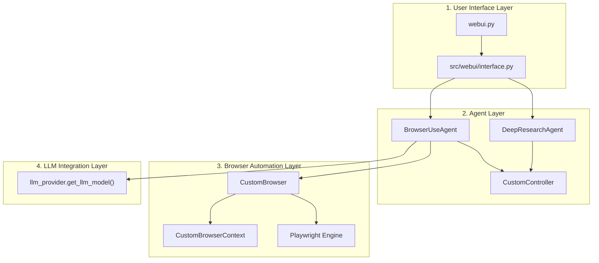

<!-- source: DeepWiki mcp.deepwiki.com · repo browser-use/web-ui · page 1 Overview · fetched 2026-10-30 -->

# Overview

Relevant source files

The following files were used as context for generating this wiki page:

- [README.md](README.md)
- [src/__init__.py](src/__init__.py)
- [src/agent/__init__.py](src/agent/__init__.py)
- [webui.py](webui.py)

## Purpose and Scope

This document provides a high-level introduction to the browser-use web-ui project, explaining its architecture, core components, and capabilities. It serves as an entry point for understanding how the system enables AI-powered browser automation through a Gradio-based web interface [README.md:10-14](). 

For detailed installation instructions, see [Getting Started](#1.1). For repository structure and dependency details, see [Project Layout and Dependencies](#1.2).

**Sources:** [README.md:1-151](), [webui.py:1-19]()

## What is browser-use web-ui?

`browser-use web-ui` is a Gradio-based graphical interface for AI-driven browser automation, built on top of the `browser-use` package [README.md:10-14](). The system enables users to control web browsers through natural language commands, leveraging Large Language Models (LLMs) to interpret tasks and execute browser actions autonomously [README.md:10-21]().

The application supports two primary workflows:
1. **Interactive Browser Automation** - Direct control of browser sessions through the agent interface, allowing users to submit tasks and receive real-time assistance requests [README.md:14-20]()
2. **Automated Research Workflows** - Multi-step research operations through research agents that autonomously plan, execute, and synthesize findings [README.md:14-21]()

The project extends base browser-use functionality by providing expanded LLM provider support (Google, OpenAI, Azure, Anthropic, DeepSeek, Ollama, etc.), custom browser integration to preserve authentication states, and persistent browser sessions [README.md:16-20]().

**Sources:** [README.md:1-21](), [webui.py:1-19]()

## Child Pages

The documentation is organized into the following child pages for detailed exploration:

- **[Getting Started](#1.1)** — Quick start instructions for installing and running the application, including prerequisites, `uv` and Playwright setup, `.env` configuration, and first execution [README.md:24-107]().
- **[Project Layout and Dependencies](#1.2)** — Repository directory structure mapping (`src/webui`, `src/agent`, `src/browser`, `src/controller`, `src/utils`, `tests`) and third-party dependencies from `requirements.txt` [README.md:58-62]().

**Sources:** [README.md:24-107]()

## Core System Architecture

The application is structured into layered modules handling the user interface, agent execution, browser control, LLM communication, and external tool integration [webui.py:1-19]().

**Sources:** [webui.py:1-19](), [README.md:10-21]()

---

