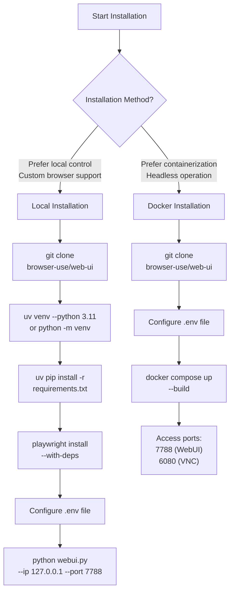
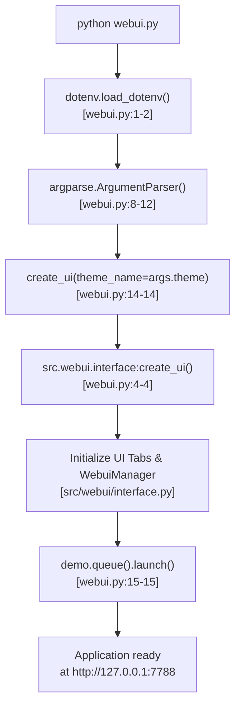

<!-- source: DeepWiki mcp.deepwiki.com · repo browser-use/web-ui · page 1.1 Getting Started · fetched 2026-10-30 -->

# Getting Started

<details>
<summary>Relevant source files</summary>

The following files were used as context for generating this wiki page:

- [README.md](README.md)
- [requirements.txt](requirements.txt)
- [webui.py](webui.py)

</details>


This document provides step-by-step instructions for installing and running the browser-use web-ui application. It covers both local and Docker deployment options, environment configuration, and initial setup verification, bridging user deployment workflows to underlying code entities such as `webui.py` and `requirements.txt`.

For detailed information about the system architecture and how components interact, see [User Interface](#3). For deployment-specific details and production considerations, see [Development](#10).

---

## Prerequisites

Before installing browser-use web-ui, ensure your system meets the requirements specified by the environment setup and dependency configuration:

### For Local Installation

| Requirement | Version/Details |
|-------------|-----------------|
| **Python** | 3.11 or higher |
| **pip** | Latest version (or `uv` recommended) |
| **Git** | For cloning the repository |
| **Operating System** | Windows, macOS, or Linux |
| **Playwright Dependencies** | System libraries for browser automation specified in [README.md:64-71]() |

### For Docker Installation

| Requirement | Details |
|-------------|---------|
| **Docker** | Docker Desktop (Windows/macOS) or Docker Engine (Linux) [README.md:111-113]() |
| **Docker Compose** | Included with Docker Desktop; separate install for Linux [README.md:111-113]() |
| **Git** | For cloning the repository [README.md:115-119]() |

Sources: [README.md:24-114]()

---

## Installation Decision Flow

The following diagram illustrates the decision process and maps installation steps to code assets like `requirements.txt` and `webui.py`:



Sources: [README.md:24-147](), [requirements.txt:1-10]()

---

## Local Installation

### Step 1: Clone the Repository

Clone the browser-use web-ui repository from GitHub:

```bash
git clone https://github.com/browser-use/web-ui.git
cd web-ui
```

This creates a local copy of the codebase in the `web-ui` directory.

Sources: [README.md:30-34]()

### Step 2: Create Python Virtual Environment

The project requires Python 3.11. Using `uv` (recommended) or the standard `venv` module:

**Using uv (recommended):**
```bash
uv venv --python 3.11
```

**Using standard venv:**
```bash
python3.11 -m venv .venv
```

### Step 3: Activate Virtual Environment

Activation commands vary by operating system:

| Platform | Command |
|----------|---------|
| **Windows (Command Prompt)** | `.venv\Scripts\activate` |
| **Windows (PowerShell)** | `.\.venv\Scripts\Activate.ps1` |
| **macOS/Linux** | `source .venv/bin/activate` |

After activation, your terminal prompt should show `(.venv)` prefix.

Sources: [README.md:36-56]()

### Step 4: Install Python Dependencies

The [requirements.txt:1-10]() file specifies all Python packages needed:

```bash
uv pip install -r requirements.txt
```

**Key dependencies installed:**
- `browser-use==0.1.48` - Core browser automation framework [requirements.txt:1-1]()
- `gradio==5.27.0` - Web UI framework [requirements.txt:3-3]()
- `langgraph==0.3.34` - Research agent workflow orchestration [requirements.txt:9-9]()
- `langchain-mistralai`, `langchain-ibm`, `langchain_mcp_adapters` - LLM provider integrations [requirements.txt:5-8]()
- `pyperclip`, `json-repair`, `MainContentExtractor` - Utility libraries [requirements.txt:2-6]()

Sources: [requirements.txt:1-10]()

### Step 5: Install Playwright Browsers

Playwright requires browser binaries and system dependencies:

**Install all browsers with dependencies:**
```bash
playwright install --with-deps
```

**Install specific browser (recommended for minimal setup):**
```bash
playwright install chromium --with-deps
```

The `--with-deps` flag automatically installs system-level dependencies required for browser automation.

Sources: [README.md:64-71]()

### Step 6: Configure Environment Variables

Create a `.env` file from the template:

**Windows (Command Prompt):**
```bash
copy .env.example .env
```

**macOS/Linux/PowerShell:**
```bash
cp .env.example .env
```

Edit `.env` to add your API keys and settings. See [Environment Configuration](#environment-configuration) below for details.

Sources: [README.md:73-83]()

### Step 7: Run the Application

Start the Gradio web interface using [webui.py:7-19]():

```bash
python webui.py --ip 127.0.0.1 --port 7788
```

**Command-line arguments in [webui.py:8-12]():**
- `--ip`: IP address to bind to (default: `127.0.0.1`) [webui.py:9-9]()
- `--port`: Port number for the web server (default: `7788`) [webui.py:10-10]()
- `--theme`: Theme to use for the UI (choices from `theme_map`) [webui.py:11-11]()

Access the application at `http://127.0.0.1:7788` in your web browser.

Sources: [webui.py:7-19](), [README.md:85-90]()

---

## Docker Installation

### Step 1: Clone the Repository

```bash
git clone https://github.com/browser-use/web-ui.git
cd web-ui
```

Sources: [README.md:115-119]()

### Step 2: Configure Environment Variables

Create `.env` file as described in the local installation section:

```bash
cp .env.example .env
```

Edit the file to add your API keys and configuration. Docker-specific variables include resolution, VNC password, and debugging ports.

Sources: [README.md:121-131]()

### Step 3: Build and Run Docker Container

**For x86_64 systems:**
```bash
docker compose up --build
```

**For ARM64 systems (Apple Silicon Macs):**
```bash
TARGETPLATFORM=linux/arm64 docker compose up --build
```

This command builds the Docker image and starts all services defined in `docker-compose.yml`.

Sources: [README.md:133-140]()

### Step 4: Access the Application

The Docker deployment exposes multiple ports:

| Port | Service | URL |
|------|---------|-----|
| **7788** | Gradio WebUI | `http://localhost:7788` |
| **6080** | noVNC (Web VNC) | `http://localhost:6080/vnc.html` |
| **5901** | VNC Server | `vnc://localhost:5901` |
| **9222** | Chrome DevTools Protocol | `http://localhost:9222` |

**Default VNC password:** `youvncpassword` (configurable via `VNC_PASSWORD` in `.env`)

Sources: [README.md:143-146]()

---

## Environment Configuration

The `.env` file configures LLM providers, browser settings, and deployment parameters.

### Configuration File Structure

```mermaid
graph TB
    ENV[".env Configuration File"]
    
    subgraph "LLM Provider Credentials"
        OPENAI["OPENAI_API_KEY<br/>OPENAI_ENDPOINT"]
        ANTHROPIC["ANTHROPIC_API_KEY<br/>ANTHROPIC_ENDPOINT"]
        GOOGLE["GOOGLE_API_KEY"]
        AZURE["AZURE_OPENAI_ENDPOINT<br/>AZURE_OPENAI_API_KEY"]
        DEEPSEEK["DEEPSEEK_API_KEY<br/>DEEPSEEK_ENDPOINT"]
        MISTRAL["MISTRAL_API_KEY<br/>MISTRAL_ENDPOINT"]
        OLLAMA["OLLAMA_ENDPOINT"]
    end
    
    subgraph "Application Settings"
        DEFAULT_LLM["DEFAULT_LLM"]
        TELEMETRY["ANONYMIZED_TELEMETRY"]
        LOG_LEVEL["BROWSER_USE_LOGGING_LEVEL"]
    end
    
    subgraph "Browser Configuration"
        BROWSER_PATH["BROWSER_PATH"]
        BROWSER_DATA["BROWSER_USER_DATA"]
        CDP_PORT["BROWSER_DEBUGGING_PORT"]
        KEEP_OPEN["KEEP_BROWSER_OPEN"]
        USE_OWN["USE_OWN_BROWSER"]
    end
    
    ENV --> OPENAI
    ENV --> ANTHROPIC
    ENV --> GOOGLE
    ENV --> AZURE
    ENV --> DEEPSEEK
    ENV --> MISTRAL
    ENV --> OLLAMA
    ENV --> DEFAULT_LLM
    ENV --> TELEMETRY
    ENV --> LOG_LEVEL
    ENV --> BROWSER_PATH
    ENV --> BROWSER_DATA
    ENV --> CDP_PORT
    ENV --> KEEP_OPEN
    ENV --> USE_OWN
```



Sources: [.env.example:1-71]()

### Essential Configuration Variables

| Variable | Purpose | Example Value |
|----------|---------|---------------|
| `OPENAI_API_KEY` | OpenAI API authentication | `sk-...` |
| `DEFAULT_LLM` | Default LLM provider | `openai`, `anthropic`, `google` |
| `BROWSER_USE_LOGGING_LEVEL` | Logging verbosity | `result`, `info`, `debug` |
| `KEEP_BROWSER_OPEN` | Persist browser between tasks | `true`, `false` |
| `BROWSER_PATH` | Custom browser executable | Windows: `C:\Program Files\Google\Chrome\Application\chrome.exe`<br/>macOS: `/Applications/Google Chrome.app/Contents/MacOS/Google Chrome` |
| `BROWSER_USER_DATA` | Custom browser profile directory | Windows: `C:\Users\Username\AppData\Local\Google\Chrome\User Data`<br/>macOS: `/Users/Username/Library/Application Support/Google/Chrome` |

Sources: [.env.example:1-71](), [README.md:92-106]()

---

## First-Time Configuration and Code Initialization Workflow

The following diagram maps the startup sequence from `webui.py` to `src/webui/interface.py` and `create_ui`/`theme_map`:



Sources: [webui.py:1-19](), [src/webui/interface.py]()

---

## Using Custom Browser (Optional)

For advanced users who want to use their existing browser profile with saved logins and history:

### Configuration Steps

1. **Set environment variables in `.env`:**
   - `BROWSER_PATH` - Path to browser executable [README.md:92-92]()
   - `BROWSER_USER_DATA` - Path to browser user data directory [README.md:92-92]()
   
2. **Close all instances of the target browser** (critical to avoid conflicts) [README.md:104-104]()

3. **Open the WebUI in a different browser** (e.g., Firefox if using Chrome data) [README.md:105-105]()

4. **Enable in Browser Settings tab:**
   - Check "Use Own Browser" option [README.md:106-106]()
   - Verify the paths are correctly configured

Sources: [README.md:91-106](), [.env.example:54-61]()

---

## Verification Steps

After installation, verify the setup is working correctly:

1. **Check Web Interface Access:** Navigate to `http://127.0.0.1:7788` [README.md:90-90]().
2. **Verify LLM Provider Configuration:** Open the **Agent Settings** tab and verify the dropdown model list.
3. **Test Browser Automation:** Submit a task via the **Browser Use Agent** tab.
4. **Docker-Specific Verification:** Verify noVNC access at `http://localhost:6080/vnc.html` [README.md:144-144]().

Sources: [README.md:90-146]()

---

