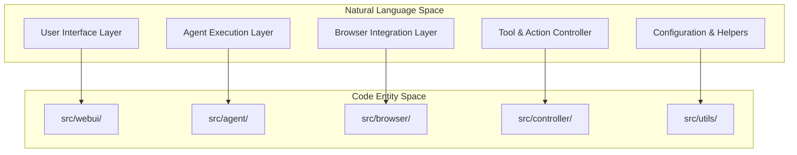
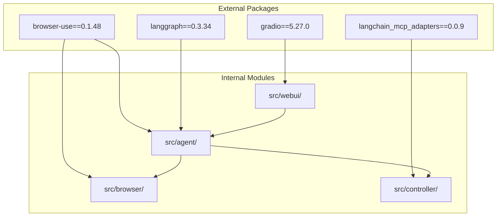

<!-- source: DeepWiki mcp.deepwiki.com · repo browser-use/web-ui · page 1.2 Project Layout and Dependencies · fetched 2026-10-30 -->

# Project Layout and Dependencies

<details>
<summary>Relevant source files</summary>

The following files were used as context for generating this wiki page:

- [LICENSE](LICENSE)
- [SECURITY.md](SECURITY.md)
- [requirements.txt](requirements.txt)
- [src/__init__.py](src/__init__.py)
- [src/agent/__init__.py](src/agent/__init__.py)

</details>


## Purpose and Scope
This page maps the repository directory structure of the `browser-use/web-ui` codebase and details its core third-party dependencies as specified in `requirements.txt`. It provides a technical breakdown of how the source tree is organized across modules like `src/webui`, `src/agent`, `src/browser`, `src/controller`, `src/utils`, and `tests`, explaining the specific role of each package and library.

Sources: `[requirements.txt:1-10](), [src/__init__.py:1-1]()`

---

## Repository Directory Structure

The codebase follows a modular Python application layout, separating concerns between user interface orchestration, agent execution loops, browser automation wrappers, tool controllers, and utility helpers. 

```
.
├── src/
│   ├── __init__.py
│   ├── webui/          # Gradio interface, WebuiManager, and tab layouts
│   ├── agent/          # Browser Use and Deep Research agent workflows
│   ├── browser/        # CustomBrowser and CustomBrowserContext wrappers
│   ├── controller/     # CustomController and action orchestration
│   └── utils/          # Configuration, environment handlers, and helpers
├── tests/              # Automated test suite (LLM APIs, controllers, agents)
└── requirements.txt    # Third-party Python dependencies
```

### Natural Language to Code Entity Mapping

The following diagram bridges conceptual system layers with their concrete directory and module counterparts in the codebase.


Sources: `[src/__init__.py:1-1]()`

---

## Key Third-Party Dependencies

The application relies on several core external packages specified in `requirements.txt`. These libraries provide the underlying browser automation runtime, UI framework, multi-provider LLM integrations, Model Context Protocol (MCP) support, and graph-based agent orchestration.

| Dependency | Version | Code Role & Purpose |
| :--- | :--- | :--- |
| `browser-use` | `0.1.48` | Core browser automation engine providing the base Agent framework, DOM parsing, and action execution `[requirements.txt:1]()`. |
| `gradio` | `5.27.0` | UI framework powering the web interface, reactive components, and real-time streaming displays `[requirements.txt:3]()`. |
| `langgraph` | `0.3.34` | Graph-based workflow orchestration engine utilized by complex agents like Deep Research `[requirements.txt:9]()`. |
| `langchain-mistralai` | `0.2.4` | Mistral AI provider integration for LangChain/LangGraph ecosystems `[requirements.txt:5]()`. |
| `langchain-ibm` | `0.3.10` | IBM watsonx LLM provider integration `[requirements.txt:7]()`. |
| `langchain_mcp_adapters` | `0.0.9` | Model Context Protocol (MCP) adapters for dynamic external tool registration `[requirements.txt:8]()`. |
| `json-repair` | Latest | Robust JSON parsing utility for recovering malformed model outputs `[requirements.txt:4]()`. |
| `pyperclip` | `1.9.0` | Cross-platform clipboard interaction utility `[requirements.txt:2]()`. |
| `MainContentExtractor` | `0.0.4` | Utility for parsing and extracting main readable text content from web pages `[requirements.txt:6]()`. |

Sources: `[requirements.txt:1-10]()`

---

## Module Breakdown

### 1. `src/webui/`
Houses the Gradio-based graphical interface components. It contains modules responsible for assembling interface tabs, managing reactive UI state through `WebuiManager`, handling chat histories, and synchronizing user configurations across sessions.

### 2. `src/agent/`
Contains the agent logic implementations. This includes wrappers and execution definitions for the primary interactive Browser Use Agent as well as the graph-based Deep Research Agent.

### 3. `src/browser/`
Implements custom Playwright browser wrappers (`CustomBrowser`) and context managers (`CustomBrowserContext`). It handles Chromium launch arguments, debugging port configurations, window sizing, security policies, and isolated session contexts.

### 4. `src/controller/`
Defines `CustomController` and custom action registries. This module bridges LLM tool-call outputs with concrete browser interactions, handling user assistance requests (`ask_for_assistant`) and file uploads.

### 5. `src/utils/`
Provides cross-cutting utility functions and configuration helpers. It manages environment variable parsing, UI theme maps, image encoding helpers for vision models, and configuration persistence.

### 6. `tests/`
Contains the test suite covering LLM API connectivity (`test_llm_api.py`), controller validation (`test_controller.py`), agent execution paths (`test_agents.py`), and Playwright integration (`test_playwright.py`).

---

## Component Dependency and Execution Flow

The following diagram illustrates how external dependencies interact with internal modules during runtime execution.


Sources: `[requirements.txt:1-10]()`

---

