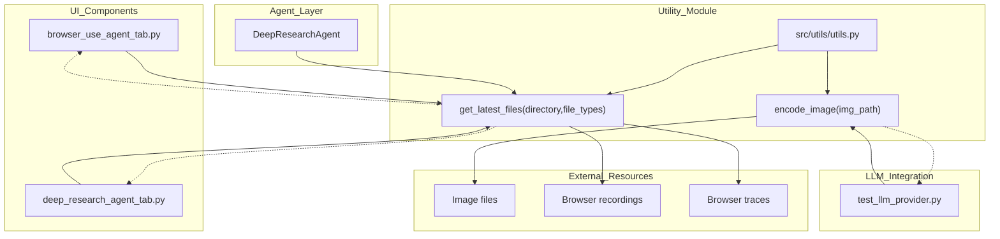
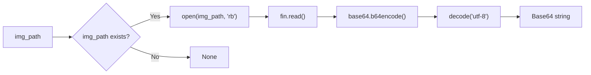
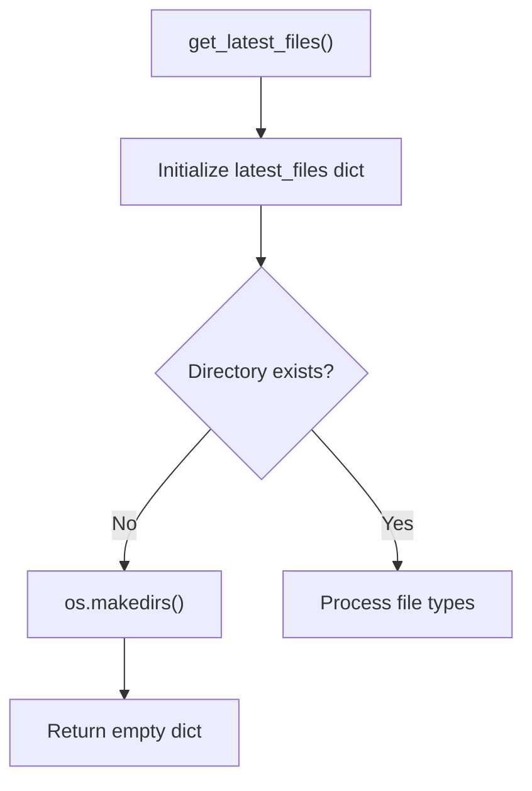
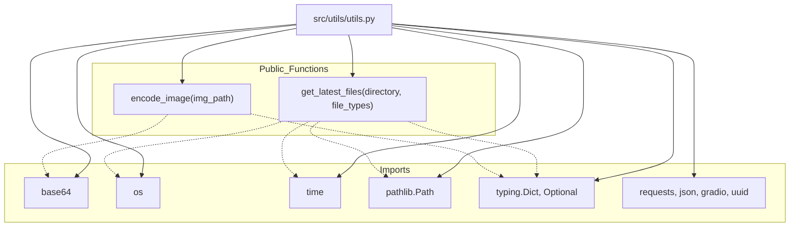

<!-- source: DeepWiki mcp.deepwiki.com · repo browser-use/web-ui · page 10.1 Utility Functions · fetched 2026-10-30 -->

# Utility Functions

<details>
<summary>Relevant source files</summary>

The following files were used as context for generating this wiki page:

- [src/utils/utils.py](src/utils/utils.py)

</details>


This document describes the utility functions provided in `src/utils/utils.py`. These are helper functions used throughout the browser-use web-ui codebase for common operations such as image encoding and file retrieval. The utilities support the UI components, agent implementations, and LLM integration layers.

For information about the overall development environment and testing infrastructure, see [Testing](#10.2) and [CI/CD Pipeline](#10.3).

---

## Overview

The utility module provides two primary functions that are used across multiple system components:

| Function | Purpose | Primary Consumers |
|----------|---------|-------------------|
| `encode_image` | Base64 encoding of image files | LLM vision model integration, testing framework |
| `get_latest_files` | Retrieval of most recent files by type | Browser Use Agent tab (recordings/traces), Deep Research Agent |

**Sources:** [src/utils/utils.py:1-39]()

---

## System Integration

The following diagram illustrates how utility functions integrate with the broader system architecture:



**Sources:** [src/utils/utils.py:1-39]()

---

## Image Encoding Function

### Function Signature

```python
encode_image(img_path) -> Optional[str]
```

The `encode_image` function converts an image file to a base64-encoded string suitable for transmission to LLM vision models.

**Sources:** [src/utils/utils.py:12-17]()

### Implementation Details

The function operates as follows:

1. **Null Check**: Returns `None` if `img_path` is not provided [src/utils/utils.py:13-14]()
2. **File Reading**: Opens the image file in binary read mode [src/utils/utils.py:15]()
3. **Base64 Encoding**: Encodes the binary data using `base64.b64encode()` [src/utils/utils.py:16]()
4. **String Conversion**: Decodes the bytes to a UTF-8 string for JSON serialization [src/utils/utils.py:16]()

### Data Flow



**Sources:** [src/utils/utils.py:12-17]()

### Use Cases

The `encode_image` function is primarily used in:

1. **LLM Testing**: The `test_llm_provider.py` module uses this function to prepare test images for vision model API calls. Vision-capable models require base64-encoded images in their message payloads.

2. **Multimodal Agent Interactions**: When agents need to send screenshots or other visual content to vision-enabled LLMs for analysis or decision-making.

**Sources:** [src/utils/utils.py:12-17]()

---

## File Retrieval Function

### Function Signature

```python
get_latest_files(directory: str, file_types: list = ['.webm', '.zip']) -> Dict[str, Optional[str]]
```

The `get_latest_files` function retrieves the most recently modified files of specified types from a directory.

**Sources:** [src/utils/utils.py:20-39]()

### Parameters

| Parameter | Type | Default | Description |
|-----------|------|---------|-------------|
| `directory` | `str` | (required) | Directory path to search for files |
| `file_types` | `list` | `['.webm', '.zip']` | List of file extensions to search for |

### Return Value

Returns a `Dict[str, Optional[str]]` where:
- **Keys**: File extensions from `file_types` parameter
- **Values**: Absolute path to the latest file of that type, or `None` if no file found

**Sources:** [src/utils/utils.py:20-22]()

### Implementation Details

The function implements a robust file retrieval algorithm:

#### Directory Handling



**Sources:** [src/utils/utils.py:22-26]()

#### File Selection Logic

For each file type, the function:

1. **Recursive Search**: Uses `Path.rglob()` to find all matching files recursively [src/utils/utils.py:30]()
2. **Timestamp Comparison**: Identifies the file with the most recent modification time using `max()` with `st_mtime` [src/utils/utils.py:32]()
3. **Completion Check**: Only returns files that were modified more than 1 second ago to avoid returning files still being written [src/utils/utils.py:34]()
4. **Error Handling**: Wraps operations in try-except to gracefully handle permission errors or corrupted files [src/utils/utils.py:29-37]()

**Sources:** [src/utils/utils.py:28-37]()

### Completion Check Rationale

The 1-second delay check at [src/utils/utils.py:34]() prevents the function from returning files that are currently being written to. This is critical for:

- **Browser recordings** (`.webm`): Playwright may still be encoding video frames
- **Browser traces** (`.zip`): Trace files may still be compressed
- **Concurrent writes**: Prevents race conditions when files are being generated asynchronously

**Sources:** [src/utils/utils.py:34-35]()

### Use Cases

The `get_latest_files` function is used by several components:

#### Browser Use Agent Tab

The Browser Use Agent tab calls this function to retrieve:
- **Recording files** (`.webm`): Browser session recordings for playback in the UI
- **Trace files** (`.zip`): Playwright trace files for debugging browser interactions

#### Deep Research Agent

The Deep Research Agent uses this function to locate research artifacts generated during the workflow.

**Sources:** [src/utils/utils.py:20-39]()

---

## Error Handling

Both utility functions implement defensive programming practices:

### encode_image Error Handling

- **Null Safety**: Returns `None` for invalid input rather than raising exceptions [src/utils/utils.py:13-14]()
- **File I/O**: Relies on Python's built-in exception handling for `open()` operations, allowing exceptions to propagate to the caller

### get_latest_files Error Handling

- **Directory Creation**: Automatically creates missing directories with `exist_ok=True` [src/utils/utils.py:25]()
- **Exception Catching**: Wraps file operations in try-except blocks to prevent crashes [src/utils/utils.py:29-37]()
- **Error Logging**: Prints error messages to console for debugging [src/utils/utils.py:37]()
- **Graceful Degradation**: Returns partial results if some file types fail to retrieve

**Sources:** [src/utils/utils.py:13-14](), [src/utils/utils.py:24-37]()

---

## Usage Patterns

### Typical encode_image Usage

```python
# In LLM testing or vision model integration
image_path = "path/to/screenshot.png"
encoded_data = encode_image(image_path)
if encoded_data:
    message = {"image": encoded_data, "type": "base64"}
```

### Typical get_latest_files Usage

```python
# In Browser Use Agent tab after task completion
latest = get_latest_files("./tmp/downloads", ['.webm', '.zip'])
recording_path = latest.get('.webm')
trace_path = latest.get('.zip')

if recording_path:
    gr.Video(value=recording_path)
```

**Sources:** [src/utils/utils.py:12-39]()

---

## Dependencies

The utility module has minimal dependencies:

| Module | Purpose | Usage |
|--------|---------|-------|
| `base64` | Base64 encoding/decoding | Image data encoding [src/utils/utils.py:1]() |
| `os` | Operating system interface | Directory existence checks, path operations [src/utils/utils.py:2]() |
| `time` | Time access and conversions | File modification time checks [src/utils/utils.py:3]() |
| `pathlib.Path` | Object-oriented filesystem paths | Recursive file searching with `rglob()` [src/utils/utils.py:4]() |
| `typing` | Type hints | Function signature annotations [src/utils/utils.py:5]() |

Note that while `requests`, `json`, `gradio`, and `uuid` are imported [src/utils/utils.py:6-9](), they are not currently used in the implemented functions and may represent planned future utilities.

**Sources:** [src/utils/utils.py:1-9]()

---

## Module Structure



**Sources:** [src/utils/utils.py:1-39]()

---

