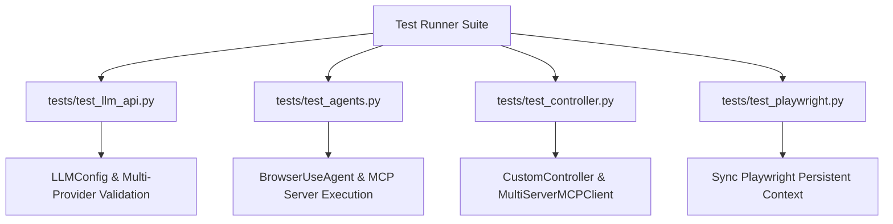
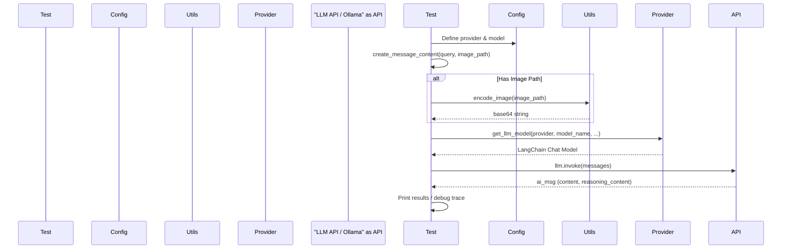
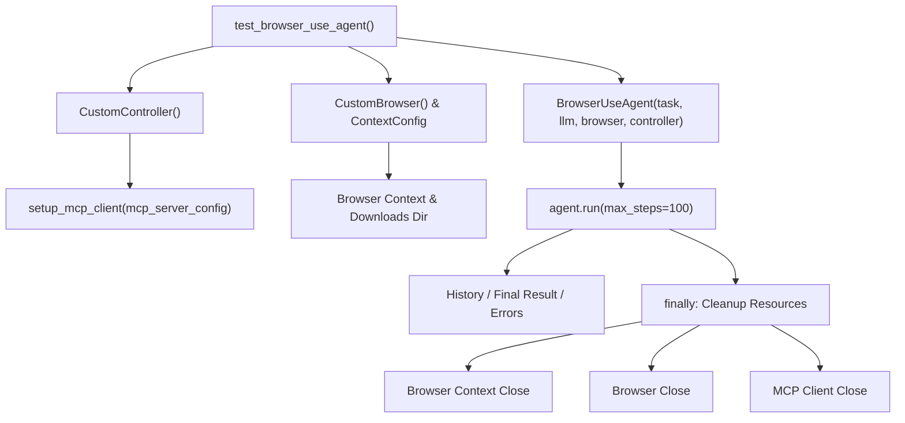
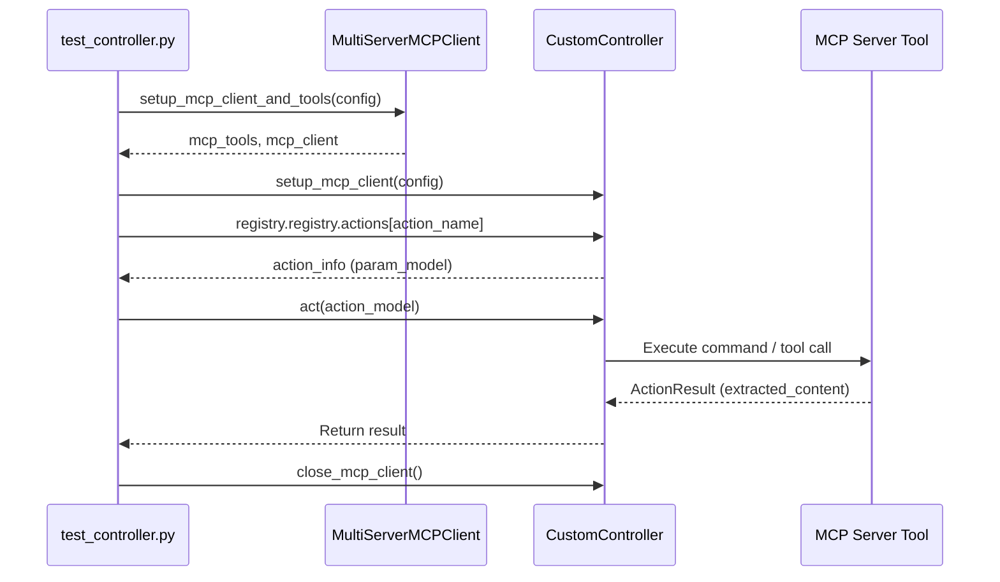

<!-- source: DeepWiki mcp.deepwiki.com · repo browser-use/web-ui · page 10.2 Testing · fetched 2026-10-30 -->

# Testing

<details>
<summary>Relevant source files</summary>

The following files were used as context for generating this wiki page:

- [src/agent/browser_use/browser_use_agent.py](src/agent/browser_use/browser_use_agent.py)
- [src/utils/mcp_client.py](src/utils/mcp_client.py)
- [tests/test_agents.py](tests/test_agents.py)
- [tests/test_controller.py](tests/test_controller.py)
- [tests/test_llm_api.py](tests/test_llm_api.py)
- [tests/test_playwright.py](tests/test_playwright.py)

</details>


This document explains the testing infrastructure located in the `tests/` directory of the `browser-use/web-ui` codebase. It covers unit and integration tests for LLM APIs (`tests/test_llm_api.py`), agent execution (`tests/test_agents.py`), MCP tool integration and controller actions (`tests/test_controller.py`), and direct Playwright browser connectivity (`tests/test_playwright.py`).

---

## 1. Testing Architecture Overview

The `tests/` directory houses modular test scripts designed to validate independent subsystems as well as end-to-end agent workflows. 



Sources: [tests/test_llm_api.py:1-159](), [tests/test_agents.py:20-164](), [tests/test_controller.py:13-131](), [tests/test_playwright.py:7-28]()

---

## 2. LLM Integration Testing (`tests/test_llm_api.py`)

`tests/test_llm_api.py` provides a testing harness for verifying model connectivity, text generation, tool calling, reasoning, and vision capabilities across various LLM providers (OpenAI, Azure, Google, DeepSeek, Ollama, Mistral, Moonshot, IBM, and Alibaba) [tests/test_llm_api.py:38-147]().

### Key Entities and Data Flow
- **`LLMConfig`**: A dataclass encapsulating provider settings, model names, temperature, base URLs, and API keys [tests/test_llm_api.py:16-23]().
- **`create_message_content()`**: Formats text queries and encodes local images (e.g., `.png` or `.jpeg`) into base64 data URLs via `src.utils.utils.encode_image()` [tests/test_llm_api.py:25-35]().
- **`get_env_value()`**: Resolves provider-specific environment variables for endpoints and API keys (`OPENAI_API_KEY`, `AZURE_OPENAI_ENDPOINT`, `DEEPSEEK_API_KEY`, etc.) [tests/test_llm_api.py:38-52]().
- **`test_llm()`**: Dispatches the request to either local Ollama instances (with special handling for `DeepSeekR1ChatOllama`) or standardized models via `src.utils.llm_provider.get_llm_model()` [tests/test_llm_api.py:55-91]().



Sources: [tests/test_llm_api.py:16-91]()

---

## 3. Agent Testing (`tests/test_agents.py`)

`tests/test_agents.py` verifies the execution of `BrowserUseAgent` integrated with `CustomBrowser`, `CustomController`, and Model Context Protocol (MCP) servers [tests/test_agents.py:20-164]().

### Key Functions
- **`test_browser_use_agent()`**: Initializes an OpenAI or Azure LLM model, sets up an MCP configuration (e.g., `@wonderwhy-er/desktop-commander`), instantiates `CustomBrowser` and `CustomBrowserContext`, and runs `BrowserUseAgent` against tasks like stock price lookups [tests/test_agents.py:20-147]().
- **Resource Cleanup**: Employs a robust `try...finally` block to ensure browser contexts, browser instances, and MCP clients are properly closed [tests/test_agents.py:104-164]().



Sources: [tests/test_agents.py:20-164](), [src/agent/browser_use/browser_use_agent.py:48-169]()

---

## 4. Controller and MCP Tool Testing (`tests/test_controller.py`)

`tests/test_controller.py` tests Model Context Protocol (MCP) tool discovery, dynamic Pydantic schema generation, and tool execution through `CustomController` [tests/test_controller.py:1-131]().

### Test Suites
- **`test_mcp_client()`**: Tests `setup_mcp_client_and_tools()` and `create_tool_param_model()` from `src.utils.mcp_client`, iterating over fetched MCP tools and printing their JSON schemas [tests/test_controller.py:13-53]().
- **`test_controller_with_mcp()`**: Initializes `CustomController`, connects to MCP servers, fetches actions (e.g., `mcp.desktop-commander.execute_command`), validates parameters against generated Pydantic models (`ActionModel`), executes actions via `controller.act()`, and handles asynchronous output streaming [tests/test_controller.py:55-127]().



Sources: [tests/test_controller.py:13-131](), [src/utils/mcp_client.py:17-44]()

---

## 5. Playwright Browser Connectivity (`tests/test_playwright.py`)

`tests/test_playwright.py` provides a low-level diagnostic script to verify direct Playwright synchronization and persistent browser context launching [tests/test_playwright.py:7-28]().

### Implementation Details
- **`test_connect_browser()`**: Utilizes `playwright.sync_api.sync_playwright()` to launch a Chromium persistent context with user data paths and executable paths configured via environment variables (`CHROME_PATH`, `CHROME_USER_DATA`) [tests/test_playwright.py:7-19]().
- Opens a new page, navigates to a target URL (`https://mail.google.com/`), waits for load states, and pauses for manual inspection before closing [tests/test_playwright.py:21-27]().

Sources: [tests/test_playwright.py:7-28]()

---

## 6. Testing Practices and Execution Guidelines

When running or adding tests in the repository, follow these standard practices:

1. **Environment Setup**: Always ensure a `.env` file is present or required environment variables (`OPENAI_API_KEY`, etc.) are exported before executing LLM or agent tests [tests/test_llm_api.py:5-9](), [tests/test_agents.py:3-5]().
2. **Selective Execution**: Run specific test functions directly via python:
   ```bash
   python tests/test_llm_api.py
   python tests/test_agents.py
   python tests/test_controller.py
   python tests/test_playwright.py
   ```
3. **Resource Management**: Always use `try...finally` blocks to close browser contexts, browsers, and MCP clients to prevent orphan processes or locked user data directories [tests/test_agents.py:154-164]().

Sources: [tests/test_llm_api.py:149-159](), [tests/test_agents.py:154-164](), [tests/test_controller.py:129-131](), [tests/test_playwright.py:30-31]()

---

