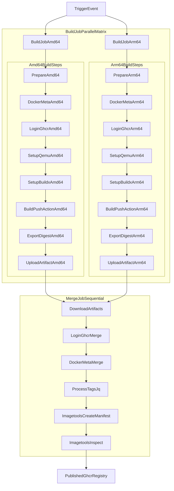
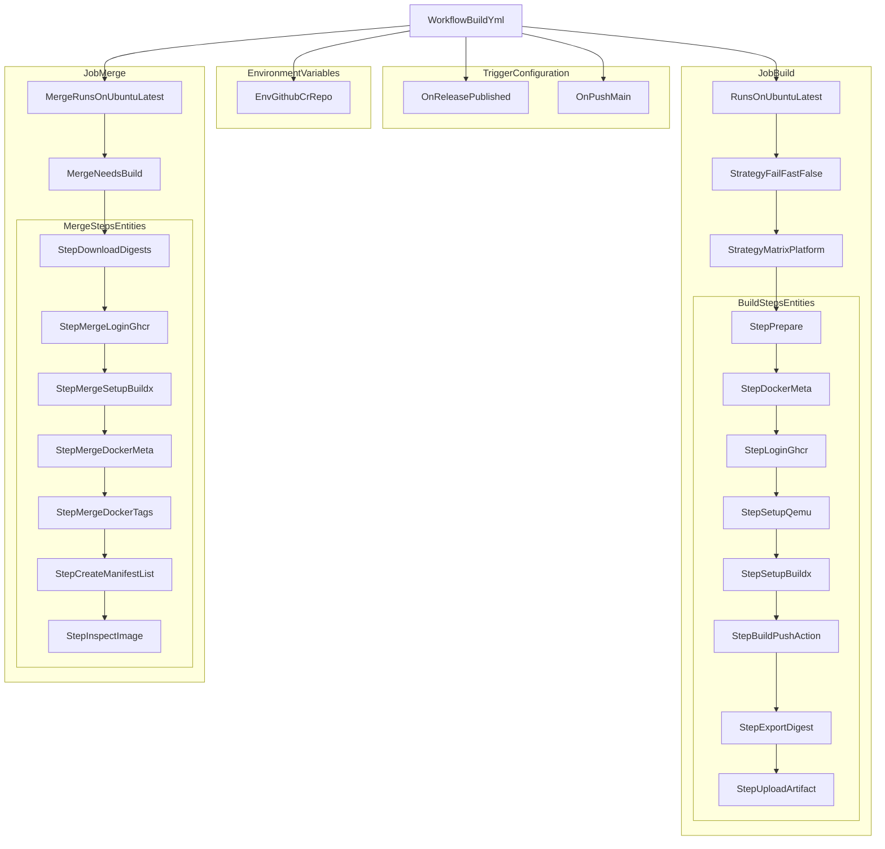
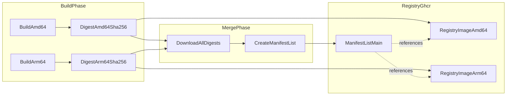

<!-- source: DeepWiki mcp.deepwiki.com · repo browser-use/web-ui · page 10.3 CI/CD Pipeline · fetched 2026-10-30 -->

# CI/CD Pipeline

<details>
<summary>Relevant source files</summary>

The following files were used as context for generating this wiki page:

- [.github/workflows/build.yml](.github/workflows/build.yml)

</details>


## Purpose and Scope

This document describes the Continuous Integration and Continuous Deployment (CI/CD) pipeline for the browser-use web-ui project. The pipeline automates the building and publishing of multi-platform Docker images to GitHub Container Registry (GHCR) using GitHub Actions.

The pipeline handles:
- Multi-architecture Docker image builds (AMD64 and ARM64)
- Automated builds triggered by releases and main branch commits
- Digest-based building for efficient multi-platform images
- Semantic versioning and tagging strategies
- Publication to GitHub Container Registry

For information about the actual Docker deployment configuration, see [Docker Deployment](#9.1).

Sources: [.github/workflows/build.yml:1-124]()

---

## Workflow Overview

The CI/CD pipeline is implemented as a GitHub Actions workflow located in [.github/workflows/build.yml:1-124](). The workflow uses a two-job architecture:

1. **Build Job**: Builds platform-specific images in parallel using a matrix strategy
2. **Merge Job**: Combines platform-specific builds into multi-architecture manifest lists

This approach optimizes build time by parallelizing platform builds while ensuring the final image supports multiple architectures.

Sources: [.github/workflows/build.yml:1-124]()

---

## Trigger Conditions

The workflow is triggered by two types of events:

| Event Type | Trigger | Purpose |
|------------|---------|---------|
| `release` | When a release is published | Creates tagged releases with semantic versioning |
| `push` | When code is pushed to `main` branch | Creates `main` tag for latest development builds |

```yaml
on:
  release:
    types: [published]
  push:
    branches: [main]
```

Sources: [.github/workflows/build.yml:3-7]()

---

## Environment Configuration

The workflow uses a global environment variable to define the container registry repository:

```yaml
env:
  GITHUB_CR_REPO: ghcr.io/${{ github.repository }}
```

This resolves to `ghcr.io/browser-use/web-ui` for the repository, ensuring all build and push operations target the correct registry location.

Sources: [.github/workflows/build.yml:9-10]()

---

## Build Job: Multi-Platform Builds

The build job executes platform-specific builds in parallel using a matrix strategy.

### Matrix Configuration

```yaml
strategy:
  fail-fast: false
  matrix:
    platform:
      - linux/amd64
      - linux/arm64
```

The `fail-fast: false` setting ensures that if one platform build fails, the other continues, allowing partial success states.

Sources: [.github/workflows/build.yml:15-20]()

### Build Steps

The build job follows this sequence:

#### 1. Platform Preparation

Converts the platform string (e.g., `linux/amd64`) into a filesystem-safe identifier:

```bash
platform=${{ matrix.platform }}
echo "PLATFORM_PAIR=${platform//\//-}" >> $GITHUB_ENV
```

This creates identifiers like `linux-amd64` for artifact naming.

Sources: [.github/workflows/build.yml:22-25]()

#### 2. Docker Metadata Generation

Uses the `docker/metadata-action@v5` to generate standardized labels for the image:

```yaml
- name: Docker meta
  id: meta
  uses: docker/metadata-action@v5
  with:
    images: |
      ${{ env.GITHUB_CR_REPO }}
```

Sources: [.github/workflows/build.yml:27-32]()

#### 3. Registry Authentication

Authenticates with GitHub Container Registry using the built-in `GITHUB_TOKEN`:

```yaml
- name: Login to GHCR
  uses: docker/login-action@v3
  with:
    registry: ghcr.io
    username: ${{ github.repository_owner }}
    password: ${{ secrets.GITHUB_TOKEN }}
```

Sources: [.github/workflows/build.yml:34-39]()

#### 4. QEMU Setup

Enables cross-platform emulation for building ARM64 images on AMD64 runners:

```yaml
- name: Set up QEMU
  uses: docker/setup-qemu-action@v3
```

Sources: [.github/workflows/build.yml:41-42]()

#### 5. Docker Buildx Setup

Configures Docker Buildx for multi-platform builds:

```yaml
- name: Set up Docker Buildx
  uses: docker/setup-buildx-action@v3
```

Sources: [.github/workflows/build.yml:44-45]()

#### 6. Build and Push by Digest

The core build step uses digest-based pushing instead of tags:

```yaml
- name: Build and push by digest
  id: build
  uses: docker/build-push-action@v6
  with:
    platforms: ${{ matrix.platform }}
    labels: ${{ steps.meta.outputs.labels }}
    tags: |
      ${{ env.GITHUB_CR_REPO }}
    build-args: |
      TARGETPLATFORM=${{ matrix.platform }}
    outputs: type=image,push-by-digest=true,name-canonical=true,push=true
```

The `push-by-digest=true` setting is crucial - it pushes the image by content hash rather than tag, allowing later manifest creation.

Sources: [.github/workflows/build.yml:47-57]()

#### 7. Digest Export and Upload

Each platform build exports its digest hash and uploads it as an artifact:

```bash
mkdir -p ${{ runner.temp }}/digests
digest="${{ steps.build.outputs.digest }}"
touch "${{ runner.temp }}/digests/${digest#sha256:}"
```

```yaml
- name: Upload digest
  uses: actions/upload-artifact@v4
  with:
    name: digests-${{ env.PLATFORM_PAIR }}
    path: ${{ runner.temp }}/digests/*
    if-no-files-found: error
    retention-days: 1
```

Sources: [.github/workflows/build.yml:59-71]()

---

## Merge Job: Manifest List Creation

The merge job runs after all platform builds complete and combines them into multi-architecture manifest lists.

### Digest Aggregation

Downloads all platform-specific digests into a single directory:

```yaml
- name: Download digests
  uses: actions/download-artifact@v4
  with:
    path: ${{ runner.temp }}/digests
    pattern: digests-*
    merge-multiple: true
```

Sources: [.github/workflows/build.yml:78-83]()

### Tag Generation

Generates appropriate tags based on the trigger event:

```yaml
- name: Docker meta
  id: meta
  uses: docker/metadata-action@v5
  with:
    images: |
      ${{ env.GITHUB_CR_REPO }}
    tags: |
      type=ref,event=branch
      type=ref,event=pr
      type=semver,pattern={{version}}
      type=semver,pattern={{major}}
```

This creates different tags depending on the event type:

| Event | Example Tags |
|-------|--------------|
| Push to `main` | `ghcr.io/browser-use/web-ui:main` |
| Release `v1.2.3` | `ghcr.io/browser-use/web-ui:1.2.3`, `ghcr.io/browser-use/web-ui:1` |
| Pull Request #42 | `ghcr.io/browser-use/web-ui:pr-42` |

Sources: [.github/workflows/build.yml:95-106]()

### Tag Fallback Logic

If metadata generation produces no tags (edge case), the workflow falls back to using the branch/ref name:

```bash
tags=$(jq -cr '.tags | map("-t " + .) | join(" ")' <<< "$DOCKER_METADATA_OUTPUT_JSON")
if [ -z "$tags" ]; then
  echo "DOCKER_METADATA_OUTPUT_VERSION=${{ github.ref_name }}" >> $GITHUB_ENV
  tags="-t ${{ env.GITHUB_CR_REPO }}:${{ github.ref_name }}"
fi
echo "DOCKER_METADATA_TAGS=$tags" >> $GITHUB_ENV
```

Sources: [.github/workflows/build.yml:107-114]()

### Manifest Creation and Push

Creates a manifest list that references all platform-specific digests:

```bash
docker buildx imagetools create ${{ env.DOCKER_METADATA_TAGS }} \
  $(printf '${{ env.GITHUB_CR_REPO }}@sha256:%s ' *)
```

This command:
1. Reads all digest files from the digests directory
2. Creates a manifest list pointing to each platform-specific image by digest
3. Tags the manifest list with the appropriate version tags

Sources: [.github/workflows/build.yml:116-120]()

### Image Inspection

Verifies the final multi-architecture image:

```bash
docker buildx imagetools inspect ${{ env.GITHUB_CR_REPO }}:${{ env.DOCKER_METADATA_OUTPUT_VERSION }}
```

This outputs the manifest list structure, showing all supported platforms.

Sources: [.github/workflows/build.yml:122-124]()

---

## Build Process Flow

### Diagram: Build Process Flow


Sources: [.github/workflows/build.yml:1-124]()

---

## GitHub Actions Workflow Structure

### Diagram: GitHub Actions Workflow Structure


Sources: [.github/workflows/build.yml:1-124]()

---

## Image Tagging Strategy

The workflow applies different tagging strategies based on the trigger event:

### Tag Types

| Tag Type | Pattern | Example | When Applied |
|----------|---------|---------|--------------|
| Branch Reference | `type=ref,event=branch` | `main` | Push to branch |
| PR Reference | `type=ref,event=pr` | `pr-42` | Pull request |
| Semantic Version | `type=semver,pattern={{version}}` | `1.2.3` | Release published |
| Major Version | `type=semver,pattern={{major}}` | `1` | Release published |

### Version Tag Examples

For a release tagged `v1.2.3`, the following tags are created:
- `ghcr.io/browser-use/web-ui:1.2.3` (full version)
- `ghcr.io/browser-use/web-ui:1` (major version)

For a push to the `main` branch:
- `ghcr.io/browser-use/web-ui:main`

Sources: [.github/workflows/build.yml:101-106]()

---

## Digest-Based Multi-Platform Strategy

The workflow uses a digest-based approach for multi-platform image creation, which offers several advantages:

### Why Digest-Based Building?

1. **Parallel Building**: Each platform can be built independently in parallel
2. **Efficient Storage**: Avoids creating temporary multi-arch images
3. **Atomic Publishing**: The final manifest is created only when all platforms succeed
4. **Deduplication**: Registry can deduplicate layers across platforms

### Diagram: Digest-Based Multi-Platform Process


Sources: [.github/workflows/build.yml:47-124]()

---

## GitHub Actions Components

The workflow relies on several GitHub Actions and Docker tools:

### Actions Used

| Action | Version | Purpose |
|--------|---------|---------|
| `docker/metadata-action` | v5 | Generate image metadata and tags |
| `docker/login-action` | v3 | Authenticate with container registry |
| `docker/setup-qemu-action` | v3 | Enable cross-platform emulation |
| `docker/setup-buildx-action` | v3 | Set up Docker Buildx builder |
| `docker/build-push-action` | v6 | Build and push Docker images |
| `actions/upload-artifact` | v4 | Upload build artifacts |
| `actions/download-artifact` | v4 | Download build artifacts |

### Secrets and Permissions

The workflow requires:
- `GITHUB_TOKEN`: Automatically provided by GitHub Actions
  - Used for: Authenticating with GHCR, reading repository metadata
  - Scoped to: The current repository

No manual secret configuration is required.

Sources: [.github/workflows/build.yml:1-124]()

---

## Build Output

After successful execution, the workflow produces:

### Published Artifacts

1. **Multi-architecture Docker images** at `ghcr.io/browser-use/web-ui`
2. **Platform-specific image layers** stored by digest
3. **Manifest lists** tagged according to the versioning strategy

### Image Inspection Output

The final inspect step produces output showing the manifest structure:

```
Name:      ghcr.io/browser-use/web-ui:main
MediaType: application/vnd.docker.distribution.manifest.list.v2+json
Digest:    sha256:xyz789...

Manifests:
  Name:      ghcr.io/browser-use/web-ui@sha256:abc123...
  MediaType: application/vnd.docker.distribution.manifest.v2+json
  Platform:  linux/amd64

  Name:      ghcr.io/browser-use/web-ui@sha256:def456...
  MediaType: application/vnd.docker.distribution.manifest.v2+json
  Platform:  linux/arm64
```

Sources: [.github/workflows/build.yml:122-124]()

---

## Workflow Execution Context

### Job Dependencies

The workflow uses explicit job dependencies to ensure correct execution order:

```yaml
merge:
  runs-on: ubuntu-latest
  needs:
    - build
```

The `merge` job will not start until all matrix variants of the `build` job complete successfully.

### Parallel Execution

With the matrix strategy, both platform builds run in parallel on separate GitHub Actions runners, reducing total build time. The `fail-fast: false` setting allows one platform to fail while the other continues, though the merge job will not run if any build fails.

Sources: [.github/workflows/build.yml:15-16,73-76]()

---

## Build Arguments

The build step passes the target platform as a build argument:

```yaml
build-args: |
  TARGETPLATFORM=${{ matrix.platform }}
```

This allows the Dockerfile to implement platform-specific logic using the `TARGETPLATFORM` argument. For details on how this is used in the Dockerfile, see [Docker Deployment](#9.1).

Sources: [.github/workflows/build.yml:55-56]()

---

