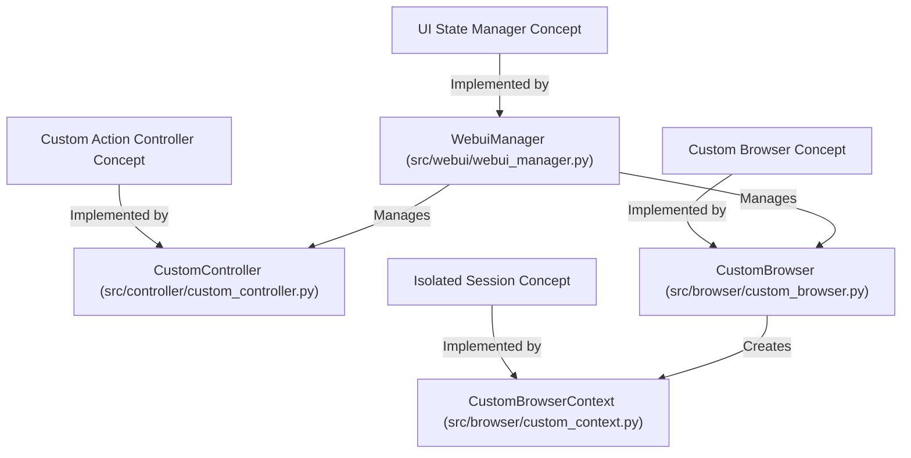
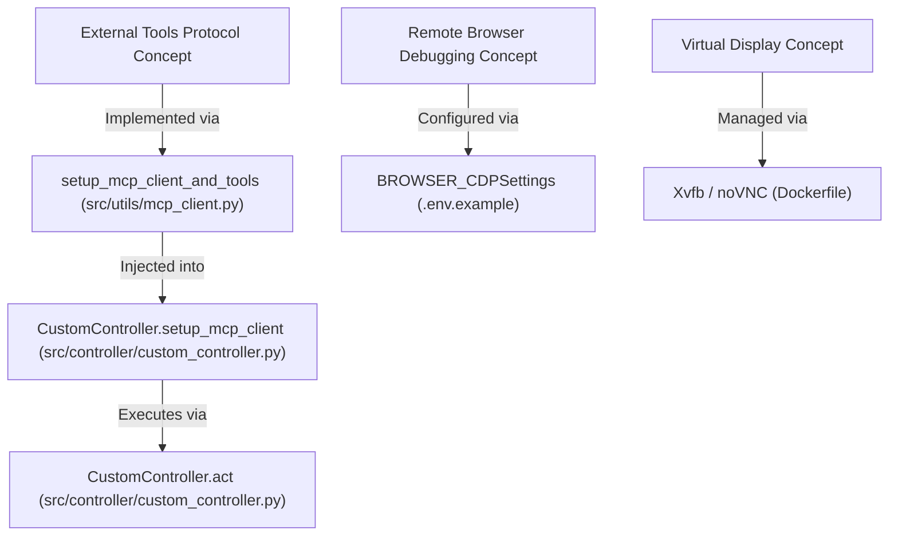

<!-- source: DeepWiki mcp.deepwiki.com · repo browser-use/web-ui · page 11 Glossary · fetched 2026-10-30 -->

# Glossary

Relevant source files

The following files were used as context for generating this wiki page:

- [.env.example](.env.example)
- [README.md](README.md)
- [src/controller/custom_controller.py](src/controller/custom_controller.py)
- [src/webui/webui_manager.py](src/webui/webui_manager.py)

## Purpose and Scope
This page serves as the definitive reference for codebase-specific terms, architectural classes, external protocols, and abbreviations used throughout the `browser-use/web-ui` repository. It bridges high-level conceptual terms (Natural Language Space) with their exact implementations in the codebase (Code Entity Space) to assist developers and contributors in navigating modules, classes, and configuration parameters.

---

## 11.1 Architectural & State Management Classes

* **`WebuiManager`**: The central state coordinator responsible for mapping Gradio UI components (`id_to_component`), managing runtime references to active browser and agent instances (`bu_agent`, `bu_browser`), maintaining chat histories, and handling JSON configuration persistence (`save_config`, `load_config`).
  * Defined in: `src/webui/webui_manager.py:22-123`
* **`CustomController`**: An extension of the base `Controller` class from `browser-use`. It registers custom user actions such as `ask_for_assistant` and `upload_file`, processes action execution (`act`), and integrates Model Context Protocol (MCP) servers and tools.
  * Defined in: `src/controller/custom_controller.py:39-159`
* **`CustomBrowser`**: A specialized Playwright browser wrapper that handles custom launch configurations, headless settings, security arguments, Chrome user data directories, and debugging ports.
  * Defined in: `src/browser/custom_browser.py` (Referenced in `src/webui/webui_manager.py:16-36`)
* **`CustomBrowserContext`**: Extends the base Playwright `BrowserContext` to merge custom settings, manage isolated session states, and support persistent browser profiles.
  * Defined in: `src/browser/custom_context.py` (Referenced in `src/webui/webui_manager.py:17-36`)

Sources: `src/webui/webui_manager.py:22-123`, `src/controller/custom_controller.py:39-159`

---

## 11.2 Protocols & Infrastructure Terms

* **`MCP` (Model Context Protocol)**: An open standard protocol used to securely connect external tools and data sources to LLM agents. In this codebase, it is initialized via `setup_mcp_client_and_tools` and dynamically generates Pydantic parameter models for registered tools.
  * Defined/Referenced in: `src/controller/custom_controller.py:30-159`
* **`CDP` (Chrome DevTools Protocol)**: A protocol enabling inspection, debugging, and control of Chromium-based browsers. Used in configuration to attach to running browser instances via remote debugging hosts and ports.
  * Configured in: `.env.example:56-61`
* **`Xvfb` (X Virtual Framebuffer)**: A display server implementing the X11 display server protocol without showing any screen output, used extensively in Docker environments to run headless browser instances.
  * Referenced in: `Dockerfile` / README.md
* **`noVNC`**: An HTML5 VNC client library and server setup that allows users to view and interact with the Xvfb virtual desktop running the browser automation inside a Docker container via a web browser.
  * Referenced in: `README.md:144-146`

Sources: `src/controller/custom_controller.py:30-159`, `.env.example:56-61`, `README.md:144-146`

---

## 11.3 External Libraries & Frameworks

* **`browser-use`**: The core underlying Python library providing the foundational agent loop, browser interaction primitives, and base controller abstractions.
  * Referenced in: `README.md:10-15`, `src/controller/custom_controller.py:6-9`
* **`Langgraph`**: A library for building stateful, multi-actor applications with LLMs, utilized by the Deep Research Agent for planning, parallel web searching, and report synthesis workflows.
  * Referenced in: `src/agent/deep_research/deep_research_agent.py` (and `src/webui/webui_manager.py:19-50`)
* **DeepSeekR1 Wrappers**: Specialized LLM handling layers designed to parse reasoning tokens (``) and integrate advanced reasoning models with browser automation tasks.
  * Referenced in: `README.md:149`
* **`theme_map`**: A UI styling and layout configuration mapping structure used within Gradio interface assembly modules to apply custom themes across tabs.
  * Referenced in: `src/webui/interface.py`

Sources: `README.md:10-15`, `src/controller/custom_controller.py:6-9`, `src/webui/webui_manager.py:19-50`

---

## 11.4 Natural Language to Code Entity Mappings

### Diagram 1: UI & Agent Control Concepts to Code Entities

Sources: `src/webui/webui_manager.py:22-123`, `src/controller/custom_controller.py:39-159`

### Diagram 2: Tooling & Protocol Concepts to Code Entities

Sources: `src/controller/custom_controller.py:30-159`, `.env.example:56-61`