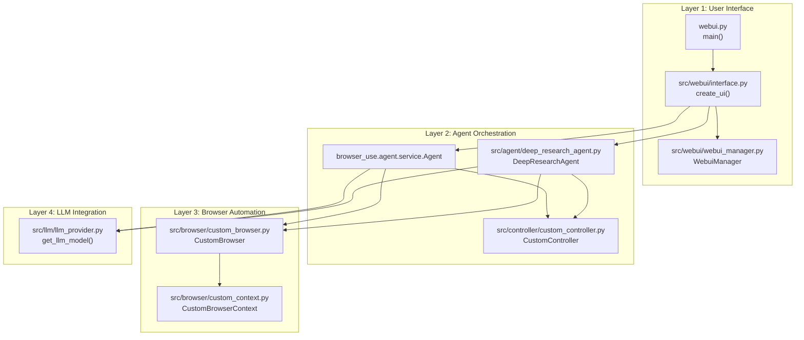
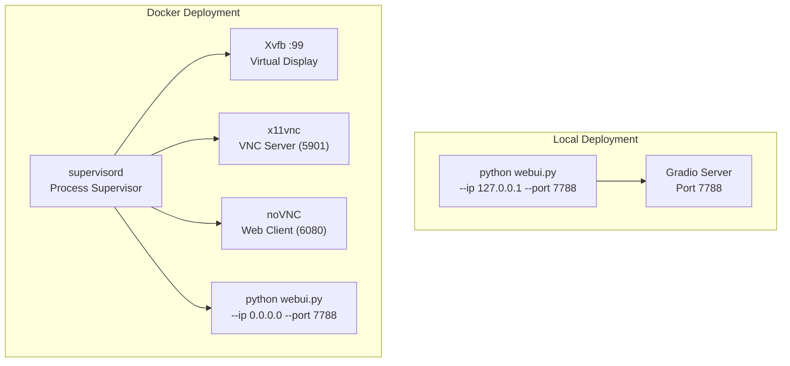
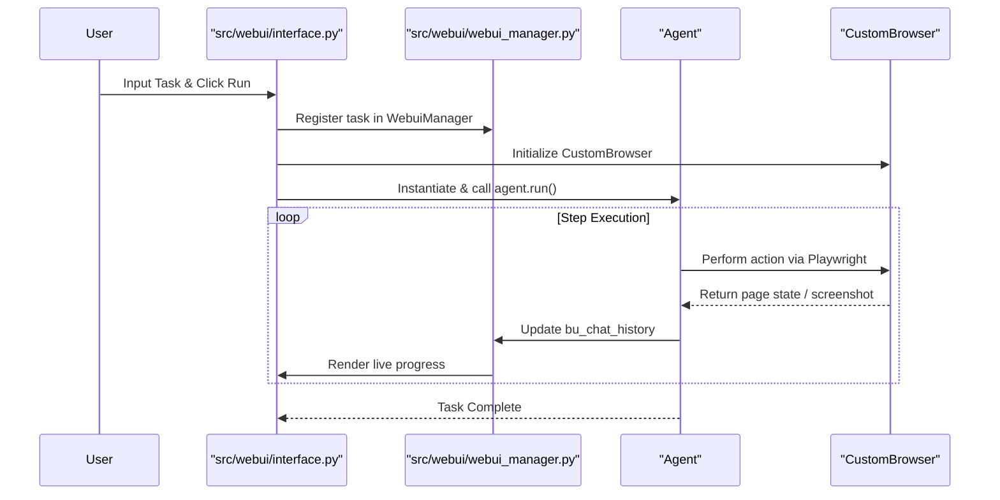

<!-- source: DeepWiki mcp.deepwiki.com · repo browser-use/web-ui · page 2 System Architecture · fetched 2026-10-30 -->

# System Architecture

Relevant source files

The following files were used as context for generating this wiki page:

- [src/webui/interface.py](src/webui/interface.py)
- [src/webui/webui_manager.py](src/webui/webui_manager.py)
- [webui.py](webui.py)

## Purpose and Scope

This document explains the high-level layered design of the browser-use web-ui system, its deployment models, and how components interact across the user interface, agent, browser, and LLM tiers. 

Because this is a parent page, it provides a high-level overview of the architecture and points to dedicated child pages for deep technical details:
- For application startup, CLI arguments, and Gradio tab assembly, see [Application Entrypoint and Interface Assembly](#2.1).
- For component registration, state management, chat history, and configuration persistence, see [WebuiManager and State Flow](#2.2).

**Sources:** [webui.py:1-19](), [src/webui/interface.py:1-95](), [src/webui/webui_manager.py:1-122]()

---

## System Layers

The system follows a strict layered architecture separating concerns from the Gradio interface down to Playwright browser automation and multi-provider LLM inference.

### Layered Architecture Overview

The following diagram bridges natural language functional concepts to code entities (`webui.py`, `interface.py`, `WebuiManager`, `CustomBrowser`, `CustomController`, `get_llm_model`) within the codebase:

**Sources:** [webui.py:1-19](), [src/webui/interface.py:1-95](), [src/webui/webui_manager.py:1-122]()

### Layer Responsibilities

| Layer | Primary Code Entities | Responsibilities |
|-------|----------------------|------------------|
| **User Interface** | `webui.py`, `src/webui/interface.py`, `src/webui/webui_manager.py` | CLI parsing, Gradio block assembly, layout themes (`theme_map`), and state coordination |
| **Agent Orchestration** | `Agent`, `DeepResearchAgent`, `CustomController` | Task execution loops, action registration, step planning, and tool dispatch |
| **Browser Automation** | `CustomBrowser`, `CustomBrowserContext` | Playwright lifecycle control, CDP port binding, user data directories, and isolation |
| **LLM Integration** | `src/llm/llm_provider.py` | Multi-provider chat model instantiation and fallback handling |

**Sources:** [webui.py:1-19](), [src/webui/interface.py:1-95](), [src/webui/webui_manager.py:1-122]()

---

## Deployment Architectures

The system supports both local execution via standard Python environments and headless containerized execution via Docker.

### Deployment Architecture Mapping

**Sources:** [webui.py:7-16](), [src/webui/interface.py:22-30]()

---

## Component Interaction Model

The interaction model governs how user triggers pass through the UI manager down to agents, controllers, and browser sessions.

### Request-Response Flow

**Sources:** [src/webui/interface.py:22-95](), [src/webui/webui_manager.py:30-43]()

---

## Subsystem Details and Child Pages

For granular technical documentation on entrypoints, interface building, and state coordination, please refer to the child pages:

- **2.1 Application Entrypoint and Interface Assembly**: Details `webui.py` argument parsing, `theme_map`, `create_ui`, and tab registration in `src/webui/interface.py`.
- **2.2 WebuiManager and State Flow**: Explains component registration via `id_to_component`, chat history, browser reference management, and config save/load routines in `src/webui/webui_manager.py`.

**Sources:** [webui.py:1-19](), [src/webui/interface.py:1-95](), [src/webui/webui_manager.py:1-122]()

---

