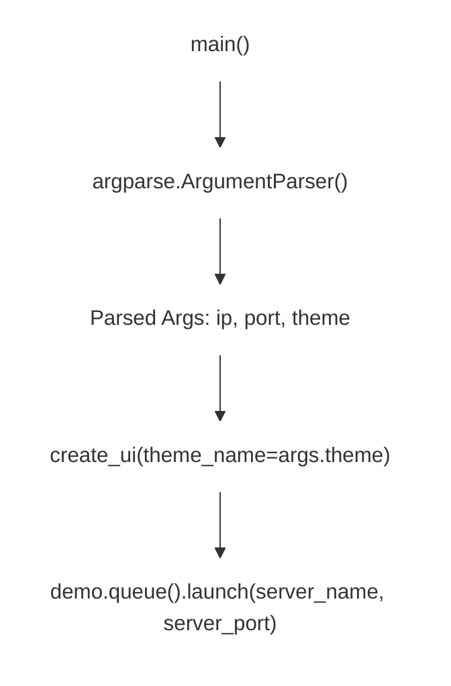
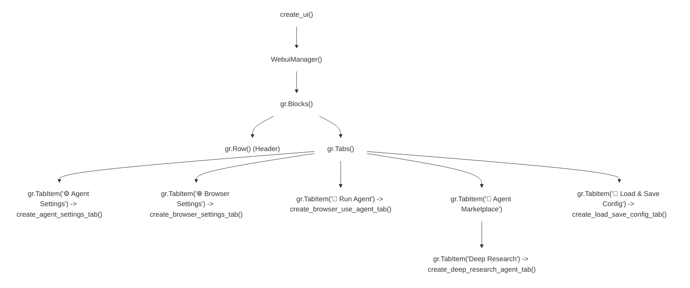

<!-- source: DeepWiki mcp.deepwiki.com · repo browser-use/web-ui · page 2.1 Application Entrypoint and Interface Assembly · fetched 2026-10-30 -->

# Application Entrypoint and Interface Assembly

Relevant source files

The following files were used as context for generating this wiki page:

- [src/webui/interface.py](src/webui/interface.py)
- [webui.py](webui.py)

The purpose and scope of this document is to detail the application entrypoint (`webui.py`) and the interface assembly layer (`src/webui/interface.py`). It covers CLI argument parsing, theme mapping, custom CSS/JS injection, the `WebuiManager` initialization, and the hierarchical assembly of Gradio tabs that launch the web server.

---

## 1. Application Entrypoint (`webui.py`)

The application starts via `webui.py`, which acts as the primary executable script. It loads environment variables, parses command-line arguments to configure network binding and UI themes, and initializes the Gradio application instance.

The execution flow begins by invoking `load_dotenv()` from the `dotenv` package to populate the environment from local configuration files [webui.py:1-2]. An `argparse.ArgumentParser` is then instantiated to handle three primary configuration parameters:
- `--ip`: The binding IP address for the Gradio server (default `127.0.0.1`) [webui.py:9].
- `--port`: The network port on which the server listens (default `7788`) [webui.py:10].
- `--theme`: The visual theme applied to the interface, restricted to valid keys present in `theme_map` (default `Ocean`) [webui.py:11].

Once arguments are parsed, `create_ui()` is called with the selected theme name [webui.py:14]. The returned Gradio `Blocks` demo object has its queue enabled and launches using the specified server parameters [webui.py:15].

Sources: `webui.py:1-20`

---

## 2. Theme Mapping and Styling

The UI presentation layer relies on a predefined dictionary of Gradio themes and custom style injections located in `src/webui/interface.py`.

### Theme Mapping (`theme_map`)
The `theme_map` dictionary associates string identifiers with Gradio theme instances [src/webui/interface.py:10-19]:
- `"Default"`: `gr.themes.Default()`
- `"Soft"`: `gr.themes.Soft()`
- `"Monochrome"`: `gr.themes.Monochrome()`
- `"Glass"`: `gr.themes.Glass()`
- `"Origin"`: `gr.themes.Origin()`
- `"Citrus"`: `gr.themes.Citrus()`
- `"Ocean"`: `gr.themes.Ocean()`
- `"Base"`: `gr.themes.Base()`

### CSS and JS Injection
`create_ui()` defines a custom CSS block (`css`) that controls layout sizing, container margins, header alignments, and section padding for the `.gradio-container` [src/webui/interface.py:23-43]. Additionally, a JavaScript injection snippet (`js_func`) forces the browser session into dark mode by inspecting and modifying the URL query parameters (`__theme=dark`) upon load [src/webui/interface.py:46-55].

Sources: `src/webui/interface.py:1-55`

---

## 3. Interface Assembly and Tab Hierarchy (`src/webui/interface.py`)

The core user interface is assembled within `create_ui(theme_name)` [src/webui/interface.py:22]. This function instantiates the global state container `WebuiManager` and constructs the main Gradio layout using `gr.Blocks` and `gr.Tabs` [src/webui/interface.py:57-71].

### Tab Breakdown
- **Agent Settings Tab**: Invokes `create_agent_settings_tab(ui_manager)` to render model selections, API keys, and behavioral parameters [src/webui/interface.py:72-73].
- **Browser Settings Tab**: Invokes `create_browser_settings_tab(ui_manager)` to configure headless mode, viewport dimensions, and proxy parameters [src/webui/interface.py:75-76].
- **Run Agent Tab**: Invokes `create_browser_use_agent_tab(ui_manager)` to host the primary interactive browser automation interface [src/webui/interface.py:78-79].
- **Agent Marketplace / Deep Research Tab**: Nests sub-tabs under an agent marketplace header, invoking `create_deep_research_agent_tab(ui_manager)` for multi-step research workflows [src/webui/interface.py:81-90].
- **Load & Save Config Tab**: Invokes `create_load_save_config_tab(ui_manager)` to manage profile persistence [src/webui/interface.py:92-93].

Sources: `src/webui/interface.py:56-96`

---

