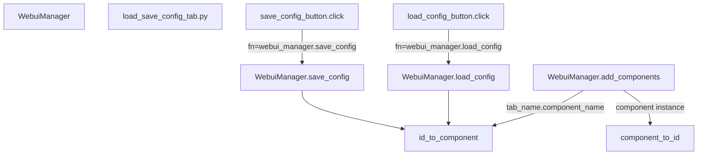
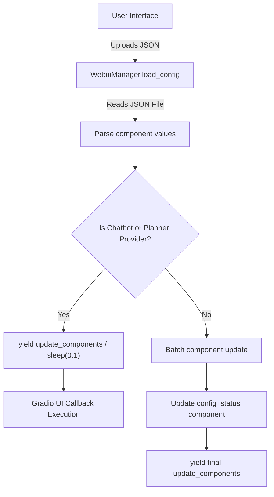

<!-- source: DeepWiki mcp.deepwiki.com · repo browser-use/web-ui · page 2.2 WebuiManager and State Flow · fetched 2026-10-30 -->

# WebuiManager and State Flow

<details>
<summary>Relevant source files</summary>

The following files were used as context for generating this wiki page:

- [src/webui/components/load_save_config_tab.py](src/webui/components/load_save_config_tab.py)
- [src/webui/webui_manager.py](src/webui/webui_manager.py)

</details>


## Purpose and Scope

The `WebuiManager` class serves as the central state container, component registry, and session coordinator for the application's Gradio interface. It manages UI component mapping via unique identifiers (`id_to_component`), maintains live references to underlying execution engines (`Agent`, `CustomBrowser`, `CustomController`), coordinates synchronization events for user-in-the-loop actions, and implements persistent configuration save/load workflows.

Sources: `src/webui/webui_manager.py:22-29`

---

## Component Registration and Identification

To allow global access and dynamic updates across disparate Gradio tabs, `WebuiManager` maintains bidirectional maps between Gradio `Component` instances and string identifiers.

### Key Data Structures
* `self.id_to_component`: Maps string keys of the format `"{tab_name}.{comp_name}"` to Gradio `Component` objects.
* `self.component_to_id`: Reverse lookup mapping `Component` instances back to their string identifiers.

```python
# Initialization of registration dictionaries
self.id_to_component: dict[str, Component] = {}
self.component_to_id: dict[Component, str] = {}
```

### Registration Methods
Components are registered during UI assembly by calling `add_components`:
* `add_components(tab_name: str, components_dict: dict[str, Component])`: Iterates through a dictionary of components for a given tab, constructs the namespaced key `f"{tab_name}.{comp_name}"`, and populates both lookup dictionaries.
* `get_components()`: Returns a list of all registered `Component` objects.
* `get_component_by_id(comp_id: str)`: Retrieves a specific component by its namespaced string ID.
* `get_id_by_component(comp: Component)`: Resolves a component instance to its string ID.

Sources: `src/webui/webui_manager.py:24-25`, `src/webui/webui_manager.py:53-78`


*Figure 1: Component registration and interface wiring linking UI events to `WebuiManager` methods.*

Sources: `src/webui/webui_manager.py:22-78`, `src/webui/components/load_save_config_tab.py:39-49`

---

## Agent, Browser, and State References

`WebuiManager` initializes and holds runtime references for the application's execution backends. It separates state management between the interactive Browser Use Agent and the Deep Research Agent.

### Browser Use Agent State (`init_browser_use_agent`)
* `self.bu_agent`: Reference to the `Agent` instance from `browser_use.agent.service`.
* `self.bu_browser`: Reference to the `CustomBrowser` instance.
* `self.bu_browser_context`: Reference to the active `CustomBrowserContext`.
* `self.bu_controller`: Reference to the `CustomController` instance.
* `self.bu_chat_history`: List of dictionaries storing message history for the chat interface.
* `self.bu_response_event`: An `asyncio.Event` utilized for synchronizing user assistance or step approvals.
* `self.bu_user_help_response`: String buffer holding user input provided during interactive prompts.
* `self.bu_current_task`: Active `asyncio.Task` running the agent execution loop.
* `self.bu_agent_task_id`: Unique string identifier for the active agent run.

### Deep Research Agent State (`init_deep_research_agent`)
* `self.dr_agent`: Reference to the `DeepResearchAgent` instance.
* `self.dr_current_task`: Active task handle for research execution.
* `self.dr_agent_task_id`: Unique identifier for the research task.
* `self.dr_save_dir`: File system path where research artifacts and reports are persisted.

Sources: `src/webui/webui_manager.py:30-52`

---

## Configuration Save and Load Flow

`WebuiManager` handles configuration persistence by serializing component values to JSON files in a designated settings directory (`./tmp/webui_settings` by default).

### Saving Configuration (`save_config`)
The `save_config` function iterates over all provided components, filters out buttons, file pickers, and non-interactive elements, and builds a dictionary mapping component IDs to their current values. It then serializes the dictionary to a timestamped JSON file.

```python
config_name = datetime.now().strftime("%Y%m%d-%H%M%S")
with open(os.path.join(self.settings_save_dir, f"{config_name}.json"), "w") as fw:
    json.dump(cur_settings, fw, indent=4)
```
Sources: `src/webui/webui_manager.py:80-95`

### Loading Configuration (`load_config`)
The `load_config` function reads a JSON settings file and updates the corresponding UI components. Because certain settings (such as LLM providers) trigger cascading UI callback refreshes, `load_config` is implemented as a Python generator (`yield`), allowing intermediary state to propagate to the Gradio runtime before continuing.

```python
for comp_id, comp_val in ui_settings.items():
    if comp_id in self.id_to_component:
        comp = self.id_to_component[comp_id]
        if comp.__class__.__name__ == "Chatbot":
            update_components[comp] = comp.__class__(value=comp_val, type="messages")
        else:
            update_components[comp] = comp.__class__(value=comp_val)
            if comp_id == "agent_settings.planner_llm_provider":
                yield update_components  # yield provider, let callback run
                time.sleep(0.1)  # wait for Gradio UI callback
```

Sources: `src/webui/webui_manager.py:97-123`


*Figure 2: Data flow during configuration loading via `WebuiManager.load_config`.*

Sources: `src/webui/webui_manager.py:97-123`, `src/webui/components/load_save_config_tab.py:45-49`

---

