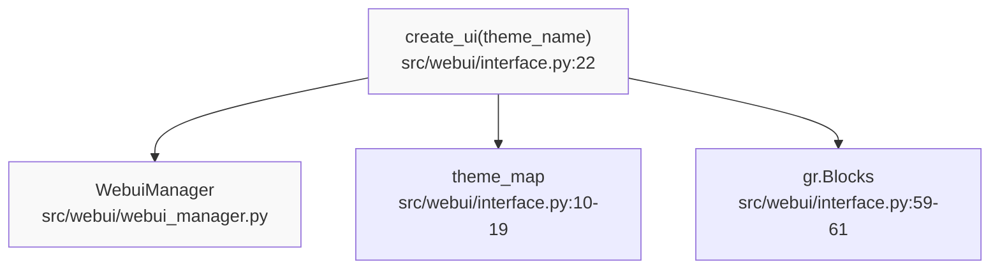
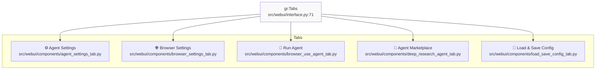

<!-- source: DeepWiki mcp.deepwiki.com · repo browser-use/web-ui · page 3 User Interface · fetched 2026-10-30 -->

# User Interface

Relevant source files

The following files were used as context for generating this wiki page:

- [src/webui/__init__.py](src/webui/__init__.py)
- [src/webui/components/__init__.py](src/webui/components/__init__.py)
- [src/webui/interface.py](src/webui/interface.py)

The User Interface provides a Gradio-based web frontend for controlling browser automation agents, configuring LLM providers, and monitoring task execution. This page documents the main entrypoint, tab organization, and how the UI layer coordinates with backend components through `WebuiManager`.

For detailed documentation of specific tabs, see:
- [Browser Use Agent Tab](#3.1)
- [Deep Research Agent Tab](#3.2)
- [Settings Tabs](#3.3)

## Overview and Interface Assembly

The UI is implemented using Gradio inside `src/webui/interface.py`. The `create_ui()` function initializes the `WebuiManager` state coordinator [src/webui/interface.py:57-57]() and constructs a `gr.Blocks` layout complete with customized themes (`theme_map`), CSS styling, and automatic dark mode enforcement [src/webui/interface.py:59-61]().

**Interface Assembly Flow**

Sources: [src/webui/interface.py:1-95]()

## Tab Structure and Components

The Gradio interface is structured into modular tabs supporting agent execution, configuration, and research workflows. Each tab is imported and assembled into the main layout via `create_ui()` [src/webui/interface.py:4-8]().

**UI Tab Architecture**

| Tab Title | Implementation Module | Primary Role |
|-----------|----------------------|--------------|
| ⚙️ Agent Settings | [src/webui/components/agent_settings_tab.py]() | Configure LLM providers, API keys, and agent execution parameters |
| 🌐 Browser Settings | [src/webui/components/browser_settings_tab.py]() | Configure Playwright browser flags, headless mode, and MCP servers |
| 🤖 Run Agent | [src/webui/components/browser_use_agent_tab.py]() | Interactive task submission, live browser view, and chat progress |
| 🎁 Agent Marketplace / Deep Research | [src/webui/components/deep_research_agent_tab.py]() | Multi-step research tasks and report generation |
| 📁 Load & Save Config | [src/webui/components/load_save_config_tab.py]() | Persistence of UI configurations and settings files |

Sources: [src/webui/interface.py:71-94]()

## Sub-Topics and Child Pages

- **[Browser Use Agent Tab](#3.1)**: Detail the interactive Browser Use Agent tab: task submission, real-time progress, live browser view, user assistance requests, stop/pause/resume controls.
- **[Deep Research Agent Tab](#3.2)**: Explain the Deep Research Agent tab: topic submission, research plan visualization, progress monitoring, report generation.
- **[Settings Tabs](#3.3)**: Document Agent Settings and Browser Settings tabs, plus load/save config: LLM configuration, browser options, MCP server setup, persistence.

Sources: [src/webui/interface.py:1-95]()

---

