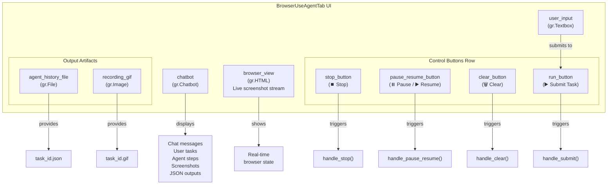
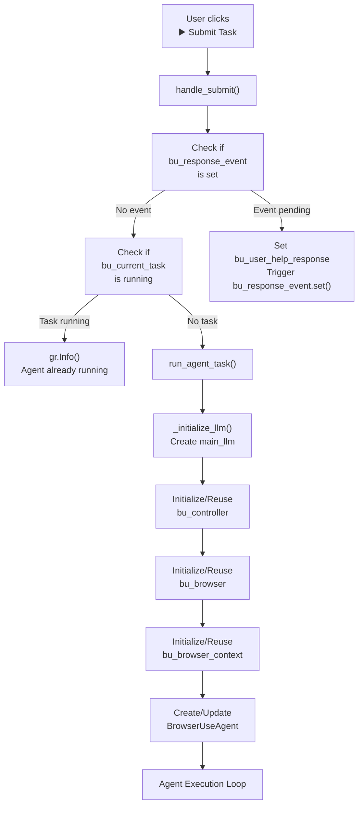
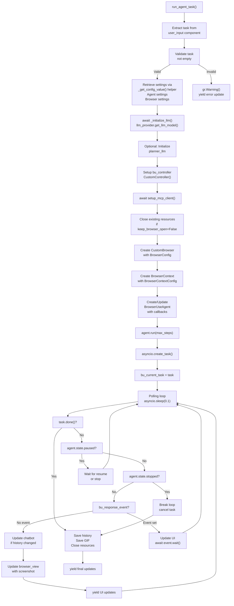
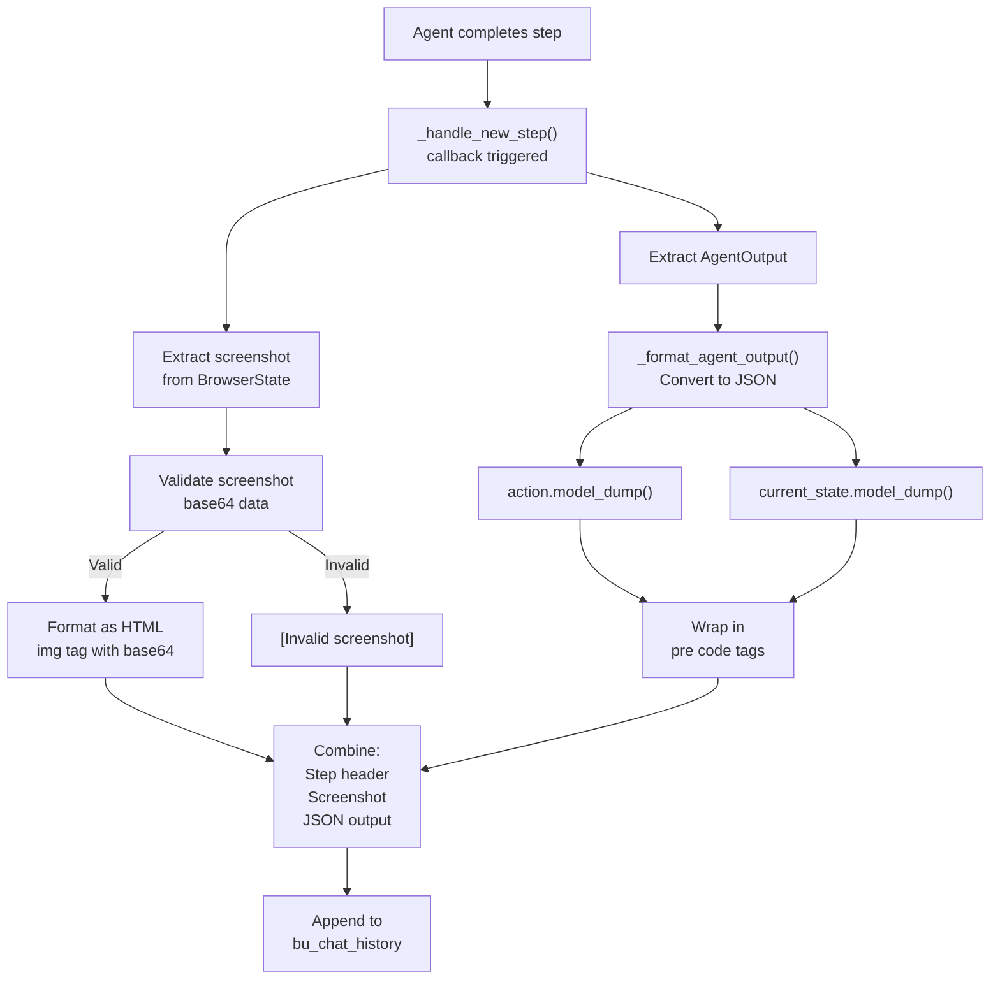
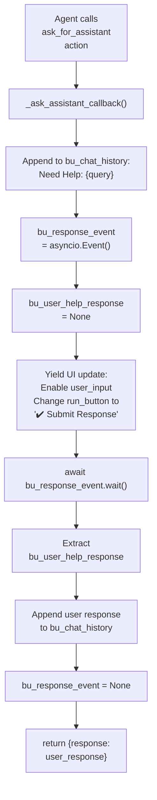

<!-- source: DeepWiki mcp.deepwiki.com · repo browser-use/web-ui · page 3.1 Browser Use Agent Tab · fetched 2026-10-30 -->

# Browser Use Agent Tab

<details>
<summary>Relevant source files</summary>

The following files were used as context for generating this wiki page:

- [src/webui/components/browser_use_agent_tab.py](src/webui/components/browser_use_agent_tab.py)

</details>


## Purpose and Scope

The Browser Use Agent Tab provides an interactive Gradio-based interface for submitting browser automation tasks to the `BrowserUseAgent`. This tab enables users to control and monitor AI-driven web browsing sessions through a chat-like interface with real-time progress updates, screenshot displays, and interactive controls for pausing, resuming, or stopping tasks. The agent can also request user assistance during execution when it encounters situations requiring human intervention.

For information about the underlying agent implementation and execution logic, see [Browser Use Agent](#4.1). For details about the Deep Research Agent interface, see [Deep Research Agent Tab](#3.2). For configuration options that affect agent and browser behavior, see [Settings Tabs](#3.3).

**Sources:** [src/webui/components/browser_use_agent_tab.py:1-81]()

---

## UI Components and Layout

### Component Structure

The tab consists of several key UI components organized in a vertical layout:

| Component | Type | Purpose | Element ID |
|-----------|------|---------|------------|
| `chatbot` | `gr.Chatbot` | Displays conversation history with agent outputs and screenshots | `browser_use_chatbot` |
| `user_input` | `gr.Textbox` | Input field for tasks or user responses | `user_input` |
| `run_button` | `gr.Button` | Submit task / Submit response to agent | - |
| `stop_button` | `gr.Button` | Stop the currently running task | - |
| `pause_resume_button` | `gr.Button` | Pause or resume task execution | - |
| `clear_button` | `gr.Button` | Clear chat history and reset state | - |
| `browser_view` | `gr.HTML` | Live browser screenshot stream (headless mode only) | `browser_view` |
| `agent_history_file` | `gr.File` | Download agent execution history JSON | - |
| `recording_gif` | `gr.Image` | View animated GIF recording of the task | - |



**Sources:** [src/webui/components/browser_use_agent_tab.py:1071-1080]()

### Component Registration

Components are registered with the `WebuiManager` using a tab-specific prefix (`"browser_use_agent"`) for unique identification via `webui_manager.add_components()`:

```python
webui_manager.add_components("browser_use_agent", tab_components)
```

This allows components to be retrieved by ID using the pattern `"browser_use_agent.{component_name}"`, enabling cross-tab access for settings and state coordination.

**Sources:** [src/webui/components/browser_use_agent_tab.py:25-26](), [src/webui/components/browser_use_agent_tab.py:69-96]()

---

## Task Submission and Execution Flow

### Submission Handler Architecture



**Sources:** [src/webui/components/browser_use_agent_tab.py:21-25]()

### Main Execution Loop

The execution workflow coordinates LLM initialization, browser contexts, and agent steps inside `run_agent_task()`:



**Sources:** [src/webui/components/browser_use_agent_tab.py:33-66](), [src/webui/components/browser_use_agent_tab.py:69-96]()

### Settings Retrieval

Settings are retrieved from both the Agent Settings and Browser Settings tabs using the helper function `_get_config_value()`, which searches components via `WebuiManager.get_component_by_id()`.

**Sources:** [src/webui/components/browser_use_agent_tab.py:69-96]()

---

## Real-time Progress Monitoring

### Step-by-Step Display

The agent execution is monitored through callback functions like `_handle_new_step()` that update the UI as each step completes:



**Sources:** [src/webui/components/browser_use_agent_tab.py:98-167]()

### Screenshot Display Format

Screenshots are embedded directly in chat messages using base64-encoded JPEG data:

```html

```

**Sources:** [src/webui/components/browser_use_agent_tab.py:151-166]()

### Agent Output Formatting

Agent outputs are formatted via `_format_agent_output()` into syntax-highlighted JSON blocks using Pydantic's `model_dump()` method.

**Sources:** [src/webui/components/browser_use_agent_tab.py:98-128]()

---

## User Assistance Mechanism

### Assistance Request Flow

When the agent needs user help, it triggers a specialized callback (`_ask_assistant_callback`) which instantiates an `asyncio.Event` (`bu_response_event`) and suspends execution until the user submits text via `user_input`.



**Sources:** [src/webui/components/browser_use_agent_tab.py:21-25]()

---

## Browser Control Features

### Live Browser View

In headless mode, a live browser view is updated periodically by invoking `take_screenshot()` on `bu_browser_context` and streaming the resulting HTML `` tag into `browser_view`.

**Sources:** [src/webui/components/browser_use_agent_tab.py:21-25]()

### Pause, Resume, and Stop Controls

The agent handles execution pacing and cancellation states via internal flags (`agent.state.paused`, `agent.state.stopped`), manipulated by `handle_pause_resume()` and `handle_stop()` callbacks respectively.

**Sources:** [src/webui/components/browser_use_agent_tab.py:21-25]()

---

## State Management and Output Artifacts

State variables (e.g., `bu_chat_history`, `bu_current_task`, `bu_agent`, `bu_browser`, `bu_controller`, `bu_response_event`) are maintained globally through `WebuiManager`. Completed task executions serialize history to disk as JSON and compile step captures into a GIF recording when configured.

**Sources:** [src/webui/components/browser_use_agent_tab.py:21-26]()

Sources: [src/webui/components/browser_use_agent_tab.py:1-1080]()

---

