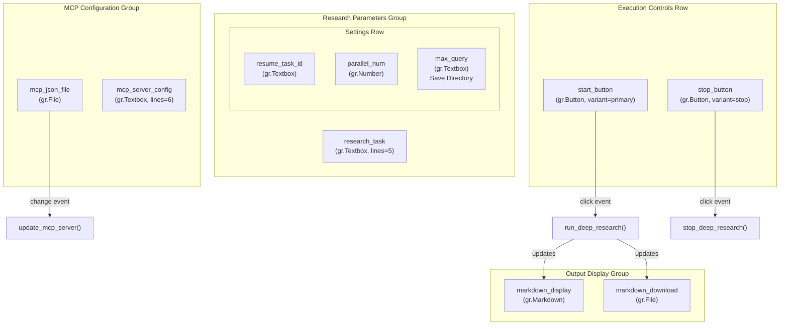
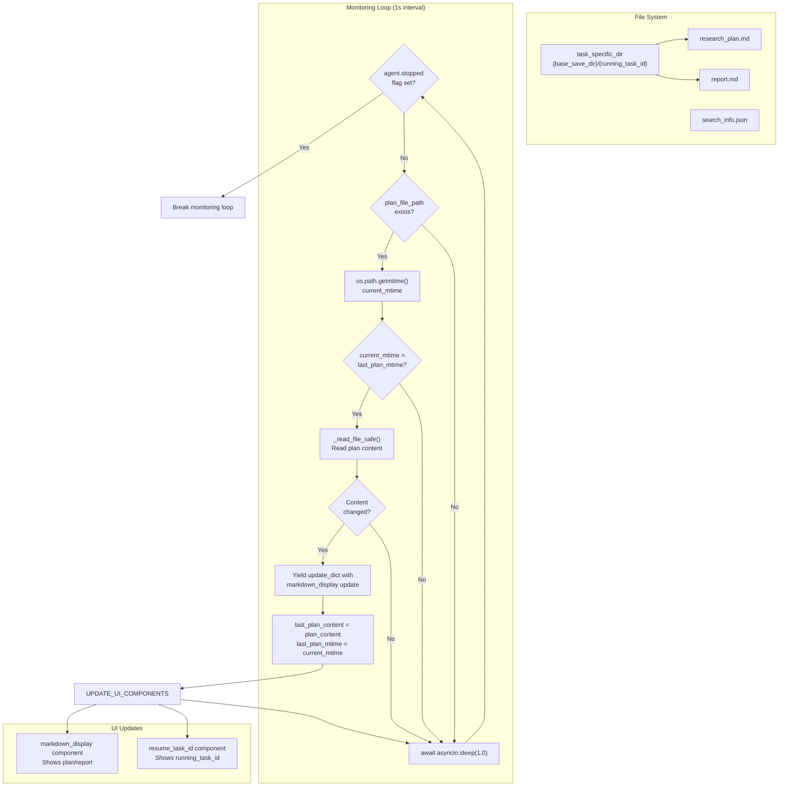
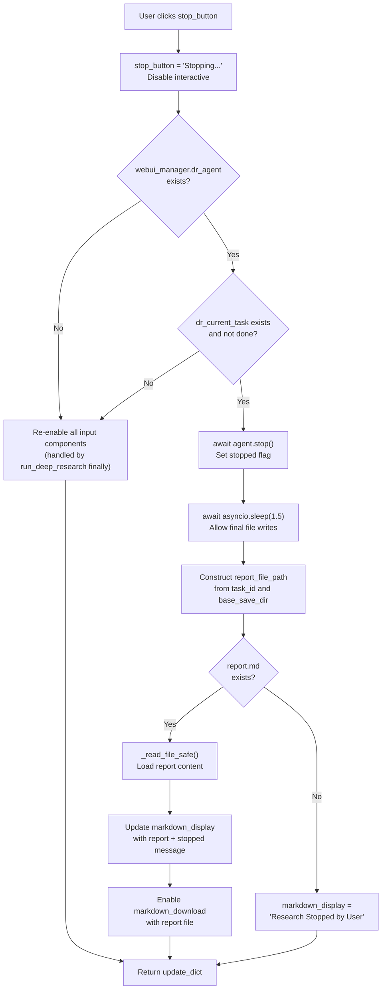
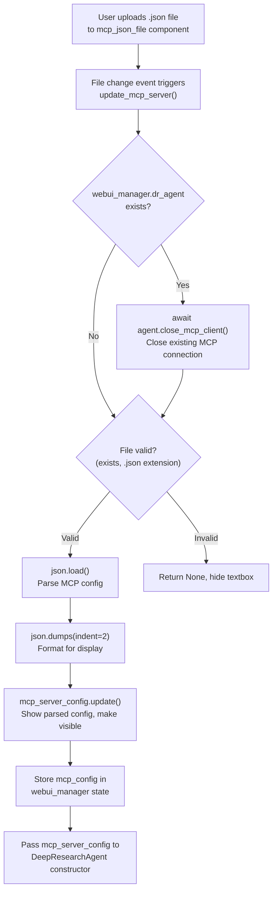
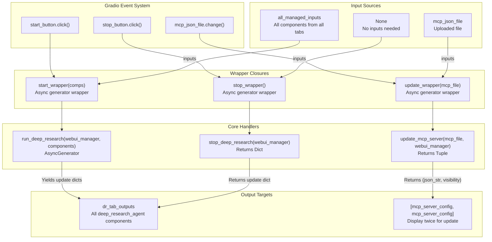

<!-- source: DeepWiki mcp.deepwiki.com · repo browser-use/web-ui · page 3.2 Deep Research Agent Tab · fetched 2026-10-30 -->

# Deep Research Agent Tab

<details>
<summary>Relevant source files</summary>

The following files were used as context for generating this wiki page:

- [src/webui/components/deep_research_agent_tab.py](src/webui/components/deep_research_agent_tab.py)

</details>


## Purpose and Scope

The Deep Research Agent Tab provides a Gradio-based user interface for executing multi-step research workflows using the `DeepResearchAgent` class [src/webui/components/deep_research_agent_tab.py:12](). This tab enables users to submit research topics, configure parallel browser execution, monitor real-time progress through dynamically updated research plans, and download final research reports.

For information about the underlying agent implementation and Langgraph workflow, see [Custom Browser Context](#5.2). For details about configuring LLM and browser settings used by this tab, see [Controller and Actions](#4.3). For the simpler interactive browser automation interface, see [Browser Use Agent](#4.1).

Sources: [src/webui/components/deep_research_agent_tab.py:1-457]()

## UI Component Structure

The Deep Research Agent tab is organized into four main sections: MCP configuration, research parameters, execution controls, and output display.

### Component Layout Diagram

This diagram bridges natural language interface concepts with concrete UI component variables defined in the module.



Sources: [src/webui/components/deep_research_agent_tab.py:57-420]()

### Component Registry

All components are registered with the `WebuiManager` using the prefix `"deep_research_agent"`. The tab creation function builds a dictionary mapping component names to Gradio objects:

| Component ID | Type | Purpose | Default Value |
|-------------|------|---------|---------------|
| `research_task` | `gr.Textbox` | Research topic input | Example travel plan query |
| `resume_task_id` | `gr.Textbox` | Task ID for resuming previous research | Empty string |
| `parallel_num` | `gr.Number` | Number of parallel browser agents | 1 |
| `max_query` | `gr.Textbox` | Output directory path | `"./tmp/deep_research"` |
| `start_button` | `gr.Button` | Initiates research execution | "▶️ Run" |
| `stop_button` | `gr.Button` | Stops running research | "⏹️ Stop" |
| `markdown_display` | `gr.Markdown` | Real-time plan/report display | Empty |
| `markdown_download` | `gr.File` | Download link for final report | Disabled |
| `mcp_json_file` | `gr.File` | MCP server configuration file upload | None |
| `mcp_server_config` | `gr.Textbox` | Parsed MCP configuration JSON | Hidden initially |

Sources: [src/webui/components/deep_research_agent_tab.py:383-419]()

## Research Execution Flow

The research execution process is orchestrated by the `run_deep_research()` async generator, which handles initialization, monitoring, and finalization in a single continuous flow.

### Execution State Machine

```mermaid
graph TB
    START["User clicks start_button"]
    EXTRACT["Extract task parameters<br/>from components dict"]
    VALIDATE{"Validate<br/>task_topic?"}
    INIT_UI["Update UI:<br/>Disable inputs<br/>Enable stop button"]
    GET_SETTINGS["Retrieve settings from<br/>agent_settings & browser_settings tabs"]
    INIT_LLM["_initialize_llm()<br/>Create LLM instance"]
    CHECK_LLM{"LLM created<br/>successfully?"}
    INIT_AGENT{"webui_manager.dr_agent<br/>exists?"}
    CREATE_AGENT["Create DeepResearchAgent<br/>with llm, browser_config, mcp_config"]
    START_RUN["webui_manager.dr_agent.run()<br/>Create async task"]
    WAIT_ID["Wait 1s for task_id generation"]
    GET_ID["Retrieve current_task_id<br/>from agent"]
    MONITOR["Monitor loop:<br/>Check research_plan.md every 1s"]
    FILE_CHANGED{"Plan file<br/>mtime changed?"}
    UPDATE_DISPLAY["Update markdown_display<br/>with plan content"]
    AGENT_DONE{"agent_task.done()?"}
    AWAIT_RESULT["await agent_task<br/>Get final_result_dict"]
    LOAD_REPORT["Load report.md<br/>from task directory"]
    FINAL_UPDATE["Update markdown_display<br/>Enable markdown_download"]
    CLEANUP["Reset UI state<br/>Clear dr_current_task"]
    END["Yield final updates"]
    ERROR["Handle exception<br/>Display error in markdown_display"]
    
    START --> EXTRACT
    EXTRACT --> VALIDATE
    VALIDATE -->|"Empty"| ERROR
    VALIDATE -->|"Valid"| INIT_UI
    INIT_UI --> GET_SETTINGS
    GET_SETTINGS --> INIT_LLM
    INIT_LLM --> CHECK_LLM
    CHECK_LLM -->|"Failed"| ERROR
    CHECK_LLM -->|"Success"| INIT_AGENT
    INIT_AGENT -->|"None"| CREATE_AGENT
    INIT_AGENT -->|"Exists"| START_RUN
    CREATE_AGENT --> START_RUN
    START_RUN --> WAIT_ID
    WAIT_ID --> GET_ID
    GET_ID --> MONITOR
    MONITOR --> FILE_CHANGED
    FILE_CHANGED -->|"No"| AGENT_DONE
    FILE_CHANGED -->|"Yes"| UPDATE_DISPLAY
    UPDATE_DISPLAY --> AGENT_DONE
    AGENT_DONE -->|"No"| MONITOR
    AGENT_DONE -->|"Yes"| AWAIT_RESULT
    AWAIT_RESULT --> LOAD_REPORT
    LOAD_REPORT --> FINAL_UPDATE
    FINAL_UPDATE --> CLEANUP
    CLEANUP --> END
    ERROR --> CLEANUP
```



Sources: [src/webui/components/deep_research_agent_tab.py:57-290]()

### Settings Retrieval Pattern

The `run_deep_research()` function retrieves configuration from other tabs using a helper closure that accesses the `components` dictionary:

```python
def get_setting(tab: str, key: str, default: Any = None):
    comp = webui_manager.id_to_component.get(f"{tab}.{key}")
    return components.get(comp, default) if comp else default
```

This pattern allows the function to pull LLM configuration from the `agent_settings` tab and browser configuration from the `browser_settings` tab without direct coupling to those UI components.

Sources: [src/webui/components/deep_research_agent_tab.py:118-120]()

### LLM and Browser Configuration

The execution flow retrieves the following settings:

| Setting Category | Settings Keys | Source Tab |
|-----------------|---------------|------------|
| LLM Configuration | `llm_provider`, `llm_model_name`, `llm_temperature`, `llm_base_url`, `llm_api_key`, `ollama_num_ctx` | `agent_settings` |
| Browser Configuration | `headless`, `disable_security`, `browser_binary_path`, `browser_user_data_dir`, `window_w`, `window_h` | `browser_settings` |

The browser settings are packaged into a dictionary (`browser_config_dict`) rather than instantiating full `CustomBrowser` objects, as the `DeepResearchAgent` creates its own browser instances internally.

Sources: [src/webui/components/deep_research_agent_tab.py:122-147]()

### Agent Initialization and Execution

The agent initialization follows a lazy creation pattern:

1. Check if `webui_manager.dr_agent` already exists
2. If not, create new `DeepResearchAgent` with current configuration
3. Call `agent.run()` with topic, task_id (for resume), save_dir, and max_parallel_browsers
4. Wrap the coroutine in `asyncio.create_task()` and store in `webui_manager.dr_current_task`

Sources: [src/webui/components/deep_research_agent_tab.py:150-166]()

## Progress Monitoring System

The tab implements a file-based progress monitoring system that watches the `research_plan.md` file for changes, providing real-time updates to the UI without requiring the agent to explicitly send status messages.

### File Monitoring Architecture



Sources: [src/webui/components/deep_research_agent_tab.py:188-229]()

### Monitoring Implementation Details

The monitoring system uses file modification time (`mtime`) to detect changes rather than polling the file content directly:

1. **Task ID Resolution**: After starting the agent, wait 1 second and retrieve `agent.current_task_id` to determine the task-specific directory path
2. **Plan File Path Construction**: `{base_save_dir}/{running_task_id}/research_plan.md`
3. **Mtime Tracking**: Store `last_plan_mtime` and compare with current `os.path.getmtime()`
4. **Content Change Detection**: Only update UI if file content actually changed (handles cases where mtime changes but content doesn't)
5. **Error Handling**: If plan file becomes unreadable, reset `last_plan_mtime` to 0 to force retry on next iteration

Sources: [src/webui/components/deep_research_agent_tab.py:206-223]()

### File Reading Safety

The `_read_file_safe()` helper function provides safe file reading with error handling:

- Returns `None` if file doesn't exist (rather than raising exception)
- Catches and logs exceptions during file reading
- Uses UTF-8 encoding explicitly
- Prevents the monitoring loop from crashing on transient file system errors

Sources: [src/webui/components/deep_research_agent_tab.py:43-52]()

## Stop Mechanism

The stop functionality allows users to gracefully terminate a running research task while preserving partial results.

### Stop Flow Diagram



Sources: [src/webui/components/deep_research_agent_tab.py:293-355]()

### Stop Signal Coordination

The stop mechanism coordinates between the UI handler and the monitoring loop:

1. **UI Handler (`stop_deep_research()`)**: 
   - Calls `await agent.stop()` which sets the agent's internal `stopped` flag
   - Waits 1.5 seconds for agent to write final files
   - Attempts to load and display partial report
   - Returns immediate UI update (button states, stopped message)

2. **Monitoring Loop (`run_deep_research()`)**: 
   - Checks `getattr(webui_manager.dr_agent, 'stopped', False)` each iteration
   - Breaks monitoring loop if stopped flag detected
   - Proceeds to finalization block to await final agent result
   - Executes `finally` block to reset all UI components

This two-phase approach ensures the UI responds immediately while allowing the agent's async tasks to complete gracefully.

Sources: [src/webui/components/deep_research_agent_tab.py:200-203](), [src/webui/components/deep_research_agent_tab.py:310-322]()

## MCP Server Integration

The tab supports configuring MCP (Model Context Protocol) servers for extending the agent's capabilities with external tools.

### MCP Configuration Flow



Sources: [src/webui/components/deep_research_agent_tab.py:358-373](), [src/webui/components/deep_research_agent_tab.py:428-432]()

### MCP Configuration Lifecycle

The MCP configuration follows a specific lifecycle to prevent stale connections:

1. **Upload Detection**: User uploads JSON file to `mcp_json_file` component
2. **Client Closure**: If an agent instance exists, close its MCP client connection (prevents reusing stale tool connections)
3. **File Validation**: Check file exists, has `.json` extension
4. **Parsing**: Load and parse JSON configuration
5. **Display**: Show formatted JSON in `mcp_server_config` textbox, make it visible
6. **Storage**: Configuration stored in `components` dictionary
7. **Agent Initialization**: When research starts, configuration passed to `DeepResearchAgent` constructor

Sources: [src/webui/components/deep_research_agent_tab.py:84-85](), [src/webui/components/deep_research_agent_tab.py:151-155]()

## State Management

The tab maintains state through the `WebuiManager` singleton, which coordinates shared state across the application.

### State Variables and Lifecycle

```mermaid
graph TB
    subgraph "WebuiManager State"
        DR_AGENT["webui_manager.dr_agent<br/>DeepResearchAgent instance"]
        DR_CURRENT_TASK["webui_manager.dr_current_task<br/>asyncio.Task for agent.run()"]
        DR_TASK_ID["webui_manager.dr_task_id<br/>Current running task ID"]
        DR_SAVE_DIR["webui_manager.dr_save_dir<br/>Base output directory"]
    end
    
    subgraph "Component State"
        COMPONENTS_DICT["components: Dict[Component, Any]<br/>All input values"]
        ID_TO_COMPONENT["webui_manager.id_to_component<br/>ID -> Component mapping"]
    end
    
    subgraph "Local Monitoring State"
        LAST_PLAN_CONTENT["last_plan_content: Optional[str]<br/>Previous plan file content"]
        LAST_PLAN_MTIME["last_plan_mtime: float<br/>Previous modification time"]
        RUNNING_TASK_ID["running_task_id: Optional[str]<br/>Local copy of task ID"]
    end
    
    subgraph "File System State"
        PLAN_FILE["research_plan.md<br/>Updated by agent"]
        REPORT_FILE["report.md<br/>Final output"]
    end
    
    RUN_START["run_deep_research() starts"]
    RUN_MONITOR["Monitoring loop active"]
    RUN_FINISH["run_deep_research() finishes"]
    STOP_CLICK["stop_deep_research() called"]
    
    RUN_START -->|"Initialize"| DR_SAVE_DIR
    RUN_START -->|"Create or reuse"| DR_AGENT
    RUN_START -->|"Create task"| DR_CURRENT_TASK
    RUN_START -->|"Store ID"| DR_TASK_ID
    RUN_START -->|"Initialize"| LAST_PLAN_CONTENT
    RUN_START -->|"Initialize"| LAST_PLAN_MTIME
    
    RUN_MONITOR -->|"Read"| DR_AGENT
    RUN_MONITOR -->|"Check"| PLAN_FILE
    RUN_MONITOR -->|"Update"| LAST_PLAN_CONTENT
    RUN_MONITOR -->|"Update"| LAST_PLAN_MTIME
    
    STOP_CLICK -->|"Read"| DR_AGENT
    STOP_CLICK -->|"Read"| DR_CURRENT_TASK
    STOP_CLICK -->|"Read"| DR_TASK_ID
    STOP_CLICK -->|"Read"| DR_SAVE_DIR
    STOP_CLICK -->|"Call stop()"| DR_AGENT
    
    RUN_FINISH -->|"Clear (None)"| DR_CURRENT_TASK
    RUN_FINISH -->|"Clear (None)"| DR_TASK_ID
    RUN_FINISH -->|"Persist"| DR_AGENT
```



Sources: [src/webui/components/deep_research_agent_tab.py:93](), [src/webui/components/deep_research_agent_tab.py:108-113](), [src/webui/components/deep_research_agent_tab.py:150-156](), [src/webui/components/deep_research_agent_tab.py:166](), [src/webui/components/deep_research_agent_tab.py:185](), [src/webui/components/deep_research_agent_tab.py:277-278](), [src/webui/components/deep_research_agent_tab.py:296-299]()

### State Access Patterns

The tab uses multiple patterns for accessing state:

| Pattern | Usage | Example |
|---------|-------|---------|
| Direct attribute access | Accessing agent singleton | `webui_manager.dr_agent` |
| Component ID lookup | Retrieving UI component references | `webui_manager.get_component_by_id("deep_research_agent.start_button")` |
| Dictionary access | Reading component values | `components.get(research_task_comp, "")` |
| Settings retrieval closure | Cross-tab configuration access | `get_setting("agent_settings", "llm_provider")` |

Sources: [src/webui/components/deep_research_agent_tab.py:62-71](), [src/webui/components/deep_research_agent_tab.py:118-120]()

## File Output Structure

The Deep Research Agent creates a structured directory hierarchy for organizing research outputs.

### Output Directory Structure

```
{base_save_dir}/                    # Default: ./tmp/deep_research
└── {task_id}/                      # UUID or timestamp-based ID
    ├── research_plan.md            # Hierarchical research plan (updated during execution)
    ├── search_info.json            # Search results metadata
    └── report.md                   # Final synthesized research report
```

### File Purposes

| File | Created By | Updated | Purpose |
|------|-----------|---------|---------|
| `research_plan.md` | `planning_node` | During `research_execution_node` | Contains hierarchical research plan with task status markers |
| `search_info.json` | `parallel_browser_search` | After each search batch | Stores structured search results from parallel browser agents |
| `report.md` | `synthesis_node` | Once at completion | Final synthesized research report combining all findings |

Sources: [src/webui/components/deep_research_agent_tab.py:189-192](), [src/webui/components/deep_research_agent_tab.py:245-252]()

### Directory Path Safety

The implementation includes path validation to prevent directory traversal attacks:

1. Normalize the user-provided `base_save_dir` path using `os.path.abspath()` and `os.path.normpath()`
2. Define a safe root directory (`./tmp/deep_research`)
3. Use `os.path.commonpath()` to verify the normalized path is within the safe root
4. If validation fails, default to the safe root directory and log a warning

This ensures users cannot specify paths outside the intended output directory tree.

Sources: [src/webui/components/deep_research_agent_tab.py:77-83]()

## Event Handlers and Data Flow

The tab uses Gradio's event system to wire UI interactions to async handler functions through wrapper closures.

### Event Handler Architecture



Sources: [src/webui/components/deep_research_agent_tab.py:437-457]()

### Input/Output Configuration

The event handlers are configured with specific input and output component sets:

1. **Start Handler**: 
   - Inputs: `all_managed_inputs` (all components from all tabs via `webui_manager.get_components()`)
   - Outputs: `dr_tab_outputs` (all components specific to Deep Research tab)
   - This allows reading settings from other tabs while only updating the current tab

2. **Stop Handler**:
   - Inputs: `None` (reads state from `webui_manager` directly)
   - Outputs: `dr_tab_outputs`

3. **MCP Change Handler**:
   - Inputs: `[mcp_json_file]`
   - Outputs: `[mcp_server_config, mcp_server_config]` (same component listed twice to update value and visibility)

Sources: [src/webui/components/deep_research_agent_tab.py:434-435](), [src/webui/components/deep_research_agent_tab.py:447-457]()

### Wrapper Pattern Rationale

The wrapper closures serve two purposes:

1. **Signature Adaptation**: Convert between handler signatures that take specific parameters and Gradio's event system that passes all input component values as a dictionary
2. **Generator Wrapping**: Ensure single-return functions are wrapped in async generators to match Gradio's streaming update expectations

For example, `stop_wrapper` converts the `Dict` returned by `stop_deep_research()` into an async generator that yields once:

```python
async def stop_wrapper() -> AsyncGenerator[Dict[Component, Any], None]:
    update_dict = await stop_deep_research(webui_manager)
    yield update_dict
```

Sources: [src/webui/components/deep_research_agent_tab.py:442-444]()

---

