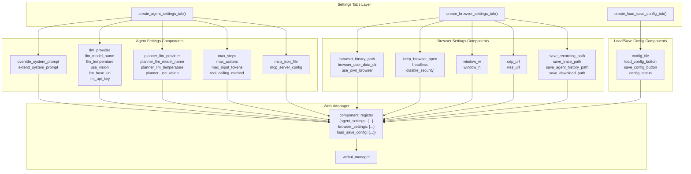
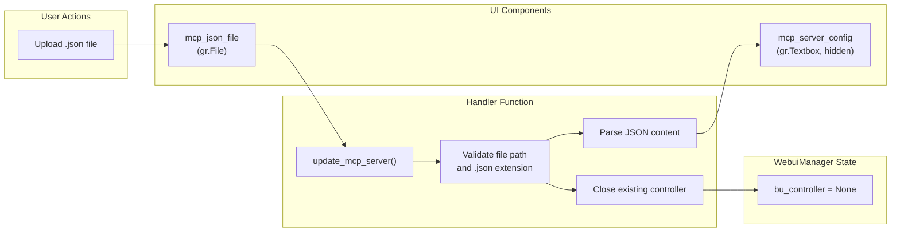
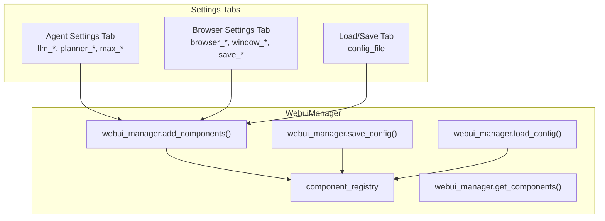

<!-- source: DeepWiki mcp.deepwiki.com · repo browser-use/web-ui · page 3.3 Settings Tabs · fetched 2026-10-30 -->

# Settings Tabs

Relevant source files

The following files were used as context for generating this wiki page:

- [src/webui/components/agent_settings_tab.py](src/webui/components/agent_settings_tab.py)
- [src/webui/components/browser_settings_tab.py](src/webui/components/browser_settings_tab.py)
- [src/webui/components/load_save_config_tab.py](src/webui/components/load_save_config_tab.py)

## Purpose and Scope

This document covers the Settings Tabs in the Gradio web interface, which provide configuration controls for both agent behavior, browser automation, and settings persistence. The settings interface consists of three distinct components:

1. **Agent Settings Tab** - Configures LLM providers, model parameters, system prompts, MCP server integration, and agent execution limits.
2. **Browser Settings Tab** - Configures browser instance options, window dimensions, remote debugging, and file storage paths.
3. **Load and Save Configuration Tab** - Persists and restores user interface settings via JSON files.

For information about how these settings are consumed by agents during task execution, see [Custom Browser](#5.1) and [Custom Browser Context](#5.2). For details on the underlying LLM provider system, see [MCP Client Integration](#7.1). For browser automation specifics, see [LLM Provider System](#6.1).

Sources: [src/webui/components/agent_settings_tab.py:46-237](), [src/webui/components/browser_settings_tab.py:30-152](), [src/webui/components/load_save_config_tab.py:8-50]()

## Settings Tab Architecture

The Settings Tabs are implemented as Gradio components that register their input controls with the `WebuiManager`, enabling other tabs to access configuration values during agent initialization and state persistence.

**Settings Tab Component Registration Flow**

Sources: [src/webui/components/agent_settings_tab.py:46-237](), [src/webui/components/browser_settings_tab.py:30-152](), [src/webui/components/load_save_config_tab.py:8-50]()

## Agent Settings Tab

The Agent Settings Tab is created by the `create_agent_settings_tab()` function and provides comprehensive configuration for both the primary LLM and the planner LLM used by the Deep Research Agent.

### LLM Configuration

The primary LLM configuration section controls the language model used for browser automation tasks. It includes provider selection, model selection, and runtime parameters.

| Component | Type | Purpose | Default Value |
|-----------|------|---------|---------------|
| `llm_provider` | Dropdown | Select LLM provider from `config.model_names` | `os.getenv("DEFAULT_LLM", "openai")` |
| `llm_model_name` | Dropdown | Select or enter model name | Provider's first model |
| `llm_temperature` | Slider | Control randomness (0.0-2.0) | 0.6 |
| `use_vision` | Checkbox | Enable vision capabilities | True |
| `ollama_num_ctx` | Slider | Ollama context length (2^8 to 2^16) | 16000 |
| `llm_base_url` | Textbox | API endpoint URL | Empty |
| `llm_api_key` | Textbox (password) | API key override | Empty |

The `llm_provider` dropdown is populated from `config.model_names`, which maps provider names to their available models. When the provider changes, the `update_model_dropdown()` function is called to update the model choices: [src/webui/components/agent_settings_tab.py:15-24]().

Sources: [src/webui/components/agent_settings_tab.py:63-119]()

### Planner LLM Configuration

The Deep Research Agent uses a separate LLM instance for planning tasks. The planner LLM configuration mirrors the primary LLM configuration but is optional (defaults to None, which uses the primary LLM).

| Component | Type | Purpose | Default Value |
|-----------|------|---------|---------------|
| `planner_llm_provider` | Dropdown | Select LLM provider | None |
| `planner_llm_model_name` | Dropdown | Select or enter model name | Empty |
| `planner_llm_temperature` | Slider | Control randomness (0.0-2.0) | 0.6 |
| `planner_use_vision` | Checkbox | Enable vision capabilities | False |
| `planner_ollama_num_ctx` | Slider | Ollama context length | 16000 |
| `planner_llm_base_url` | Textbox | API endpoint URL | Empty |
| `planner_llm_api_key` | Textbox (password) | API key override | Empty |

Sources: [src/webui/components/agent_settings_tab.py:121-176]()

### Agent Execution Parameters

These parameters control agent behavior limits and tool calling mechanisms:

| Component | Type | Purpose | Range/Choices |
|-----------|------|---------|---------------|
| `max_steps` | Slider | Maximum agent iteration steps | 1-1000, default: 100 |
| `max_actions` | Slider | Maximum actions per step | 1-100, default: 10 |
| `max_input_tokens` | Number | Maximum input token limit | Default: 128000 |
| `tool_calling_method` | Dropdown | Tool invocation strategy | `['function_calling', 'json_mode', 'raw', 'auto', 'tools', "None"]` |

Sources: [src/webui/components/agent_settings_tab.py:178-212]()

### System Prompt Customization

The tab provides two textboxes for customizing the agent's system prompt:
- **`override_system_prompt`** - Completely replaces the default system prompt when non-empty.
- **`extend_system_prompt`** - Appends additional instructions to the default system prompt.

Sources: [src/webui/components/agent_settings_tab.py:53-56]()

### MCP Server Integration

The MCP (Model Context Protocol) server configuration enables external tool integration:

**MCP Configuration Flow**

When a user uploads an MCP JSON file, the `update_mcp_server()` function is invoked [src/webui/components/agent_settings_tab.py:27-43]().

Sources: [src/webui/components/agent_settings_tab.py:27-43](), [src/webui/components/agent_settings_tab.py:59-60]()

## Browser Settings Tab

The Browser Settings Tab is created by the `create_browser_settings_tab()` function and provides configuration for browser automation behavior, window dimensions, remote debugging, and file storage.

### Browser Instance Configuration

| Component | Type | Purpose | Default/Placeholder |
|-----------|------|---------|-------------------|
| `browser_binary_path` | Textbox | Path to browser executable | Placeholder: `'/Applications/Google\ Chrome.app/Contents/MacOS/Google\ Chrome'` |
| `browser_user_data_dir` | Textbox | Browser profile directory | Placeholder: "Leave it empty if you use your default user data" |

Sources: [src/webui/components/browser_settings_tab.py:37-50]()

### Browser Behavior Options

| Component | Type | Purpose | Default Value |
|-----------|------|---------|---------------|
| `use_own_browser` | Checkbox | Connect to existing browser instance | `os.getenv("USE_OWN_BROWSER", "false")` |
| `keep_browser_open` | Checkbox | Persist browser between tasks | `os.getenv("KEEP_BROWSER_OPEN", "true")` |
| `headless` | Checkbox | Run browser without GUI | False |
| `disable_security` | Checkbox | Disable browser security features | False |

Sources: [src/webui/components/browser_settings_tab.py:52-76]()

### Window Configuration

| Component | Type | Purpose | Default Value |
|-----------|------|---------|---------------|
| `window_w` | Number | Browser window width in pixels | 1280 |
| `window_h` | Number | Browser window height in pixels | 1100 |

Sources: [src/webui/components/browser_settings_tab.py:78-91]()

### Remote Debugging Configuration

| Component | Type | Purpose | Default Value |
|-----------|------|---------|---------------|
| `cdp_url` | Textbox | Chrome DevTools Protocol URL | `os.getenv("BROWSER_CDP", None)` |
| `wss_url` | Textbox | WebSocket Secure URL for remote browser | Empty |

Sources: [src/webui/components/browser_settings_tab.py:92-104]()

### Storage Paths Configuration

| Component | Type | Purpose | Default Value |
|-----------|------|---------|---------------|
| `save_recording_path` | Textbox | Directory for browser recordings (GIF) | Placeholder: `./tmp/record_videos` |
| `save_trace_path` | Textbox | Directory for browser traces (ZIP) | Placeholder: `./tmp/traces` |
| `save_agent_history_path` | Textbox | Directory for agent history JSON | `./tmp/agent_history` |
| `save_download_path` | Textbox | Directory for browser downloads | `./tmp/downloads` |

Sources: [src/webui/components/browser_settings_tab.py:105-133]()

### Settings Change Handling

When certain browser behavior settings change, the existing browser instance is closed via `close_browser()` to ensure new settings take effect [src/webui/components/browser_settings_tab.py:12-28]().

Sources: [src/webui/components/browser_settings_tab.py:12-28](), [src/webui/components/browser_settings_tab.py:154-161]()

## Load and Save Configuration Tab

The Load and Save Configuration Tab is created by `create_load_save_config_tab()` [src/webui/components/load_save_config_tab.py:8-50](). It allows users to export current UI configurations to a JSON file or restore them from an existing file.

| Component | Type | Purpose |
|-----------|------|---------|
| `config_file` | File (.json) | Upload JSON configuration file for loading |
| `load_config_button` | Button | Triggers configuration loading into UI components |
| `save_config_button` | Button | Exports all registered UI settings to JSON |
| `config_status` | Textbox | Displays load/save execution status |

The save action invokes `webui_manager.save_config()` passing all registered components as inputs, while the load action calls `webui_manager.load_config()` with the uploaded file [src/webui/components/load_save_config_tab.py:39-49]().

Sources: [src/webui/components/load_save_config_tab.py:8-50]()

## Settings Flow and Integration

**Settings Flow from Configuration to Agent Initialization**

Sources: [src/webui/components/agent_settings_tab.py:237](), [src/webui/components/browser_settings_tab.py:152](), [src/webui/components/load_save_config_tab.py:37]()

## Configuration Defaults and Environment Variables

Both settings tabs support default values from environment variables:

| Setting | Environment Variable | UI Override |
|---------|---------------------|-------------|
| Default LLM Provider | `DEFAULT_LLM` | `llm_provider` dropdown |
| Use Own Browser | `USE_OWN_BROWSER` | `use_own_browser` checkbox |
| Keep Browser Open | `KEEP_BROWSER_OPEN` | `keep_browser_open` checkbox |
| Browser CDP URL | `BROWSER_CDP` | `cdp_url` textbox |

Sources: [src/webui/components/agent_settings_tab.py:67](), [src/webui/components/browser_settings_tab.py:55-61](), [src/webui/components/browser_settings_tab.py:96]()

---

