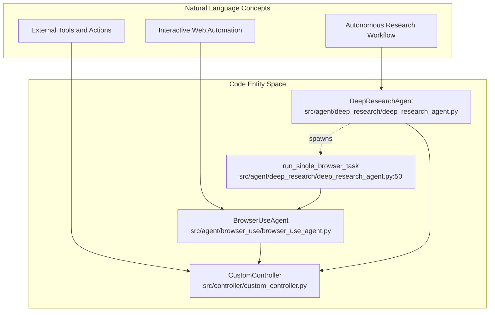

<!-- source: DeepWiki mcp.deepwiki.com · repo browser-use/web-ui · page 4 Agent System · fetched 2026-10-30 -->

# Agent System

Relevant source files

The following files were used as context for generating this wiki page:

- [src/__init__.py](src/__init__.py)
- [src/agent/__init__.py](src/agent/__init__.py)
- [src/agent/browser_use/browser_use_agent.py](src/agent/browser_use/browser_use_agent.py)
- [src/agent/deep_research/deep_research_agent.py](src/agent/deep_research/deep_research_agent.py)
- [tests/test_playwright.py](tests/test_playwright.py)

## Purpose and Scope

This document provides a high-level overview of the agent architecture within the browser-use web-ui system. The platform orchestrates two primary agent classes—the interactive `BrowserUseAgent` and the autonomous `DeepResearchAgent`—leveraging shared infrastructure such as `CustomBrowser`, `CustomBrowserContext`, and `CustomController` to execute tasks via Large Language Models (LLMs).

As a parent page, this document summarizes the system design and interaction models. For deep technical implementation details, see the respective child pages:
- [Browser Use Agent](#4.1) — Detailed step-by-step execution loop, action selection, state management, and user assistance integration.
- [Deep Research Agent](#4.2) — Langgraph-based research workflows, planning nodes, parallel browser search execution, and report synthesis.
- [Controller and Actions](#4.3) — Action orchestration, built-in actions (`ask_for_assistant`, `upload_file`), tool registration, and execution flow.

Sources:
- [src/agent/browser_use/browser_use_agent.py:30-46]()
- [src/agent/deep_research/deep_research_agent.py:34-37]()

---

## Agent Architecture Overview

The codebase implements a multi-tiered agent architecture where interactive single-task browser automation and multi-step autonomous research share a common runtime foundation. Both agent types interact with language models through LangChain abstractions and control browser instances via Playwright-backed custom wrappers.

| Agent Type | Class / Module | Execution Model | Primary Role |
|------------|----------------|-----------------|--------------|
| Browser Use Agent | `BrowserUseAgent` [src/agent/browser_use/browser_use_agent.py:30-30]() | Iterative step-by-step loop (`run`) | Interactive web automation with human-in-the-loop assistance |
| Deep Research Agent | `DeepResearchAgent` [src/agent/deep_research/deep_research_agent.py:1008-1010]() | Langgraph state machine graph | Hierarchical planning and parallel web research |

### System-to-Code Architecture Bridge

The following diagram bridges natural language functional concepts to code entities within the `src/agent/` and `src/controller/` packages:

Sources:
- [src/agent/browser_use/browser_use_agent.py:30-51]()
- [src/agent/deep_research/deep_research_agent.py:50-61]()
- [src/agent/deep_research/deep_research_agent.py:1008-1043]()

---

## Browser Use Agent

The `BrowserUseAgent` class extends the core `Agent` service from the `browser_use` package [src/agent/browser_use/browser_use_agent.py:30-30](). It governs the iterative step-by-step execution loop where the LLM evaluates the current browser state, selects actions, and performs tasks such as form filling, clicking, and navigation.

Key architectural aspects include tool-calling configuration (`_set_tool_calling_method`) [src/agent/browser_use/browser_use_agent.py:31-45](), signal handling for safe pausing and resuming during execution [src/agent/browser_use/browser_use_agent.py:56-66](), and automated history artifact saving (such as Playwright scripts and GIFs) [src/agent/browser_use/browser_use_agent.py:144-169]().

For detailed coverage of the execution loop, action selection, pause/resume states, and human-in-the-loop callbacks, see [Browser Use Agent](#4.1).

Sources:
- [src/agent/browser_use/browser_use_agent.py:30-169]()

---

## Deep Research Agent

The `DeepResearchAgent` orchestrates comprehensive multi-step research tasks using a Langgraph `StateGraph` workflow [src/agent/deep_research/deep_research_agent.py:29-30](). It handles hierarchical planning, state resumption from disk, and parallel execution of browser automation tasks.

The research workflow breaks topics down into structured categories and tasks, invoking `run_single_browser_task` [src/agent/deep_research/deep_research_agent.py:50-61]() to spin up isolated `CustomBrowser` and `CustomBrowserContext` instances [src/agent/deep_research/deep_research_agent.py:95-115]() for concurrent query execution.

For detailed information on the planning node, parallel search execution, graph states, and report synthesis, see [Deep Research Agent](#4.2).

Sources:
- [src/agent/deep_research/deep_research_agent.py:50-115]()
- [src/agent/deep_research/deep_research_agent.py:1008-1043]()

---

## Controller and Actions

Action execution across both agent types is managed by `CustomController`. The controller registers built-in browser actions, file system utilities, and human-assistance mechanisms like `ask_for_assistant`. Additionally, it integrates with Model Context Protocol (MCP) clients to dynamically load external tools.

For details on action orchestration, parameter validation, built-in action definitions, and registration flows, see [Controller and Actions](#4.3).

Sources:
- [src/agent/deep_research/deep_research_agent.py:36-38]()
- [src/agent/deep_research/deep_research_agent.py:118-118]()

---

