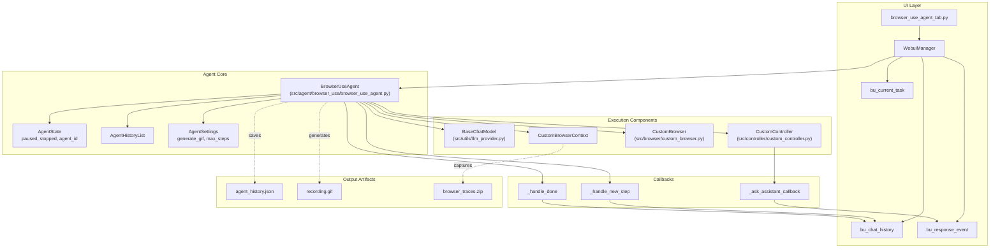
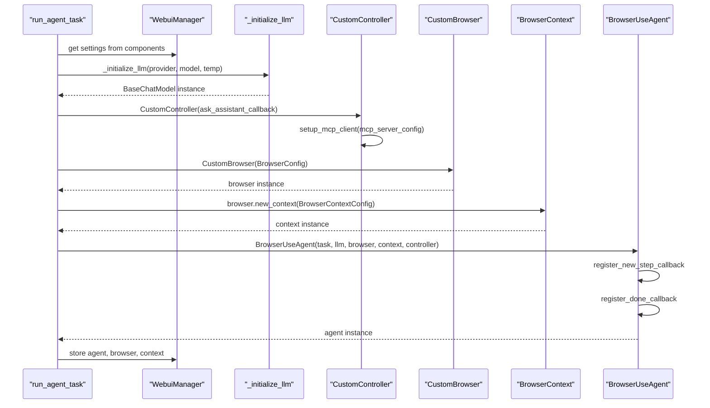
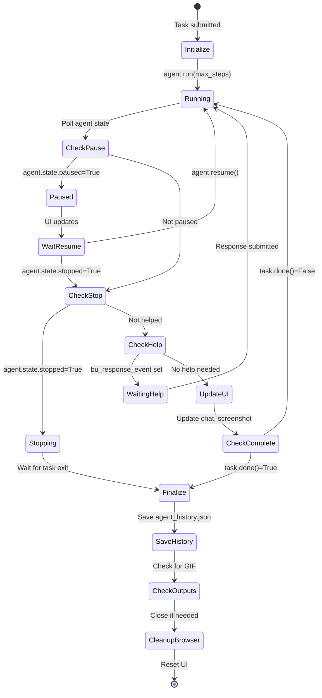

<!-- source: DeepWiki mcp.deepwiki.com · repo browser-use/web-ui · page 4.1 Browser Use Agent · fetched 2026-10-30 -->

# Browser Use Agent

<details>
<summary>Relevant source files</summary>

The following files were used as context for generating this wiki page:

- [src/agent/browser_use/browser_use_agent.py](src/agent/browser_use/browser_use_agent.py)
- [src/webui/components/browser_use_agent_tab.py](src/webui/components/browser_use_agent_tab.py)
- [tests/test_playwright.py](tests/test_playwright.py)

</details>


This document explains the Browser Use Agent's step-by-step execution loop, action selection, state management, user assistance mechanism, and integration with the `CustomController`. The Browser Use Agent is designed for interactive browser automation tasks where an LLM-powered agent navigates and interacts with web pages to accomplish user-defined goals.

For information about the Deep Research Agent's Langgraph-based workflow, see [Deep Research Agent](#4.2). For details on the `CustomController`'s action orchestration, see [Controller and Actions](#4.3).

## Overview and Purpose

The Browser Use Agent (`BrowserUseAgent`) is the primary agent for interactive web automation. It operates in a step-by-step execution loop where:
1. The agent observes the current browser state (screenshot, DOM, etc.)
2. An LLM decides what action(s) to take next
3. The agent executes the action(s) through the browser
4. The loop continues until the task is complete or max steps is reached

The agent can request human assistance when needed, supports pause/resume/stop operations, and generates comprehensive execution history and recordings.

**Sources**: [src/webui/components/browser_use_agent_tab.py:1-30](), [src/agent/browser_use/browser_use_agent.py:30-52]()

## Agent Architecture and Component Integration



**Architecture Overview**

The Browser Use Agent integrates multiple layers, bridging natural language spaces to concrete code entities:
- **UI Layer**: Gradio components managed by `WebuiManager` that maintain chat history, current task reference, and user assistance events [src/webui/components/browser_use_agent_tab.py:25]()
- **Agent Core**: The `BrowserUseAgent` instance defined in `src/agent/browser_use/browser_use_agent.py` [src/agent/browser_use/browser_use_agent.py:30]() with internal state tracking and execution history
- **Execution Components**: LLM for decision-making via `llm_provider`, `CustomController` [src/webui/components/browser_use_agent_tab.py:23]() for action orchestration, and `CustomBrowser` [src/webui/components/browser_use_agent_tab.py:22]() for web interaction
- **Callbacks**: Callback functions monitoring agent progress and handling user assistance requests
- **Output Artifacts**: Persistent files including JSON history, GIF recordings, and browser traces

**Sources**: [src/webui/components/browser_use_agent_tab.py:21-26](), [src/agent/browser_use/browser_use_agent.py:30-52]()

## Initialization and Configuration

### Agent Initialization Process



**Initialization Flow**

The initialization process follows these steps:
1. **Settings Retrieval**: Extract agent settings (LLM config, max steps, tool calling method) and browser settings.
2. **LLM Initialization**: Create the main LLM using `_initialize_llm()` [src/webui/components/browser_use_agent_tab.py:33-66]() which calls `llm_provider.get_llm_model()`.
3. **Controller Setup**: Create `CustomController` with the `ask_assistant_callback` wrapper and initialize MCP client if configured.
4. **Browser/Context Creation**: Configure and instantiate `CustomBrowser` [src/webui/components/browser_use_agent_tab.py:22]() and `BrowserContext`.
5. **Agent Instantiation**: Create new `BrowserUseAgent` [src/agent/browser_use/browser_use_agent.py:30]() instance registering step and done callbacks.

**Sources**: [src/webui/components/browser_use_agent_tab.py:33-66](), [src/agent/browser_use/browser_use_agent.py:30-52]()

### Configuration Parameters

| Parameter Category | Key Parameters | Default Value | Description |
|-------------------|----------------|---------------|-------------|
| **LLM Settings** | `llm_provider` | None | Provider name (openai, anthropic, etc.) |
| | `llm_model_name` | None | Model identifier |
| | `llm_temperature` | 0.6 | Sampling temperature |
| | `use_vision` | True | Enable vision capabilities |
| **Agent Settings** | `max_steps` | 100 | Maximum execution steps |
| | `tool_calling_method` | "auto" | Tool calling strategy |
| **Browser Settings** | `headless` | False | Headless mode |
| | `keep_browser_open` | False | Reuse browser between tasks |
| **Output Settings** | `save_agent_history_path` | "./tmp/agent_history" | History save location |

**Sources**: [src/webui/components/browser_use_agent_tab.py:33-66](), [src/agent/browser_use/browser_use_agent.py:30-52]()

## Execution Loop and State Machine

### Main Execution Loop



**Execution Loop Details**

The execution loop managed in `BrowserUseAgent.run()` [src/agent/browser_use/browser_use_agent.py:48-169]() handles asynchronous step execution, signal handling, consecutive failure checks, and cleanup:
1. **Signal Handling**: Registers `SignalHandler` for graceful pause/resume control via keyboard or UI interrupts [src/agent/browser_use/browser_use_agent.py:59-66]().
2. **Step Iteration**: Iterates up to `max_steps`, evaluating `self.state.paused`, `self.state.stopped`, and `consecutive_failures` [src/agent/browser_use/browser_use_agent.py:76-96]().
3. **Playwright Script Saving**: Automatically serializes execution steps into a executable Playwright script upon completion if requested [src/agent/browser_use/browser_use_agent.py:144-157]().
4. **GIF Generation**: Generates history recordings using `create_history_gif` if enabled [src/agent/browser_use/browser_use_agent.py:164-169]().

**Sources**: [src/agent/browser_use/browser_use_agent.py:30-169](), [src/webui/components/browser_use_agent_tab.py:1-167]()

### Internal Agent Step Execution

```mermaid
sequenceDiagram
    participant Loop as "BrowserUseAgent.run"
    participant Agent as "BrowserUseAgent.step"
    participant LLM as "BaseChatModel"
    participant Ctrl as "CustomController"
    participant Ctx as "BrowserContext"
    participant CB as "_handle_new_step"
    
    Loop->>Agent: agent.run(max_steps)
    
    loop Each Step
        Agent->>Ctx: get_state() → BrowserState
        Agent->>LLM: decide_action(state) → AgentOutput
        Agent->>Ctrl: execute_action(action)
        Ctrl->>Ctx: perform browser action
        Ctx-->>Ctrl: action result
        Ctrl-->>Agent: execution status
        
        Agent->>CB: _handle_new_step(state, output, step_num)
        CB->>CB: format AgentOutput as JSON
        CB->>CB: display screenshot
        CB->>CB: append to bu_chat_history
    end
```

**Step Execution Details**

Each step inside `agent.run()` [src/agent/browser_use/browser_use_agent.py:48-169]() captures state, queries the LLM, executes actions via `CustomController`, and triggers the `_handle_new_step` callback [src/webui/components/browser_use_agent_tab.py:134-167]() to format output and render screenshots.

**Sources**: [src/agent/browser_use/browser_use_agent.py:48-169](), [src/webui/components/browser_use_agent_tab.py:134-167]()

## State Management

### WebUI Manager State

The `WebuiManager` [src/webui/components/browser_use_agent_tab.py:25]() maintains state variables for the agent (`bu_agent`), browser (`bu_browser`), browser context (`bu_browser_context`), controller (`bu_controller`), chat history (`bu_chat_history`), and coordination events (`bu_response_event`).

**Sources**: [src/webui/components/browser_use_agent_tab.py:21-26]()

## Action Selection and Execution

### LLM Action Selection and Tool Calling

`BrowserUseAgent` defines `_set_tool_calling_method()` [src/agent/browser_use/browser_use_agent.py:31-45]() to configure tool execution behavior based on model capabilities and library types (e.g. `ChatOpenAI`, `ChatGoogleGenerativeAI`, or raw tool support).

**Sources**: [src/agent/browser_use/browser_use_agent.py:31-45]()

## Callbacks and Event Handling

### Step Callback System

The `_handle_new_step` function processes state updates and formats screenshots into base64 image tags [src/webui/components/browser_use_agent_tab.py:134-167]() for chat display.

**Sources**: [src/webui/components/browser_use_agent_tab.py:134-167]()

## Browser Integration and Testing

Playwright integration is validated through test fixtures such as `tests/test_playwright.py` [tests/test_playwright.py:7-29](), which launch persistent browser contexts with custom executable paths and user data directories.

**Sources**: [tests/test_playwright.py:7-29]()

---

