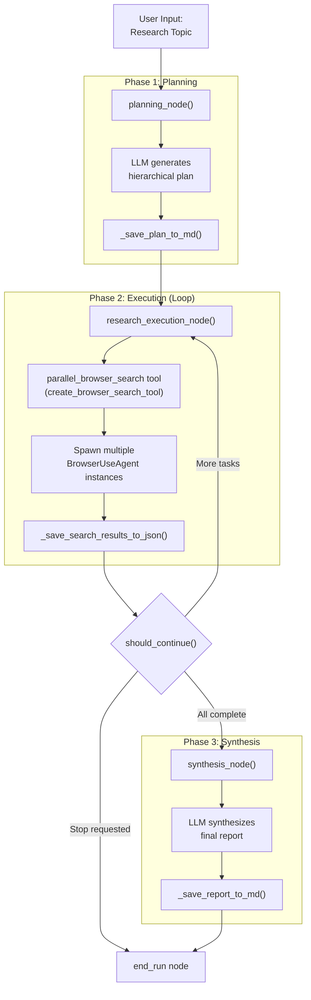
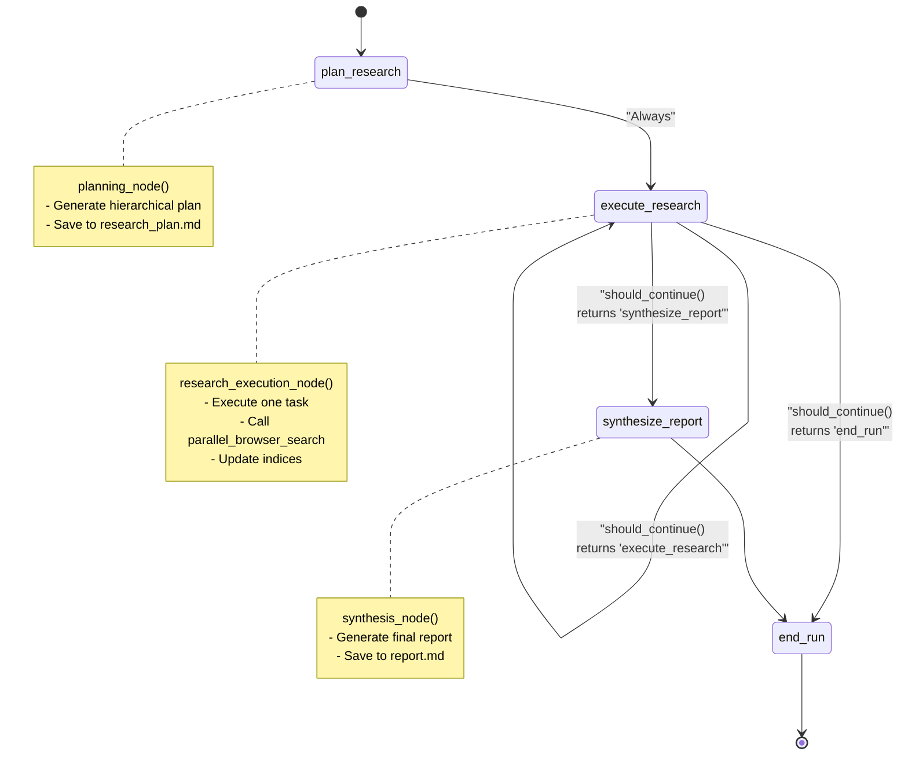
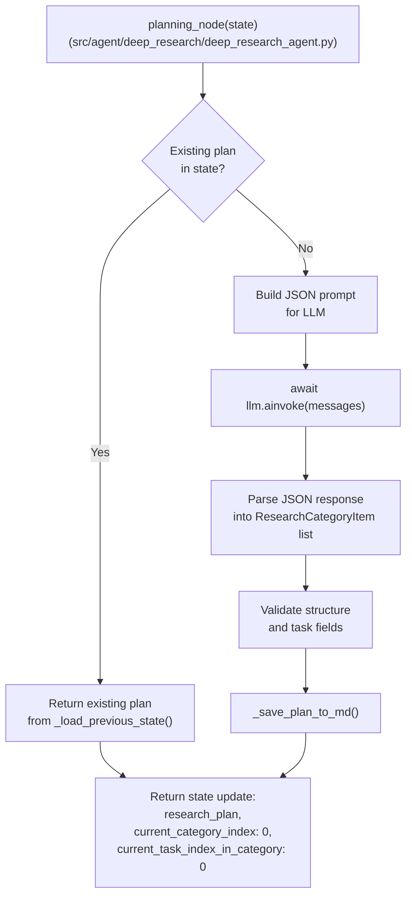
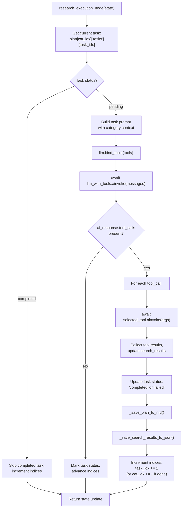
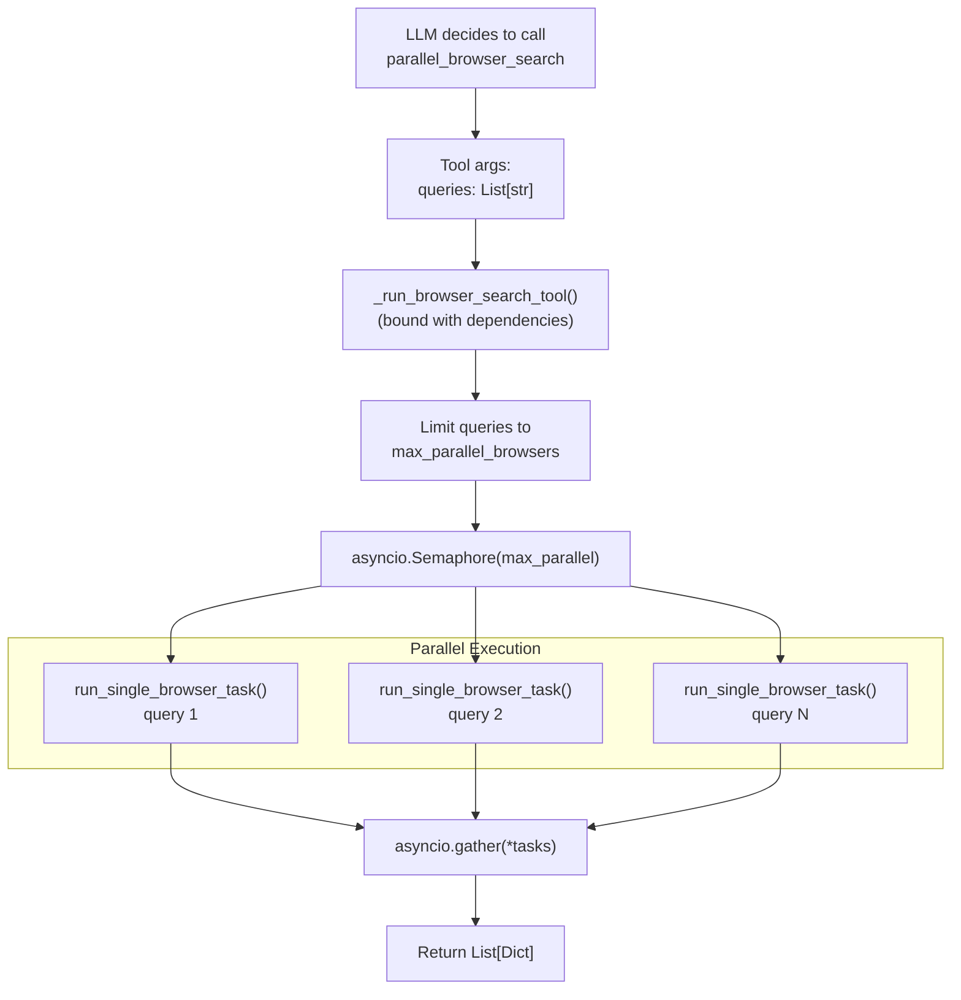

<!-- source: DeepWiki mcp.deepwiki.com · repo browser-use/web-ui · page 4.2 Deep Research Agent · fetched 2026-10-30 -->

# Deep Research Agent

<details>
<summary>Relevant source files</summary>

The following files were used as context for generating this wiki page:

- [src/agent/deep_research/deep_research_agent.py](src/agent/deep_research/deep_research_agent.py)

</details>


## Purpose and Scope

The Deep Research Agent implements an automated, multi-phase research workflow using Langgraph state machines (`StateGraph`) defined in `src/agent/deep_research/deep_research_agent.py` to systematically investigate a topic [src/agent/deep_research/deep_research_agent.py:1-1261](). It generates a hierarchical research plan (`research_plan.md`), executes parallel browser searches for each research task via `BrowserUseAgent` instances [src/agent/deep_research/deep_research_agent.py:133-141](), and synthesizes findings into a comprehensive markdown report (`report.md`) [src/agent/deep_research/deep_research_agent.py:42]().

This document covers the Deep Research Agent's architecture, Langgraph-based workflow, state management, and integration with parallel browser automation. For the interactive Browser Use Agent that executes individual browser tasks, see [Custom Browser](#5.1). For the UI integration, see [Deep Research Agent](#4.2).

**Sources:**
- [src/agent/deep_research/deep_research_agent.py:1-1261]()

---

## Architecture Overview

The Deep Research Agent uses a three-phase workflow orchestrated by a Langgraph state machine compiled in `DeepResearchAgent._compile_graph()` [src/agent/deep_research/deep_research_agent.py:1050-1083]():



**Diagram: Three-Phase Research Workflow Mapping System Names to Code Entities (`src/agent/deep_research/deep_research_agent.py`)**

The agent maintains progress state across execution, enabling resume functionality after interruption via `_load_previous_state()` [src/agent/deep_research/deep_research_agent.py:338-418](). Each phase saves its output to disk for persistence and monitoring.

**Sources:**
- [src/agent/deep_research/deep_research_agent.py:461-977]()
- [src/agent/deep_research/deep_research_agent.py:1050-1083]()

---

## State Management

### DeepResearchState TypedDict

The agent uses a `DeepResearchState` TypedDict to manage execution state through the Langgraph workflow:

```mermaid
graph LR
    subgraph "DeepResearchState Fields"
        TASK_ID["task_id: str"]
        TOPIC["topic: str"]
        PLAN["research_plan:<br/>List[ResearchCategoryItem]"]
        RESULTS["search_results:<br/>List[Dict]"]
        MSGS["messages:<br/>List[BaseMessage]"]
        LLM["llm: Any"]
        TOOLS["tools: List[Tool]"]
        OUTPUT["output_dir: Path"]
        BROWSER["browser_config: Dict"]
        REPORT["final_report:<br/>Optional[str]"]
        CAT_IDX["current_category_index: int"]
        TASK_IDX["current_task_index_in_category: int"]
        STOP["stop_requested: bool"]
        ERROR["error_message:<br/>Optional[str]"]
    end
```



**Diagram: DeepResearchState Structure**

**Sources:**
- [src/agent/deep_research/deep_research_agent.py:318-333]()

### Hierarchical Plan Structure

The research plan follows a two-level hierarchy defined by `ResearchCategoryItem` and `ResearchTaskItem`:

| TypedDict | Fields | Purpose |
|-----------|--------|---------|
| `ResearchCategoryItem` | `category_name: str`<br/>`tasks: List[ResearchTaskItem]` | Top-level research category (e.g., "Historical Development") [src/agent/deep_research/deep_research_agent.py:304-316]() |
| `ResearchTaskItem` | `task_description: str`<br/>`status: str`<br/>`queries: Optional[List[str]]`<br/>`result_summary: Optional[str]` | Individual research task within a category [src/agent/deep_research/deep_research_agent.py:304-316]() |

Task status values: `"pending"`, `"completed"`, `"failed"`

**Sources:**
- [src/agent/deep_research/deep_research_agent.py:304-316]()

---

## Langgraph State Machine

The `DeepResearchAgent._compile_graph()` method constructs a Langgraph workflow with four nodes and conditional routing [src/agent/deep_research/deep_research_agent.py:1050-1083]():



**Diagram: Langgraph State Machine Execution Paths**

The `should_continue()` function determines routing based on [src/agent/deep_research/deep_research_agent.py:938-977]():
- `stop_requested` flag → route to `"end_run"`
- Critical errors in `error_message` → route to `"end_run"`
- More pending tasks exist → route to `"execute_research"`
- All tasks complete → route to `"synthesize_report"`

**Sources:**
- [src/agent/deep_research/deep_research_agent.py:938-977]()
- [src/agent/deep_research/deep_research_agent.py:1050-1083]()

---

## Phase 1: Planning Node

### Planning Workflow

The `planning_node()` function generates or loads the hierarchical research plan [src/agent/deep_research/deep_research_agent.py:461-607]():



**Diagram: Planning Node Flow and Code Entities**

### Plan Generation Prompt

The LLM receives a system prompt requesting a JSON array of categories, each with a list of tasks [src/agent/deep_research/deep_research_agent.py:481-521](). The prompt instructs the LLM to generate 3-10 categories with 2-6 tasks each, scaled to topic complexity.

**Sources:**
- [src/agent/deep_research/deep_research_agent.py:461-607]()

### Plan File Format

The `_save_plan_to_md()` function writes the plan to `research_plan.md` using markdown checkbox syntax [src/agent/deep_research/deep_research_agent.py:421-436]():

```markdown
# Research Plan

## 1. Understanding Core Concepts

  - [ ] Define primary terminology
  - [x] Identify fundamental principles
  - [-] Research historical context
```

Checkbox markers:
- `- [ ]` = pending
- `- [x]` = completed
- `- [-]` = failed

**Sources:**
- [src/agent/deep_research/deep_research_agent.py:421-436]()

---

## Phase 2: Research Execution Node

### Execution Loop

The `research_execution_node()` executes one research task per invocation, then updates indices [src/agent/deep_research/deep_research_agent.py:609-809]():



**Diagram: Research Execution Node Flow**

**Sources:**
- [src/agent/deep_research/deep_research_agent.py:609-809]()

---

## Parallel Browser Search Tool

### Tool Architecture

The `create_browser_search_tool()` factory function creates a `StructuredTool` that spawns multiple `BrowserUseAgent` instances in parallel via `run_single_browser_task()` [src/agent/deep_research/deep_research_agent.py:50-299]():



**Diagram: Parallel Browser Search Tool Execution**

**Sources:**
- [src/agent/deep_research/deep_research_agent.py:50-299]()

### Single Browser Task Execution

The `run_single_browser_task()` function manages the lifecycle of one browser task, instantiating `CustomBrowser`, `BrowserContextConfig`, and `BrowserUseAgent` [src/agent/deep_research/deep_research_agent.py:50-176]().

**Sources:**
- [src/agent/deep_research/deep_research_agent.py:50-176]()

---

## Phase 3: Synthesis Node

### Synthesis Workflow

The `synthesis_node()` generates the final report from collected search results by calling `llm.ainvoke()` with formatted system and human prompts, then writes the result via `_save_report_to_md()` [src/agent/deep_research/deep_research_agent.py:811-933]().

**Sources:**
- [src/agent/deep_research/deep_research_agent.py:811-933]()

---

## File Outputs

The agent produces three primary output files in `{output_dir}/{task_id}/`:

| Filename | Format | Purpose | Updated By |
|----------|--------|---------|------------|
| `research_plan.md` | Markdown | Hierarchical plan with checkbox status | `_save_plan_to_md()` [src/agent/deep_research/deep_research_agent.py:421-436]() |
| `search_info.json` | JSON | Array of all search result dicts | `_save_search_results_to_json()` [src/agent/deep_research/deep_research_agent.py:438-448]() |
| `report.md` | Markdown | Final synthesized research report | `_save_report_to_md()` [src/agent/deep_research/deep_research_agent.py:450-458]() |

**Constant Definitions:**
- `REPORT_FILENAME = "report.md"` [src/agent/deep_research/deep_research_agent.py:42]()
- `PLAN_FILENAME = "research_plan.md"` [src/agent/deep_research/deep_research_agent.py:43]()
- `SEARCH_INFO_FILENAME = "search_info.json"` [src/agent/deep_research/deep_research_agent.py:44]()

**Sources:**
- [src/agent/deep_research/deep_research_agent.py:42-458]()

---

## Stop Mechanism and Resume Capability

The agent supports clean cancellation and persistence across runs via `_AGENT_STOP_FLAGS`, `_BROWSER_AGENT_INSTANCES`, and `_load_previous_state()` [src/agent/deep_research/deep_research_agent.py:46-418](). Resuming reads existing files and locates the first pending task index [src/agent/deep_research/deep_research_agent.py:338-418]().

**Sources:**
- [src/agent/deep_research/deep_research_agent.py:46-418]()
- [src/agent/deep_research/deep_research_agent.py:1249-1259]()

---

## DeepResearchAgent Class

The main controller class `DeepResearchAgent` orchestrates initialization, tool setup (`_setup_tools`), graph compilation (`_compile_graph`), and execution (`run`) [src/agent/deep_research/deep_research_agent.py:982-1261]().

**Sources:**
- [src/agent/deep_research/deep_research_agent.py:982-1261]()

---

