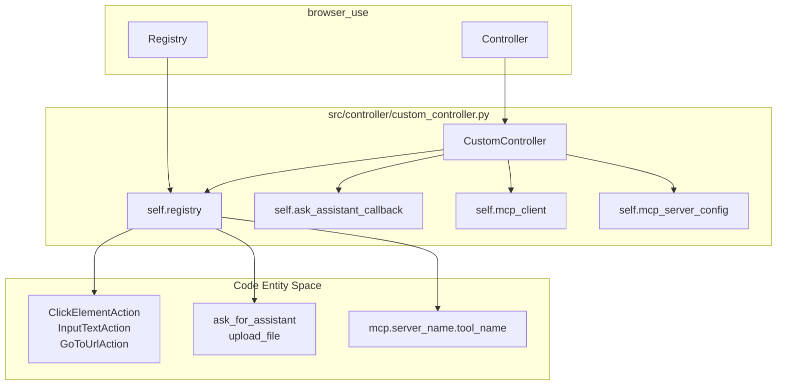
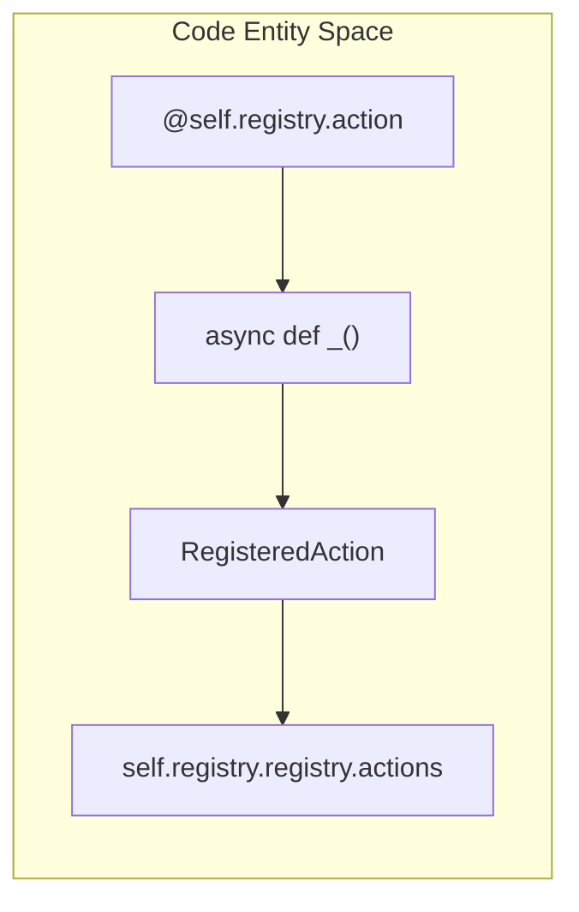
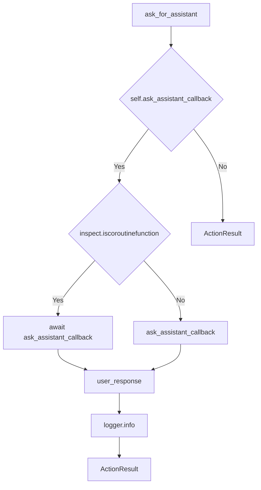
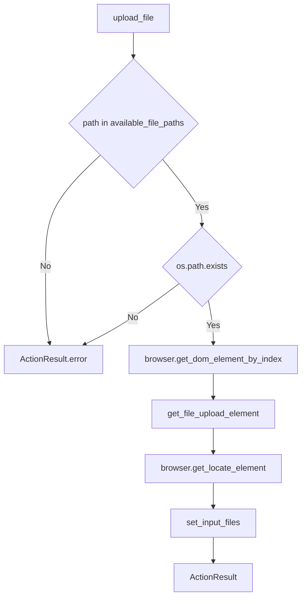
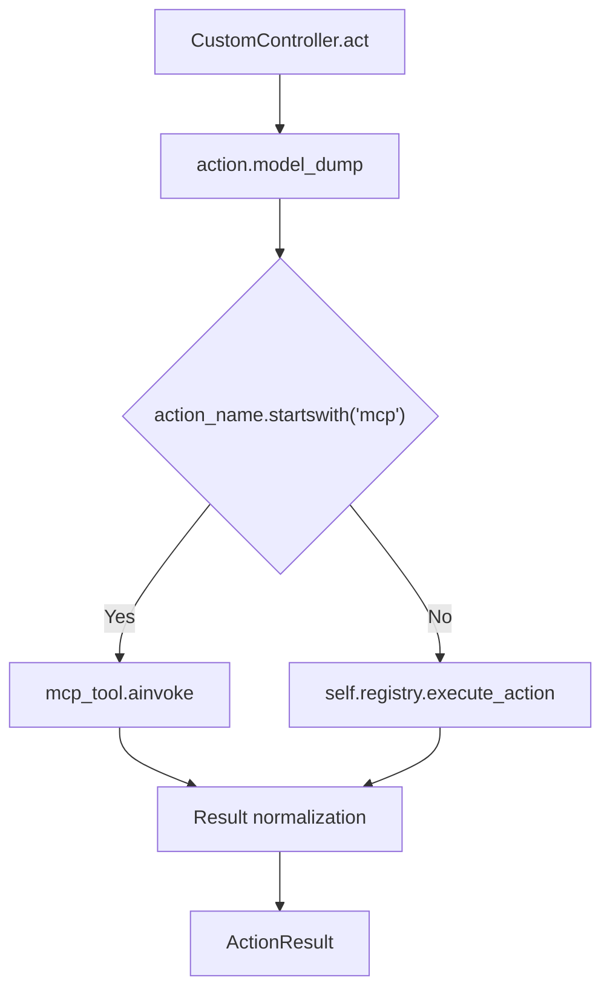
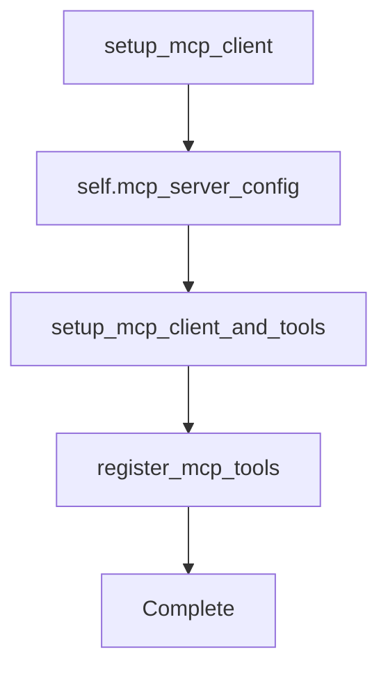

<!-- source: DeepWiki mcp.deepwiki.com · repo browser-use/web-ui · page 4.3 Controller and Actions · fetched 2026-10-30 -->

# Controller and Actions

Relevant source files

The following files were used as context for generating this wiki page:

- [src/controller/__init__.py](src/controller/__init__.py)
- [src/controller/custom_controller.py](src/controller/custom_controller.py)

## Purpose and Scope

The `CustomController` serves as the central action orchestration layer in the browser-use web-ui system. It extends the base `Controller` from the `browser_use` package to provide custom actions, integrate external Model Context Protocol (MCP) tools, and manage the execution flow between agents and browser automation primitives.

This page covers the controller's architecture, action registration mechanisms, built-in actions (`ask_for_assistant`, `upload_file`), and the action execution flow through `act()`.

Sources: [src/controller/custom_controller.py:1-159]()

---

## Controller Architecture

The `CustomController` class extends the base `Controller` from `browser_use` and adds custom browser action definitions and MCP client integration capabilities.

Sources: [src/controller/custom_controller.py:39-49]()

### Constructor Parameters

| Parameter | Type | Purpose |
|-----------|------|---------|
| `exclude_actions` | `list[str]` | Actions to exclude from the registry |
| `output_model` | `Optional[Type[BaseModel]]` | Pydantic model for structured output |
| `ask_assistant_callback` | `Optional[Callable]` | Callback function invoked when agent requests user assistance |

Sources: [src/controller/custom_controller.py:39-49]()

---

## Action Registration System

The controller utilizes a decorator-based registration system inherited from the base `Controller` class, storing actions within `self.registry`.

Sources: [src/controller/custom_controller.py:51-108]()

---

## Built-in Custom Actions

`CustomController._register_custom_actions()` registers two core custom actions during initialization.

Sources: [src/controller/custom_controller.py:51-108]()

### ask_for_assistant

This action handles user assistance requests when the agent hits a blocker.

Sources: [src/controller/custom_controller.py:60-72]()

### upload_file

This action uploads files to interactive DOM elements using Playwright selectors.

Sources: [src/controller/custom_controller.py:73-108]()

---

## Action Execution Flow

The `CustomController.act()` method manages the execution of actions dispatched by agents.

Sources: [src/controller/custom_controller.py:109-153]()

---

## MCP Tool Integration

`CustomController.setup_mcp_client()` initializes external MCP server connections and registers discovered tools.

Sources: [src/controller/custom_controller.py:154-159]()

---

## Summary

`CustomController` provides a unified execution interface for built-in browser actions, custom human-in-the-loop workflows, and external MCP tool integrations.

Sources: [src/controller/custom_controller.py:1-159]()

---

