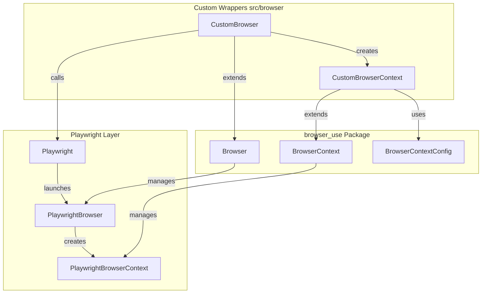
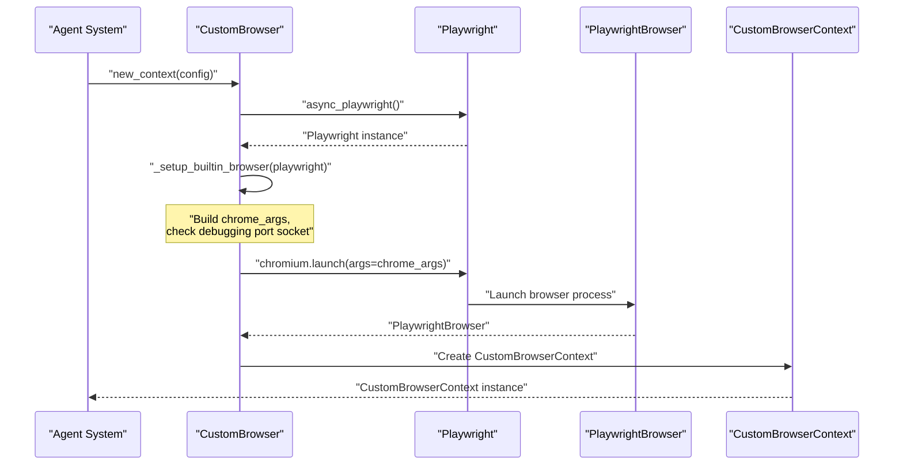

<!-- source: DeepWiki mcp.deepwiki.com · repo browser-use/web-ui · page 5 Browser Integration · fetched 2026-10-30 -->

# Browser Integration

Relevant source files

The following files were used as context for generating this wiki page:

- [src/browser/__init__.py](src/browser/__init__.py)
- [src/browser/custom_browser.py](src/browser/custom_browser.py)
- [src/browser/custom_context.py](src/browser/custom_context.py)

## Purpose and Scope

This document provides a high-level overview of how `browser-use` web-ui integrates with Playwright for browser automation. It covers the core architectural wrappers (`CustomBrowser` and `CustomBrowserContext`), configuration merging, Chrome DevTools Protocol (CDP) port handling, and browser launch workflows.

As a parent page, this section introduces the high-level concepts. For deeper technical implementation details, refer to the child pages:
- For `CustomBrowser` launch logic, argument assembly, and debugging port handling, see [Custom Browser](#5.1).
- For `CustomBrowserContext` session management and configuration merging, see [Custom Browser Context](#5.2).

Sources: `[src/browser/custom_browser.py:1-109]()`, `[src/browser/custom_context.py:1-22]()`

## Architecture Overview

The browser integration layer extends the base `browser_use` package via subclasses that customize browser lifecycle management, context creation, and process launch arguments.

Sources: `[src/browser/custom_browser.py:1-110]`, `[src/browser/custom_context.py:1-23]`

## Browser Initialization Flow

The browser initialization sequence coordinates asynchronous Playwright setup, argument assembly, port conflict resolution, and browser context generation.

Sources: `[src/browser/custom_browser.py:36-109]`, `[src/browser/custom_context.py:15-22]`

## Custom Browser

The `CustomBrowser` class inherits from `Browser` and handles the underlying Playwright browser process, argument compilation (such as `CHROME_ARGS`, `CHROME_DOCKER_ARGS`, and security flags), and CDP port checking via a local socket connection. 

For full details on configuration options, headless behaviors, window sizing adjustments, and Chrome argument handling, see [Custom Browser](#5.1).

Sources: `[src/browser/custom_browser.py:34-110]`

## Custom Browser Context

The `CustomBrowserContext` class extends `BrowserContext` to manage isolated browsing sessions. It merges browser-level configurations (`self.config`) with context-specific overrides (`config`) when instantiating new sessions.

For detailed information on state management and configuration merging, see [Custom Browser Context](#5.2).

Sources: `[src/browser/custom_context.py:15-23]`, `[src/browser/custom_browser.py:36-41]`

---

