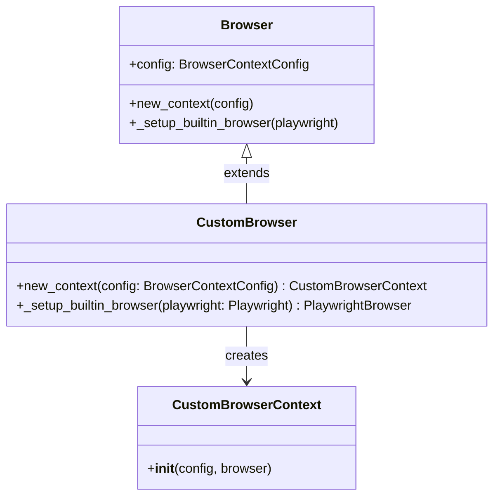
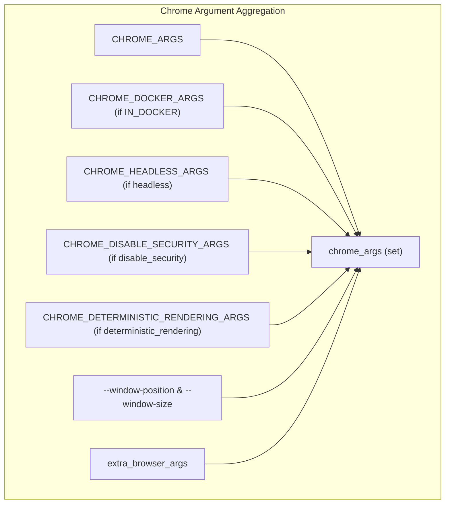
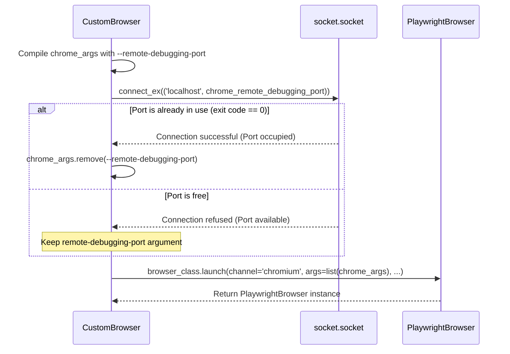

<!-- source: DeepWiki mcp.deepwiki.com · repo browser-use/web-ui · page 5.1 Custom Browser · fetched 2026-10-30 -->

# Custom Browser

Relevant source files

The following files were used as context for generating this wiki page:

- [src/browser/custom_browser.py](src/browser/custom_browser.py)

## Purpose and Scope

The `CustomBrowser` class (defined in `src/browser/custom_browser.py`) [src/browser/custom_browser.py:34-34]() extends the base `Browser` class from `browser-use` [src/browser/custom_browser.py:12-12]() to provide tailored browser automation capabilities for the web-ui application. It handles advanced window sizing calculations, dynamic Chrome argument aggregation (including security flags, headless modes, and Docker-specific configurations), robust debugging port conflict resolution, and the instantiation of custom browser contexts (`CustomBrowserContext`) [src/browser/custom_browser.py:29-41]().

Sources:
- [src/browser/custom_browser.py:12-41]()

## Class Architecture and Inheritance

`CustomBrowser` inherits from `Browser` and overrides context creation and browser setup logic to integrate custom configuration handling and custom context types.

Sources:
- [src/browser/custom_browser.py:12-41]()

## Configuration Options and Window Sizing

When launching a builtin browser via `_setup_builtin_browser`, `CustomBrowser` determines the screen dimensions and window positioning based on headless state, custom context specifications, or environment defaults.

| Condition | Width / Height Source | Position Adjustment |
|---|---|---|
| Non-Headless with Context Size | `self.config.new_context_config.window_width` / `window_height` [src/browser/custom_browser.py:48-57]() | `get_window_adjustments()` [src/browser/custom_browser.py:58]() |
| Headless Mode | Fixed `1920` x `1080` [src/browser/custom_browser.py:59-60]() | `0, 0` [src/browser/custom_browser.py:61]() |
| Default / Interactive Mode | `get_screen_resolution()` [src/browser/custom_browser.py:63]() | `get_window_adjustments()` [src/browser/custom_browser.py:64]() |

Sources:
- [src/browser/custom_browser.py:43-65]()

## Chrome Argument Handling

`CustomBrowser` compiles a comprehensive set of command-line arguments when launching Chromium-based browsers. These arguments control rendering behavior, sandbox restrictions, debugging capabilities, and window geometry.

Sources:
- [src/browser/custom_browser.py:17-23](), [src/browser/custom_browser.py:66-76]()

## Debugging Port Logic and Conflict Resolution

To avoid port binding collisions with existing Chrome or browser-use instances, `CustomBrowser` checks whether `chrome_remote_debugging_port` is already active on localhost before launching the process.

Sources:
- [src/browser/custom_browser.py:78-109]()

## Browser Launch Process

The `_setup_builtin_browser` function finalizes the launch sequence by selecting the appropriate browser engine (`chromium`, `firefox`, or `webkit`), injecting specific startup flags, configuring proxy settings, and disabling signal handlers (`handle_sigterm=False`, `handle_sigint=False`) to ensure smooth integration with the web-ui task lifecycle.

Sources:
- [src/browser/custom_browser.py:84-109]()

---

