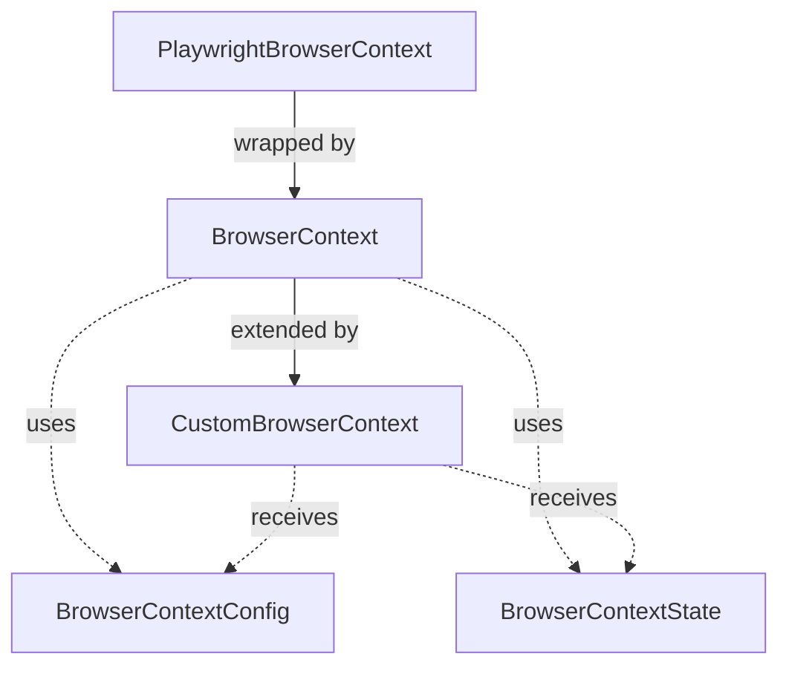
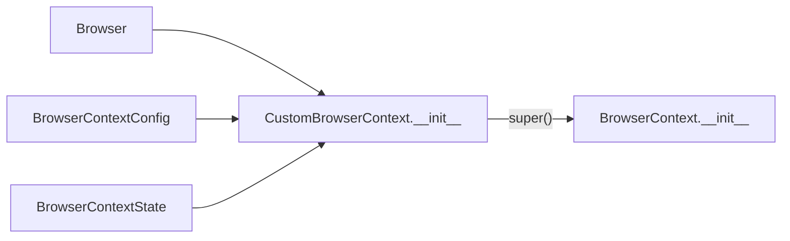
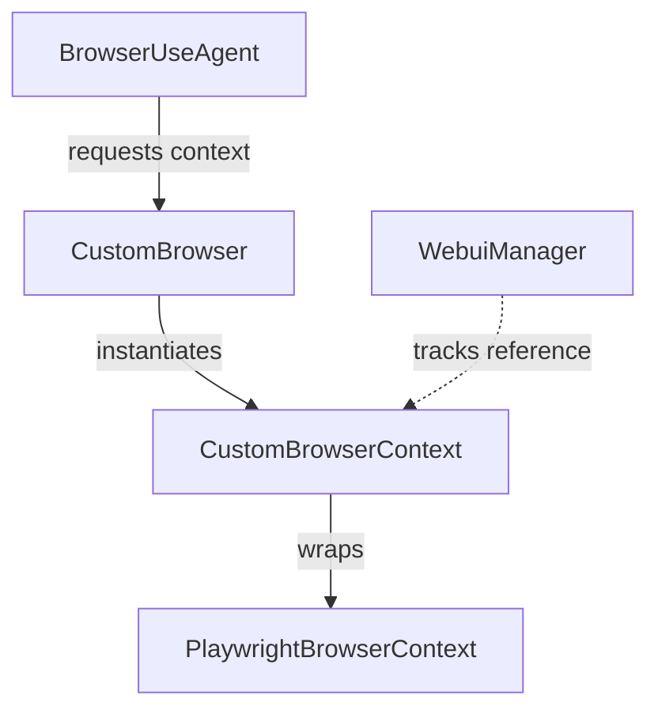
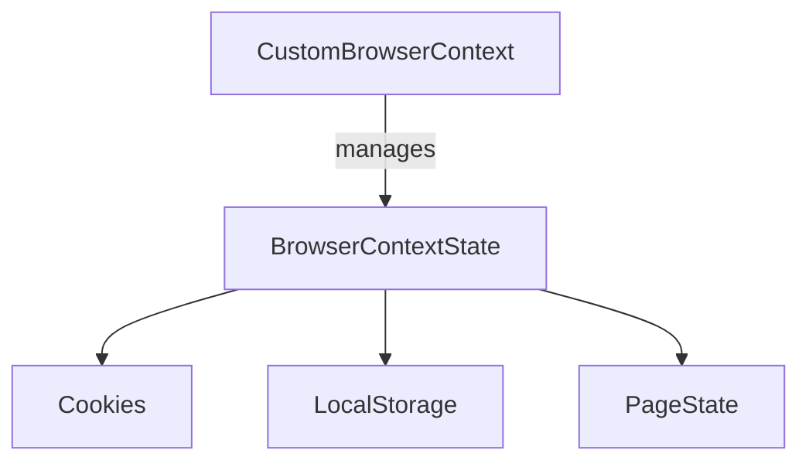
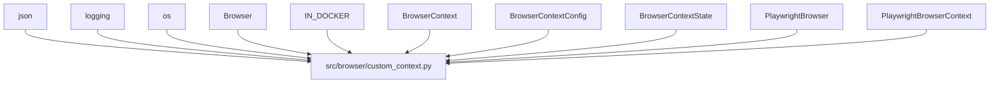

<!-- source: DeepWiki mcp.deepwiki.com · repo browser-use/web-ui · page 5.2 Custom Browser Context · fetched 2026-10-30 -->

# Custom Browser Context

Relevant source files

The following files were used as context for generating this wiki page:

- [src/browser/custom_context.py](src/browser/custom_context.py)

## Purpose and Scope

The `CustomBrowserContext` class (`[src/browser/custom_context.py:15]()`) provides isolated session management for browser automation within the `browser-use` web-ui system. It extends the upstream `BrowserContext` class (`[src/browser/custom_context.py:6]()`) to maintain independent browsing sessions with configurable state management, cookies, local storage, and page states.

This page covers the implementation details of `CustomBrowserContext`, its initialization parameters, state handling, and integration within agent workflows. For browser-level configuration, see [Custom Browser](#5.1).

Sources: [src/browser/custom_context.py:1-22]()

---

## Class Overview

`CustomBrowserContext` is a subclass of `BrowserContext` provided by the underlying `browser-use` library (`[src/browser/custom_context.py:6,15]()`). It acts as a specialized extension point for managing Playwright-backed browser sessions (`[src/browser/custom_context.py:7-8]()`).

### Class Hierarchy and Inheritance

Sources: [src/browser/custom_context.py:6-10,15-22]()

---

## Constructor Implementation

The `CustomBrowserContext.__init__` method (`[src/browser/custom_context.py:16-21]`) initializes the context by forwarding parameters to the parent `BrowserContext` constructor (`[src/browser/custom_context.py:22]()`).

### Constructor Parameter Flow

| Parameter | Type | Optional | Description |
|-----------|------|----------|-------------|
| `browser` | `Browser` | No | Parent `Browser` instance managing this context (`[src/browser/custom_context.py:18]()`) |
| `config` | `BrowserContextConfig | None` | Yes | Configuration object controlling context behavior (`[src/browser/custom_context.py:19]()`) |
| `state` | `BrowserContextState | Optional` | Yes | Initial or restored state data (`[src/browser/custom_context.py:20]()`) |

Sources: [src/browser/custom_context.py:16-22]()

---

## Integration with Browser System

`CustomBrowserContext` bridges the agent execution layers with Playwright's execution context.

### System Architecture to Code Mapping

Sources: [src/browser/custom_context.py:5-22]()

---

## State Management

`CustomBrowserContext` inherits session isolation and state handling features from `BrowserContext` (`[src/browser/custom_context.py:6,15]()`), allowing tasks to maintain cookies, navigation history, and storage independently.

### State Container Components

Sources: [src/browser/custom_context.py:6,10,15-22]()

---

## Import Dependencies

The module relies on standard libraries, Playwright bindings, and base classes from `browser_use`.

Sources: [src/browser/custom_context.py:1-11]()

---

## Summary

The `CustomBrowserContext` class (`[src/browser/custom_context.py:15-23]`) acts as a direct extension of `BrowserContext` (`[src/browser/custom_context.py:6]()`), establishing a clean architectural boundary for managing isolated browser sessions, configuration merging, and state persistence across agent runs.

Sources: [src/browser/custom_context.py:1-22]()

---

