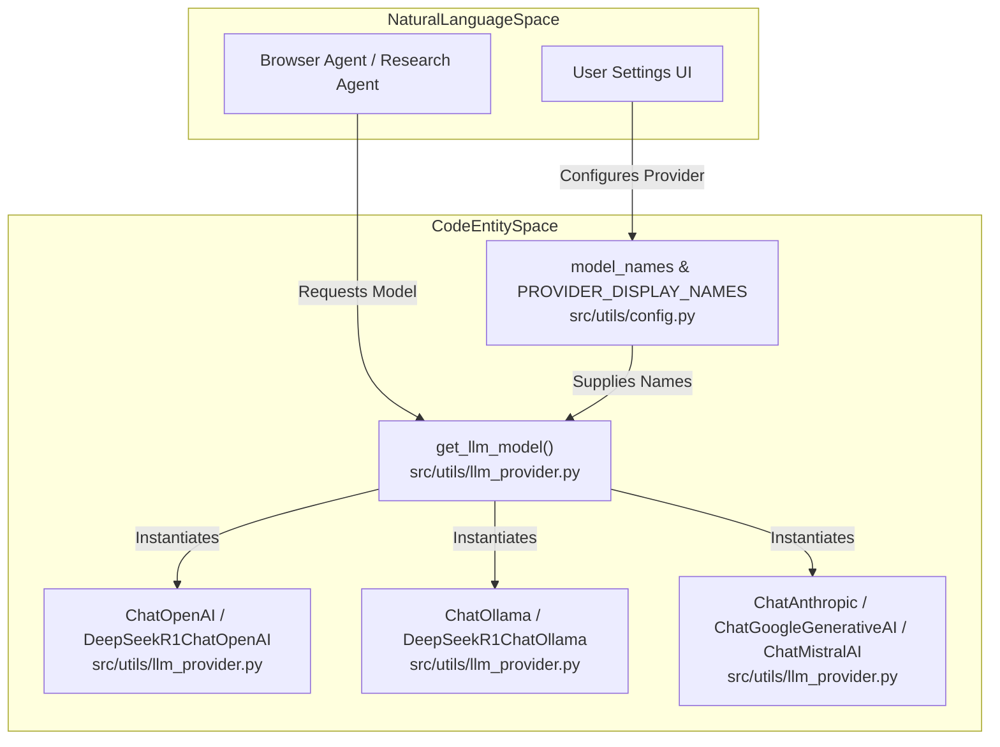

<!-- source: DeepWiki mcp.deepwiki.com · repo browser-use/web-ui · page 6 LLM Integration · fetched 2026-10-30 -->

# LLM Integration

Relevant source files

The following files were used as context for generating this wiki page:

- [.gitignore](.gitignore)
- [src/utils/__init__.py](src/utils/__init__.py)
- [src/utils/config.py](src/utils/config.py)
- [src/utils/llm_provider.py](src/utils/llm_provider.py)

## Purpose and Scope

This document provides a high-level overview of the multi-provider Large Language Model (LLM) integration within the `browser-use` web-ui system. The architecture decouples the agent system from concrete LLM vendor APIs through a unified factory pattern and abstraction layer. 

For deep technical details regarding model initialization, provider-specific configurations, and specialized wrapper classes, see [LLM Provider System](#6.1). For details on verification routines and automated API testing, see [LLM Testing](#6.2).

## Overview of LLM Architecture

The system supports a diverse set of LLM providers (OpenAI, Anthropic, Google, Ollama, DeepSeek, Mistral, Alibaba, etc.) by wrapping LangChain chat models and providing fallback configuration logic. The entry point for instantiating any provider is the `get_llm_model()` factory function [src/utils/llm_provider.py:152-193](). Predefined models and display maps are maintained centrally in `src/utils/config.py:1-100]().

Sources: [src/utils/llm_provider.py:152-193](), [src/utils/config.py:1-100]()

## Child Pages

- **[LLM Provider System](#6.1)**: Covers the `get_llm_model` factory implementation, environment validation, provider-specific initialization logic, the `DeepSeekR1ChatOpenAI` and `DeepSeekR1ChatOllama` wrapper classes, and model mapping metadata (`model_names` and `PROVIDER_DISPLAY_NAMES`).
- **[LLM Testing](#6.2)**: Covers automated validation tests found in `tests/test_llm_api.py`, per-provider test functions, vision model image encoding routines, and test execution procedures.

Sources: [src/utils/llm_provider.py:55-193](), [src/utils/config.py:1-100]()

---

