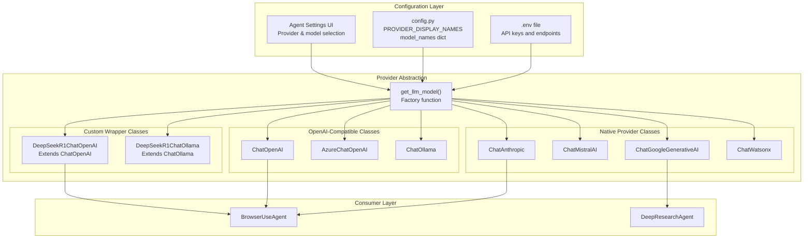
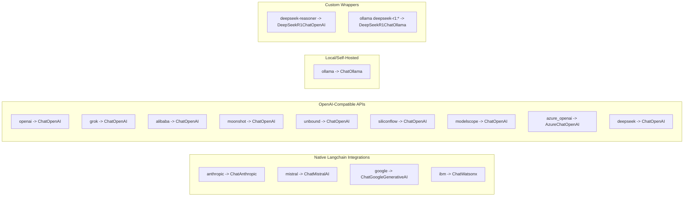
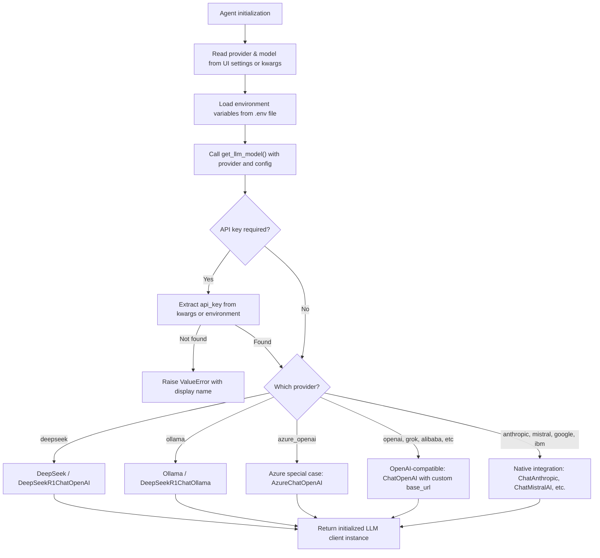

<!-- source: DeepWiki mcp.deepwiki.com · repo browser-use/web-ui · page 6.1 LLM Provider System · fetched 2026-10-30 -->

# LLM Provider System

<details>
<summary>Relevant source files</summary>

The following files were used as context for generating this wiki page:

- [.gitignore](.gitignore)
- [src/utils/config.py](src/utils/config.py)
- [src/utils/llm_provider.py](src/utils/llm_provider.py)

</details>


## Purpose and Scope

The LLM Provider System provides a unified abstraction layer for integrating multiple Large Language Model (LLM) providers into the browser-use web-ui. This system enables agents to seamlessly switch between 14 different LLM providers through a single factory function, handles provider-specific authentication and configuration, and includes custom wrapper classes for providers with non-standard APIs.

This document covers the `get_llm_model()` factory function, provider-specific configurations, custom LLM classes, and the model selection mechanism. For information on how agents use LLM instances, see [Agent System](#4). For UI-based model selection and configuration, see [Settings Tabs](#3.3). For testing LLM integrations, see [LLM Testing](#6.2).

Sources: [src/utils/llm_provider.py:1-355](), [src/utils/config.py:1-100]()

---

## Architecture Overview

The LLM Provider System acts as a central abstraction layer between agents and LLM APIs. It translates provider-agnostic requests into provider-specific API calls, manages authentication credentials, and normalizes responses across different providers.

### Provider System Integration



Sources: [src/utils/llm_provider.py:152-355](), [src/utils/config.py:1-100]()

---

## Provider Factory Function

The `get_llm_model()` function is the central entry point for obtaining LLM instances. It accepts a provider name and configuration parameters, validates API credentials, and returns an initialized LLM client.

### Function Signature

```python
def get_llm_model(provider: str, **kwargs):
    """
    Get LLM model
    :param provider: LLM provider
    :param kwargs: Configuration parameters (model_name, temperature, api_key, base_url, etc.)
    :return: Initialized LLM client instance
    """
```

Sources: [src/utils/llm_provider.py:152-158]()

### API Key Validation

The factory performs automatic API key validation for most providers. It checks the `kwargs` for an `api_key` parameter, falls back to environment variables, and raises a descriptive error if neither is present.

| Provider | Exempted from Key Check | Reason |
|----------|------------------------|--------|
| `ollama` | Yes | Local installation, no API key required |
| `bedrock` | Yes | Uses AWS credentials instead |
| All others | No | Require API key authentication |

The error message uses provider display names from the configuration system for better user experience:

```python
provider_display = config.PROVIDER_DISPLAY_NAMES.get(provider, provider.upper())
error_msg = f"💥 {provider_display} API key not found! 🔑..."
```

Sources: [src/utils/llm_provider.py:159-166](), [src/utils/config.py:1-12]()

---

## Provider Categories

The system organizes providers into three categories based on their API compatibility and integration approach.

### Provider Categorization Diagram



Sources: [src/utils/llm_provider.py:152-355]()

---

## Native Provider Integrations

Native integrations use provider-specific Langchain classes that implement each provider's unique API requirements.

### Anthropic Provider

| Configuration Parameter | Default Value | Environment Variable | Description |
|------------------------|---------------|---------------------|-------------|
| `model` | `claude-3-5-sonnet-20241022` | - | Model identifier |
| `temperature` | `0.0` | - | Sampling temperature |
| `base_url` | `https://api.anthropic.com` | `ANTHROPIC_ENDPOINT` | API endpoint |
| `api_key` | - | `ANTHROPIC_API_KEY` | Authentication key |

Sources: [src/utils/llm_provider.py:168-179]()

### Mistral Provider

| Configuration Parameter | Default Value | Environment Variable | Description |
|------------------------|---------------|---------------------|-------------|
| `model` | `mistral-large-latest` | - | Model identifier |
| `temperature` | `0.0` | - | Sampling temperature |
| `base_url` | `https://api.mistral.ai/v1` | `MISTRAL_ENDPOINT` | API endpoint |
| `api_key` | - | `MISTRAL_API_KEY` | Authentication key |

Sources: [src/utils/llm_provider.py:180-195]()

### Google Provider

The Google provider uses `ChatGoogleGenerativeAI` and requires only an API key (no base URL configuration):

| Configuration Parameter | Default Value | Environment Variable | Description |
|------------------------|---------------|---------------------|-------------|
| `model` | `gemini-2.0-flash-exp` | - | Model identifier |
| `temperature` | `0.0` | - | Sampling temperature |
| `api_key` | - | `GOOGLE_API_KEY` | Authentication key |

Sources: [src/utils/llm_provider.py:240-245]()

### IBM Watsonx Provider

IBM's provider requires additional configuration parameters beyond standard API credentials:

| Configuration Parameter | Default Value | Environment Variable | Description |
|------------------------|---------------|---------------------|-------------|
| `model_id` | `ibm/granite-vision-3.1-2b-preview` | - | Model identifier |
| `url` | `https://us-south.ml.cloud.ibm.com` | `IBM_ENDPOINT` | Service URL |
| `project_id` | - | `IBM_PROJECT_ID` | IBM Cloud project ID |
| `apikey` | - | `IBM_API_KEY` | Authentication key |
| `params.temperature` | `0.0` | - | Sampling temperature |
| `params.max_tokens` | `32000` (from `num_ctx`) | - | Maximum output tokens |

Sources: [src/utils/llm_provider.py:292-308]()

---

## OpenAI-Compatible Providers

These providers implement OpenAI's API specification, allowing them to use `ChatOpenAI` or `AzureChatOpenAI` classes with different base URLs.

### Standard OpenAI-Compatible Configuration

Most OpenAI-compatible providers follow this pattern:

```python
return ChatOpenAI(
    model=kwargs.get("model_name", "<default_model>"),
    temperature=kwargs.get("temperature", 0.0),
    base_url=base_url,
    api_key=api_key,
)
```

Sources: [src/utils/llm_provider.py:196-207]()

### Provider-Specific Endpoints

| Provider | Default Endpoint | Environment Variable | Default Model |
|----------|-----------------|---------------------|---------------|
| `openai` | `https://api.openai.com/v1` | `OPENAI_ENDPOINT` | `gpt-4o` |
| `grok` | `https://api.x.ai/v1` | `GROK_ENDPOINT` | `grok-3` |
| `alibaba` | `https://dashscope.aliyuncs.com/compatible-mode/v1` | `ALIBABA_ENDPOINT` | `qwen-plus` |
| `moonshot` | - | `MOONSHOT_ENDPOINT` | `moonshot-v1-32k-vision-preview` |
| `unbound` | `https://api.getunbound.ai` | `UNBOUND_ENDPOINT` | `gpt-4o-mini` |
| `siliconflow` | - | `SiliconFLOW_ENDPOINT` | `Qwen/QwQ-32B` |
| `modelscope` | - | `MODELSCOPE_ENDPOINT` | `Qwen/QwQ-32B` |

Sources: [src/utils/llm_provider.py:196-239]()

### Azure OpenAI Special Case

Azure OpenAI uses a separate class `AzureChatOpenAI` and requires an additional `api_version` parameter:

| Configuration Parameter | Default Value | Environment Variable | Description |
|------------------------|---------------|---------------------|-------------|
| `model` | `gpt-4o` | - | Deployment name (not model name) |
| `temperature` | `0.0` | - | Sampling temperature |
| `azure_endpoint` | - | `AZURE_OPENAI_ENDPOINT` | Azure resource endpoint |
| `api_key` | - | `AZURE_OPENAI_API_KEY` | Authentication key |
| `api_version` | `2025-01-01-preview` | `AZURE_OPENAI_API_VERSION` | API version |

Sources: [src/utils/llm_provider.py:267-279]()

### ModelScope Special Configuration

ModelScope includes an `extra_body` parameter to disable thinking mode:

```python
return ChatOpenAI(
    api_key=api_key,
    base_url=base_url,
    model_name=kwargs.get("model_name", "Qwen/QwQ-32B"),
    temperature=kwargs.get("temperature", 0.0),
    extra_body={"enable_thinking": False}
)
```

Sources: [src/utils/llm_provider.py:338-353]()

---

## Local and Self-Hosted Providers

### Ollama Provider

Ollama runs models locally and requires no API key authentication. The provider supports local model serving with configurable context windows.

| Configuration Parameter | Default Value | Environment Variable | Description |
|------------------------|---------------|---------------------|-------------|
| `model` | `qwen2.5:7b` | - | Local model name |
| `temperature` | `0.0` | - | Sampling temperature |
| `base_url` | `http://localhost:11434` | `OLLAMA_ENDPOINT` | Ollama server endpoint |
| `num_ctx` | `32000` | - | Context window size |
| `num_predict` | `1024` | - | Maximum prediction tokens |

Sources: [src/utils/llm_provider.py:246-266]()

---

## Custom LLM Wrapper Classes

For models with non-standard response formats, the system provides custom wrapper classes that extend base Langchain classes and normalize their outputs.

### DeepSeek R1 Reasoning Models

DeepSeek's R1 models output reasoning traces alongside their final responses. The system provides two wrapper classes to handle different hosting environments.

#### DeepSeekR1ChatOpenAI Class

This class extends `ChatOpenAI` and handles DeepSeek's official API format, where reasoning content is provided in a separate field.

**Key Implementation Details:**

1. **Custom Client Initialization**: Creates a direct OpenAI client instance.
2. **Message History Conversion**: Transforms Langchain messages to OpenAI format.
3. **Reasoning Content Extraction**: Separates reasoning from final answer (`reasoning_content` and `content`).

Both `invoke()` and `ainvoke()` methods are overridden to support synchronous and asynchronous execution.

Sources: [src/utils/llm_provider.py:55-115]()

#### DeepSeekR1ChatOllama Class

This class extends `ChatOllama` for local DeepSeek R1 models, where reasoning is embedded in the response using tags, extracts the final answer after the `</think>` tag, and cleans up JSON response prefixes if present.

Sources: [src/utils/llm_provider.py:117-150]()

### Provider Selection Logic for DeepSeek

The `get_llm_model()` function includes conditional logic to select the appropriate wrapper:

| Condition | Class Used | Trigger |
|-----------|-----------|---------|
| `provider == "deepseek"` AND `model_name == "deepseek-reasoner"` | `DeepSeekR1ChatOpenAI` | Official DeepSeek R1 API |
| `provider == "deepseek"` AND `model_name != "deepseek-reasoner"` | `ChatOpenAI` | Standard DeepSeek models |
| `provider == "ollama"` AND `"deepseek-r1" in model_name` | `DeepSeekR1ChatOllama` | Local DeepSeek R1 |
| `provider == "ollama"` AND `"deepseek-r1" not in model_name` | `ChatOllama` | Other Ollama models |

Sources: [src/utils/llm_provider.py:55-150](), [src/utils/llm_provider.py:220-266]()

---

## Configuration System Integration

The LLM Provider System integrates with the broader configuration system through two primary mechanisms: the `config.py` module and environment variables.

### Model Names Configuration

The `model_names` dictionary maps provider identifiers to lists of available models:

```python
model_names = {
    "anthropic": ["claude-3-5-sonnet-20241022", ...],
    "openai": ["gpt-4o", "gpt-4", "gpt-3.5-turbo", "o3-mini"],
    "deepseek": ["deepseek-chat", "deepseek-reasoner"],
    "google": ["gemini-2.0-flash", ...],
}
```

Sources: [src/utils/config.py:14-100]()

### Provider Display Names

The `PROVIDER_DISPLAY_NAMES` dictionary provides user-friendly names for UI labels, error messages, and log outputs.

Sources: [src/utils/config.py:1-12]()

---

## Provider Instantiation Flow

### End-to-End Provider Setup



Sources: [src/utils/llm_provider.py:152-355]()

---

## Supported Providers Summary

| Provider | Class | API Key Required | Custom Endpoint Support | Special Features |
|----------|-------|-----------------|------------------------|------------------|
| `anthropic` | `ChatAnthropic` | Yes | Yes | Native integration |
| `openai` | `ChatOpenAI` | Yes | Yes | Standard OpenAI |
| `azure_openai` | `AzureChatOpenAI` | Yes | Yes | Requires `api_version` |
| `google` | `ChatGoogleGenerativeAI` | Yes | No | Native integration |
| `deepseek` | `ChatOpenAI` / `DeepSeekR1ChatOpenAI` | Yes | Yes | Conditional R1 wrapper |
| `mistral` | `ChatMistralAI` | Yes | Yes | Native integration |
| `ollama` | `ChatOllama` / `DeepSeekR1ChatOllama` | No | Yes | Local models, conditional R1 wrapper |
| `grok` | `ChatOpenAI` | Yes | Yes | OpenAI-compatible |
| `alibaba` | `ChatOpenAI` | Yes | Yes | OpenAI-compatible |
| `moonshot` | `ChatOpenAI` | Yes | Yes | OpenAI-compatible |
| `unbound` | `ChatOpenAI` | Yes | Yes | OpenAI-compatible |
| `siliconflow` | `ChatOpenAI` | Yes | Yes | OpenAI-compatible |
| `modelscope` | `ChatOpenAI` | Yes | Yes | `extra_body` parameter |
| `ibm` | `ChatWatsonx` | Yes | Yes | Requires `project_id` |

Sources: [src/utils/llm_provider.py:152-355](), [src/utils/config.py:14-100]()

---

