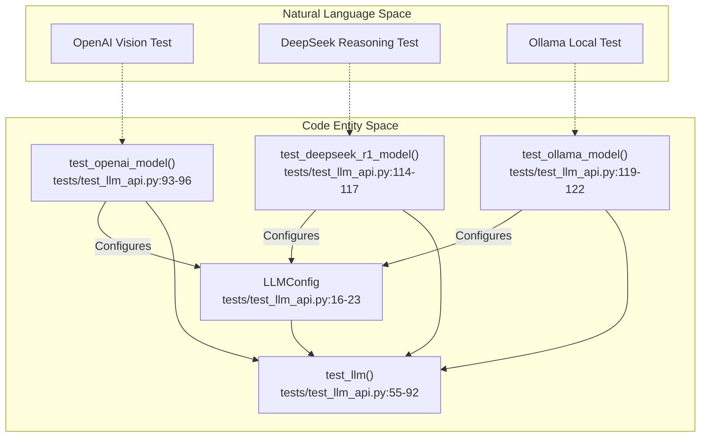
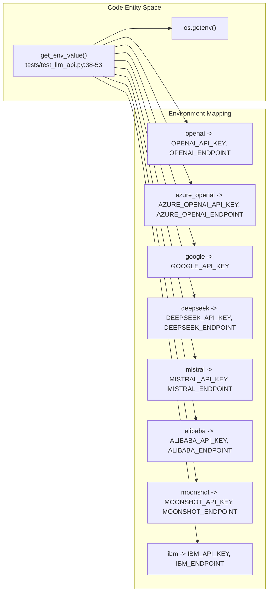
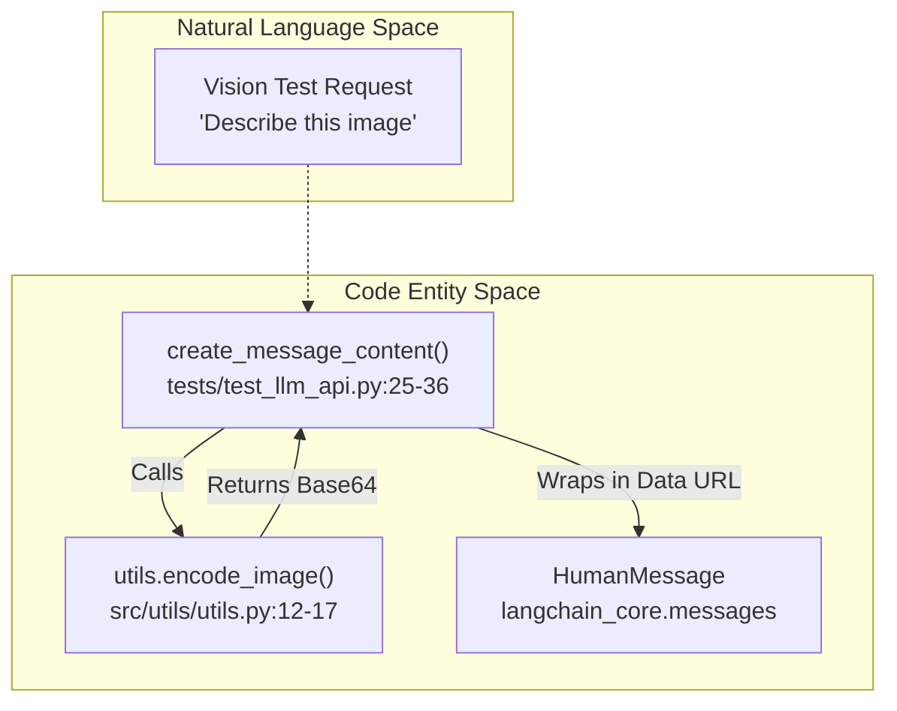
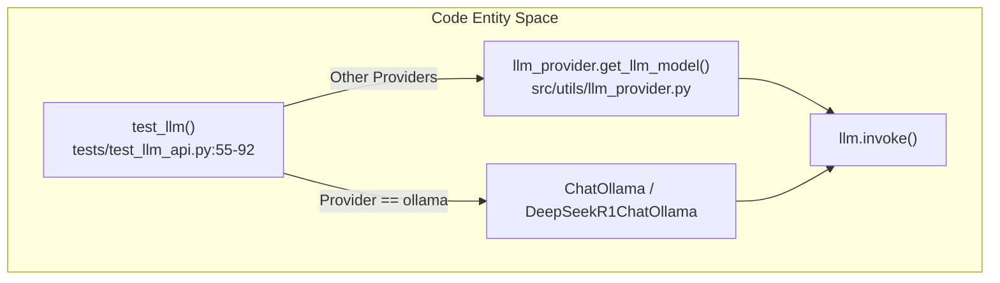

<!-- source: DeepWiki mcp.deepwiki.com · repo browser-use/web-ui · page 6.2 LLM Testing · fetched 2026-10-30 -->

# LLM Testing

<details>
<summary>Relevant source files</summary>

The following files were used as context for generating this wiki page:

- [src/utils/utils.py](src/utils/utils.py)
- [tests/test_llm_api.py](tests/test_llm_api.py)

</details>


## Purpose and Scope

This document describes the LLM testing framework implemented in `tests/test_llm_api.py`. The testing system provides a standardized approach to verify API connectivity, model invocation, vision capabilities, and reasoning output across all supported LLM providers in the codebase.

For details on the LLM provider abstraction layer, see [LLM Provider System](#6.1). For configuration files and model names, see [Configuration Files](#8.2).

---

## Testing Framework Overview

The LLM testing framework (`tests/test_llm_api.py`) defines individual test functions for each supported provider and orchestration utilities to validate responses [tests/test_llm_api.py:1-159]().

The following diagram maps the high-level testing concepts (Natural Language Space) directly to their implementing code entities (`Code Entity Space`), showing how test cases flow through `test_llm` and helper functions.



**Sources:** [tests/test_llm_api.py:16-122]()

---

## LLMConfig Dataclass

The `LLMConfig` dataclass (`tests/test_llm_api.py`) encapsulates parameters required to configure a test run:

| Field | Type | Default | Description |
|-------|------|---------|-------------|
| `provider` | `str` | Required | Provider identifier (e.g., `"openai"`, `"google"`, `"ollama"`) |
| `model_name` | `str` | Required | Model identifier (e.g., `"gpt-4o"`, `"gemini-2.0-flash-exp"`) |
| `temperature` | `float` | `0.8` | Sampling temperature for model generation |
| `base_url` | `str` | `None` | Custom API endpoint URL |
| `api_key` | `str` | `None` | Override API key |

**Sources:** [tests/test_llm_api.py:16-23]()

---

## Environment Variable Resolution

The `get_env_value` function maps provider names to their corresponding environment variables [tests/test_llm_api.py:38-53]().



**Sources:** [tests/test_llm_api.py:38-53]()

---

## Message Content Construction and Vision Encoding

The `create_message_content` function builds message content structures, handling image encoding via `utils.encode_image` for vision models [tests/test_llm_api.py:25-36]().

The bridge diagram below connects user-facing vision test requirements to the specific codebase entities responsible for processing images.



**Sources:** [src/utils/utils.py:12-17](), [tests/test_llm_api.py:25-36]()

---

## Core Test Function (`test_llm`)

The `test_llm` function orchestrates test execution, branching between Ollama-specific logic and standard provider initialization [tests/test_llm_api.py:55-92]().



**Key Behaviors:**
1. **Ollama Models**: Instantiates `ChatOllama` or `DeepSeekR1ChatOllama` directly and invokes with raw queries [tests/test_llm_api.py:59-70]().
2. **Standard Models**: Retrieves the model instance via `llm_provider.get_llm_model()` and passes structured messages [tests/test_llm_api.py:73-86]().
3. **Reasoning Content**: Inspects responses for `reasoning_content` attributes (exposed by DeepSeek R1) [tests/test_llm_api.py:89-92]().

**Sources:** [tests/test_llm_api.py:55-92]()

---

## Provider-Specific Test Functions

The test suite provides individual entry points for each supported provider [tests/test_llm_api.py:93-147]():

| Function Name | Provider | Model Identifier | Purpose / Features |
|---------------|----------|------------------|--------------------|
| `test_openai_model()` | `openai` | `gpt-4o` | Vision test [tests/test_llm_api.py:93-96]() |
| `test_google_model()` | `google` | `gemini-2.0-flash-exp` | Vision test [tests/test_llm_api.py:98-102]() |
| `test_azure_openai_model()` | `azure_openai` | `gpt-4o` | Vision test [tests/test_llm_api.py:104-107]() |
| `test_deepseek_model()` | `deepseek` | `deepseek-chat` | Text-only test [tests/test_llm_api.py:109-112]() |
| `test_deepseek_r1_model()` | `deepseek` | `deepseek-reasoner` | Reasoning test [tests/test_llm_api.py:114-117]() |
| `test_ollama_model()` | `ollama` | `qwen2.5:7b` | Local model test [tests/test_llm_api.py:119-122]() |
| `test_deepseek_r1_ollama_model()` | `ollama` | `deepseek-r1:14b` | Local reasoning + debug trace [tests/test_llm_api.py:124-127]() |
| `test_mistral_model()` | `mistral` | `pixtral-large-latest` | Vision test [tests/test_llm_api.py:129-132]() |
| `test_moonshot_model()` | `moonshot` | `moonshot-v1-32k-vision-preview` | Vision test [tests/test_llm_api.py:134-137]() |
| `test_ibm_model()` | `ibm` | `meta-llama/llama-4-maverick-17b-128e-instruct-fp8` | Vision test [tests/test_llm_api.py:139-142]() |
| `test_qwen_model()` | `alibaba` | `qwen-vl-max` | Vision test [tests/test_llm_api.py:144-147]() |

**Sources:** [tests/test_llm_api.py:93-147]()

---

## Running Tests

To run the LLM integration tests:

1. Configure required API keys and endpoints in your `.env` file.
2. Open `tests/test_llm_api.py` and uncomment the desired test function in the execution block [tests/test_llm_api.py:149-159]().
3. Execute the test script from the repository root:
   ```bash
   python tests/test_llm_api.py
   ```

**Sources:** [tests/test_llm_api.py:1-159]()

---

