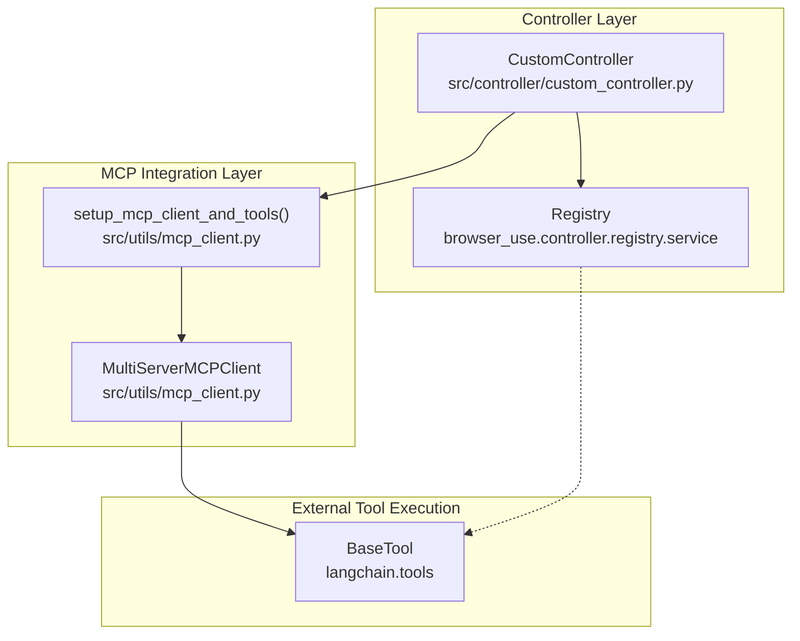
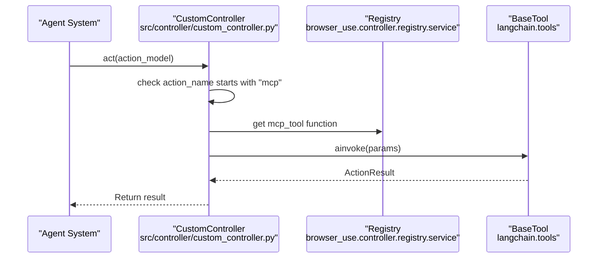

<!-- source: DeepWiki mcp.deepwiki.com · repo browser-use/web-ui · page 7 External Tool Integration · fetched 2026-10-30 -->

# External Tool Integration

Relevant source files

The following files were used as context for generating this wiki page:

- [src/controller/custom_controller.py](src/controller/custom_controller.py)
- [src/utils/mcp_client.py](src/utils/mcp_client.py)
- [tests/test_controller.py](tests/test_controller.py)

## Purpose and Scope

This document provides a high-level overview of the Model Context Protocol (MCP) integration within the codebase. MCP enables the agent system to leverage external tools—such as file system access, terminal commands, or custom utilities—beyond standard browser automation capabilities.

As a parent page, this document outlines the architecture and execution flow. For detailed implementation of client connection logic, dynamic Pydantic model generation, and tool registration, see [MCP Client Integration](#7.1). For details on how MCP server JSON configurations are supplied via the user interface and passed to the client at runtime, see [MCP Configuration and Usage](#7.2).

Sources: [src/controller/custom_controller.py:39-50](), [src/utils/mcp_client.py:17-44]()

---

## MCP Architecture Overview

The system integrates external tools through `CustomController`, which extends `Controller` from the `browser-use` library. External tools are fetched and managed via `MultiServerMCPClient` from the `langchain-mcp-adapters` package. 

### Diagram: High-Level MCP Architecture

Sources: [src/controller/custom_controller.py:39-50](), [src/utils/mcp_client.py:17-44]()

---

## 7.1 MCP Client Integration

The MCP client integration manages connections to external server processes, discovers available tools, translates their JSON schemas into type-safe Pydantic parameter models, and registers them into the controller's action namespace using the `mcp.{server_name}.{tool_name}` convention.

For detailed implementation of `MultiServerMCPClient`, dynamic schema translation via `create_tool_param_model()`, and controller tool registration logic, see [MCP Client Integration](#7.1).

Sources: [src/controller/custom_controller.py:154-159](), [src/utils/mcp_client.py:46-132]()

---

## 7.2 MCP Configuration and Usage

MCP servers are configured using JSON dictionaries defining server commands (such as `npx` or `docker`) and arguments. These configurations can be provided through the UI or agent settings and are passed into `CustomController.setup_mcp_client()` at runtime.

For details on how MCP server configurations are structured, parsed, and passed into `setup_mcp_client_and_tools()` at runtime, see [MCP Configuration and Usage](#7.2).

Sources: [src/controller/custom_controller.py:154-159](), [tests/test_controller.py:16-43]()

---

## Execution Flow

When an agent executes an action, `CustomController.act()` evaluates whether the action name belongs to an MCP tool or a built-in browser action. If it starts with the `mcp` prefix, it invokes the underlying tool instance asynchronously.

### Diagram: MCP Action Execution Flow

Sources: [src/controller/custom_controller.py:110-153]()

---

