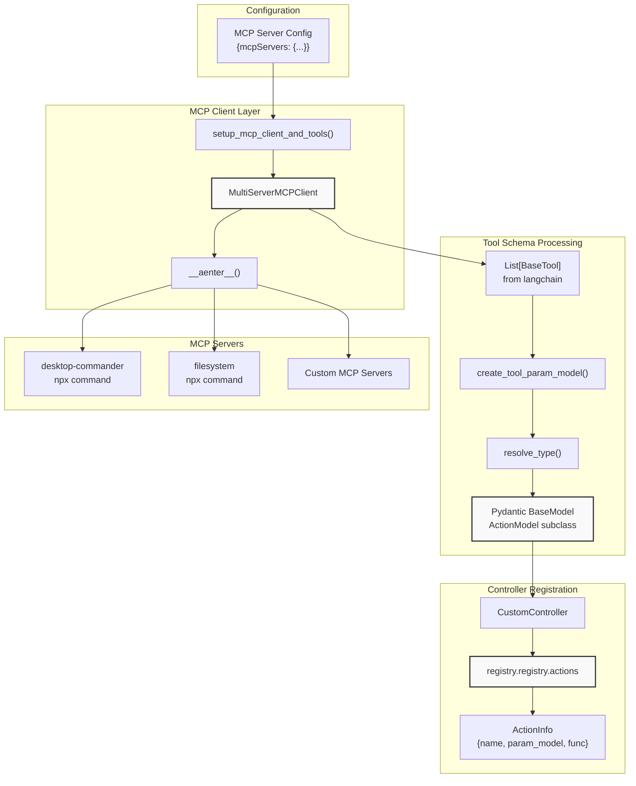
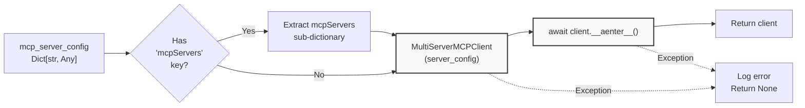
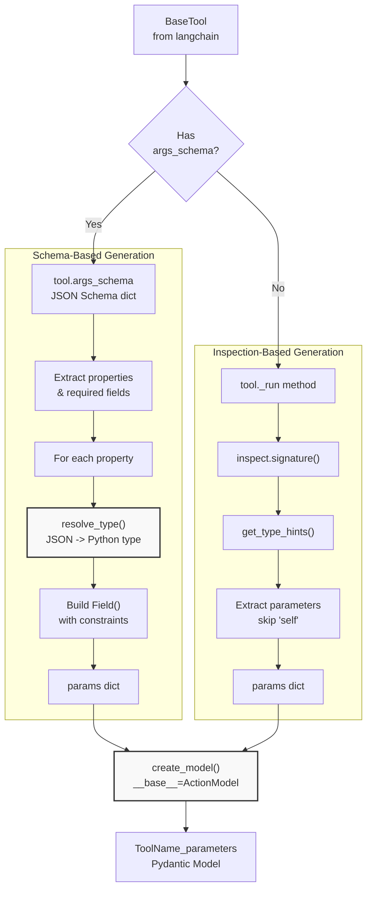
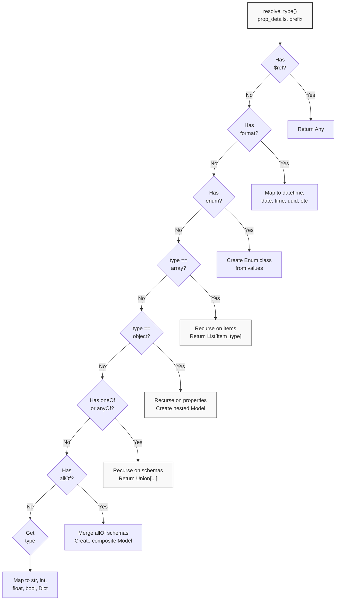
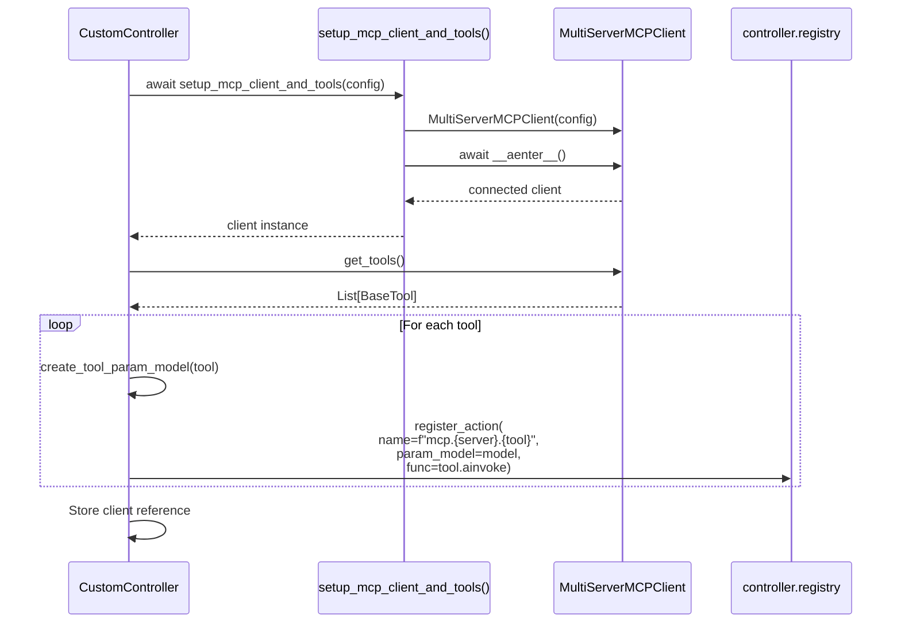

<!-- source: DeepWiki mcp.deepwiki.com · repo browser-use/web-ui · page 7.1 MCP Client Integration · fetched 2026-10-30 -->

# MCP Client Integration

Relevant source files

The following files were used as context for generating this wiki page:

- [src/utils/mcp_client.py](src/utils/mcp_client.py)
- [tests/test_controller.py](tests/test_controller.py)

## Purpose and Scope

This document details the Model Context Protocol (MCP) client integration system, which enables the browser-use web-ui to interact with external MCP servers and expose their tools to AI agents. The integration uses `MultiServerMCPClient` from `langchain_mcp_adapters` to connect to multiple MCP servers simultaneously, dynamically generates Pydantic parameter models from tool schemas, and registers these tools with the `CustomController` for agent execution.

For information about how the CustomController orchestrates these MCP tools alongside built-in actions, see [Controller and Actions](#4.3). For details on agent-level tool usage, see [Browser Use Agent](#4.1) and [Deep Research Agent](#4.2).

---

## MCP Integration Architecture

The MCP client integration layer bridges external tool servers with the agent execution system through a multi-stage pipeline: server connection, tool discovery, schema conversion, and action registration.

### System Overview

Sources: [src/utils/mcp_client.py:1-254](), [tests/test_controller.py:1-131]()

---

## MultiServerMCPClient Setup

The `setup_mcp_client_and_tools()` function initializes the MCP client and establishes connections to all configured MCP servers [src/utils/mcp_client.py:17-43](). It returns the client instance for lifecycle management.

### Setup Process

Sources: [src/utils/mcp_client.py:17-43](), [tests/test_controller.py:16-45]()

---

## Tool Parameter Model Generation

The `create_tool_param_model()` function converts LangChain tool schemas into Pydantic models that inherit from `ActionModel`, enabling type-safe parameter validation and integration with the controller's action registry [src/utils/mcp_client.py:46-131]().

### Model Creation Flow

Sources: [src/utils/mcp_client.py:46-131]()

---

## Type Resolution System

The `resolve_type()` function recursively converts JSON Schema type definitions into Python/Pydantic types, handling complex schemas including nested objects, unions, arrays, and enums [src/utils/mcp_client.py:134-254]().

### Type Resolution Algorithm

Sources: [src/utils/mcp_client.py:134-254]()

---

## Integration with CustomController

The MCP tools are registered with `CustomController` through its setup methods, handling client initialization, tool extraction, and action registration [tests/test_controller.py:55-127]().

### Controller Integration Flow

Sources: [tests/test_controller.py:55-127](), [src/utils/mcp_client.py:17-43]()

---

## Summary

The MCP client integration system provides a robust bridge between external tool servers and the browser-use agent system through:

1. **MultiServerMCPClient** - Manages connections to multiple MCP servers simultaneously [src/utils/mcp_client.py:37-38]().
2. **Dynamic Model Generation** - Converts tool schemas to type-safe Pydantic models [src/utils/mcp_client.py:46-98]().
3. **Advanced Type Resolution** - Handles complex JSON Schema features (enums, unions, nested objects) [src/utils/mcp_client.py:134-254]().
4. **Controller Integration** - Registers MCP tools as first-class actions with namespaced identifiers [tests/test_controller.py:89-92]().

Sources: [src/utils/mcp_client.py:1-254](), [tests/test_controller.py:1-131]()

---

