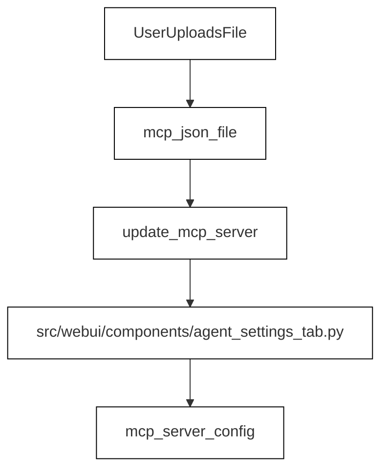
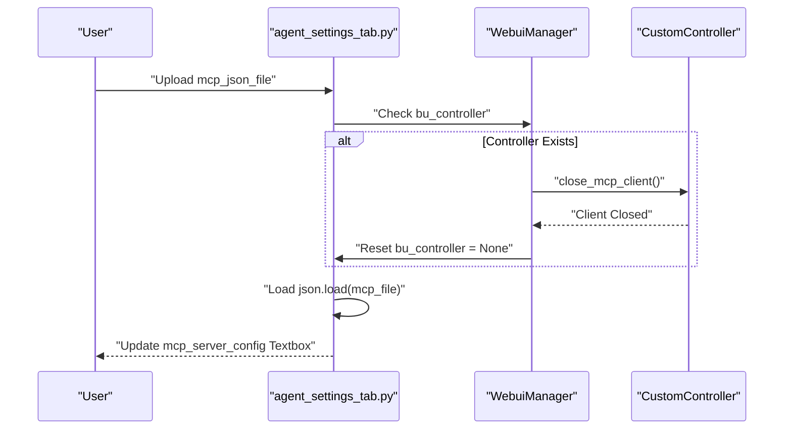
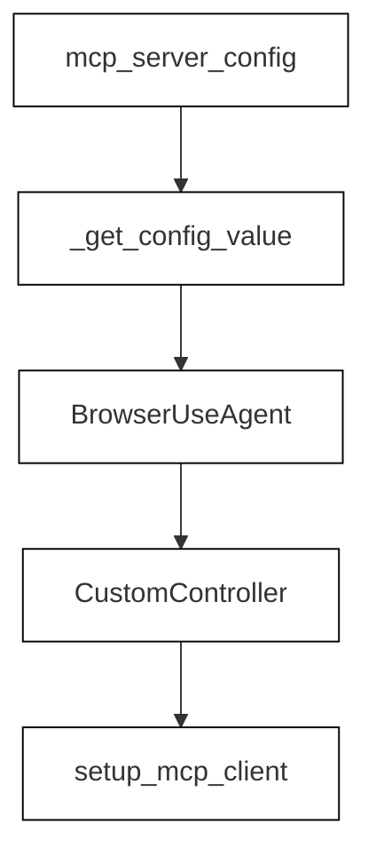

<!-- source: DeepWiki mcp.deepwiki.com · repo browser-use/web-ui · page 7.2 MCP Configuration and Usage · fetched 2026-10-30 -->

# MCP Configuration and Usage

Relevant source files

The following files were used as context for generating this wiki page:

- [src/webui/components/agent_settings_tab.py](src/webui/components/agent_settings_tab.py)
- [src/webui/components/browser_use_agent_tab.py](src/webui/components/browser_use_agent_tab.py)

### Purpose and Scope
This section details how Model Context Protocol (MCP) server configurations are supplied through the user interface, managed within application state, and passed into `setup_mcp_client` at runtime to empower agents with external tools.

Sources: `[src/webui/components/agent_settings_tab.py:27-43]()`

---

## 1. UI Configuration Elements and Upload Flow

The Model Context Protocol (MCP) server integration begins in the Agent Settings tab, where users can upload or define an MCP server configuration via a JSON file. 

Within `[src/webui/components/agent_settings_tab.py:46-61]`, Gradio components are instantiated for this exact workflow:
* `mcp_json_file`: A `gr.File` component restricted to `.json` extensions, allowing users to upload their server configuration file.
* `mcp_server_config`: A hidden-by-default `gr.Textbox` that displays the parsed JSON content once an eligible file is loaded.

When a file is uploaded, the event triggers the asynchronous handler `update_mcp_server` defined in `[src/webui/components/agent_settings_tab.py:27-43]`. This function validates the file path extension, opens the JSON payload, loads it into a dictionary, and returns a formatted JSON string to populate the `mcp_server_config` text area while rendering it visible.

*Figure 1: UI configuration flow mapping user action to `update_mcp_server` and `mcp_server_config`.*

Sources: `[src/webui/components/agent_settings_tab.py:27-61]()`

---

## 2. State Management and Controller Lifecycle

When the MCP configuration file changes or is updated, the active controller instance must be managed to prevent stale connections or mismatched tool declarations. 

As implemented in `[src/webui/components/agent_settings_tab.py:31-35]`, `update_mcp_server` checks whether `webui_manager.bu_controller` is instantiated. If a prior controller exists, it invokes `await webui_manager.bu_controller.close_mcp_client()` and resets the controller reference to `None`. This guarantees that subsequent agent initializations instantiate a fresh MCP client mapped to the newly supplied configuration.

*Figure 2: Sequence of controller teardown upon MCP configuration modification.*

Sources: `[src/webui/components/agent_settings_tab.py:27-44]`, `[src/webui/webui_manager.py]()`

---

## 3. Runtime Parsing and Client Initialization

At runtime, the contents of the `mcp_server_config` text area (or the underlying JSON dictionary) are extracted and passed down to the agent execution environment. 

The application uses these parameters to configure the underlying MCP client via functions like `setup_mcp_client`. The configuration dictionary typically maps server names to their respective transport specifications (e.g., standard input/output command execution paths, environment variables, and arguments).

*Figure 3: Data propagation from UI component state to runtime `setup_mcp_client`.*

Sources: `[src/webui/components/agent_settings_tab.py:58-61]`, `[src/webui/components/browser_use_agent_tab.py:69-96]()`

---

