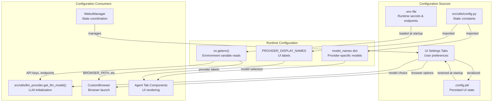

<!-- source: DeepWiki mcp.deepwiki.com · repo browser-use/web-ui · page 8 Configuration · fetched 2026-10-30 -->

# Configuration

Relevant source files

The following files were used as context for generating this wiki page:

- [.env.example](.env.example)
- [.gitignore](.gitignore)
- [src/utils/config.py](src/utils/config.py)
- [src/utils/llm_provider.py](src/utils/llm_provider.py)

This page provides an overview of the configuration system used throughout the `browser-use` web-ui application. It outlines how configuration is sourced from environment variables, static configuration files, and UI settings, and how these different configuration sources work together to control LLM providers, browser behavior, and system-wide settings.

As a parent page, this section maintains a high-level view. For specific details, refer to the child pages:
- For a complete reference of environment variables, see [Environment Variables](#8.1).
- For details on static configuration structures and constants, see [Configuration Files](#8.2).

## Configuration Architecture

The application uses a three-tiered configuration system that combines static defaults, environment-based configuration, and user preferences. Each tier serves a specific purpose and can override values from lower tiers.

**Sources:** [.env.example:1-71](), [src/utils/config.py:1-100](), [.gitignore:189]()

## Configuration Tiers

The configuration system operates in three distinct tiers, each with specific responsibilities:

| Tier | Source | Purpose | Persistence | Override Priority |
|------|--------|---------|-------------|-------------------|
| **Static Defaults** | `src/utils/config.py` | Model lists, provider names, default values | Code repository | Lowest |
| **Environment Configuration** | `.env` file | API keys, endpoints, browser paths | File system | Medium |
| **User Preferences** | UI Settings tabs | Model selection, browser options | `.config.pkl` | Highest |

- **Static Defaults**: Defined in `src/utils/config.py`, providing foundational data structures like `model_names` and `PROVIDER_DISPLAY_NAMES`. For details, see [Configuration Files](#8.2).
- **Environment Configuration**: Loaded via `.env` and `.env.example` templates, managed through `os.getenv()`. For details, see [Environment Variables](#8.1).
- **User Preferences**: Runtime choices made through the UI settings tabs that persist via `.config.pkl` (excluded by [.gitignore:189]()).

**Sources:** [src/utils/config.py:1-100](), [.env.example:1-71](), [.gitignore:189]()

---

