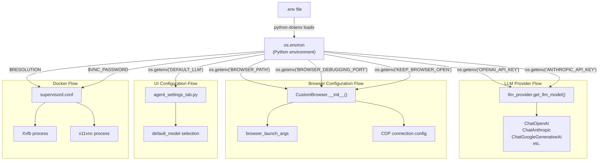
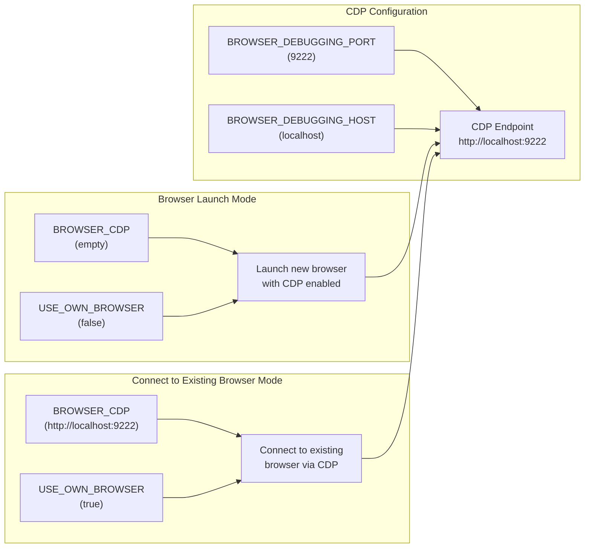

<!-- source: DeepWiki mcp.deepwiki.com · repo browser-use/web-ui · page 8.1 Environment Variables · fetched 2026-10-30 -->

# Environment Variables

<details>
<summary>Relevant source files</summary>

The following files were used as context for generating this wiki page:

- [.env.example](.env.example)

</details>


## Purpose and Scope

This document provides a comprehensive reference for all environment variables used in the browser-use web-ui system. Environment variables control LLM provider credentials, browser automation settings, display configuration, and application behavior.

Environment variables are loaded from a `.env` file in the project root and are used throughout the application to configure runtime behavior. For information about how these variables are processed and used in code, see [Configuration Files](#8.2). For details on LLM provider usage, see [LLM Provider System](#6.1). For browser-specific settings implementation, see [Custom Browser](#5.1).

**Sources:** [.env.example:1-71]()

## Environment Variable Categories

The system organizes environment variables into five primary categories:

```mermaid
graph TB
    ENV[".env file"]
    
    subgraph "LLM Provider Configuration"
        LLM_KEYS["API Keys & Endpoints<br/>14 providers"]
        DEFAULT["DEFAULT_LLM"]
    end
    
    subgraph "Browser Configuration"
        BROWSER["BROWSER_PATH<br/>BROWSER_USER_DATA<br/>BROWSER_CDP"]
        DEBUG["BROWSER_DEBUGGING_PORT<br/>BROWSER_DEBUGGING_HOST"]
        BROWSER_FLAGS["KEEP_BROWSER_OPEN<br/>USE_OWN_BROWSER"]
    end
    
    subgraph "Display Configuration"
        RESOLUTION["RESOLUTION<br/>RESOLUTION_WIDTH<br/>RESOLUTION_HEIGHT"]
    end
    
    subgraph "VNC Configuration"
        VNC["VNC_PASSWORD"]
    end
    
    subgraph "Application Settings"
        TELEMETRY["ANONYMIZED_TELEMETRY"]
        LOGGING["BROWSER_USE_LOGGING_LEVEL"]
    end
    
    ENV --> LLM_KEYS
    ENV --> DEFAULT
    ENV --> BROWSER
    ENV --> DEBUG
    ENV --> BROWSER_FLAGS
    ENV --> RESOLUTION
    ENV --> VNC
    ENV --> TELEMETRY
    ENV --> LOGGING
```



**Sources:** [.env.example:1-71]()

## Complete Environment Variable Reference

### LLM Provider Variables

The system supports 14 LLM providers, each requiring specific API keys and endpoints. Most providers follow the pattern of `{PROVIDER}_API_KEY` and `{PROVIDER}_ENDPOINT`:

| Variable | Purpose | Default Value | Required |
|----------|---------|---------------|----------|
| `OPENAI_API_KEY` | OpenAI API authentication | - | For OpenAI models |
| `OPENAI_ENDPOINT` | OpenAI API base URL | `https://api.openai.com/v1` | No |
| `ANTHROPIC_API_KEY` | Anthropic (Claude) API key | - | For Anthropic models |
| `ANTHROPIC_ENDPOINT` | Anthropic API base URL | `https://api.anthropic.com` | No |
| `GOOGLE_API_KEY` | Google (Gemini) API key | - | For Google models |
| `AZURE_OPENAI_ENDPOINT` | Azure OpenAI endpoint URL | - | For Azure OpenAI |
| `AZURE_OPENAI_API_KEY` | Azure OpenAI API key | - | For Azure OpenAI |
| `AZURE_OPENAI_API_VERSION` | Azure API version | `2025-01-01-preview` | No |
| `DEEPSEEK_API_KEY` | DeepSeek API key | - | For DeepSeek models |
| `DEEPSEEK_ENDPOINT` | DeepSeek API base URL | `https://api.deepseek.com` | No |
| `MISTRAL_API_KEY` | Mistral AI API key | - | For Mistral models |
| `MISTRAL_ENDPOINT` | Mistral API base URL | `https://api.mistral.ai/v1` | No |
| `OLLAMA_ENDPOINT` | Ollama server URL | `http://localhost:11434` | For Ollama models |
| `ALIBABA_API_KEY` | Alibaba Cloud API key | - | For Alibaba models |
| `ALIBABA_ENDPOINT` | Alibaba API base URL | `https://dashscope.aliyuncs.com/compatible-mode/v1` | No |
| `MODELSCOPE_API_KEY` | ModelScope API key | - | For ModelScope models |
| `MODELSCOPE_ENDPOINT` | ModelScope API base URL | `https://api-inference.modelscope.cn/v1` | No |
| `MOONSHOT_API_KEY` | Moonshot AI API key | - | For Moonshot models |
| `MOONSHOT_ENDPOINT` | Moonshot API base URL | `https://api.moonshot.cn/v1` | No |
| `UNBOUND_API_KEY` | Unbound API key | - | For Unbound models |
| `UNBOUND_ENDPOINT` | Unbound API base URL | `https://api.getunbound.ai` | No |
| `SiliconFLOW_API_KEY` | SiliconFlow API key | - | For SiliconFlow models |
| `SiliconFLOW_ENDPOINT` | SiliconFlow API base URL | `https://api.siliconflow.cn/v1/` | No |
| `IBM_API_KEY` | IBM Watsonx API key | - | For IBM models |
| `IBM_ENDPOINT` | IBM Watsonx endpoint | `https://us-south.ml.cloud.ibm.com` | No |
| `IBM_PROJECT_ID` | IBM Watsonx project ID | - | For IBM models |
| `GROK_API_KEY` | Grok (X.AI) API key | - | For Grok models |
| `GROK_ENDPOINT` | Grok API base URL | `https://api.x.ai/v1` | No |

**Sources:** [.env.example:1-42]()

### Browser Configuration Variables

These variables control browser automation behavior, including browser executable paths, debugging capabilities, and session management:

| Variable | Purpose | Default Value | Example |
|----------|---------|---------------|---------|
| `BROWSER_PATH` | Custom browser executable path | Empty (uses Playwright default) | `/usr/bin/chromium` |
| `BROWSER_USER_DATA` | Browser user data directory path | Empty (temporary profile) | `/path/to/profile` |
| `BROWSER_DEBUGGING_PORT` | Chrome DevTools Protocol port | `9222` | `9222` |
| `BROWSER_DEBUGGING_HOST` | CDP listening host | `localhost` | `0.0.0.0` |
| `KEEP_BROWSER_OPEN` | Keep browser running between tasks | `true` | `true` or `false` |
| `USE_OWN_BROWSER` | Connect to existing browser via CDP | `false` | `true` or `false` |
| `BROWSER_CDP` | CDP connection URL (for existing browser) | Empty | `http://localhost:9222` |

The `BROWSER_PATH` variable is read by `CustomBrowser` when launching browsers [src/browser/custom_browser.py](), while `BROWSER_DEBUGGING_PORT` and `BROWSER_DEBUGGING_HOST` are used to configure the Chrome DevTools Protocol endpoint for remote browser control.

**Sources:** [.env.example:53-61]()

### Display Configuration Variables

Display settings are primarily used in Docker deployments to configure the virtual display (Xvfb) and ensure proper rendering:

| Variable | Purpose | Default Value | Notes |
|----------|---------|---------------|-------|
| `RESOLUTION` | Xvfb display resolution | `1920x1080x24` | Format: WIDTHxHEIGHTxDEPTH |
| `RESOLUTION_WIDTH` | Display width in pixels | `1920` | Used for browser window sizing |
| `RESOLUTION_HEIGHT` | Display height in pixels | `1080` | Used for browser window sizing |

These variables are referenced in the Docker deployment configuration and are used to initialize the virtual display when running in headless mode. See [Docker Deployment](#9.1) for details on how these are used with Xvfb.

**Sources:** [.env.example:62-68]()

### VNC Configuration Variables

VNC settings enable remote visualization of the browser in Docker deployments:

| Variable | Purpose | Default Value | Security Note |
|----------|---------|---------------|---------------|
| `VNC_PASSWORD` | VNC server authentication password | `youvncpassword` | Change in production |

The VNC password is used by x11vnc to secure access to the virtual display. This is essential for production deployments where the VNC port (5901) or noVNC web interface (6080) are exposed.

**Sources:** [.env.example:70-71]()

### Application Settings Variables

These variables control general application behavior:

| Variable | Purpose | Default Value | Options |
|----------|---------|---------------|---------|
| `DEFAULT_LLM` | Default LLM provider selection | `openai` | Any supported provider name |
| `ANONYMIZED_TELEMETRY` | Enable/disable anonymized usage tracking | `false` | `true` or `false` |
| `BROWSER_USE_LOGGING_LEVEL` | Logging verbosity level | `info` | `result`, `info`, `debug` |

The `DEFAULT_LLM` variable sets which provider is pre-selected in the Agent Settings UI. The value must match one of the provider keys defined in the LLM provider system (see [LLM Provider System](#6.1)).

The `BROWSER_USE_LOGGING_LEVEL` controls the verbosity of browser-use package logging:
- `result`: Only final results
- `info`: Standard operational logging
- `debug`: Verbose debugging information

**Sources:** [.env.example:43-51]()

## Environment Variable Flow

The following diagram shows how environment variables are loaded and propagated through the system components:



**Sources:** [.env.example:1-71]()

## Provider-Specific Configuration

### OpenAI-Compatible Providers

Several providers use OpenAI-compatible APIs and only require endpoint and API key configuration:

- **Ollama** (`OLLAMA_ENDPOINT`): Local model serving, no API key required
- **Alibaba** (`ALIBABA_ENDPOINT`, `ALIBABA_API_KEY`): Alibaba Cloud DashScope
- **ModelScope** (`MODELSCOPE_ENDPOINT`, `MODELSCOPE_API_KEY`): ModelScope inference API
- **Moonshot** (`MOONSHOT_ENDPOINT`, `MOONSHOT_API_KEY`): Moonshot AI Chinese models
- **SiliconFlow** (`SiliconFLOW_ENDPOINT`, `SiliconFLOW_API_KEY`): SiliconFlow platform
- **Grok** (`GROK_ENDPOINT`, `GROK_API_KEY`): X.AI's Grok models

These providers are instantiated using `ChatOpenAI` with custom endpoints in the LLM provider factory.

**Sources:** [.env.example:19-42]()

### Native Provider Integrations

Providers with dedicated LangChain classes:

- **Anthropic**: Uses `ChatAnthropic` class
- **Google**: Uses `ChatGoogleGenerativeAI` class
- **Azure OpenAI**: Uses `AzureChatOpenAI` class with version specification
- **Mistral**: Uses `ChatMistralAI` class
- **IBM**: Uses `ChatWatsonx` class with project ID

**Sources:** [.env.example:1-42]()

### DeepSeek Special Configuration

DeepSeek has both standard and reasoning (R1) model configurations. The `DEEPSEEK_ENDPOINT` and `DEEPSEEK_API_KEY` are used to initialize custom `DeepSeekR1ChatOpenAI` and `DeepSeekR1ChatOllama` classes that handle the DeepSeek-specific reasoning capabilities. See [LLM Provider System](#6.1) for implementation details.

**Sources:** [.env.example:13-14]()

## Browser CDP Configuration

The Chrome DevTools Protocol (CDP) configuration enables advanced browser debugging and remote control:



When `USE_OWN_BROWSER` is set to `true` and `BROWSER_CDP` contains a valid CDP URL, the system connects to an existing browser instance instead of launching a new one. This is useful for debugging or when using a pre-configured browser with specific extensions or settings.

**Sources:** [.env.example:53-61]()

## Configuration File Creation

To initialize the environment configuration:

1. **Copy the example file:**
   ```bash
   cp .env.example .env
   ```

2. **Set required API keys** for your chosen LLM provider(s)

3. **Configure browser settings** if using custom browser paths or CDP connections

4. **Set display/VNC settings** for Docker deployments

5. **Adjust logging and telemetry** preferences

The `.env` file is loaded automatically when the application starts via python-dotenv, making all variables available through `os.getenv()` calls throughout the codebase.

**Sources:** [.env.example:1-71]()

## Security Considerations

### Sensitive Variables

The following variables contain sensitive credentials and should never be committed to version control:

- All `*_API_KEY` variables
- `VNC_PASSWORD`
- `AZURE_OPENAI_API_KEY`
- `IBM_API_KEY` and `IBM_PROJECT_ID`

The `.env.example` file provides a template with empty values. The actual `.env` file should be listed in `.gitignore` to prevent accidental exposure.

### Production Recommendations

For production deployments:

1. **Change default VNC password:** The default `youvncpassword` should be replaced with a strong password
2. **Restrict CDP access:** Set `BROWSER_DEBUGGING_HOST` to `localhost` unless remote debugging is required
3. **Use environment-specific endpoints:** Configure appropriate API endpoints for production vs. development
4. **Disable telemetry if needed:** Set `ANONYMIZED_TELEMETRY=false` for privacy-sensitive deployments

**Sources:** [.env.example:1-71]()

---

