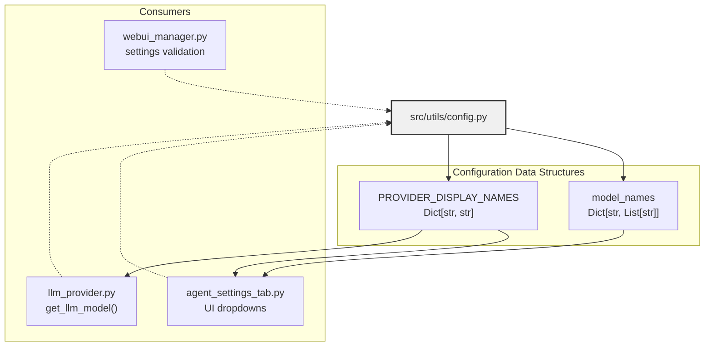
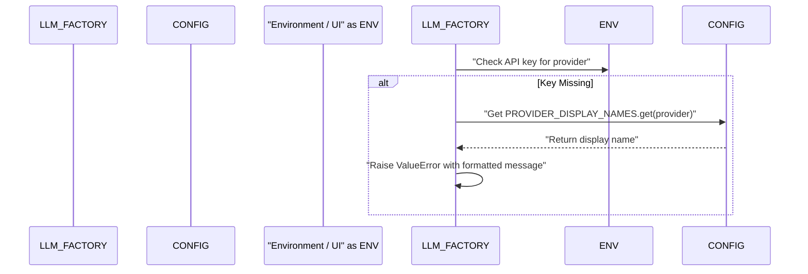

<!-- source: DeepWiki mcp.deepwiki.com · repo browser-use/web-ui · page 8.2 Configuration Files · fetched 2026-10-30 -->

# Configuration Files

<details>
<summary>Relevant source files</summary>

The following files were used as context for generating this wiki page:

- [.gitignore](.gitignore)
- [src/utils/config.py](src/utils/config.py)
- [src/utils/llm_provider.py](src/utils/llm_provider.py)
- [src/webui/components/load_save_config_tab.py](src/webui/components/load_save_config_tab.py)

</details>


## Purpose and Scope

This document details the configuration file structure used to define LLM provider metadata and model options throughout the browser-use web-ui system. The primary configuration module is `src/utils/config.py`, which provides centralized definitions for provider display names and available models per provider.

Configuration data from this file is accessed by the LLM provider factory (`src/utils/llm_provider.py`) and UI components (such as settings tabs) to populate dropdown menus, standardize names, and validate provider/model selections.

Sources: [src/utils/config.py:1-100](), [src/utils/llm_provider.py:52]()

---

## Configuration File Structure

The application centralizes provider and model metadata in a single Python module (`src/utils/config.py`). This design decouples hardcoded model lists from UI components and execution pipelines.

The module exports two main data structures:
1. `PROVIDER_DISPLAY_NAMES` (`Dict[str, str]`): Maps short internal provider IDs to human-readable names.
2. `model_names` (`Dict[str, List[str]]`): Maps provider IDs to lists of valid model identifiers.



Sources: [src/utils/config.py:1-100](), [src/utils/llm_provider.py:52]()

---

## `PROVIDER_DISPLAY_NAMES` Dictionary

The `PROVIDER_DISPLAY_NAMES` dictionary maps internal string identifiers for LLM providers to clean, capitalized display names used in UI forms and error logging.

### Implementation

```python
PROVIDER_DISPLAY_NAMES = {
    "openai": "OpenAI",
    "azure_openai": "Azure OpenAI",
    "anthropic": "Anthropic",
    "deepseek": "DeepSeek",
    "google": "Google",
    "alibaba": "Alibaba",
    "moonshot": "MoonShot",
    "unbound": "Unbound AI",
    "ibm": "IBM",
    "grok": "Grok",
}
```[src/utils/config.py:1-12]()

### Provider Mapping Reference

| Internal Provider ID | Display Name | Primary Consumers |
|---------------------|--------------|-------------------|
| `"openai"` | `"OpenAI"` | LLM Factory, UI Dropdowns |
| `"azure_openai"` | `"Azure OpenAI"` | LLM Factory, UI Dropdowns |
| `"anthropic"` | `"Anthropic"` | LLM Factory, UI Dropdowns |
| `"deepseek"` | `"DeepSeek"` | LLM Factory, UI Dropdowns |
| `"google"` | `"Google"` | LLM Factory, UI Dropdowns |
| `"alibaba"` | `"Alibaba"` | LLM Factory, UI Dropdowns |
| `"moonshot"` | `"MoonShot"` | LLM Factory, UI Dropdowns |
| `"unbound"` | `"Unbound AI"` | LLM Factory, UI Dropdowns |
| `"ibm"` | `"IBM"` | LLM Factory, UI Dropdowns |
| `"grok"` | `"Grok"` | LLM Factory, UI Dropdowns |

Sources: [src/utils/config.py:1-12]()

---

## `model_names` Dictionary

The `model_names` dictionary lists supported model IDs across various cloud and local inference providers.

### Structure and Catalogs

```python
model_names = {
    "anthropic": ["claude-3-5-sonnet-20241022", "claude-3-5-sonnet-20240620", "claude-3-opus-20240229"],
    "openai": ["gpt-4o", "gpt-4", "gpt-3.5-turbo", "o3-mini"],
    "deepseek": ["deepseek-chat", "deepseek-reasoner"],
    # ... other providers ...
}
```[src/utils/config.py:14-100]()

### Summary of Model Catalogs

| Provider Key | Predefined Models Count | Representative Models |
|--------------|-------------------------|-----------------------|
| `"anthropic"` | 3 | `claude-3-5-sonnet-20241022`, `claude-3-opus-20240229` |
| `"openai"` | 4 | `gpt-4o`, `gpt-4`, `o3-mini` |
| `"deepseek"` | 2 | `deepseek-chat`, `deepseek-reasoner` |
| `"google"` | 8 | `gemini-2.0-flash`, `gemini-2.5-pro-preview-03-25` |
| `"ollama"` | 8 | `qwen2.5:7b`, `deepseek-r1:14b` |
| `"azure_openai"` | 3 | `gpt-4o`, `gpt-4`, `gpt-3.5-turbo` |
| `"mistral"` | 4 | `pixtral-large-latest`, `mistral-large-latest` |
| `"alibaba"` | 6 | `qwen-plus`, `qwen-max`, `qwen-vl-max` |
| `"moonshot"` | 2 | `moonshot-v1-32k-vision-preview` |
| `"unbound"` | 4 | `gemini-2.0-flash`, `gpt-4o-mini` |
| `"grok"` | 7 | `grok-3`, `grok-2-vision` |
| `"siliconflow"` | 30 | `deepseek-ai/DeepSeek-R1`, `Qwen/Qwen2.5-72B-Instruct` |
| `"ibm"` | 3 | `ibm/granite-vision-3.1-2b-preview` |
| `"modelscope"` | 24 | `Qwen/Qwen3-32B`, `deepseek-ai/DeepSeek-R1` |

Sources: [src/utils/config.py:14-100]()

---

## Integration and Access Patterns

Modules across the application access `config.py` via standard python imports (`from src.utils import config`).

### Error Message Generation in `get_llm_model()`

When an API key is missing for a given provider, `src/utils/llm_provider.py` queries `config.PROVIDER_DISPLAY_NAMES` to build a clean error message:

```python
if provider not in ["ollama", "bedrock"]:
    env_var = f"{provider.upper()}_API_KEY"
    api_key = kwargs.get("api_key", "") or os.getenv(env_var, "")
    if not api_key:
        provider_display = config.PROVIDER_DISPLAY_NAMES.get(provider, provider.upper())
        error_msg = f"💥 {provider_display} API key not found! 🔑 Please set the `{env_var}` environment variable or provide it in the UI."
        raise ValueError(error_msg)
```[src/utils/llm_provider.py:159-165]()



Sources: [src/utils/llm_provider.py:159-165](), [src/utils/config.py:1-12]()

---

## Extending Configuration

To introduce a new LLM provider into the application:
1. **Add Display Name**: Register the internal name and human-readable label in `src/utils/config.py` under `PROVIDER_DISPLAY_NAMES`.
2. **Add Model List**: Define available model strings in `src/utils/config.py` under `model_names`.
3. **Implement Factory Handler**: Add branching logic in `src/utils/llm_provider.py` inside `get_llm_model()` to instantiate the corresponding LangChain model wrapper.

Sources: [src/utils/config.py:1-100](), [src/utils/llm_provider.py:152-193]()

---

